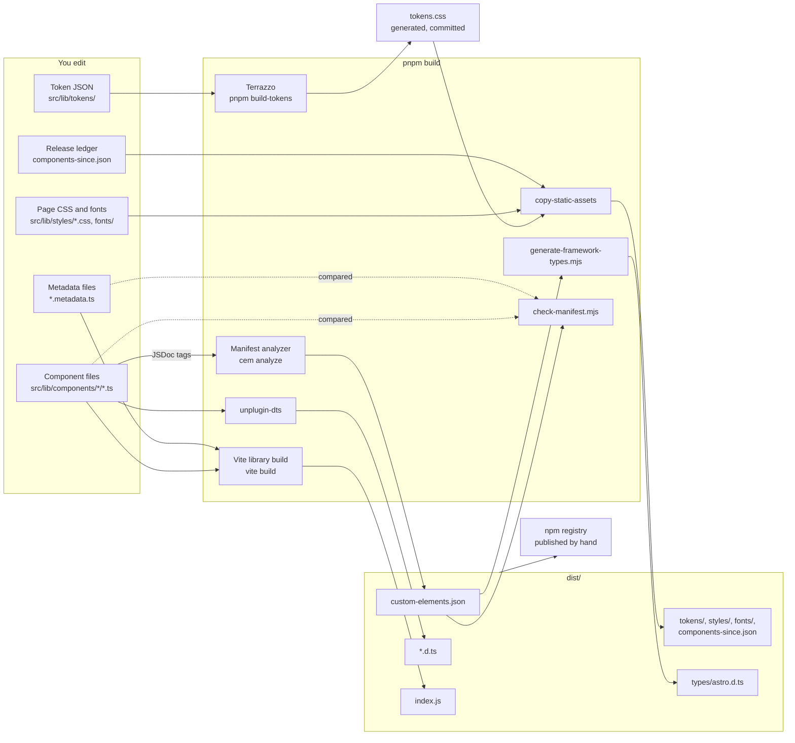
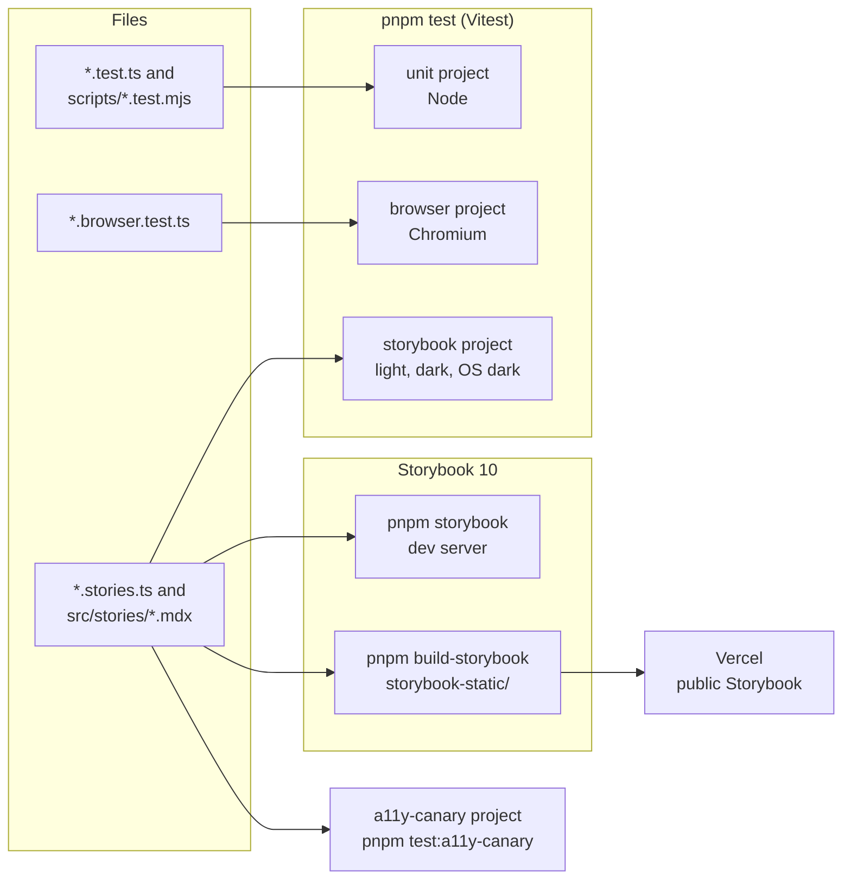
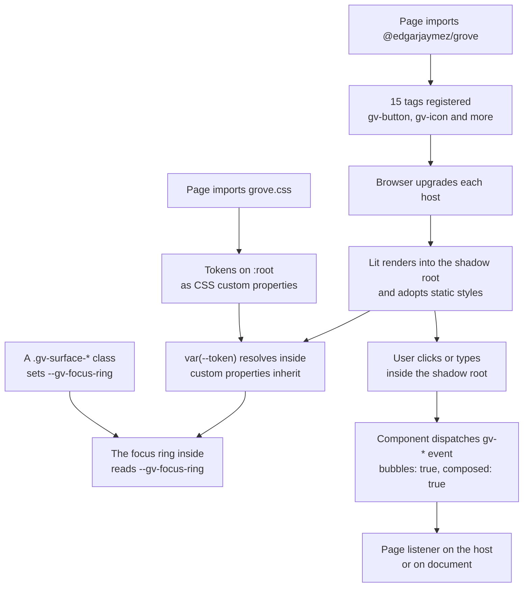
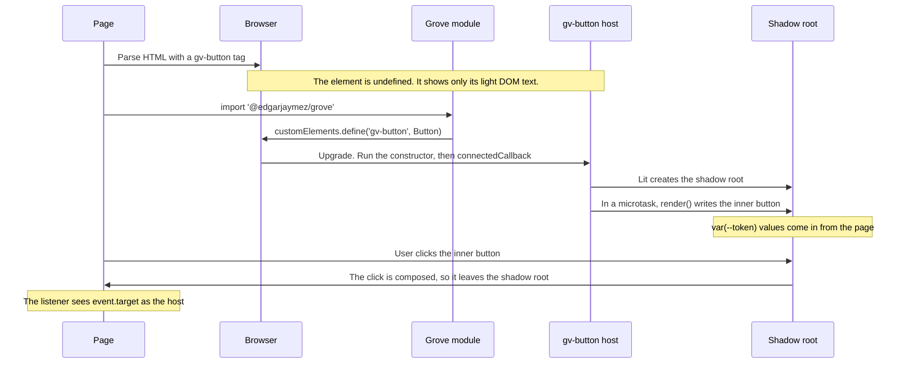
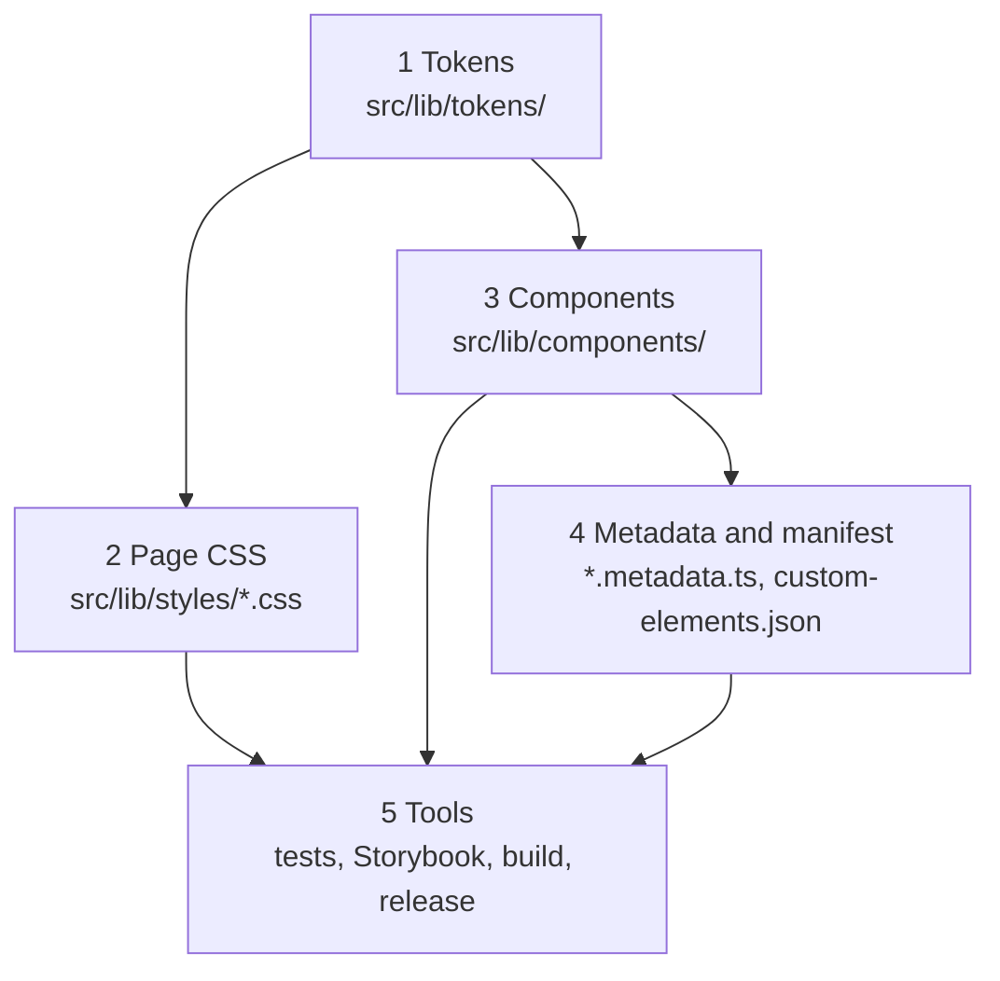
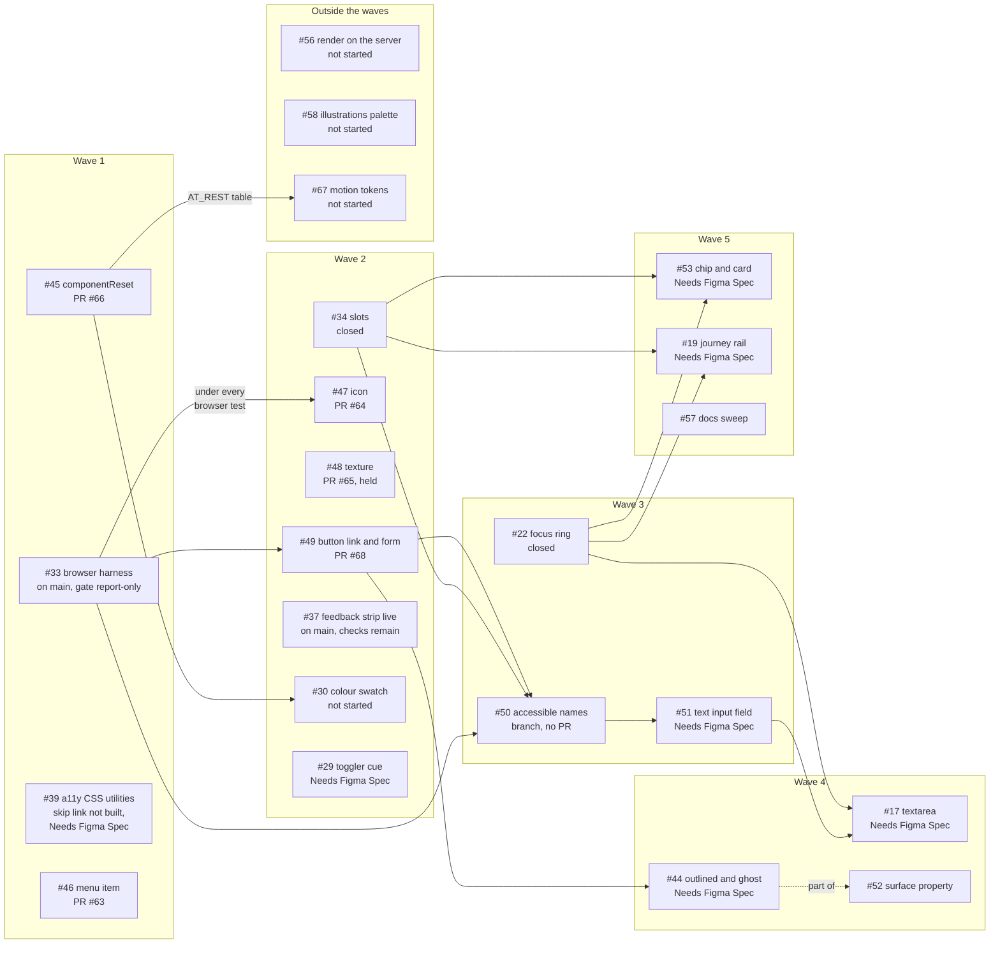
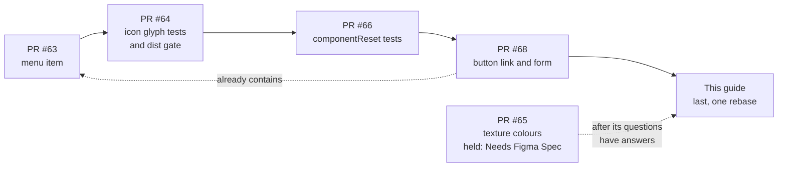

# 00 · The whiteboard

> **What you learn here**
>
> - The whole repo on one board: what you edit, which tool reads it and what comes out.
> - What happens in the browser when a page uses Grove.
> - The five layers of the repo, and the chapter for each layer.
> - The path of one change from your editor to npm.
> - The open work, and the order in which it can land.
>
> **Read first:** nothing. **Time:** 30 minutes.
>
> Open work as of main @ e251d45, 2026-10-27.

Grove is a library of web components and a design system. It uses Lit 3 and TypeScript. It
publishes one npm package, `@edgarjaymez/grove`, at version 0.45.0 on `main`. The package holds
15 custom elements with the `gv-` prefix, the design tokens, two fonts and the CSS for the page.

This chapter is the map. Each box on each diagram has a chapter that explains it. Use the tables
under the diagrams to find that chapter.

## Whiteboard

The first diagram shows the system map: the files that you edit, the tools that read them, and the
files that go to npm.

| Box                                                  | What it is                                                                | Chapter                                                                                     |
| ---------------------------------------------------- | ------------------------------------------------------------------------- | ------------------------------------------------------------------------------------------- |
| Token JSON, Terrazzo, `tokens.css`                   | The design values in DTCG JSON, and the CSS that Terrazzo makes from them | [11 · Design tokens](11-design-tokens.md#the-pipeline)                                      |
| Component files                                      | One Lit class for each `gv-*` tag                                         | [04 · Anatomy of a component](04-anatomy-of-a-component.md#whiteboard)                      |
| Metadata files                                       | A description of each component for tools and AI assistants               | [15 · Metadata and the manifest](15-metadata-and-the-manifest.md#component-metadata)        |
| Page CSS and fonts                                   | `grove.css` and the files it imports                                      | [13 · Themes and page CSS](13-themes-and-page-css.md#the-page-level-css)                    |
| Release ledger                                       | The first version of each component                                       | [19 · Release](19-release.md#the-release-ledger)                                            |
| Vite library build, unplugin-dts, copy-static-assets | The bundle, the type files and the copied files                           | [18 · Build and package](18-build-and-package.md#the-vite-library-build)                    |
| Manifest analyzer, `check-manifest.mjs`              | The custom elements manifest, and the check that fails the build          | [15 · Metadata and the manifest](15-metadata-and-the-manifest.md#when-check-manifest-fails) |
| `generate-framework-types.mjs`, `astro.d.ts`         | Attribute types for Astro templates                                       | [15 · Metadata and the manifest](15-metadata-and-the-manifest.md#framework-types)           |
| `dist/`                                              | The only folder that npm gets                                             | [18 · Build and package](18-build-and-package.md#what-dist-holds)                           |
| npm, published by hand                               | No CI publishes the package                                               | [19 · Release](19-release.md#release-by-hand)                                               |

`pnpm build` runs three steps in this order: `pnpm build-tokens`, `vite build` and
`pnpm build-manifest`. The last step runs the analyzer, writes `astro.d.ts` and then runs
`check-manifest.mjs`. Thus a component that breaks the manifest rules fails at the end of the build,
not in `pnpm check`.

The second diagram shows the checks and the documentation around the library. None of these files
go to npm.

| Box                                          | What it is                            | Chapter                                                   |
| -------------------------------------------- | ------------------------------------- | --------------------------------------------------------- |
| Test files and the test projects             | Four projects in one `vite.config.ts` | [17 · Tests](17-tests.md#the-four-test-projects)          |
| Story files, Storybook dev and static builds | The catalogue of every component      | [16 · Storybook](16-storybook.md#a-story-file)            |
| a11y canary                                  | A check that the a11y checks can fail | [09 · Accessibility](09-accessibility.md#the-a11y-canary) |
| Vercel                                       | The host of the static Storybook      | [16 · Storybook](16-storybook.md#deploy)                  |

## The runtime map

The diagram shows what happens in the browser when a page uses Grove.

| Box                                                     | Chapter                                                                                                                                    |
| ------------------------------------------------------- | ------------------------------------------------------------------------------------------------------------------------------------------ |
| `grove.css`, tokens on `:root`, themes                  | [13 · Themes and page CSS](13-themes-and-page-css.md#the-page-level-css)                                                                   |
| The import of the package, the registration of the tags | [20 · Grove in an app](20-grove-in-an-app.md#register-the-elements)                                                                        |
| Upgrade                                                 | [02 · Web components](02-web-components.md#upgrade)                                                                                        |
| The shadow root and `static styles`                     | [02 · Web components](02-web-components.md#shadow-dom) and [06 · Styles inside a component](06-styles-inside-a-component.md#static-styles) |
| Inherited custom properties                             | [06 · Styles inside a component](06-styles-inside-a-component.md#what-crosses-the-shadow-boundary)                                         |
| Surface classes and the focus ring                      | [12 · Surfaces and elevation](12-surfaces-and-elevation.md#surface-classes) and [14 · The focus ring](14-the-focus-ring.md#the-mechanism)  |
| `gv-*` events                                           | [08 · Events](08-events.md#the-event-rules)                                                                                                |

The sequence diagram shows the same work in time order, for one `gv-button`.

Two facts on this board cause most of the surprises in this repo:

- **The page CSS does not go into a shadow root.** Only inherited properties and custom properties
  go in. Thus each component uses `var(--token)` values directly, and the page cannot style the
  inner markup with a class.
  [Source: MDN, Using shadow DOM](https://developer.mozilla.org/en-US/docs/Web/API/Web_components/Using_shadow_DOM)
- **An event leaves a shadow root only when its `composed` flag is true.** Grove dispatches every
  `gv-*` event with `bubbles: true, composed: true`. The page then sees the host as the target.
  [Source: MDN, Event: composed property](https://developer.mozilla.org/en-US/docs/Web/API/Event/composed)

The page must also import each Phosphor glyph that it or a component draws, for example
`import '@phosphor-icons/webcomponents/PhTree';`. `@phosphor-icons/webcomponents` is an optional
peer dependency. [20 · Grove in an app](20-grove-in-an-app.md#phosphor-glyphs) tells
which glyphs each component needs.

## The five layers

The diagram shows the five layers of the repo. Each layer uses the layer above it.

**Layer 1, tokens.** A token is a named design value: a colour, a spacing, a radius, a shadow or a
type style. The source is 24 DTCG token files and one resolver file in `src/lib/tokens/`.
Terrazzo writes them into one file, `tokens.css`, with a light theme, a dark theme, four
breakpoints and a print variant. Read
[11 · Design tokens](11-design-tokens.md#what-a-token-is) first. Then read
[12 · Surfaces and elevation](12-surfaces-and-elevation.md#tracks-and-depths) for the surface
system that the colour tokens describe.

**Layer 2, page CSS.** `grove.css` imports `tokens.css`, the fonts and five more CSS files for the
page. The five files hold the globals, the typography classes, the effect classes, the surface
classes and the `.visually-hidden` class. These rules style the light DOM only. The page imports
`grove.css` one time.
[13 · Themes and page CSS](13-themes-and-page-css.md#the-page-level-css) explains each file.

**Layer 3, components.** Each component is one LitElement class in its own directory. It registers
its tag, declares its properties, adopts `static styles` and renders a template into its shadow
root. Read [02 · Web components](02-web-components.md#custom-elements) and
[03 · Lit essentials](03-lit-essentials.md#litelement-and-the-decorators), then walk one file in
[04 · Anatomy of a component](04-anatomy-of-a-component.md#whiteboard).
[05 · Component catalogue](05-component-catalogue.md#the-catalogue-table) lists all 15.

**Layer 4, metadata and manifest.** Each component has a `*.metadata.ts` file. It is a description
of the component for tools and AI assistants. The build also writes `custom-elements.json` from the
JSDoc tags and the decorators. A script fails the build when the two do not agree with the code.
[15 · Metadata and the manifest](15-metadata-and-the-manifest.md#component-metadata) explains both.

**Layer 5, tools.** Vitest runs the unit tests, the browser tests and every story in three
themes. Storybook shows each component, and Vercel hosts the static build. Vite builds the package,
and the maintainer publishes it by hand. Read [16 · Storybook](16-storybook.md#a-story-file),
[17 · Tests](17-tests.md#the-four-test-projects),
[18 · Build and package](18-build-and-package.md#the-build-steps)
and [19 · Release](19-release.md#no-ci).

### Where to go next

**Part 1, Foundations**

- [01 · Repo map](01-repo-map.md): each folder and file, and what goes to npm.
- [02 · Web components](02-web-components.md): custom elements, upgrade, shadow DOM and slots.
- [03 · Lit essentials](03-lit-essentials.md): the Lit features that Grove uses, and the ones it
  does not use.

**Part 2, Components**

- [04 · Anatomy of a component](04-anatomy-of-a-component.md): `Button.ts` from the top to the
  bottom.
- [05 · Component catalogue](05-component-catalogue.md): all 15 tags and the proposed tags.
- [06 · Styles inside a component](06-styles-inside-a-component.md): `static styles`, the reset
  and what crosses the shadow boundary.
- [07 · Slots](07-slots.md): the `SlotContent` controller and the slot rules.
- [08 · Events](08-events.md): the `gv-*` events and the three event patterns.

**Part 3, Accessibility and forms**

- [09 · Accessibility](09-accessibility.md): the WCAG 2.2 AA target, names and the a11y checks.
- [10 · Forms](10-forms.md): why no component takes part in a form on `main`, and the open work
  that changes it.

**Part 4, Design system**

- [11 · Design tokens](11-design-tokens.md): the token files, the pipeline and the names.
- [12 · Surfaces and elevation](12-surfaces-and-elevation.md): tracks, depths and the nesting
  rules.
- [13 · Themes and page CSS](13-themes-and-page-css.md): light, dark, print and `grove.css`.
- [14 · The focus ring](14-the-focus-ring.md): how a surface sets the colour of the ring.

**Part 5, Tools**

- [15 · Metadata and the manifest](15-metadata-and-the-manifest.md): the metadata files, the
  manifest and its checks.
- [16 · Storybook](16-storybook.md): stories, the global preview and the deploy.
- [17 · Tests](17-tests.md): the four test projects and the test helpers.
- [18 · Build and package](18-build-and-package.md): the build steps and the `package.json` fields.
- [19 · Release](19-release.md): the release by hand and the ledger.

**Part 6, Use and change Grove**

- [20 · Grove in an app](20-grove-in-an-app.md): install, import and use the package.
- [21 · House rules and how work moves](21-house-rules-and-how-work-moves.md): the conventions,
  the roadmap decisions and the merge order.
- [22 · Cookbook](22-cookbook.md): step-by-step recipes.
- [23 · Known drift](23-known-drift.md): the places where two sources do not agree.

**Back matter:** [the syllabus](syllabus.md#progress-checklist),
[the glossary](glossary.md#grove), [the topic index](topic-index.md#open-work-by-number) and
[the style rules](style-rules.md#the-ste-standard).

## The life of a change

The diagram shows the path of one change, from your editor to npm.

```mermaid
flowchart LR
	accTitle: The life of a change
	accDescr: Edit the source. Run pnpm check, then pnpm vitest run, then pnpm build, which ends with the manifest check. Add or update the story. Format and lint only the files that you changed. Open a PR. No CI runs, so the local checks are the gate. The PR merges with a merge commit. Later the maintainer records the release in the ledger and publishes to npm by hand.

	edit["Edit the source"]
	check["pnpm check<br/>type check"]
	test["pnpm vitest run<br/>unit, browser, storybook"]
	build["pnpm build<br/>tokens, bundle, manifest check"]
	story["Add or update the story"]
	lint["prettier and eslint<br/>on your paths only"]
	pr["Open a PR"]
	gate["No CI<br/>your local checks are the gate"]
	merge["Merge commit on main"]
	rel["Release by hand<br/>record-release, prepack, publish"]

	edit --> check --> test --> build --> story --> lint --> pr --> gate --> merge --> rel
	build -.->|fails| edit
	test -.->|fails| edit
```

Do these steps for each change:

1. Edit the source files.
2. Run `pnpm check`. TypeScript checks the files in `src/` only.
3. Run `pnpm vitest run`. Vitest runs the `unit`, `browser` and `storybook` projects one time,
   and then it stops.
4. Run `pnpm build`. The last step of the build is the manifest check.
5. Add or update the story of the component, and look at it in `pnpm storybook`.
6. Format and lint only the paths that you changed: `prettier --write <paths>`, then
   `eslint <paths>`.
7. Push the branch and open a PR.

`pnpm test` runs the same three projects. In a terminal, Vitest then stays in watch mode after the
first run. Press `q` to stop it. Under CI or an AI agent, Vitest turns watch mode off, and the
command stops after one run.
[17 · Tests](17-tests.md#watch-mode-and-agents) tells more.

> [!CAUTION]
> Revert `src/lib/tokens/tokens.css` before you commit, if you did not change a token JSON file.
> `pnpm build` runs `build-tokens` first, and Terrazzo can rewrite the file with no real change. Use
> `git checkout -- src/lib/tokens/tokens.css`.
> [22 · Cookbook](22-cookbook.md#recipe-11-undo-churn-in-the-generated-tokens) has the recipe.

`pnpm lint` checks the whole repo, so it can fail on old format drift in files that you did not
touch. Do not run `prettier --write .` to fix it. That command changes many unrelated files.
[18 · Build and package](18-build-and-package.md#lint-and-format-scope) explains the scope.

The repo has no CI. No workflow runs on a PR or on a push. Thus "no conflict" on GitHub does not
mean that the tests pass. Run the checks on your machine before you ask for a merge.
[21 · House rules and how work moves](21-house-rules-and-how-work-moves.md#mergeable-and-approved)
explains what "mergeable" means here.

A release goes out by hand. The maintainer runs `pnpm record-release <version>` to write the
ledger. Then `pnpm prepack` runs `check-ledger`, the build and `publint`. The package manager runs
`prepack` again when it packs. After the merge, the maintainer runs `pnpm publish` from `main`.
[19 · Release](19-release.md#release-by-hand) gives the full steps.

> [!IMPORTANT]
> **Open work: #64 — gv-icon glyph tests and the dist gate** (open PR, no conflict with main on
> 2026-10-27)
>
> The PR adds `scripts/check-dist.mjs` to the build. It fails when no `dist/*.js` file reads
> `process.env.NODE_ENV`, because then the development warnings are on or off for every consumer.
> When the PR lands, `pnpm build` has four steps: `pnpm build-tokens`, `vite build`,
> `node scripts/check-dist.mjs` and `pnpm build-manifest`. Then change the step count in this
> chapter and in the system map. <https://github.com/edgarjaymez/grove-lit/pull/64>

> [!IMPORTANT]
> **Open work: #33 — the a11y gate in Storybook** (issue, open: behaviour on main, checks remain)
>
> The test harness and the static Storybook build of #33 are on `main`. The a11y checks in the
> `storybook` project are report-only: `.storybook/preview.ts` sets `a11y.test` to `'todo'`. Thus
> an axe violation does not fail `pnpm test` today. The gate changes to `'error'` after #46 (PR
> #63) and #50 land, and after a decision about the contrast failures in the FocusRing stories.
> When it changes, step 3 above also fails on a11y violations.
> <https://github.com/edgarjaymez/grove-lit/issues/33>

## The work in motion

The open work follows the roadmap in issue #54. The roadmap puts the specs into PR groups and
sorts the groups into five waves. A wave is a set of epics that can go in parallel. Some items must
wait for others, because they change the same file or need the same helper.

The diagram shows the waves and the chains between them. A solid arrow means "must land before".

| Box                           | Chapter                                                                                                                     |
| ----------------------------- | --------------------------------------------------------------------------------------------------------------------------- |
| #33 harness and the a11y gate | [17 · Tests](17-tests.md#the-four-test-projects) and [09 · Accessibility](09-accessibility.md#the-a11y-checks-in-storybook) |
| #45 componentReset and PR #66 | [06 · Styles inside a component](06-styles-inside-a-component.md#the-component-reset)                                       |
| #39 skip link                 | [09 · Accessibility](09-accessibility.md#visually-hidden-text-and-skip-links)                                               |
| #46 menu item and PR #63      | [05 · Component catalogue](05-component-catalogue.md#notes-for-each-component)                                              |
| #34 slots                     | [07 · Slots](07-slots.md#the-slotcontent-controller)                                                                        |
| #47 icon and PR #64           | [05 · Component catalogue](05-component-catalogue.md#notes-for-each-component)                                              |
| #48 texture and PR #65        | [06 · Styles inside a component](06-styles-inside-a-component.md#the-currentcolor-fallback)                                 |
| #49 button and PR #68         | [10 · Forms](10-forms.md#the-formcontrol-mixin)                                                                             |
| #37, #30, #29                 | [09 · Accessibility](09-accessibility.md#live-regions) and [08 · Events](08-events.md#document-level-keys)                  |
| #22 focus ring                | [14 · The focus ring](14-the-focus-ring.md#the-mechanism)                                                                   |
| #50 accessible names          | [09 · Accessibility](09-accessibility.md#accessible-names-across-the-shadow-boundary)                                       |
| #51 and #17                   | [10 · Forms](10-forms.md#field-state-and-validity)                                                                          |
| #52 and #44                   | [12 · Surfaces and elevation](12-surfaces-and-elevation.md#contrast-on-summit-and-aurora)                                   |
| #53 and #19                   | [05 · Component catalogue](05-component-catalogue.md#proposed-components)                                                   |
| #57 docs sweep                | [16 · Storybook](16-storybook.md#the-landing-page)                                                                          |
| #56 render on the server      | [03 · Lit essentials](03-lit-essentials.md#lit-on-the-server)                                                               |
| #58 and #67                   | [11 · Design tokens](11-design-tokens.md#token-gaps)                                                                        |

Read the chains in this way:

- **#33 is under all browser tests.** It built the `browser` test project and the static
  Storybook build. Every PR with a `*.browser.test.ts` file uses it.
- **#34 comes before #50, #53 and #19.** These items name controls or build cards with slotted
  content, so they need the slots of #34. #34 is closed.
- **#49 comes before #50, then #51, then #17.** #49 (PR #68) adds the `FormControl` mixin. #50
  builds the accessible names on that mixin. #51 builds the text field on both, and #17 copies the
  text field.
- **#49 comes before #44.** Both change `Button.ts`. #44 also waits for its Figma design and for
  its decision 1.
- **#22 comes before #53, #19 and #17.** New components use the focus ring from the start. #22 is
  closed.
- **#66 comes before #67 and #30.** PR #66 adds the `AT_REST` timing table to
  `reduced-motion.browser.test.ts`. #67 changes the timing values, and #30 changes the swatch
  timing. Thus both must update that table.

The second diagram shows the merge train. The merge train is the recommended merge order of the
open PRs.

All five PRs had no git conflict with `main` on 2026-10-27. They can still conflict with each
other, because they change some of the same files. For example, #64 and #66 both add
`src/test/shadow.ts`, with the same content. #68 contains the merge of #63. Thus a merge of #68
also lands the commits of #63.

PR #65 has the label "Needs Figma Spec". That label means that the item waits for an answer from
the Figma design.
[21 · House rules and how work moves](21-house-rules-and-how-work-moves.md#merge-order) gives the
order and the reasons.

> [!IMPORTANT]
> **Open work: #54 — the roadmap: PR groups and waves** (issue, open: behaviour on main, checks
> remain)
>
> #54 groups the open specs into 23 PRs in five waves and records five decisions, #54 D1 to #54 D5.
> PR #55 landed much of waves 1 to 4 on `main` and closed 13 specs. The open part is on the board
> above.
>
> There are two traps. First, #54 names a branch for each PR group, but most of those branches were
> never made. Find the work through the PR or the epic link. Second, the release that #54 planned as
> 0.46.0 shipped as 0.45.0 on 2026-10-08. Its list also names the submit change of #40, but #40 did
> not ship. It is in #68, which is now the plan for 0.46.0.
>
> When an item on the board lands, change its box label and its arrows. When #54 closes, delete the
> board or replace it with the next roadmap. <https://github.com/edgarjaymez/grove-lit/issues/54>

> [!IMPORTANT]
> **Open work: #68 — gv-button link mode and form association** (open PR, no conflict with main on
> 2026-10-27)
>
> #68 is the largest open PR and the start of the longest chain. It adds
> `src/lib/utils/form-control.ts`, makes `gv-button` a form-associated custom element and adds a
> link mode with `href`. It closes #14 and #40, and it is part of epic #49. Merge it after #63, #64
> and #66. When it lands, change the label of #49 on the board, and draw #50 as the next item.
> <https://github.com/edgarjaymez/grove-lit/pull/68>

## See it in the code

| File                                  | Look for                                                      |
| ------------------------------------- | ------------------------------------------------------------- |
| `package.json`                        | `scripts.build`, `scripts.prepack`, `files`, `exports`        |
| `vite.config.ts`                      | `build.lib`, the `copy-static-assets` plugin, `test.projects` |
| `terrazzo.config.js`                  | `tokens`, `outDir` and the CSS permutations                   |
| `custom-elements-manifest.config.mjs` | `globs` and the `expandTypesPlugin`                           |
| `src/lib/index.ts`                    | The package entry: every public export                        |
| `src/lib/styles/grove.css`            | The seven `@import` lines                                     |
| `.storybook/preview.ts`               | `a11y.test: 'todo'`                                           |
| `vercel.json`                         | `buildCommand` and `outputDirectory`                          |

## Sources

**Platform reference**

- [MDN, Using shadow DOM](https://developer.mozilla.org/en-US/docs/Web/API/Web_components/Using_shadow_DOM).
  Read 2026-10-27.
- [MDN, Event: composed property](https://developer.mozilla.org/en-US/docs/Web/API/Event/composed).
  Read 2026-10-27.

## Check yourself

Do [Lesson 0 Find your way](syllabus.md#lesson-0-find-your-way) in the syllabus. Without this page,
draw the system map on paper: the five sources, the tools of `pnpm build` and the files in `dist/`.
Then draw the chain from #49 to #17, and say why #44 waits for #49.

[Index](README.md) · [01 · Repo map →](01-repo-map.md)
