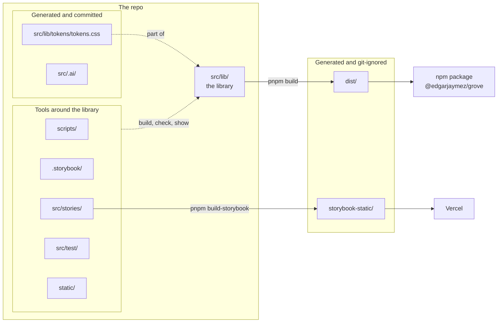

# 01 · Repo map

> **What you learn here**
>
> - Which folder becomes the npm package, and which folders are tools around it.
> - Which files you write, which files a tool writes, and which files git does not track.
> - The files in each component directory, and the two export lists that a new component joins.
>
> **Read first:** [00 · The whiteboard](00-the-whiteboard.md). **Time:** 20 minutes.
>
> Open work as of main @ e251d45, 2026-10-27.

The repo is `edgarjaymez/grove-lit` on GitHub. The npm package that it builds has a different name,
`@edgarjaymez/grove`. Use the package name in import lines and the repo name for git and `gh`.

## Whiteboard

The diagram shows which parts of the repo go to npm and which parts stay in the repo.



Before you edit a file, ask one question: "Does this file go into `dist/`?" If it does, a consumer
sees the change. If it does not, only maintainers see the change.

## The tree

In the tree, `(git-ignored)` means that the path exists on a work machine, but git does not track
it. `GENERATED` means that a tool writes the file. Edit the source of the file, not the file.

```
grove-lit/
├── package.json · pnpm-lock.yaml · pnpm-workspace.yaml · .npmrc · .node-version
├── tsconfig.json · vite.config.ts · eslint.config.js · .prettierrc · .prettierignore
├── terrazzo.config.js · custom-elements-manifest.config.mjs · vercel.json
├── components-since.json                 the release ledger: component → first version
├── README                                an essay about systems, not setup docs
├── LICENSE · DESIGN_SYSTEM.md            the MIT licence; the design language in prose
├── .mcp.json · .vscode/                  editor settings; not part of the library
├── docs/                                 the old guide, and this guide in docs/guide/
├── .storybook/                           main.ts · preview.ts · vitest.setup.ts · globals.d.ts · tsconfig.json
├── .github/ISSUE_TEMPLATE/               one issue template; no workflows
├── scripts/                              build, release and test helpers (Node, .mjs)
│   ├── check-manifest.mjs                fails the build when the manifest and the sources disagree
│   ├── manifest-types.mjs (+ .test.mjs)  writes each type alias as its union in the manifest
│   ├── generate-framework-types.mjs      writes dist/types/astro.d.ts
│   ├── record-release.mjs · check-ledger.mjs · components-since.mjs (+ .test.mjs)
│   ├── a11y-canary.mjs · storybook-static-smoke.mjs
│   └── fixtures/                         aliased-union.ts, for the manifest-types test
├── src/
│   ├── lib/                              THE PUBLISHED LIBRARY
│   │   ├── index.ts                      the package entry: every public export, by name
│   │   ├── events.ts                     GroveEventMap: the type of every gv-* event
│   │   ├── surfaces.ts                   GroveSurface, GroveTrack, GROVE_SURFACES, isAurora
│   │   ├── events.browser.test.ts · slots.browser.test.ts
│   │   ├── components/                   15 component directories + index.ts, metadata.ts, metadata.test.ts
│   │   ├── styles/                       *.css for the page · *.ts Lit style fragments · their tests
│   │   ├── tokens/                       token JSON (border/ effects/ palette/ spacing/ text/),
│   │   │                                 main.resolver.json, tokens.css GENERATED, contrast.test.ts
│   │   ├── fonts/                        display/ (Cakra) · sans-serif/ (Inclusive Sans) · fonts.css
│   │   ├── utils/                        slot-content.ts · dev.ts · link-attributes.ts · index.ts (empty)
│   │   └── **/__screenshots__/           (git-ignored) screenshots of failed browser tests
│   ├── stories/                          repo-level Storybook pages: Home.mdx, Accessibility.mdx,
│   │                                     FocusRing.stories.ts, A11yCanary.stories.ts
│   ├── test/                             browser-setup.ts · commands.d.ts · events.types.ts ·
│   │                                     grove-tags.ts · themes.ts
│   └── .ai/                              GENERATED: the generated AI index (TOON files)
├── static/                               Storybook favicons and the web app manifest
├── dist/                                 (git-ignored) the build output: what npm gets
└── storybook-static/                     (git-ignored) the static Storybook: what Vercel deploys
```

The tree shows tracked files on `main` @ e251d45. `git ls-files` lists them.

> [!IMPORTANT]
> **Open work: #68 — gv-button link mode and form association** (open PR, no conflict with main on
> 2026-10-27)
>
> The PR adds three paths to the tree: `src/lib/utils/form-control.ts` (the `FormControl` mixin),
> `src/lib/utils/form-control.browser.test.ts` and `src/test/forms.ts` (the helpers `nextTask`,
> `cancelFormSubmits`, `recordSubmits` and `settle`). It also adds
> `src/lib/components/Button/Button.browser.test.ts`. The file
> `src/lib/utils/link-attributes.test.ts` comes from PR #63, which #68 already contains.
> When the PR lands, add `form-control.ts` to the `utils/` line and `forms.ts` to the `test/` line.
> <https://github.com/edgarjaymez/grove-lit/pull/68>

> [!IMPORTANT]
> **Open work: #64 — gv-icon glyph tests and the dist gate** (open PR, no conflict with main on
> 2026-10-27)
>
> The PR adds `scripts/check-dist.mjs`, a build step that fails when no `dist/*.js` file reads
> `process.env.NODE_ENV`. It also adds `src/lib/components/glyphs.browser.test.ts`,
> `src/test/shadow.ts` (`deepElements`, `settleDeep`, `frames`) and `src/test/component-metadata.ts`
> (`metadataByTag`). When the PR lands, add these four paths to the tree.
> <https://github.com/edgarjaymez/grove-lit/pull/64>

> [!IMPORTANT]
> **Open work: #66 — componentReset tests for hidden and reduced motion** (open PR, no conflict with
> main on 2026-10-27)
>
> The PR adds `src/test/shadow.ts` too, with the same content as #64. A trial merge of the two PR
> heads with `git merge-tree` on 2026-10-27 had no conflict. Whichever PR lands first adds the
> file. The other PR then adds nothing new for that path.
> <https://github.com/edgarjaymez/grove-lit/pull/66>

> [!IMPORTANT]
> **Open work: #50 — accessible names across the shadow boundary** (branch, no PR)
>
> The #50 work branch, linked from epic #50, adds `src/lib/utils/accessible-name.ts`,
> `src/lib/names.browser.test.ts` and `src/test/ax-nodes.browser.test.ts`. It starts from an older
> commit of #68, so it also carries its own copy of `form-control.ts`. When a PR for #50 lands,
> add these paths to the tree. <https://github.com/edgarjaymez/grove-lit/issues/50>

## The package and the tools

Only `dist/` goes to npm. `package.json` says so in its `files` field:

`package.json`, `files`:

```json
	"files": [
		"dist",
		"!dist/**/*.test.*",
		"!dist/**/*.spec.*"
	],
```

npm puts only the paths in `files` into the package, plus a few files that it always adds, such as
`package.json` and `README`.
[Source: npm Docs, package.json](https://docs.npmjs.com/cli/v11/configuring-npm/package-json/)
Vite builds `dist/` from `src/lib/` alone. All other folders (`scripts/`, `.storybook/`,
`src/stories/`, `src/test/`, `static/`) build, check or show `src/lib/`.

The files at the root configure the tools:

| File                                                 | Read by               | What it sets                                                                                                                                                      |
| ---------------------------------------------------- | --------------------- | ----------------------------------------------------------------------------------------------------------------------------------------------------------------- |
| `package.json`                                       | pnpm, npm, Node       | The scripts, `files`, `exports`, `sideEffects`, the peer dependencies (`lit ^3.0.0` and the optional `@phosphor-icons/webcomponents`) and `engines` (`node >=20`) |
| `pnpm-lock.yaml`                                     | pnpm                  | The exact version of each dependency                                                                                                                              |
| `pnpm-workspace.yaml`                                | pnpm                  | Two pnpm settings: `allowBuilds` (esbuild) and `minimumReleaseAgeExclude`                                                                                         |
| `.npmrc`                                             | pnpm                  | `engine-strict=true`, so an install on a Node version outside `engines` fails                                                                                     |
| `.node-version`                                      | Node version managers | `20`                                                                                                                                                              |
| `tsconfig.json`                                      | TypeScript            | `strict`, the decorator setup, and `include: ["src"]`                                                                                                             |
| `vite.config.ts`                                     | Vite and Vitest       | The library build, the type files, the copy step and the four test projects                                                                                       |
| `terrazzo.config.js`                                 | Terrazzo              | The token resolver, the output folder and the CSS permutations                                                                                                    |
| `custom-elements-manifest.config.mjs`                | The manifest analyzer | The globs of the component files and the `expandTypesPlugin`                                                                                                      |
| `eslint.config.js`, `.prettierrc`, `.prettierignore` | ESLint and Prettier   | The lint rules and the code format                                                                                                                                |
| `vercel.json`                                        | Vercel                | `pnpm build-storybook` and the `storybook-static` output folder                                                                                                   |

pnpm reads `allowBuilds` and `minimumReleaseAgeExclude` from `pnpm-workspace.yaml`.
[Source: pnpm, Settings](https://pnpm.io/settings)
[18 · Build and package](18-build-and-package.md#the-package-fields) explains the fields of
`package.json`. [17 · Tests](17-tests.md#the-four-test-projects) explains the test projects.

`pnpm check` runs `tsc --noEmit`. Because `tsconfig.json` includes only `src`, it does not check
`scripts/`, `.storybook/` or the root config files.
[18 · Build and package](18-build-and-package.md#type-check-scope) tells more.

## One directory per component

Each component has its own directory, `src/lib/components/<PascalName>/`. Button is an example:

| File                     | Required | What it is                                                         |
| ------------------------ | -------- | ------------------------------------------------------------------ |
| `Button.ts`              | yes      | The Lit class and its `@customElement('gv-button')` registration   |
| `Button.metadata.ts`     | yes      | `ButtonMetadata`: use cases, slots, states and accessibility notes |
| `Button.stories.ts`      | yes      | The Storybook stories                                              |
| `Button.browser.test.ts` | no       | Tests that need a real browser                                     |

- A component directory has no `index.ts`. Do not add one. The two export lists below do that work.
- The directory name and the class name use PascalCase, for example `ToDoListItem`. The tag uses
  kebab case with the `gv-` prefix, for example `gv-todo-list-item`.
- On `main`, five components have a browser test: FeedbackStrip, Icon, MenuItem, Texture and Title.
  Button has none.
- A directory can hold a helper module. `Icon/phosphor.ts` builds the Phosphor tag name, and
  `Icon/phosphor.test.ts` tests it. The manifest analyzer skips `phosphor.ts`.
- Three files sit next to the directories: `components/index.ts` (an export list),
  `components/metadata.ts` (the `ComponentMetadata` type) and `components/metadata.test.ts`.

[04 · Anatomy of a component](04-anatomy-of-a-component.md#the-files-around-it) shows how these
files connect. [15 · Metadata and the manifest](15-metadata-and-the-manifest.md#component-metadata)
explains the metadata file. [16 · Storybook](16-storybook.md#a-story-file) explains the stories
file. [17 · Tests](17-tests.md#a-new-browser-test) explains the browser test.

## The two export lists

Add a new component to both of these files.

**1. `src/lib/components/index.ts`** is a barrel. A barrel is an `index.ts` file that exports other
modules. This one has one `export * from` line for each component, in alphabetical order.

`src/lib/components/index.ts`, the first two lines:

```ts
export * from './BackButton/BackButton.js';
export * from './Button/Button.js';
```

No file in the build or in the tests imports this barrel today. Keep it complete, because the house
rules ask for it.

**2. `src/lib/index.ts`** is the package entry. `vite.config.ts` sets it as `build.lib.entry`, so
Vite builds `dist/index.js` from it. A component that is not in this file is not in the package.
The file exports each name explicitly: each class, its `*Metadata` object and its public types.
It also exports the style fragments, the surface types and values, the event map type and the
metadata types.

`src/lib/index.ts`, the Button lines:

```ts
export { Button } from './components/Button/Button.js';
export { ButtonMetadata } from './components/Button/Button.metadata.js';
```

The package entry does not export the modules in `src/lib/utils/`. `utils/index.ts` is an empty
file. The components import the helpers directly, and Vite puts them into the bundle.

The tests read the package entry too. The test helper `src/test/grove-tags.ts` makes the list of
tags to test from the exports of `src/lib/index.ts`:

`src/test/grove-tags.ts`, `groveTags`:

```ts
import * as grove from '../lib/index.js';

/** Every custom element the public entry registers, read from the registry so new components are covered. */
export const groveTags = Object.values(grove)
	.map((value) =>
		typeof value === 'function' ? customElements.getName(value as CustomElementConstructor) : null
	)
	.filter((tag): tag is string => !!tag)
	.sort();
```

Thus a component that is not in `src/lib/index.ts` is also not in the tests that use `groveTags`.

> [!IMPORTANT]
> **Open work: #68 — gv-button link mode and form association** (open PR, no conflict with main on
> 2026-10-27)
>
> The `FormControl` mixin in `src/lib/utils/form-control.ts` stays internal: `src/lib/index.ts` does
> not export it. But the PR adds the file to the `globs` of the manifest analyzer and to the
> `include` list of `unplugin-dts`. Then the manifest lists the members that `gv-button` gets from
> the mixin. When the PR lands, change the paragraph about `src/lib/utils/` above. Say that one
> module there, `form-control.ts`, is in the manifest and in the type files.
> <https://github.com/edgarjaymez/grove-lit/pull/68>

> [!IMPORTANT]
> **Open work: #64 — gv-icon glyph tests and the dist gate** (open PR, no conflict with main on
> 2026-10-27)
>
> The PR adds a registry guard in `glyphs.browser.test.ts`. It pairs each registered tag with
> exactly one metadata file. Thus a component with no metadata file, or a metadata file with no
> component, fails a test. When the PR lands, add this check to the list above.
> <https://github.com/edgarjaymez/grove-lit/pull/64>

## Generated but committed

Two generated outputs are in git, because other tools read them with no build:

- **`src/lib/tokens/tokens.css`.** `pnpm build-tokens` writes it from the token JSON. Storybook,
  the Vercel deploy and the unit tests read it. Never edit it by hand.
  [11 · Design tokens](11-design-tokens.md#churn-in-the-generated-file) tells how to undo a change
  that the build makes with no real token change.
- **`src/.ai/`.** This is the generated AI index, which the maintainer regenerates. It has seven
  TOON files about the components, their relations and the token use. No package script makes
  them. Never edit them by hand. If they look old, ask the maintainer to regenerate them.
  [15 · Metadata and the manifest](15-metadata-and-the-manifest.md#the-generated-ai-index) tells
  more.

> [!CAUTION]
> Do not run `prettier --write` on `src/lib/tokens/tokens.css`. `.prettierignore` excludes it, and
> the file must stay exactly as Terrazzo writes it.

Tools also write `dist/` and `storybook-static/`, but `.gitignore` excludes them.

## Files outside the library

Some files in the repo are not part of the library:

- **`README`** (with no file extension) is an essay, "Systems Thinking Guidelines to Live in a
  World of Uncertainty". It is not the setup documentation. For setup, read
  [Day one](README.md#day-one) in this guide.
- **`LICENSE`** is the MIT licence.
- **`DESIGN_SYSTEM.md`** describes the design language in prose. Where it and `tokens.css`
  disagree about a token name or value, `tokens.css` wins.
  [When two sources disagree](README.md#when-two-sources-disagree) gives the full order.
- **`docs/`** holds the old guide (`docs/01`–`11`, `docs/glossary.md`) and this guide in
  `docs/guide/`.
- **`static/`** holds the Storybook favicons and the web app manifest.
- **`.mcp.json`** and **`.vscode/`** hold editor settings. The library does not use them.
- **`components-since.json`** is the release ledger. It records the first version of each
  component. The build copies it into `dist/`. [19 · Release](19-release.md#the-release-ledger)
  explains it.

Some files at the repo root and some folders are in `.gitignore`. They are not part of the
library, and this guide does not describe them.

## The issue template

`.github/ISSUE_TEMPLATE/spec-driven-development.md` is the only file in `.github/`. It is a
Markdown form for a spec: context, inputs, functional requirements, files, open decisions. The repo
has no workflow files, so no CI runs.
[21 · House rules and how work moves](21-house-rules-and-how-work-moves.md#how-work-moves) tells
how a spec becomes a PR.

## See it in the code

| File                          | Look for                                            |
| ----------------------------- | --------------------------------------------------- |
| `package.json`                | `files`, `exports`, `peerDependencies`, `engines`   |
| `src/lib/index.ts`            | `export { Button }` and `export { ButtonMetadata }` |
| `src/lib/components/index.ts` | The 15 `export *` lines                             |
| `src/test/grove-tags.ts`      | `groveTags`                                         |
| `src/lib/components/Button/`  | Three files, and no browser test                    |
| `.gitignore`                  | `dist`, `storybook-static`, `__screenshots__`       |

## Sources

**Tool docs**

- [npm Docs, package.json](https://docs.npmjs.com/cli/v11/configuring-npm/package-json/). Read
  2026-10-27.
- [pnpm, Settings](https://pnpm.io/settings). Read 2026-10-27.

## Check yourself

Do [Lesson 0 Find your way](syllabus.md#lesson-0-find-your-way) in the syllabus. Then answer these
questions without this page:

1. Which folder does npm get?
2. Which two files must list a new component?
3. Why do the tests that use `groveTags` skip a component that is not in `src/lib/index.ts`?
4. Which two generated outputs are in git?

[← 00 · The whiteboard](00-the-whiteboard.md) · [Index](README.md) ·
[02 · Web components →](02-web-components.md)
