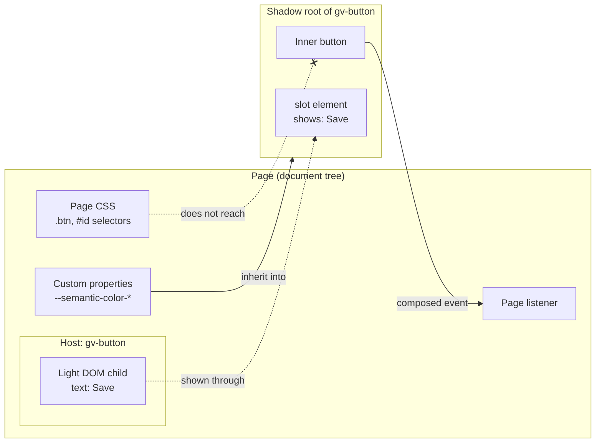
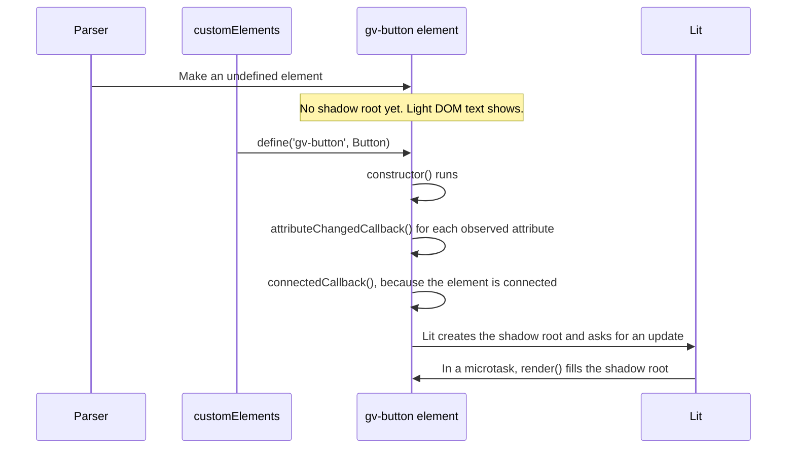
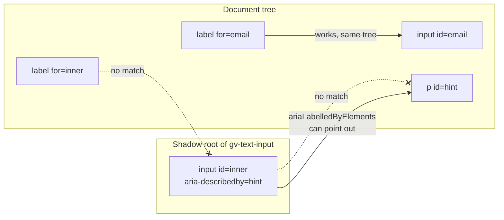
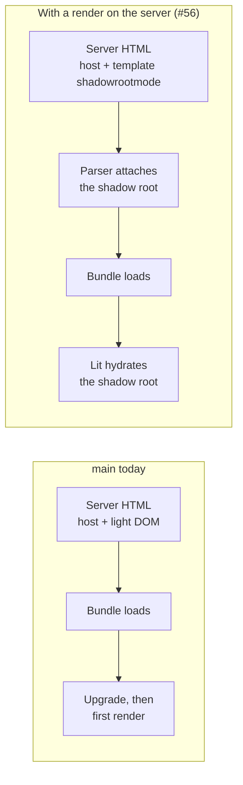

# 02 · Web components

> **What you learn here**
>
> - The browser features that Grove uses: custom elements, upgrade, shadow DOM and slots.
> - Why an ID reference does not go through a shadow boundary.
> - What Declarative Shadow DOM is, and why Grove does not use it yet.
> - How these ideas compare with React and Vue.
>
> **Read first:** [00 · The whiteboard](00-the-whiteboard.md). **Time:** 35 minutes.
>
> Open work as of main @ e251d45, 2026-10-27.

This chapter is about the web platform. It does not need Lit. The next chapter,
[03 · Lit essentials](03-lit-essentials.md), tells what Lit adds on top.

## Whiteboard

The diagram shows one host, its light DOM and its shadow root, and the things that go through the
shadow boundary.



| Goes in                   | How                                                                      |
| ------------------------- | ------------------------------------------------------------------------ |
| Inherited CSS properties  | `color`, `font` and the other inherited properties inherit from the host |
| Every CSS custom property | Custom properties inherit, so `var(--token)` works inside                |
| Light DOM children        | A `<slot>` shows them in the shadow root. They stay children of the host |

| Goes out | How                                                                                              |
| -------- | ------------------------------------------------------------------------------------------------ |
| Events   | Only an event with `composed: true` leaves the shadow root. The browser retargets it to the host |

| Does not cross                | Why                                                                         |
| ----------------------------- | --------------------------------------------------------------------------- |
| Page CSS selectors            | A selector in the page matches nodes in the document tree only              |
| ID references                 | `for`, `aria-labelledby` and `aria-describedby` look in their own tree only |
| `querySelector` from the page | It searches the document tree, not shadow roots                             |

Grove depends on each row. Tokens reach each component because custom properties inherit. Surfaces
set the focus ring colour in the same way. Components report changes with composed events.
[06 · Styles inside a component](06-styles-inside-a-component.md#what-crosses-the-shadow-boundary)
and [08 · Events](08-events.md#event-targets-across-shadow-roots) explain the details.

## Custom elements

A custom element is an HTML element that a class defines. You write a class that extends
`HTMLElement`. Then you register it with a name that contains a hyphen.
[Source: MDN, Using custom elements](https://developer.mozilla.org/en-US/docs/Web/API/Web_components/Using_custom_elements)

Example:

```ts
customElements.define('gv-button', Button);
```

The name must start with a lowercase ASCII letter and contain a hyphen. The HTML standard gives the
full rule.
[Source: HTML Standard, valid custom element name](https://html.spec.whatwg.org/multipage/custom-elements.html#valid-custom-element-name)
Grove uses the prefix `gv-` for each tag. Grove never calls `customElements.define()` by hand. The
Lit decorator `@customElement` calls it.

After the registration, the browser treats `<gv-button>` like a built-in tag. It can be in HTML,
you can make it with `document.createElement('gv-button')`, and CSS and `querySelector` find it.
No framework runtime runs. The browser makes the element and calls its methods.

This guide calls the element in the page the host. For example, `<gv-button>` is the host of the
real `<button>` that Grove renders inside it.

> [!NOTE]
> **Lit box: the decorator registers the tag**
>
> `@customElement('gv-button')` on the class calls `customElements.define('gv-button', Button)`.
> The registration happens when the module loads. Grove example, `Button.ts`:
> `@customElement('gv-button')`.
>
> Lit docs: [Defining a component](https://lit.dev/docs/v3/components/defining/)

## Upgrade

The browser can parse a `<gv-button>` tag before the class is registered. Then the element is an
undefined, plain `HTMLElement`. It has no lifecycle callbacks and no shadow root. It shows only its
light DOM children.
[Source: MDN, CustomElementRegistry upgrade()](https://developer.mozilla.org/en-US/docs/Web/API/CustomElementRegistry/upgrade)

When the class is registered, the browser upgrades each connected element of that name. The
upgrade makes the element an instance of the class, without a new element. The HTML standard
gives the steps.
[Source: HTML Standard, Upgrades](https://html.spec.whatwg.org/multipage/custom-elements.html#upgrades)

The diagram shows the order of the work in an upgrade.



These facts follow from the upgrade:

- **The import order is not important for markup.** A page can put `<gv-button>` in its HTML and
  import Grove later. The browser upgrades the element when the import runs.
- **Before the upgrade, the host shows its light DOM.** Grove puts visible text in slots, so the
  text of `<gv-button>Save</gv-button>` shows before the script loads. The inner markup of the
  component shows only after the upgrade.
- **The CSS pseudo-class `:defined` selects an element after its registration.** A page can hide
  `gv-button:not(:defined)` to stop a flash of unstyled content.
  [Source: MDN, :defined](https://developer.mozilla.org/en-US/docs/Web/CSS/Reference/Selectors/:defined)
- **A document with no browsing context does not upgrade.** For example,
  `document.implementation.createHTMLDocument('')` makes such a document. An element that you parse
  into it stays undefined. When you append it to the live document, the browser upgrades it.
- **`customElements.upgrade(root)` upgrades a subtree that is not connected.** Grove does not use
  it.
  [Source: MDN, CustomElementRegistry upgrade()](https://developer.mozilla.org/en-US/docs/Web/API/CustomElementRegistry/upgrade)

> [!IMPORTANT]
> **Open work: #66 — componentReset tests for hidden and reduced motion** (open PR, no conflict with
> main on 2026-10-27)
>
> The PR adds the test "stays hidden through upgrade" to `host-hidden.browser.test.ts`. It parses
> `<${tag} hidden>` into a document from `createHTMLDocument('')`, so the element stays
> undefined, as server HTML is before the bundle runs. The test then appends the element to
> `document.body` and checks that the host never shows. After the append, the host has a shadow
> root at once, but Lit has not rendered yet.
>
> `host-hidden.browser.test.ts` at c29308e, the test "stays hidden through upgrade":
>
> ```ts
> const inert = document.implementation.createHTMLDocument('');
> inert.body.innerHTML = `<${tag} hidden></${tag}>`;
> const el = inert.body.firstElementChild as HTMLElement;
> expect(el.shadowRoot).toBeNull();
>
> document.body.append(el);
> // Upgraded and styled, not yet rendered.
> expect(el.shadowRoot).not.toBeNull();
> ```
>
> When the PR lands, cite this test here as the proof of the upgrade rule.
> <https://github.com/edgarjaymez/grove-lit/pull/66>

## Shadow DOM

Each Grove element renders its inner markup into a shadow root. A shadow root is a private DOM tree
that is attached to the host. The DOM standard calls it a shadow tree.
[Source: DOM Standard, Shadow tree](https://dom.spec.whatwg.org/#shadow-trees)

Two things follow from this:

- **The styles are scoped.** CSS inside the shadow root applies only there. CSS in the page does
  not reach in. A `.btn` rule in `gv-button` cannot change a `.btn` element in the page, and the
  opposite is also true.
  [Source: MDN, Using shadow DOM](https://developer.mozilla.org/en-US/docs/Web/API/Web_components/Using_shadow_DOM)
- **The markup is hidden.** `document.querySelector('.btn')` does not find the button in
  `gv-button`. Use `element.shadowRoot` to get it.

The light DOM is the normal DOM of the page. It includes the children that you put between
`<gv-button>` and `</gv-button>`.

The shadow roots of Grove are open, so `element.shadowRoot` returns the root. Tests use this to
walk into nested shadow roots.
[17 · Tests](17-tests.md#nested-shadow-roots-in-tests) shows how.

> [!NOTE]
> **Lit box: Lit renders into an open shadow root**
>
> A LitElement makes an open shadow root when it connects. Then it renders its template there and
> adopts its `static styles` there. Grove example, `Button.ts`:
> ``static styles = [componentReset, focusRing, css`…`]``.
>
> Lit docs: [Working with shadow DOM](https://lit.dev/docs/v3/components/shadow-dom/)

## ID references stay in one tree

A shadow root is a separate node tree. An ID reference finds an element only in its own tree. This
applies to `<label for>`, `aria-labelledby` and `aria-describedby`.
[Source: Reference Target explainer, proposal, not shipped](https://github.com/WICG/webcomponents/blob/gh-pages/proposals/reference-target-explainer.md)

The diagram shows which references work and which do not.



These rules are the reason for most of the work on names in Grove:

- **A page `<label for>` cannot name the inner `<input>` of `gv-text-input`.** The browser looks
  for the `for` value in the page, but the input is in the shadow root.
- **A `<label>` around a control needs a labelable element.** A custom element is labelable only
  when it is a form-associated custom element. No Grove component is form-associated on `main`.
  [Source: HTML Standard, labelable elements](https://html.spec.whatwg.org/multipage/forms.html#category-label)
- **An `aria-label` on the host names the host.** The host has no role. Thus the host becomes a
  named generic element, and WAI-ARIA 1.2 does not permit a name on the generic role.
  [Source: WAI-ARIA 1.2, generic role](https://www.w3.org/TR/wai-aria-1.2/#generic)
- **An element reference can point out, not in.** The properties such as `ariaLabelledByElements`
  can refer to an element in an ancestor tree. They cannot refer into a nested shadow root.

Reference Target is a proposal that lets a shadow root forward ID references to an element inside
it. It is a proposal, not shipped. Do not depend on it in Grove code.
[Source: Reference Target explainer, proposal, not shipped](https://github.com/WICG/webcomponents/blob/gh-pages/proposals/reference-target-explainer.md)
[09 · Accessibility](09-accessibility.md#accessible-names-across-the-shadow-boundary) tells how
Grove names its controls.

> [!IMPORTANT]
> **Open work: #21 — accessible names and descriptions across the shadow boundary** (branch, no
> PR)
>
> #21 measured these rules on all 15 components. It lists four options. A is form association
> with `delegatesFocus`. B is properties that render inside the shadow root. C is ARIA element
> reflection that points out. D is Reference Target. Option D is a proposal, so the spec keeps it
> for later, behind feature detection.
>
> The work for #21 is on the #50 work branch, linked from epic #50. That branch makes `gv-button` and `gv-checkbox` form-associated. It copies the text of a page
> label onto the inner control. When it lands, add the new rule to this section: a page `<label>`
> names a form-associated Grove control.
> <https://github.com/edgarjaymez/grove-lit/issues/21>

## Slots

A `<slot>` in the shadow root is a place where the light DOM children of the host show. If a page
writes `<gv-button>Save</gv-button>`, the text `Save` stays in the light DOM. The browser shows it
at the place of the `<slot></slot>` in the shadow root of `gv-button`.
[Source: MDN, Using templates and slots](https://developer.mozilla.org/en-US/docs/Web/API/Web_components/Using_templates_and_slots)

- A named slot has a `name`, for example `<slot name="heading">`. A child selects it with
  `slot="heading"`.
- The default slot has no `name`. It gets each child that has no `slot` attribute, text included.
- A slot can show fallback content when it gets no nodes. Grove does not use this fallback. The
  whitespace between the tags of the host is a text node, and the browser gives it to the default
  slot. Thus the fallback does not show.

`slot.assignedNodes()` returns the nodes that a slot gets.
[Source: MDN, HTMLSlotElement assignedNodes()](https://developer.mozilla.org/en-US/docs/Web/API/HTMLSlotElement/assignedNodes)
Grove uses its own `SlotContent` controller instead, which ignores whitespace.
[07 · Slots](07-slots.md#the-whitespace-problem) explains the problem and the controller.

A slot does not move a node. A slotted node is still a child of the host in the light DOM. Thus
the page CSS still styles it, and the node still takes part in the tree of the page.

> [!NOTE]
> **Lit box: slots in a Lit template**
>
> A Lit template writes a slot as a plain `<slot>` element. Grove renders a fallback prop next to
> the slot, not inside it, and shows the property only when the slot is empty. Grove example,
> `Button.ts`, `render()`: `<slot></slot>${this._slots.has() ? nothing : this.text}`.
>
> Lit docs: [Working with shadow DOM](https://lit.dev/docs/v3/components/shadow-dom/)

## Declarative Shadow DOM

Declarative Shadow DOM lets HTML describe a shadow root, with no script. A `<template>` element with
a `shadowrootmode` attribute becomes the shadow root of its parent element.
[Source: HTML Standard, the shadowrootmode attribute](https://html.spec.whatwg.org/multipage/scripting.html#attr-template-shadowrootmode)

Example:

```html
<gv-button>
	<template shadowrootmode="open">
		<button class="btn gv-focusable" type="button"><slot></slot></button>
	</template>
	Save
</gv-button>
```

- **Only the HTML parser reads it.** The parser makes the shadow root when the page loads.
  [Source: MDN, The template element](https://developer.mozilla.org/en-US/docs/Web/HTML/Reference/Elements/template)
  Script that sets `innerHTML` does not make a shadow root from the template. `setHTMLUnsafe()`
  does.
  [Source: MDN, Element setHTMLUnsafe()](https://developer.mozilla.org/en-US/docs/Web/API/Element/setHTMLUnsafe)
- **`shadowrootdelegatesfocus` sets `delegatesFocus` on the new root.** Then a click on a part
  that cannot take focus moves focus to the first focusable element inside.
  [Source: HTML Standard, the shadowrootdelegatesfocus attribute](https://html.spec.whatwg.org/multipage/scripting.html#attr-template-shadowrootdelegatesfocus)
- **The script must still load.** A declarative shadow root gives the markup and the styles. The
  events, the properties and form association still need the class.

Grove does not render on a server today. A server page that uses Grove sends each host with its
light DOM only. The slotted text shows at once. The inner markup of each component, for example a
heading element or a link, shows only after the upgrade.

The diagram shows the path that a server render adds.



> [!IMPORTANT]
> **Open work: #56 — a render on the server with Lit SSR and Declarative Shadow DOM** (issue, not
> started)
>
> #56 is the second half of #54 D4 (slots, then a render on the server). It asks to render each
> shadow root on the server as `<template shadowrootmode="open">` and to hydrate it on the client.
> Two traps: the `delegatesFocus` that the #50 work branch adds must come through as
> `shadowrootdelegatesfocus`, and form association still needs the script. The open decisions are
> a server entry point, the framework integrations and how `gv-icon` renders its glyphs on the
> server. When it lands, change "Grove does not render on a server today" in this section.
> [03 · Lit essentials](03-lit-essentials.md#lit-on-the-server) tells which Lit code runs on a
> server. <https://github.com/edgarjaymez/grove-lit/issues/56>

## If you know React or Vue

| React or Vue idea                               | Web component or Lit equivalent                                       |
| ----------------------------------------------- | --------------------------------------------------------------------- |
| A component function or a single-file component | A class that extends `LitElement`, registered as a tag                |
| Props                                           | Reactive properties. Many of them also read an HTML attribute         |
| Local state                                     | `@state()` fields                                                     |
| JSX or a template                               | The `html` tagged template that `render()` returns                    |
| `children` or the default slot                  | `<slot>`. The content stays in the light DOM                          |
| An emitted event or an `onX` prop               | `this.dispatchEvent(new CustomEvent('gv-*', …))`                      |
| CSS modules or scoped styles                    | Shadow DOM and `static styles`                                        |
| A render after a change                         | Lit batches the property changes and renders one time, in a microtask |

The big difference: a web component is a real DOM element. Each framework, and plain HTML, can use
it. The framework does not own it.

Frameworks differ in how they pass properties and events to a custom element. The Lit docs explain
the problem for React and the `@lit/react` wrappers.
[Source: Lit, React](https://lit.dev/docs/v3/frameworks/react/)
[20 · Grove in an app](20-grove-in-an-app.md#attributes-and-properties) tells how to
pass values to a Grove element.

## See it in the code

| File                                              | Look for                                                     |
| ------------------------------------------------- | ------------------------------------------------------------ |
| `src/lib/components/Button/Button.ts`             | `@customElement('gv-button')`, `<slot></slot>` in `render()` |
| `src/lib/utils/slot-content.ts`                   | The comment about the whitespace in the default slot         |
| `src/lib/components/ToDoListItem/ToDoListItem.ts` | `this.shadowRoot?.querySelector('gv-checkbox')`              |
| `src/lib/components/TextInput/TextInput.ts`       | `input-id`, the ID of the input inside the shadow root       |
| `src/lib/styles/host-hidden.browser.test.ts`      | The tests of the host before and after the upgrade           |

## Sources

**Standards**

- [HTML Standard, valid custom element name](https://html.spec.whatwg.org/multipage/custom-elements.html#valid-custom-element-name).
  Read 2026-10-27.
- [HTML Standard, Upgrades](https://html.spec.whatwg.org/multipage/custom-elements.html#upgrades).
  Read 2026-10-27.
- [HTML Standard, the shadowrootmode attribute](https://html.spec.whatwg.org/multipage/scripting.html#attr-template-shadowrootmode).
  Read 2026-10-27.
- [HTML Standard, the shadowrootdelegatesfocus attribute](https://html.spec.whatwg.org/multipage/scripting.html#attr-template-shadowrootdelegatesfocus).
  Read 2026-10-27.
- [DOM Standard, Shadow tree](https://dom.spec.whatwg.org/#shadow-trees). Read 2026-10-27.
- [HTML Standard, labelable elements](https://html.spec.whatwg.org/multipage/forms.html#category-label).
  Read 2026-10-27.
- [WAI-ARIA 1.2, generic role](https://www.w3.org/TR/wai-aria-1.2/#generic). Read 2026-10-27.
- [Reference Target explainer](https://github.com/WICG/webcomponents/blob/gh-pages/proposals/reference-target-explainer.md),
  proposal, not shipped. Read 2026-10-27.

**Platform reference**

- [MDN, Using custom elements](https://developer.mozilla.org/en-US/docs/Web/API/Web_components/Using_custom_elements).
  Read 2026-10-27.
- [MDN, CustomElementRegistry upgrade()](https://developer.mozilla.org/en-US/docs/Web/API/CustomElementRegistry/upgrade).
  Read 2026-10-27.
- [MDN, :defined](https://developer.mozilla.org/en-US/docs/Web/CSS/Reference/Selectors/:defined).
  Read 2026-10-27.
- [MDN, Using shadow DOM](https://developer.mozilla.org/en-US/docs/Web/API/Web_components/Using_shadow_DOM).
  Read 2026-10-27.
- [MDN, Using templates and slots](https://developer.mozilla.org/en-US/docs/Web/API/Web_components/Using_templates_and_slots).
  Read 2026-10-27.
- [MDN, HTMLSlotElement assignedNodes()](https://developer.mozilla.org/en-US/docs/Web/API/HTMLSlotElement/assignedNodes).
  Read 2026-10-27.
- [MDN, The template element](https://developer.mozilla.org/en-US/docs/Web/HTML/Reference/Elements/template).
  Read 2026-10-27.
- [MDN, Element setHTMLUnsafe()](https://developer.mozilla.org/en-US/docs/Web/API/Element/setHTMLUnsafe).
  Read 2026-10-27.

**Tool docs**

- [Lit, Defining a component](https://lit.dev/docs/v3/components/defining/). Read 2026-10-27.
- [Lit, Working with shadow DOM](https://lit.dev/docs/v3/components/shadow-dom/). Read 2026-10-27.
- [Lit, React](https://lit.dev/docs/v3/frameworks/react/). Read 2026-10-27.

## Check yourself

Do [Lesson 1 Web components](syllabus.md#lesson-1-web-components) in the syllabus. Then answer
these questions without this page:

1. What crosses a shadow boundary into a component? What crosses out?
2. Why does `<label for="x">` in the page not name the input inside `gv-text-input`?
3. Why does the element in the #66 test stay undefined until the test appends it?
4. Which part of the browser reads `<template shadowrootmode="open">`?

[← 01 · Repo map](01-repo-map.md) · [Index](README.md) ·
[03 · Lit essentials →](03-lit-essentials.md)
