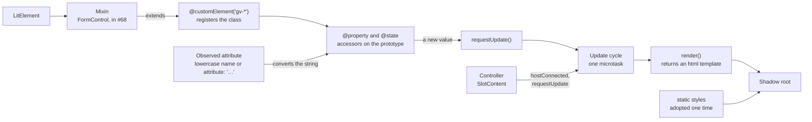
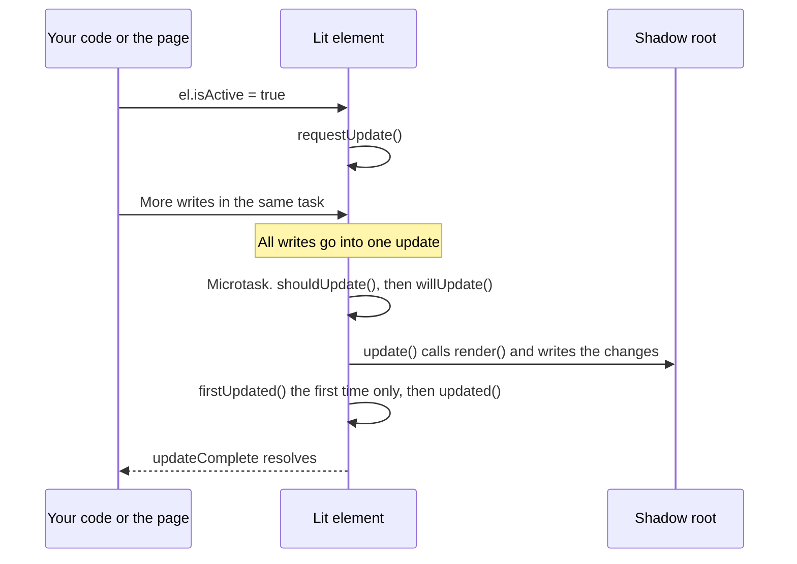

# 03 · Lit essentials

> **What you learn here**
>
> - What Lit adds on top of custom elements: reactive properties, templates, styles and an update
>   cycle.
> - The Lit features that Grove uses, with a real line from Grove for each one.
> - The difference between a controller and a mixin, and why the form work in #68 needs a mixin.
> - Which Lit code runs on a server, and which Lit features this repo does not use.
>
> **Read first:** [02 · Web components](02-web-components.md). **Time:** 50 minutes.
>
> Open work as of main @ e251d45, 2026-10-27.

Lit is a small layer over custom elements. A Lit component extends `LitElement`, declares its
properties and returns a template from `render()`. When a property changes, Lit renders again and
changes only the parts of the DOM that use that property.
[Source: Lit, Lit docs v3](https://lit.dev/docs/v3/)

`package.json` names `lit ^3.0.0` as a peer dependency. The repo itself installs `lit` 3.3.3.

## Whiteboard

The diagram shows the parts of a Lit component and how they connect.



| Box                                     | Section                                                                                                 |
| --------------------------------------- | ------------------------------------------------------------------------------------------------------- |
| `@customElement`, `@property`, `@state` | [LitElement and the decorators](#litelement-and-the-decorators)                                         |
| Accessors and the observed attribute    | [Reactive properties](#reactive-properties) and [Attributes and reflection](#attributes-and-reflection) |
| `requestUpdate()` and the update cycle  | [The update cycle](#the-update-cycle)                                                                   |
| `render()` and the template             | [Templates and bindings](#templates-and-bindings)                                                       |
| `static styles`                         | [06 · Styles inside a component](06-styles-inside-a-component.md#static-styles)                         |
| Controller and mixin                    | [Controllers and mixins](#controllers-and-mixins)                                                       |

## LitElement and the decorators

Each Grove component extends `LitElement` and uses decorators from `lit/decorators.js`. A decorator
is a function that TypeScript applies to a class or to a class member. Grove uses three Lit
decorators:

| Decorator                | What it does                                                     | Where                 |
| ------------------------ | ---------------------------------------------------------------- | --------------------- |
| `@customElement('gv-*')` | Registers the class under the tag                                | Each component        |
| `@property(options)`     | Makes a public reactive property, which usually has an attribute | Each component        |
| `@state()`               | Makes internal state: a reactive property with no attribute      | `ColorSwatch.ts` only |

`Button.ts`, the decorator import:

```ts
import { customElement, property } from 'lit/decorators.js';
```

`ColorSwatch.ts` is the only file that also imports `state`.

> [!NOTE]
> **Lit box: decorators**
>
> Lit gives decorators for the registration, the reactive properties and the internal state. They
> are a short form of the static `properties` field and `customElements.define()`. Grove example,
> `Button.ts`: `@customElement('gv-button')`.
>
> Lit docs: [Decorators](https://lit.dev/docs/v3/components/decorators/)

## Reactive properties

A reactive property is a property that Lit watches. When its value changes, Lit starts an update.
`@property` also connects the property to an HTML attribute.

`Button.ts`, `variant`:

```ts
	@property({ type: String }) variant: ButtonVariant = 'filled';
```

`Button.ts`, `disabled`:

```ts
	@property({ type: Boolean, reflect: true }) disabled = false;
```

Thus `<gv-button variant="ghost">` sets `variant` to `'ghost'`.

The `type` option tells Lit how to convert the attribute string into the property value. Grove uses
`String`, `Boolean` and `Number`. For example, `Title.ts` has
`@property({ type: Number }) level: HeadingLevel = 2;`, so `level="3"` gives the number 3.

**Accessors.** For each reactive property, Lit makes a getter and a setter on the prototype of the
class. The setter stores the value and calls `requestUpdate()`. When a class has its own getter and
setter for the property, Lit does not replace them. A decorated setter still calls
`requestUpdate()`.
[Source: Lit, Custom property accessors](https://lit.dev/docs/v3/components/properties/#accessors)

On `main`, no Grove property has its own accessor. `Texture.ts` has a getter, `_validTint`, but it
is a plain private getter. It is not a reactive property, and `render()` reads it.

**Change detection.** Lit compares the new value with the old value with `!==`. An option,
`hasChanged`, can change this test. Grove does not use it.
[Source: Lit, Customizing change detection](https://lit.dev/docs/v3/components/properties/#haschanged)

> [!NOTE]
> **Lit box: reactive properties**
>
> `@property` makes a reactive property. Lit puts an accessor on the prototype, and each write to
> the property starts the update cycle. Grove example, `Button.ts`:
> `@property({ type: String }) variant: ButtonVariant = 'filled';`
>
> Lit docs: [Reactive properties](https://lit.dev/docs/v3/components/properties/)

> [!IMPORTANT]
> **Open work: #68 — gv-button link mode and form association** (open PR, no conflict with main on
> 2026-10-27)
>
> The `FormControl` mixin declares `disabled` with its own getter and setter, and puts
> `@property` on the getter. The setter runs for each write, attribute changes included. Lit wraps
> it and calls `requestUpdate()`. The mixin uses this to see the moment when the page sets
> `disabled` to `false` after a self-disable.
>
> `form-control.ts` at ccba0a3, `FormControlElement`, `disabled`:
>
> ```ts
> 		@property({ type: Boolean, reflect: true })
> 		get disabled(): boolean {
> 			return this._disabled;
> 		}
> 		set disabled(value: boolean) {
> 			// Every write runs this setter, attribute changes and same-value writes included, so it sees
> 			// each one as it happens. Lit wraps it and requests the update itself.
> 			this._disabled = value;
> 			if (this._selfWrite) return;
> 			if (this._dispatching) this._disabledWritten = true;
> 			if (!value && this._submitting) this._release();
> 		}
> ```
>
> The Lit docs show the decorator on the setter. #68 puts it on the getter, and its comment says
> that Lit wraps the setter. When the PR lands, change "On `main`, no Grove
> property has its own accessor" in this section.
> <https://github.com/edgarjaymez/grove-lit/pull/68>

## Attributes and reflection

A property and an attribute are different things. A property is a JavaScript field on the element
object. An attribute is a name-value pair in the HTML markup, and its value is always a string.

**The default attribute name is the property name in lowercase.** A property `isSelected` reads the
attribute `isselected`, not `is-selected`.
[Source: Lit, Setting the attribute name](https://lit.dev/docs/v3/components/properties/#attributes)
Thus each Grove property with a name of more than one word sets its attribute name by hand.

`Icon.ts`, `isFilled`:

```ts
	@property({ type: Boolean, attribute: 'is-filled' }) isFilled = false;
```

| Property                     | Attribute                      | Component                                    |
| ---------------------------- | ------------------------------ | -------------------------------------------- |
| `isFilled`, `fillInHover`    | `is-filled`, `fill-in-hover`   | `Icon.ts`                                    |
| `isActive`                   | `is-active`                    | `MenuItem.ts`                                |
| `isSelected`                 | `is-selected`                  | `ToDoCategoryToggler.ts`                     |
| `isDone`                     | `is-done`                      | `ToDoListItem.ts`                            |
| `isPressed`                  | `is-pressed`                   | `Tooltip.ts`                                 |
| `inputId`, `ariaDescribedby` | `input-id`, `aria-describedby` | `TextInput.ts`                               |
| `ariaLabel`                  | `aria-label`                   | `Button.ts`, `IconButton.ts`, `TextInput.ts` |

Markup, stories and metadata always use the attribute name. The manifest check fails when a
metadata snippet uses a name that the element does not declare.
[15 · Metadata and the manifest](15-metadata-and-the-manifest.md#when-check-manifest-fails) lists
the checks.

**A Boolean attribute works by presence.** When the attribute is there, the property is `true`,
with any value or no value. Thus `is-done="false"` also gives `true`. A Boolean property must
default to `false`, or markup cannot turn it off. Each Boolean property in Grove defaults to
`false`.
[Source: Lit, Boolean attributes](https://lit.dev/docs/v3/components/properties/#boolean-attributes)

**`reflect: true` copies the property value back to the attribute** after each change. Then page
CSS can select the state, for example `gv-checkbox[checked]` or `gv-button[disabled]`. Grove
reflects `disabled` and each toggled state: `checked`, `error`, `isActive`, `isSelected`, `isDone`
and `isPressed`. It also reflects some string values, for example `type` on `gv-feedback-strip`
and `surface` on `gv-title`.
[Source: Lit, Enabling attribute reflection](https://lit.dev/docs/v3/components/properties/#reflected-attributes)

No Grove component reads its own reflected attribute with `:host([attr])` in its styles. The
reflection is for the page.

> [!NOTE]
> **Lit box: attributes and reflection**
>
> By default the attribute name is the property name in lowercase, so Grove sets a kebab-case name
> by hand. `reflect: true` writes the property value back to the attribute after each change.
> Grove example, `ToDoListItem.ts`:
> `@property({ type: Boolean, attribute: 'is-done', reflect: true }) isDone = false;`
>
> Lit docs: [Reactive properties, Attributes](https://lit.dev/docs/v3/components/properties/#attributes)

> [!IMPORTANT]
> **Open work: #68 — gv-button link mode and form association** (open PR, no conflict with main on
> 2026-10-27)
>
> The PR adds `value` to `gv-button` with the Lit option `useDefault: true`. With this option, the
> default value does not reflect at first, so the attribute shows only after you set the value.
> When the page removes the attribute, the property goes back to `''`. A native `<button>` acts in
> the same way.
>
> `Button.ts` at ccba0a3, `value`:
>
> ```ts
> 	@property({ type: String, reflect: true, useDefault: true }) value = '';
> ```
>
> A trap: `useDefault` is in `@lit/reactive-element` 2.1.0, which `lit` 3.3.0 needs. This guide
> checked the published packages: 2.0.4 has no `useDefault`. The peer range of Grove is
> `lit ^3.0.0`, so an app with an old lock file can have a Lit that ignores the option. When the PR
> lands, add `useDefault` to this section and to the property table in
> [04 · Anatomy of a component](04-anatomy-of-a-component.md#stop-5-properties).
> [Source: Lit, useDefault](https://lit.dev/docs/v3/components/properties/#use-default)
> <https://github.com/edgarjaymez/grove-lit/pull/68>

## Internal state

`@state()` makes a reactive property that is private to the component. A change to it starts an
update, but it has no attribute.
[Source: Lit, Internal reactive state](https://lit.dev/docs/v3/components/properties/#internal-reactive-state)

`ColorSwatch.ts` uses it to remember which value it copied:

`ColorSwatch.ts`, `copied`:

```ts
	@state() private copied: ColorSpace | null = null;
```

The class also has a second state field, `dismissed`. These two fields are the only internal state
in Grove. The build rejects a `@state` field that gets into the manifest.
[15 · Metadata and the manifest](15-metadata-and-the-manifest.md#when-check-manifest-fails) tells
how.

> [!NOTE]
> **Lit box: internal state**
>
> `@state()` makes a reactive field with no attribute. Mark it `private` or `protected`, because it
> is not part of the public API. Grove example, `ColorSwatch.ts`:
> `@state() private dismissed: ColorSpace | null = null;`
>
> Lit docs: [Reactive properties, Internal reactive state](https://lit.dev/docs/v3/components/properties/#internal-reactive-state)

## The decorator setup

`tsconfig.json` sets two options for the decorators:

`tsconfig.json`, `compilerOptions`:

```json
		"experimentalDecorators": true,
		"useDefineForClassFields": false,
```

> [!CAUTION]
> Do not change these two options. With `useDefineForClassFields: true`, each class field hides the
> accessor that Lit puts on the prototype. Then a property write does not start an update, and the
> component does not render again.

Lit supports two kinds of decorators. This repo uses the TypeScript experimental decorators. Lit
says that with them, `useDefineForClassFields` must be `false`.
[Source: Lit, Decorators](https://lit.dev/docs/v3/components/decorators/)
A class field is an own property of the instance. An own property hides a property of the same
name on the prototype, so the Lit accessor never runs.
[Source: Lit, Avoiding issues with class fields](https://lit.dev/docs/v3/components/properties/#avoiding-issues-with-class-fields)

The standard decorators need the `accessor` keyword on each reactive field. This repo does not use
the standard decorators, so you do not see `accessor` in the code.

> [!NOTE]
> **Lit box: experimental decorators and class fields**
>
> With TypeScript experimental decorators, set `useDefineForClassFields` to `false`. Then a class
> field such as `text = ''` gives a value through the Lit accessor, and does not hide it. Grove
> example, `Button.ts`: `@property({ type: String }) text = '';`
>
> Lit docs: [Decorators](https://lit.dev/docs/v3/components/decorators/)

## Templates and bindings

`render()` returns an `html` tagged template. Lit parses the template one time. After that, each
update changes only the values in the `${…}` expressions. The text before an expression tells Lit
what to bind.
[Source: Lit, Expressions](https://lit.dev/docs/v3/templates/expressions/)

| Syntax            | Binds to            | Example from this repo                                     |
| ----------------- | ------------------- | ---------------------------------------------------------- |
| `${x}` in content | Text or a template  | `${this._slots.has() ? nothing : this.text}` (`Button.ts`) |
| `attr=${x}`       | An attribute        | `type=${this.type}` (`Button.ts`)                          |
| `?attr=${x}`      | A Boolean attribute | `?disabled=${this.disabled}` (`Button.ts`)                 |
| `.prop=${x}`      | A DOM property      | `.value=${this.value}` (`TextInput.ts`)                    |
| `@event=${fn}`    | An event listener   | `@click=${this._toggle}` (`Checkbox.ts`)                   |

`TextInput.ts` binds `.value` as a property, not as an attribute. The `value` attribute of an
`<input>` sets only the start value. The `value` property sets the current value.
[Source: MDN, The input element](https://developer.mozilla.org/en-US/docs/Web/HTML/Reference/Elements/input#value)

`nothing` is a special value. In an attribute expression, it removes the attribute. In content, it
renders nothing.

`Button.ts`, `render()`, the `aria-label` binding:

```ts
				aria-label=${this.ariaLabel ?? nothing}
```

Lit calls a listener of an `@event` binding with `this` set to the component. Thus `this` in
`_toggle` is the `gv-checkbox` element.
[Source: Lit, Events](https://lit.dev/docs/v3/components/events/)

> [!NOTE]
> **Lit box: bindings**
>
> The text before an expression picks the binding: an attribute, `?` for a Boolean attribute, `.`
> for a property or `@` for an event listener. Grove example, `TextInput.ts`, `render()`:
> `.value=${this.value}`.
>
> Lit docs: [Expressions](https://lit.dev/docs/v3/templates/expressions/)

## Directives

A directive is a Lit function that controls how a binding applies its value.
[Source: Lit, Built-in directives](https://lit.dev/docs/v3/templates/directives/)

| Directive   | What it does                                                                              | Used in                                |
| ----------- | ----------------------------------------------------------------------------------------- | -------------------------------------- |
| `ifDefined` | Removes the attribute when the value is `undefined` or `null`. Else it sets the attribute | Button, TextInput, MenuItem and others |
| `classMap`  | Makes a `class` list from `{ name: boolean }`. It must be the only expression in `class`  | Button, Checkbox and others            |
| `styleMap`  | Makes inline styles from an object. It must be the only expression in `style`             | ColorSwatch, Isotype, Texture          |

In Lit 3, `ifDefined(value)` is `value ?? nothing`. Thus `ifDefined()` and `?? nothing` do the
same work. Grove writes `?? nothing` for the ARIA properties, which have the type
`string | null`. It writes `ifDefined()` for optional strings, which have the type
`string | undefined`. This is a house rule, not a difference in behaviour.

`Icon.ts` and `Title.ts` also use static expressions from `lit/static-html.js`. `unsafeStatic`
puts a tag name into the template before Lit parses it. Thus `Title` renders `<h1>` to `<h6>` from
one template.

`Title.ts`, `render()`:

```ts
const tag = unsafeStatic(`h${level}`);
```

The string must come from the developer, never from user input. Lit parses it as HTML and does not
sanitize it.
[Source: Lit, Static expressions](https://lit.dev/docs/v3/templates/expressions/#static-expressions)
Both components make the tag from a fixed pattern. `Title.ts` checks that `level` is 1 to 6 first.
`Icon.ts` makes a Phosphor tag name from `name` with `phosphorTag()`.

> [!NOTE]
> **Lit box: directives**
>
> `classMap` makes a class list from an object of Booleans, so the class list follows the
> properties. Grove example, `ToDoListItem.ts`, `render()`:
> `class=${classMap({ title: true, 'title--done': this.isDone })}`.
>
> Lit docs: [Built-in directives](https://lit.dev/docs/v3/templates/directives/)

## The update cycle

When a reactive property changes, Lit does not render at once. It asks for one update and runs it
at microtask timing, before the next paint. Thus many changes in a row cause one render.
[Source: Lit, Lifecycle](https://lit.dev/docs/v3/components/lifecycle/)

The diagram shows the order of the update cycle.



Tests wait for the `updateComplete` promise before they read the DOM.

`MenuItem.browser.test.ts`, the test of the active size:

```ts
md.isActive = sm.isActive = true;
await Promise.all([md.updateComplete, sm.updateComplete]);
```

An event can fire before the render. `Checkbox.ts` sets `checked` and then dispatches `gv-change`
in the same function. A listener sees the new `checked` value, but the shadow root does not show
it yet.

`Checkbox.ts`, `_toggle()`:

```ts
	private _toggle() {
		this.checked = !this.checked;
		this.dispatchEvent(
			new CustomEvent('gv-change', { detail: this.checked, bubbles: true, composed: true })
		);
	}
```

> [!NOTE]
> **Lit box: the update cycle**
>
> Lit batches property changes and renders one time, in a microtask. `updateComplete` is a promise
> that resolves after the update. Grove example, `MenuItem.browser.test.ts`:
> `await Promise.all([md.updateComplete, sm.updateComplete]);`
>
> Lit docs: [Lifecycle, Reactive update cycle](https://lit.dev/docs/v3/components/lifecycle/#reactive-update-cycle)

## Lifecycle hooks

A LitElement has the standard callbacks of a custom element and the hooks of the update cycle.
Grove has four overrides of these hooks:

| Hook                     | Where            | Why                                                              |
| ------------------------ | ---------------- | ---------------------------------------------------------------- |
| `updated()`              | `Icon.ts`        | After `name` changes, check that the glyph is registered         |
| `updated()`              | `Isotype.ts`     | After `size` changes, set `--gv-isotype-size` on the host        |
| `connectedCallback()`    | `Tooltip.ts`     | Add `role="tooltip"` to the host, if the page did not set a role |
| `disconnectedCallback()` | `ColorSwatch.ts` | Clear a timer when the element leaves the page                   |

`Tooltip.ts`, `connectedCallback()`:

```ts
	connectedCallback() {
		super.connectedCallback();
		if (!this.hasAttribute('role')) this.setAttribute('role', 'tooltip');
	}
```

Always call `super.connectedCallback()` and `super.disconnectedCallback()` when you override them.
Lit does its own work there, for example it creates the shadow root and connects the controllers.
[Source: Lit, Lifecycle](https://lit.dev/docs/v3/components/lifecycle/)

`Icon.ts`, `updated()`:

```ts
	updated(changed: PropertyValues<this>) {
		if (changed.has('name')) this._checkRegistration();
	}
```

`changed` is a map of the properties that changed in this update. `PropertyValues<this>` types its
keys as the property names of the class.

> [!NOTE]
> **Lit box: lifecycle hooks and super**
>
> When you override a standard callback, call the method of the superclass. In
> `connectedCallback()`, call it first, because Lit uses it to make the shadow root and to tell
> each controller that the host connected. Grove example, `Tooltip.ts`, `connectedCallback()`:
> `super.connectedCallback();`
>
> Lit docs: [Lifecycle](https://lit.dev/docs/v3/components/lifecycle/)

## Controllers and mixins

A controller and a mixin both put shared behaviour into more than one component. They do it in
different ways.

The diagram compares the two.

```mermaid
flowchart TB
	accTitle: A controller compared with a mixin
	accDescr: A controller is a separate object. The component makes it in a field, and it adds itself to the host with addController. Lit then calls its hostConnected and hostDisconnected hooks. A mixin is a function that takes a base class and returns a subclass. The component extends the result, so the static fields and the methods of the mixin are on the class itself. The browser reads formAssociated and the form callbacks from the class when the tag is defined, so form association needs a mixin.

	subgraph c["Controller: SlotContent"]
		cf["Field in the component<br/>new SlotContent(this, [''])"]
		ca["host.addController(this)"]
		ch["Lit calls hostConnected()<br/>and hostDisconnected()"]
		cf --> ca --> ch
	end

	subgraph m["Mixin: FormControl, in #68"]
		mf["Function<br/>FormControl(LitElement)"]
		ms["Returns a subclass with<br/>static formAssociated = true"]
		mc["Button extends the subclass"]
		md["customElements.define()<br/>reads the class"]
		mf --> ms --> mc --> md
	end
```



**A controller** is an object with its own identity. It connects to the lifecycle of a host. It
does not add anything to the prototype of the component.
[Source: Lit, Reactive controllers](https://lit.dev/docs/v3/composition/controllers/)
Grove has one controller, `SlotContent`. It tells the component which slots have content.

`slot-content.ts`, `SlotContent`, the constructor:

```ts
	constructor(host: ReactiveControllerHost & HTMLElement, names: readonly string[] = ['']) {
		this._host = host;
		this._names = names;
		host.addController(this);
	}
```

`SlotContent` uses two hooks, `hostConnected()` and `hostDisconnected()`. When the slot content
changes, it calls `this._host.requestUpdate()`.
[07 · Slots](07-slots.md#the-slotcontent-controller) explains it.

**A mixin** is a function that takes a class and returns a subclass. The component extends the
result. The static fields and the methods of the mixin are then on the class of the component.
[Source: Lit, Class mixins](https://lit.dev/docs/v3/composition/mixins/)
No mixin is on `main`.

**Why form association needs a mixin.** The browser reads the static field `formAssociated` from
the class when `customElements.define()` runs. It also reads the form callbacks, for example
`formResetCallback`, from the class at that time.
[Source: HTML Standard, Form-associated custom elements](https://html.spec.whatwg.org/multipage/custom-elements.html#form-associated-custom-elements)
A controller is a separate object, so the browser never sees its methods. Thus the form work must
be on the class itself.

> [!NOTE]
> **Lit box: reactive controllers**
>
> A controller is an object that the host adds with `addController()`. Lit then calls its hooks,
> for example `hostConnected()`, at the same points of the host lifecycle. Grove example,
> `Button.ts`: `private readonly _slots = new SlotContent(this, ['']);`
>
> Lit docs: [Reactive controllers](https://lit.dev/docs/v3/composition/controllers/)

> [!NOTE]
> **Lit box: class mixins**
>
> A mixin is a subclass factory: a function that takes a base class and returns a class that
> extends it. The component then extends the result. Grove example, `Button.ts` at ccba0a3:
> `export class Button extends FormControl(LitElement) {`
>
> Lit docs: [Class mixins](https://lit.dev/docs/v3/composition/mixins/)

> [!IMPORTANT]
> **Open work: #68 — gv-button link mode and form association** (open PR, no conflict with main on
> 2026-10-27)
>
> The PR adds the first mixin, `FormControl`, in `src/lib/utils/form-control.ts`. It sets
> `static formAssociated = true`, calls `attachInternals()` one time and adds the form callbacks.
> The decision #49 C5 keeps the mixin internal. A component plugs in through protected hooks, for
> example `formRole()`, `renderedControl()` and `onFormReset()`.
>
> `form-control.ts` at ccba0a3, `FormControl`, the start:
>
> ```ts
> export const FormControl = <T extends Constructor<LitElement>>(Base: T) => {
> 	class FormControlElement extends Base {
> 		static formAssociated = true;
>
> 		/** @internal */
> 		protected readonly internals = this.attachInternals();
> ```
>
> The TypeScript pattern has three parts: the type `Constructor<T>`, the declared class
> `FormControlInterface` for the protected members, and a cast through `unknown` at the end. The
> PR also adds an option to the controller: `new SlotContent(this, [''], { phrasingOnly: true })`.
> When the PR lands, change "No mixin is on `main`" in this section, and add `FormControl` to the
> diagram as a real mixin. [10 · Forms](10-forms.md#the-formcontrol-mixin) explains the mixin.
> <https://github.com/edgarjaymez/grove-lit/pull/68>

## ARIA properties and reflection

Each element has built-in ARIA properties, for example `ariaLabel`. They reflect their attributes:
`el.ariaLabel = 'Close'` writes `aria-label="Close"` on the element.
[Source: MDN, Element ariaLabel](https://developer.mozilla.org/en-US/docs/Web/API/Element/ariaLabel)

Three Grove components declare their own reactive property with the same name:

`Button.ts`, `ariaLabel`:

```ts
	@property({ type: String, attribute: 'aria-label' }) ariaLabel: string | null = null;
```

`IconButton.ts` and `TextInput.ts` have the same line. The Lit accessor on the class hides the
built-in property. This has two effects:

- **Markup:** `<gv-button aria-label="Close">` keeps the attribute on the host. Lit reads it into
  the property, and `render()` forwards it to the inner `<button>`.
- **Script:** `el.ariaLabel = 'Close'` sets the Lit property only. The inner `<button>` gets the
  name, but the host gets no attribute. #21 read this from the source, and it was not probed.

In the markup case, the host and the inner button both carry the name. The host has no role, so it
is a named generic element. [09 · Accessibility](09-accessibility.md#aria-properties) explains the
problem with names.

> [!NOTE]
> **Lit box: a reactive property can hide a built-in property**
>
> A reactive property puts an accessor on the class prototype. When its name is the name of a
> built-in property, the Lit accessor wins, and the built-in behaviour stops. Grove example,
> `IconButton.ts`:
> `@property({ type: String, attribute: 'aria-label' }) ariaLabel: string | null = null;`
>
> Lit docs: [Reactive properties](https://lit.dev/docs/v3/components/properties/)

> [!IMPORTANT]
> **Open work: #50 — accessible names across the shadow boundary** (branch, no PR)
>
> The #50 work branch, linked from epic #50, removes the reactive `ariaLabel` from the three
> controls that have it. `label` and `description` take its place, in those three controls and in
> `gv-checkbox`. The review item #50 R6 shows the trap:
> without the reactive property, the built-in reflection comes back. Then `el.ariaLabel = 'x'`
> writes the host attribute and leaves a named generic element. Thus the development warning and
> the migration fallback must read the attribute, not the property. When a PR for #50 lands,
> rewrite this section for `label` and `description`.
> <https://github.com/edgarjaymez/grove-lit/issues/50>

## Lit on the server

Lit can render a component to HTML in Node, with the `@lit-labs/ssr` package. It is a Lit Labs
package, which is not stable yet.
[Source: Lit, Server rendering overview](https://lit.dev/docs/v3/ssr/overview/)

Only some of the Lit code runs on the server:
[Source: Lit, Authoring components for Lit SSR](https://lit.dev/docs/v3/ssr/authoring/#lifecycle)

| Method                                                                              | Runs on the server          |
| ----------------------------------------------------------------------------------- | --------------------------- |
| `constructor()`                                                                     | Yes                         |
| `hasChanged()`                                                                      | Yes, when a property is set |
| `willUpdate()`                                                                      | Yes                         |
| `render()`                                                                          | Yes                         |
| `connectedCallback()`, `disconnectedCallback()`                                     | No                          |
| `shouldUpdate()`, `update()`, `firstUpdated()`, `updated()`                         | No                          |
| Controller `hostConnected()`, `hostDisconnected()`, `hostUpdate()`, `hostUpdated()` | No                          |

Thus Grove code would give different results on a server:

- `Tooltip.ts` adds `role="tooltip"` in `connectedCallback()`. A server render has no role on the
  host.
- `SlotContent` reads the light DOM in `hostConnected()`. On a server, `has()` is always `false`.
  A component with both slotted content and a fallback prop would render both.
- `Isotype.ts` sets `--gv-isotype-size` in `updated()`. A server render uses the 40px fallback
  until the client takes over.
- `Icon.ts` checks the glyph registration in `updated()`. This check runs only in the browser,
  which is correct.

Lit gives an `isServer` value that code can test. Grove does not use it.

> [!NOTE]
> **Lit box: lifecycle on the server**
>
> On the server, Lit runs the constructor, `willUpdate()` and `render()`. It does not run the
> connection callbacks, `updated()` or the controller hooks. Grove example, `Isotype.ts`,
> `updated()`: ``this.style.setProperty('--gv-isotype-size', `${this.size}px`);``
>
> Lit docs: [Authoring components for Lit SSR](https://lit.dev/docs/v3/ssr/authoring/)

> [!IMPORTANT]
> **Open work: #56 — a render on the server with Lit SSR and Declarative Shadow DOM** (issue, not
> started)
>
> #56 lists the same three problems: `Tooltip.ts` depends on `connectedCallback()`, `gv-icon`
> needs its `ph-*` glyphs registered on the server, and `SlotContent` reads children in
> `hostConnected()`. The slot and prop rule must give the same result on the server and on the
> client. The client must load `lit-element-hydrate-support` before Lit. The open decisions are a
> server entry point (for example `@edgarjaymez/grove/ssr`), the framework integrations and the
> glyphs. When it lands, add the server entry point and the hydration rule to this section.
> <https://github.com/edgarjaymez/grove-lit/issues/56>

## Tag registration and types

`@customElement('gv-button')` on the class calls `customElements.define()`. Each component file
then tells TypeScript which class a tag maps to.
[Source: Lit, Defining a component](https://lit.dev/docs/v3/components/defining/)

`Button.ts`, the end of the file:

```ts
declare global {
	interface HTMLElementTagNameMap {
		'gv-button': Button;
	}
}
```

With this block, `document.querySelector('gv-button')` has the type `Button | null`, not
`Element | null`. `document.createElement('gv-button')` has the type `Button`.

> [!NOTE]
> **Lit box: a type for the tag**
>
> Add the tag to `HTMLElementTagNameMap` in a `declare global` block. Then the DOM methods return
> the class type for that tag. Grove example, `Icon.ts`: `'gv-icon': Icon;`
>
> Lit docs: [Defining a component, TypeScript typings](https://lit.dev/docs/v3/components/defining/#typescript-typings)

## Lit features this repo does not use

You do not find these features in `src/lib/components/` on `main`. You can learn them, but to add
one is a design decision, not a routine change.

- The `@query`, `@queryAll`, `@queryAsync` and `@queryAssignedElements` decorators. A component
  uses `this.shadowRoot?.querySelector()` instead, for example in `ToDoListItem.ts`.
  [Source: Lit, Working with shadow DOM](https://lit.dev/docs/v3/components/shadow-dom/)
- The `firstUpdated()` and `willUpdate()` hooks.
- The `repeat`, `live` and `ref` directives.
- The static `properties` field, custom converters, `hasChanged`, `attribute: false` and own
  accessors on reactive properties.
- The `useDefault` property option.
- Form-associated custom elements (`static formAssociated`). `SlotContent` reads `formAssociated`
  on the constructor of a slotted element, but only to find form controls.
- `delegatesFocus` and the other `shadowRootOptions`, and `createRenderRoot()`.
- `::part()` and `::slotted()` in the styles.
- The standard decorators and the `accessor` keyword.
- `isServer` and the `@lit-labs/ssr` package.

> [!IMPORTANT]
> **Open work: #68 — gv-button link mode and form association** (open PR, no conflict with main on
> 2026-10-27)
>
> The PR adds three items from the list to `main`: `static formAssociated`, an own accessor pair
> on a reactive property (`disabled`) and the `useDefault` option. The PR does not change the "Lit
> features this repo does not use" list of the old guide. That list still says "form-associated
> custom elements (`static formAssociated`)", so it is stale after the merge. When the PR lands,
> remove these three items from the list above.
> <https://github.com/edgarjaymez/grove-lit/pull/68>

> [!IMPORTANT]
> **Open work: #50 — accessible names across the shadow boundary** (branch, no PR)
>
> The #50 work branch adds `delegatesFocus: true` to `static shadowRootOptions` in its copy of the
> mixin, sets `internals.role = 'none'` and overrides `requestUpdate()`. When a PR for #50 lands,
> remove `delegatesFocus` and `shadowRootOptions` from the list above.
> <https://github.com/edgarjaymez/grove-lit/issues/50>

## See it in the code

| File                                            | Look for                                                               |
| ----------------------------------------------- | ---------------------------------------------------------------------- |
| `src/lib/components/Button/Button.ts`           | Eight `@property` fields, `disabled` with `reflect: true`, `ariaLabel` |
| `src/lib/components/Icon/Icon.ts`               | `attribute: 'is-filled'`, `updated()`, `unsafeStatic`                  |
| `src/lib/components/ColorSwatch/ColorSwatch.ts` | `@state()`, `disconnectedCallback()`                                   |
| `src/lib/components/Tooltip/Tooltip.ts`         | `connectedCallback()` and `super`                                      |
| `src/lib/components/Checkbox/Checkbox.ts`       | `_toggle()`, `@click`                                                  |
| `src/lib/components/TextInput/TextInput.ts`     | `.value=${this.value}`                                                 |
| `src/lib/utils/slot-content.ts`                 | `addController`, `hostConnected()`, `requestUpdate()`                  |
| `tsconfig.json`                                 | `experimentalDecorators`, `useDefineForClassFields`                    |

## Sources

**Standards**

- [HTML Standard, Form-associated custom elements](https://html.spec.whatwg.org/multipage/custom-elements.html#form-associated-custom-elements).
  Read 2026-10-27.

**Platform reference**

- [MDN, Element ariaLabel](https://developer.mozilla.org/en-US/docs/Web/API/Element/ariaLabel).
  Read 2026-10-27.
- [MDN, The input element](https://developer.mozilla.org/en-US/docs/Web/HTML/Reference/Elements/input#value).
  Read 2026-10-27.

**Tool docs**

- [Lit, Lit docs v3](https://lit.dev/docs/v3/). Read 2026-10-27.
- [Lit, Decorators](https://lit.dev/docs/v3/components/decorators/). Read 2026-10-27.
- [Lit, Reactive properties](https://lit.dev/docs/v3/components/properties/), with the sections
  [Attributes](https://lit.dev/docs/v3/components/properties/#attributes),
  [Boolean attributes](https://lit.dev/docs/v3/components/properties/#boolean-attributes),
  [Enabling attribute reflection](https://lit.dev/docs/v3/components/properties/#reflected-attributes),
  [useDefault](https://lit.dev/docs/v3/components/properties/#use-default),
  [Custom property accessors](https://lit.dev/docs/v3/components/properties/#accessors) and
  [Customizing change detection](https://lit.dev/docs/v3/components/properties/#haschanged),
  [Internal reactive state](https://lit.dev/docs/v3/components/properties/#internal-reactive-state)
  and
  [Avoiding issues with class fields](https://lit.dev/docs/v3/components/properties/#avoiding-issues-with-class-fields).
  Read 2026-10-27.
- [Lit, Expressions](https://lit.dev/docs/v3/templates/expressions/) and
  [Static expressions](https://lit.dev/docs/v3/templates/expressions/#static-expressions). Read
  2026-10-27.
- [Lit, Built-in directives](https://lit.dev/docs/v3/templates/directives/). Read 2026-10-27.
- [Lit, Events](https://lit.dev/docs/v3/components/events/). Read 2026-10-27.
- [Lit, Lifecycle](https://lit.dev/docs/v3/components/lifecycle/) and
  [Reactive update cycle](https://lit.dev/docs/v3/components/lifecycle/#reactive-update-cycle).
  Read 2026-10-27.
- [Lit, Reactive controllers](https://lit.dev/docs/v3/composition/controllers/). Read 2026-10-27.
- [Lit, Class mixins](https://lit.dev/docs/v3/composition/mixins/). Read 2026-10-27.
- [Lit, Server rendering overview](https://lit.dev/docs/v3/ssr/overview/). Read 2026-10-27.
- [Lit, Authoring components for Lit SSR](https://lit.dev/docs/v3/ssr/authoring/) and its section
  [Lifecycle](https://lit.dev/docs/v3/ssr/authoring/#lifecycle). Read 2026-10-27.
- [Lit, Defining a component](https://lit.dev/docs/v3/components/defining/) and
  [TypeScript typings](https://lit.dev/docs/v3/components/defining/#typescript-typings). Read
  2026-10-27.
- [Lit, Working with shadow DOM](https://lit.dev/docs/v3/components/shadow-dom/). Read 2026-10-27.

## Check yourself

Do [Lesson 2 Lit](syllabus.md#lesson-2-lit) in the syllabus. Then answer these questions without
this page:

1. Why does `isDone` need `attribute: 'is-done'`?
2. Why does `is-done="false"` give `true`?
3. What breaks if `useDefineForClassFields` is `true`?
4. Why is `FormControl` in #68 a mixin and not a controller?
5. Which hooks of `Tooltip.ts` and `SlotContent` do not run on a server?

[← 02 · Web components](02-web-components.md) · [Index](README.md) ·
[04 · Anatomy of a component →](04-anatomy-of-a-component.md)
