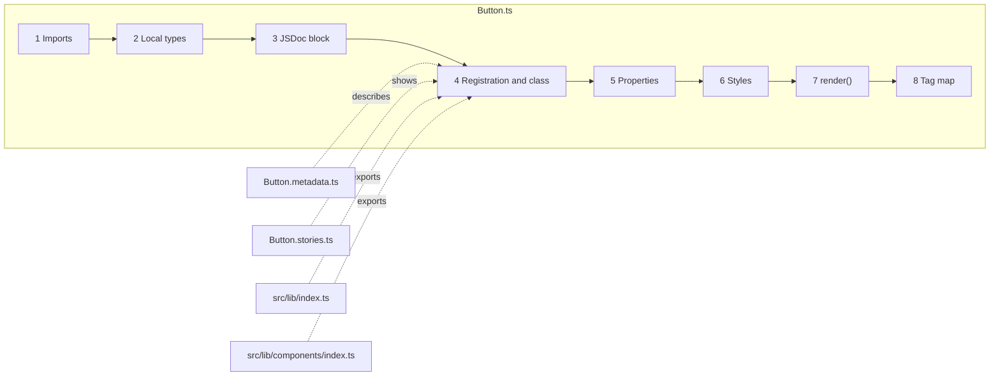

# 04 · Anatomy of a component

> **What you learn here**
>
> - How to read `src/lib/components/Button/Button.ts` from the top to the bottom, in eight stops.
> - Why each part has its form, so that you can use the same pattern in a different component.
> - How the metadata file, the stories file and the two export lists connect to the component.
>
> **Read first:** [02 · Web components](02-web-components.md) and
> [03 · Lit essentials](03-lit-essentials.md). **Time:** 40 minutes.
>
> Open work as of main @ e251d45, 2026-10-27.

Each code block in this chapter is a copy from `src/lib/components/Button/Button.ts` on `main`.
Open the file next to this chapter.

## Whiteboard

The diagram shows the eight stops of `Button.ts`, in the order of the file, and the files that
connect to it.



Every component in `src/lib/components/` has the same order. When you know one file, you can find
each part in all of them.

## Stop 1 Imports

`Button.ts`, imports:

```ts
import { LitElement, html, css, nothing } from 'lit';
import { customElement, property } from 'lit/decorators.js';
import { classMap } from 'lit/directives/class-map.js';
import { ifDefined } from 'lit/directives/if-defined.js';
import '../Icon/Icon.js';
import { componentReset } from '../../styles/component-reset.js';
import { focusRing } from '../../styles/focus-ring.js';
import { SlotContent } from '../../utils/slot-content.js';
```

- **The line `import '../Icon/Icon.js';` imports no names.** It is a side-effect import. When the
  module loads, `@customElement('gv-icon')` runs and registers the tag. Button renders `<gv-icon>`,
  so Button must make sure that the tag exists. Each component that renders a different Grove tag
  imports it in this way.
  [05 · Component catalogue](05-component-catalogue.md#how-a-composite-registers-its-children)
  shows all of these imports.
- **The import paths end in `.js`, but the files end in `.ts`.** TypeScript resolves `Icon.js` to
  `Icon.ts` when it compiles. Then the paths in the built output are correct. The Lit guide
  "Publishing" recommends file extensions on imports.
  [Source: Lit, Publishing](https://lit.dev/docs/v3/tools/publishing/)
- `componentReset` and `focusRing` are style fragments that all components use.
  [06 · Styles inside a component](06-styles-inside-a-component.md#static-styles) explains them.
  `SlotContent` is a shared controller. [07 · Slots](07-slots.md#the-slotcontent-controller)
  explains it.

## Stop 2 Local types

`Button.ts`, local types:

```ts
type ButtonVariant = 'filled' | 'tonal' | 'outlined' | 'ghost';
type ButtonColor = 'accent' | 'gray';
type ButtonSize = 'lg' | 'md' | 'sm';
type ButtonType = 'button' | 'submit' | 'reset';
```

Each type alias lists the permitted values of one property. The manifest analyzer writes the name
of an alias, for example `ButtonSize`, and that name tells a consumer nothing. Thus a build step
changes each alias into its union of values.
[15 · Metadata and the manifest](15-metadata-and-the-manifest.md#how-the-manifest-is-built) tells
how.

## Stop 3 The JSDoc block

`Button.ts`, the JSDoc block above the class:

```ts
/**
 * @slot - The button text. Falls back to `text` when empty.
 */
```

Tools read this comment, and people read it too. The tag `@slot -` declares the default slot. A
component that dispatches events also has `@fires {CustomEvent<T>} gv-*` lines. A component with
public custom properties has `@cssprop` lines. The build fails when these tags and the code do not
agree. [15 · Metadata and the manifest](15-metadata-and-the-manifest.md#when-check-manifest-fails)
lists the failures.

## Stop 4 Registration and the class

`Button.ts`, the class declaration:

```ts
@customElement('gv-button')
export class Button extends LitElement {
	private readonly _slots = new SlotContent(this, ['']);
```

- `@customElement` registers the tag when the module loads. The Lit guide "Publishing" tells
  component authors to make each element define itself and to export its class. Then a consumer can
  import the class or make a subclass of it.
  [Source: Lit, Publishing](https://lit.dev/docs/v3/tools/publishing/)
- `_slots` is a reactive controller. It records whether the default slot (`''`) has content. The
  underscore and the `private` keyword show that it is internal.

> [!NOTE]
> **Lit box: the decorator registers the tag**
>
> `@customElement('gv-button')` calls `customElements.define('gv-button', Button)` for you. The
> browser then upgrades each `<gv-button>` in the page to an instance of `Button`. Grove example,
> `Button.ts`: `@customElement('gv-button')`.
>
> Lit docs: [Defining a component](https://lit.dev/docs/v3/components/defining/)

## Stop 5 Properties

`Button.ts`, the properties:

```ts
	@property({ type: String }) text = '';
	@property({ type: String }) variant: ButtonVariant = 'filled';
	@property({ type: String }) color: ButtonColor = 'accent';
	@property({ type: String }) size: ButtonSize = 'md';
	@property({ type: String }) icon?: string;
	@property({ type: String }) type: ButtonType = 'button';
	@property({ type: Boolean, reflect: true }) disabled = false;
	@property({ type: String, attribute: 'aria-label' }) ariaLabel: string | null = null;
```

Each line is one public input. Look for these patterns:

| Property    | Pattern                                                                                              |
| ----------- | ---------------------------------------------------------------------------------------------------- |
| `text`      | The fallback prop for the slot. The button shows it only when the slot is empty.                     |
| `icon?`     | An optional string: its type is `string \| undefined`, and the template writes it with `ifDefined()` |
| `type`      | The default is `'button'`, so a `gv-button` in a form cannot submit the form by accident             |
| `disabled`  | `reflect: true`, so CSS in the page can select `gv-button[disabled]`                                 |
| `ariaLabel` | An ARIA property: `string \| null = null`, with its attribute name set by hand, and `?? nothing`     |

The properties come before `static styles`. The styles come before the methods. All components use
this order.

Grove never gives a property the name `title`. `title` is a global HTML attribute, so a `title`
property also shows a native tooltip on the host. A component with a heading and a body uses the
names `heading` and `message`.

> [!NOTE]
> **Lit box: reactive properties and attributes**
>
> `@property` makes a reactive property. When its value changes, Lit renders the component again.
> Lit also makes an attribute for the property. By default, the attribute name is the property name
> in lowercase. Grove example, `Button.ts`:
> `@property({ type: Boolean, reflect: true }) disabled = false;`
>
> Lit docs: [Reactive properties](https://lit.dev/docs/v3/components/properties/)

> [!IMPORTANT]
> **Open work: #68 — gv-button link mode and form association** (open PR, no conflict with main on
> 2026-10-27)
>
> The PR adds six properties: `name` and `value` (both reflect), `href`, `target`, `rel` and
> `hreflang`. `value` uses the Lit option `useDefault: true`, so the attribute shows only after you
> set the value. `disabled` moves into the `FormControl` mixin, which owns it through an accessor.
> When the PR lands, change this stop to list the thirteen `@property` fields of `Button.ts` at
> ccba0a3, and add the `useDefault` pattern to the table. The old guide text in the PR says
> "Twelve", but the file has thirteen. [10 · Forms](10-forms.md#the-formcontrol-mixin) explains the
> mixin. <https://github.com/edgarjaymez/grove-lit/pull/68>

## Stop 6 Styles

`Button.ts`, the start of `static styles`:

```ts
	static styles = [
		componentReset,
		focusRing,
		css`
			.btn {
				box-shadow: var(--_drop, 0 0 #0000);
				display: inline-flex;
```

- `static styles` is an array, and the order is important. `componentReset` comes first. It resets
  the browser defaults in the shadow root. `focusRing` comes second. It adds the shared focus
  indicator. The own `css` of the component comes last.
- Each value is a token, for example `var(--soft-grid-8)` or
  `var(--semantic-color-surface-accent-summit)`. The styles contain no raw pixel values. The only
  raw colour is `0 0 #0000`, an empty shadow.
- The control sets its shadow through a private custom property, `--_drop`. It never sets
  `box-shadow` directly:

  `Button.ts`, the filled accent variant:

  ```css
  .btn--filled.btn--accent {
  	background: var(--semantic-color-surface-accent-summit);
  	color: var(--semantic-color-text-on-accent-summit-base);
  	--_drop: var(--drop-shadow-under-accent-summit);
  }
  ```

  The focus ring reads `--_drop` and puts the ring on top of it.
  [14 · The focus ring](14-the-focus-ring.md#the-mechanism) tells why.

- When the pointer is on the button, the icon changes to its filled weight. The button sets two
  custom properties that `gv-icon` reads. Custom properties go into the shadow root of the child,
  so the parent controls the child from outside:

  `Button.ts`, the icon rule:

  ```css
  .btn:not(:disabled):hover gv-icon {
  	--gv-icon-regular-display: none;
  	--gv-icon-fill-display: inline-flex;
  }
  ```

- The selectors are flat, for example `.btn--outlined.btn--lg`. The styles never use CSS nesting.
  Nesting works in current browsers. Flat selectors are a house rule, because you can search for
  them and you can see their specificity.

> [!NOTE]
> **Lit box: static styles**
>
> Lit adopts `static styles` into the shadow root of each instance. The browser parses the styles
> one time for all instances. Styles in the page do not go into the shadow root, so each component
> brings its own styles. Grove example, `Button.ts`:
> ``static styles = [componentReset, focusRing, css`…`]``.
>
> Lit docs: [Styles](https://lit.dev/docs/v3/components/styles/)

> [!IMPORTANT]
> **Open work: #44 — outlined and ghost buttons on any surface** (issue, blocked: Needs Figma Spec)
>
> On a summit or an aurora surface, the label of an outlined or ghost button has too little
> contrast. The spec adds a `btn--on-<surface>` class through `classMap`, with the full `var()`
> names written out. It does not use `unsafeCSS`. The contrast test makes the colour pairs from the
> type, so a new surface value without its pairs fails the test. The issue also waits for #49,
> because #68 changes `Button.ts` too.
> [12 · Surfaces and elevation](12-surfaces-and-elevation.md#contrast-on-summit-and-aurora) explains
> the problem. <https://github.com/edgarjaymez/grove-lit/issues/44>

## Stop 7 The render method

`Button.ts`, `render()`:

```ts
	render() {
		const hasIcon = Boolean(this.icon);
		return html`
			<button
				class=${classMap({
					btn: true,
					'gv-focusable': true,
					[`btn--${this.variant}`]: true,
					[`btn--${this.color}`]: true,
					[`btn--${this.size}`]: true,
					'btn--has-icon': hasIcon
				})}
				type=${this.type}
				?disabled=${this.disabled}
				aria-label=${this.ariaLabel ?? nothing}
			>
				${hasIcon ? html`<gv-icon name=${ifDefined(this.icon)} fill-in-hover></gv-icon>` : nothing}
				<slot></slot>${this._slots.has() ? nothing : this.text}
			</button>
		`;
	}
```

- The host (`<gv-button>`) is not the button. A real `<button>` in the shadow root is the button.
  Thus the browser gives the keyboard support and the accessibility role.
- `classMap` makes the class list from the properties. The focus ring selects the `gv-focusable`
  class.
- `?disabled` adds or removes the native `disabled` attribute.
- The icon renders only when `icon` has a value. In the other case, `nothing` renders nothing.
- `<slot></slot>${this._slots.has() ? nothing : this.text}` shows the slotted content when there is
  some. When the slot is empty, it shows the `text` property. Thus both
  `<gv-button>Save</gv-button>` and `<gv-button text="Save"></gv-button>` work.

> [!NOTE]
> **Lit box: bindings and directives**
>
> In a Lit template, `?name=${value}` adds or removes a boolean attribute. `name=${value}` sets an
> attribute, and the `nothing` value removes it. In Lit 3, `ifDefined(value)` removes the attribute
> when the value is `undefined` or `null`, so it does the same work as `?? nothing`. Grove uses
> `?? nothing` for ARIA properties as a house rule. Grove example, `Button.ts`:
> `aria-label=${this.ariaLabel ?? nothing}`.
>
> Lit docs: [Expressions](https://lit.dev/docs/v3/templates/expressions/)

> [!CAUTION]
> Do not think that `type="submit"` submits a form on `main`. The real `<button>` is in the shadow
> root, so it has no form owner. A `gv-button` with `type="submit"` does nothing to the form around
> it. [10 · Forms](10-forms.md#forms-on-main-today) explains why.

> [!IMPORTANT]
> **Open work: #68 — gv-button link mode and form association** (open PR, no conflict with main on
> 2026-10-27)
>
> The PR makes the class `Button extends FormControl(LitElement)` and adds a new stop, "The form
> hooks", before `render()`. Thus the walk has nine stops. In `render()`:
>
> - The inner `<button>` always has `type="button"`. The host does the form work.
> - With `href`, the component renders a real `<a>` with the same `classMap`. A disabled link has no
>   `href`, and it has `role="link"` and `aria-disabled="true"`.
> - The class `btn--disabled` replaces the `:disabled` selector in the CSS, because an `<a>` cannot
>   match `:disabled`.
> - The `SlotContent` call becomes `new SlotContent(this, [''], { phrasingOnly: true })`.
>
> When the PR lands, add the stop "The form hooks", update this stop, and remove the caution above.
> <https://github.com/edgarjaymez/grove-lit/pull/68>

## Stop 8 The tag map

`Button.ts`, the end of the file:

```ts
declare global {
	interface HTMLElementTagNameMap {
		'gv-button': Button;
	}
}
```

This block tells TypeScript that `<gv-button>` is a `Button`. Then
`document.querySelector('gv-button')` has the type `Button | null`. Each component file ends with
this block. [Source: Lit, Defining a component](https://lit.dev/docs/v3/components/defining/)

## The files around it

| File                          | What it adds                                                                               |
| ----------------------------- | ------------------------------------------------------------------------------------------ |
| `Button.metadata.ts`          | `ButtonMetadata`: use cases, anti-patterns, the slot list, states and accessibility notes  |
| `Button.stories.ts`           | Ten stories: the variants, the colours, the sizes, the icon, the disabled state and a slot |
| `src/lib/index.ts`            | Exports `Button` and `ButtonMetadata` from the package                                     |
| `src/lib/components/index.ts` | `export * from './Button/Button.js';`                                                      |

[15 · Metadata and the manifest](15-metadata-and-the-manifest.md#component-metadata) explains the
metadata file. [16 · Storybook](16-storybook.md#a-story-file) explains the stories file.
[01 · Repo map](01-repo-map.md#the-two-export-lists) explains the two export lists.

Button has no browser test file on `main`. Shared tests examine it: `slots.browser.test.ts`,
`host-hidden.browser.test.ts` and `reduced-motion.browser.test.ts` examine each tag in `groveTags`,
and `focus-ring.browser.test.ts` renders `gv-button` directly.
[17 · Tests](17-tests.md#the-test-inventory) lists all tests.

### Button across the guide

Each chapter of this guide uses `Button.ts` as its example. This list shows where to look:

- **Repo map.** `src/lib/components/Button/` holds `Button.ts`, `Button.metadata.ts` and
  `Button.stories.ts`. The ledger records that `Button` first shipped in `0.28.0`.
  [01 · Repo map](01-repo-map.md#one-directory-per-component)
- **Lit.** Eight `@property` fields. `disabled` reflects, and `ariaLabel` sets its attribute name to
  `aria-label`. `render()` uses a child binding, attribute bindings, `?disabled`, `classMap`,
  `ifDefined` and `nothing`. Button overrides no lifecycle hooks.
  [03 · Lit essentials](03-lit-essentials.md#templates-and-bindings)
- **Styles.** The order is `[componentReset, focusRing, css…]`. The `classMap` sets
  `'gv-focusable': true`. Each variant sets `--_drop`, and the `:active` rules set
  `--_drop: 0 0 #0000` to remove the shadow when you push the button. Each size pairs
  `font: var(--typography-…)` with its letter-spacing token.
  [06 · Styles inside a component](06-styles-inside-a-component.md#static-styles)
- **Focus ring.** Button sets no `--_ring-default`. Outside a surface class, it shows the Ground
  ring. [14 · The focus ring](14-the-focus-ring.md#the-resolution-order)
- **Slots.** `_slots` records the default slot. The JSDoc has one `@slot -` tag, and it agrees with
  `composition.slots` in `Button.metadata.ts`. [07 · Slots](07-slots.md#prop-or-slot)
- **Events.** Button dispatches no custom events. A click is the native `click` event of the inner
  `<button>`. The browser makes that event bubble and composed, so the page gets it on
  `gv-button`. Thus Button needs no `@fires` tag.
  [08 · Events](08-events.md#event-targets-across-shadow-roots)
- **Tokens.** Backgrounds and text use semantic tokens, for example
  `--semantic-color-surface-accent-summit`. The shadow `--drop-shadow-under-accent-summit` changes
  in the dark theme, and Button does not change. Spacing uses the soft grid, and the radius uses
  `--border-radius-8xl`. Button has no `[data-theme]` rule and no `prefers-color-scheme` rule.
  [11 · Design tokens](11-design-tokens.md#primitive-and-semantic-colours)
- **Metadata and manifest.** `ButtonMetadata.phosphor` has `prop: 'icon'`, no default glyph and no
  fixed glyphs. Thus Button shows a glyph only when the `icon` attribute names one, and the page
  must register that glyph. The manifest shows `variant` as
  `'filled' | 'tonal' | 'outlined' | 'ghost'`, because the plugin expands `ButtonVariant`.
  [15 · Metadata and the manifest](15-metadata-and-the-manifest.md#the-phosphor-field)
- **Storybook.** `Button.stories.ts` imports `./Button.js` and has ten stories. The `Slotted` story
  puts the label in the light DOM as text. The `storybook` test project runs each story three
  times, one time for each theme. The a11y addon reports the axe results, but on `main` a
  violation does not fail the test. [16 · Storybook](16-storybook.md#a-story-file)
- **Build.** The line `import { LitElement, html, css, nothing } from 'lit';` stays an import in
  `dist/index.js`, because Lit is external. `Button` and `ButtonMetadata` get to consumers only
  because `src/lib/index.ts` exports them.
  [18 · Build and package](18-build-and-package.md#the-vite-library-build)

`Button.ts` obeys every house rule. It is a good file to copy when you start a new component.
[21 · House rules](21-house-rules-and-how-work-moves.md#names)

> [!IMPORTANT]
> **Open work: #68 — gv-button link mode and form association** (open PR, no conflict with main on
> 2026-10-27)
>
> The PR adds `Button.browser.test.ts` and raises the number of stories from ten to eighteen. It
> also changes `ButtonMetadata`. `requiredProps` changes from `['text']` to `[]`, and the states
> get `submitting`. The anti-pattern "use an anchor for navigation" changes to the `href` link
> mode. When the PR lands, update this table and remove the sentence "Button has no browser test
> file". <https://github.com/edgarjaymez/grove-lit/pull/68>

## See it in the code

| File                                           | Look for                                                                     |
| ---------------------------------------------- | ---------------------------------------------------------------------------- |
| `src/lib/components/Button/Button.ts`          | The side-effect import, `disabled`, `ariaLabel`, `static styles`, `render()` |
| `src/lib/components/Button/Button.metadata.ts` | `requiredProps`, the anti-patterns                                           |
| `src/lib/components/Button/Button.stories.ts`  | The ten exported stories                                                     |
| `src/lib/index.ts`                             | `export { Button }` and `export { ButtonMetadata }`                          |

## Sources

**Tool docs**

- [Lit, Defining a component](https://lit.dev/docs/v3/components/defining/). Read 2026-10-27.
- [Lit, Reactive properties](https://lit.dev/docs/v3/components/properties/). Read 2026-10-27.
- [Lit, Styles](https://lit.dev/docs/v3/components/styles/). Read 2026-10-27.
- [Lit, Expressions](https://lit.dev/docs/v3/templates/expressions/). Read 2026-10-27.
- [Lit, Publishing](https://lit.dev/docs/v3/tools/publishing/). Read 2026-10-27.

## Check yourself

Do [Lesson 3 Read a component](syllabus.md#lesson-3-read-a-component) in the syllabus. Then find
these five items in `Button.ts`:

1. The side-effect import.
2. The one property that reflects.
3. The property that has a hand-written attribute name.
4. The three entries of `static styles`.
5. The class that the focus ring selects.

[← 03 · Lit essentials](03-lit-essentials.md) · [Index](README.md) ·
[05 · Component catalogue →](05-component-catalogue.md)
