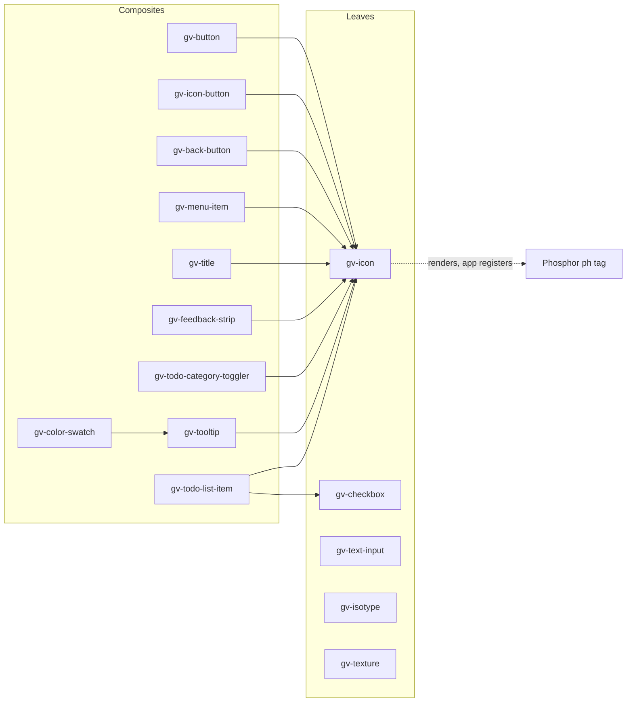

# 05 · Component catalogue

> **What you learn here**
>
> - Which 15 tags Grove registers, what each one is for, and which proposed tags wait in issues.
> - Which components render other Grove tags, and how a composite makes sure that its children
>   exist.
> - One short note for each component: the detail that you must know before you change it.
>
> **Read first:** [04 · Anatomy of a component](04-anatomy-of-a-component.md). **Time:** 35
> minutes.
>
> Open work as of main @ e251d45, 2026-10-27.

Each fact about a component in this chapter comes from its `.ts` file or its `.metadata.ts` file on
`main`. When a note and the code disagree, the code is correct.

## Whiteboard

The diagram shows which Grove tag renders which other tag. An arrow goes from the parent to the
child that it renders in its shadow root.



`gv-icon` is a leaf in Grove, but it renders a Phosphor tag that Grove does not register.
[Notes for gv-icon](#gv-icon) tells why.

## The catalogue table

The table lists the 15 tags on `main` and the four tags that open issues propose. The category comes
from the `category` field of each metadata file. The proposed tags have no directory and no
metadata yet.

| Tag                        | Directory             | Category  | Purpose                                                    | Children                    | Events                             | Slots                                               | Status                                                                                      |
| -------------------------- | --------------------- | --------- | ---------------------------------------------------------- | --------------------------- | ---------------------------------- | --------------------------------------------------- | ------------------------------------------------------------------------------------------- |
| `gv-back-button`           | `BackButton`          | atoms     | Square gray tile that goes back in the history             | `gv-icon`                   | `gv-back` (cancelable)             | none                                                | on `main`                                                                                   |
| `gv-button`                | `Button`              | atoms     | Text button: 4 variants, 2 colours, 3 sizes, optional icon | `gv-icon`                   | none (native `click`)              | default, fallback `text`                            | on `main`                                                                                   |
| `gv-checkbox`              | `Checkbox`            | atoms     | A `<button role="checkbox">` with an optional label        | none                        | `gv-change` (`boolean`)            | default (label), no fallback                        | on `main`                                                                                   |
| `gv-color-swatch`          | `ColorSwatch`         | molecules | Docs swatch: copies the OKLCH and hex values               | `gv-tooltip`                | `gv-copy`                          | none                                                | on `main`                                                                                   |
| `gv-feedback-strip`        | `FeedbackStrip`       | molecules | Success, danger or information band with a live region     | `gv-icon`                   | none                               | `heading`, `message`                                | on `main`                                                                                   |
| `gv-icon`                  | `Icon`                | atoms     | Shows one Phosphor glyph                                   | Phosphor `ph-*` tag         | none                               | none                                                | on `main`                                                                                   |
| `gv-icon-button`           | `IconButton`          | atoms     | Button with an icon and no visible text                    | `gv-icon`                   | none (native `click`)              | none                                                | on `main`                                                                                   |
| `gv-isotype`               | `Isotype`             | atoms     | The brand logo as an SVG                                   | none                        | none                               | none                                                | on `main`                                                                                   |
| `gv-menu-item`             | `MenuItem`            | molecules | Navigation link with an icon, for a sidebar                | `gv-icon`                   | none (native `click`)              | default, fallback `label`                           | on `main`                                                                                   |
| `gv-text-input`            | `TextInput`           | atoms     | Wraps a native `<input>`                                   | none                        | `gv-input`, `gv-change` (`string`) | none                                                | on `main`                                                                                   |
| `gv-texture`               | `Texture`             | atoms     | Decorative SVG grain over its parent                       | none                        | none                               | none                                                | on `main`                                                                                   |
| `gv-title`                 | `Title`               | atoms     | Icon and heading, painted on a named surface               | `gv-icon`                   | none                               | default, fallback `heading`                         | on `main`                                                                                   |
| `gv-todo-category-toggler` | `ToDoCategoryToggler` | atoms     | Colour-coded toggle with a count                           | `gv-icon`                   | `gv-toggle` (`boolean`)            | none                                                | on `main`                                                                                   |
| `gv-todo-list-item`        | `ToDoListItem`        | molecules | Checkbox, task text and category row                       | `gv-checkbox`, `gv-icon`    | `gv-change` (`boolean`)            | none                                                | on `main`                                                                                   |
| `gv-tooltip`               | `Tooltip`             | molecules | The bubble of a tooltip, without position logic            | `gv-icon`                   | none                               | `heading`, `message`                                | on `main`                                                                                   |
| `gv-card`                  | not created           | not set   | Entry card: icon, heading, status, body, meta              | `gv-icon`, `gv-status-chip` | not specified                      | `heading`, `body`, `meta`, `status`, default (plan) | [#15](https://github.com/edgarjaymez/grove-lit/issues/15): issue, blocked: Needs Figma Spec |
| `gv-status-chip`           | not created           | not set   | Inline status: a decorative dot and a label                | none                        | none                               | default (label), fallback `label` (plan)            | [#16](https://github.com/edgarjaymez/grove-lit/issues/16): issue, blocked: Needs Figma Spec |
| `gv-textarea`              | not created           | not set   | Multiline text input, like `gv-text-input` plus `rows`     | none                        | `gv-input`, `gv-change`            | none                                                | [#17](https://github.com/edgarjaymez/grove-lit/issues/17): issue, blocked: Needs Figma Spec |
| `gv-journey-rail`          | not created           | not set   | Fixed navigation rail: one link for each stop of a page    | none                        | none                               | stops as slotted links (plan)                       | [#19](https://github.com/edgarjaymez/grove-lit/issues/19): issue, blocked: Needs Figma Spec |

The category and the composite or leaf role are two different things. For example, `gv-title` is
an atom in its metadata, but it renders `gv-icon`. The category comes from the design. The role
comes from the code.

The "Events" column lists only the `gv-*` events that the component dispatches. Three components
dispatch no own event, but the page still gets the native `click` from their inner `<button>` or
`<a>`. [08 · Events](08-events.md#listeners) explains why.

## Leaves and composites

A **leaf** renders no other Grove tag. A **composite** renders one or more Grove tags in its shadow
root. On `main`, Grove has five leaves and ten composites:

- Leaves: `gv-checkbox`, `gv-icon`, `gv-isotype`, `gv-text-input` and `gv-texture`.
- Composites with one level: eight composites render only `gv-icon`. `gv-todo-list-item` renders
  `gv-checkbox` and `gv-icon`, which are both leaves.
- The composite with two levels: `gv-color-swatch` renders `gv-tooltip`, which renders `gv-icon`.

The levels are important for three reasons:

1. Each level is a new shadow root. A slot, an ID reference or a form does not cross from one level
   to the next. [07 · Slots](07-slots.md#slots-and-nested-shadow-roots) gives an example.
2. A composed event from a child leaves the child and then the parent too. The parent must stop the
   event when it sends its own. [08 · Events](08-events.md#pattern-2-forward-a-child-event) shows
   this.
3. A test that looks for a control must walk through each nested shadow root.
   [17 · Tests](17-tests.md#nested-shadow-roots-in-tests) shows how.

## How a composite registers its children

A composite renders a child tag by its name, for example `<gv-icon>`. The browser shows a real
`Icon` only when the tag is registered. Thus the composite imports the child module for its side
effect: the import runs `@customElement('gv-icon')`, and that registers the tag.
[Source: MDN, Using custom elements](https://developer.mozilla.org/en-US/docs/Web/API/Web_components/Using_custom_elements)

`ToDoListItem.ts`, the side-effect imports:

```ts
import '../Checkbox/Checkbox.js';
import '../Icon/Icon.js';
```

Obey these rules:

- Import the child module, not the class. A composite never uses the child class by name.
- Use a relative path that ends in `.js`, as every import in `src/lib` does.
- Import each child that the template renders, even when a different import also loads it. For
  example, `gv-color-swatch` imports only `../Tooltip/Tooltip.js`, because it renders no
  `gv-icon` itself. `Tooltip.ts` imports `../Icon/Icon.js`.

These are the side-effect imports on `main`:

| Composite                                                                                                                            | Imports                                          |
| ------------------------------------------------------------------------------------------------------------------------------------ | ------------------------------------------------ |
| `BackButton.ts`, `Button.ts`, `FeedbackStrip.ts`, `IconButton.ts`, `MenuItem.ts`, `Title.ts`, `ToDoCategoryToggler.ts`, `Tooltip.ts` | `'../Icon/Icon.js'`                              |
| `ToDoListItem.ts`                                                                                                                    | `'../Checkbox/Checkbox.js'`, `'../Icon/Icon.js'` |
| `ColorSwatch.ts`                                                                                                                     | `'../Tooltip/Tooltip.js'`                        |

Grove does not register the Phosphor glyphs. `gv-icon` renders a tag such as `<ph-tree>`, and the
app must import that glyph.
[20 · Grove in an app](20-grove-in-an-app.md#phosphor-glyphs) tells how.
[15 · Metadata and the manifest](15-metadata-and-the-manifest.md#the-phosphor-field) tells how the
metadata lists the glyphs that each component draws.

> [!NOTE]
> **Lit box: the decorator runs when the module loads**
>
> `@customElement` calls `customElements.define()` at the time that the module is evaluated. Thus
> an import with no names is enough to register the tag. Grove example, `Button.ts`:
> `import '../Icon/Icon.js';`
>
> Lit docs: [Defining a component](https://lit.dev/docs/v3/components/defining/)

## Notes for each component

Each note gives the facts that you must know before you change the component. The notes are in
alphabetical order of the tag.

### gv-back-button

- The inner `<button>` gets its accessible name from the `label` property. The default is
  `'Go back'`. The icon has `aria-hidden="true"`.
- A click dispatches the cancelable `gv-back` event. When no listener calls `preventDefault()`, the
  component calls `window.history.back()`.
  [08 · Events](08-events.md#pattern-3-a-cancelable-event) shows the code.
- The tile padding grows at 1280 px. The media query writes the number, because a custom property
  cannot go in a media condition.
  [06 · Styles inside a component](06-styles-inside-a-component.md#rules-for-css-inside-a-component)
  tells why.

### gv-button

[04 · Anatomy of a component](04-anatomy-of-a-component.md) explains this file stop by stop. On
`main`, `gv-button` is not form-associated. A `type="submit"` does not submit the form around it.
[10 · Forms](10-forms.md#forms-on-main-today) tells why.

### gv-checkbox

- The control is a `<button type="button" role="checkbox">` with `aria-checked`. It is not an
  `<input type="checkbox">`.
- The default slot is the label. It is inside the focusable control, so it names the checkbox, and
  a click on the label toggles the box. The label `<span>` renders only when the slot has content.
  The checkbox has no fallback prop.
- `checked` and `disabled` reflect. The `responsive` property with the value `'xl'` makes the box 28
  px. The default box is 24 px.
- `_toggle()` changes `checked` and then dispatches `gv-change` in the same call. A listener sees
  the new `checked`, but the shadow root does not show it yet.
  [08 · Events](08-events.md#the-event-rules) tells what to do in a test.

> [!IMPORTANT]
> **Open work: #25 — gv-checkbox accessible name** (branch, no PR)
>
> On `main`, only slotted text names the checkbox. The #50 work branch, linked from epic #50, adds
> the order of #54 D1: slotted text, then a page `<label>`, then a `label` property. It also adds
> reflected `name` and `value` (default `'on'`), form association through the `FormControl` mixin,
> and a reset to the `checked` state at first connection. The branch starts from an older head of
> #68, so treat its details as provisional.
>
> When it lands, add `label`, `name` and `value` to this note.
> [09 · Accessibility](09-accessibility.md#accessible-names-across-the-shadow-boundary) explains the
> mechanism. <https://github.com/edgarjaymez/grove-lit/issues/25>

### gv-color-swatch

- The swatch paints a palette primitive on purpose:
  ``styleMap({ 'background-color': `var(--color-${this.color}-${this.shade})` })``. It is a sample
  of the palette, not a surface.
- Each value is a `<button>`. A click writes the value to the clipboard. The OKLCH button copies a
  DTCG colour object, and the hex button copies the hex string. `gv-copy` fires only after the write
  succeeds.
- Each button points at its bubble with `aria-describedby="oklch-tip"` or `"hex-tip"`, so the
  bubble describes the button. This works, because the button and the bubble are in the same
  shadow root.
- Two internal states, `copied` and `dismissed`, control the "Copied!" text. The text stays for 3
  seconds (`COPIED_HOLD_MS`). A visually hidden `role="status"` region announces the copy.
- `disconnectedCallback()` clears the timer and then calls `super.disconnectedCallback()`.

> [!IMPORTANT]
> **Open work: #30 — gv-color-swatch hoverable, dismissible bubbles** (issue, blocked: #30 open
> decision 1, the name typography)
>
> An audit found that the bubbles fail
> [1.4.13 Content on Hover or Focus (AA)](https://www.w3.org/WAI/WCAG22/Understanding/content-on-hover-or-focus):
> the pointer cannot move onto a bubble, and Escape does nothing. The names "Copy hex value" leave
> out the value, so
> [2.5.3 Label in Name (A)](https://www.w3.org/WAI/WCAG22/Understanding/label-in-name) likely
> fails. The colour name fails
> [1.4.3 Contrast (Minimum) (AA)](https://www.w3.org/WAI/WCAG22/Understanding/contrast-minimum) on
> `accent` and `danger` at shade `400`. The fix stays in `gv-color-swatch`, and `gv-tooltip` does
> not change.
>
> When it lands, update this note with the new names, the Escape key and the 24 px hex button.
> [06](06-styles-inside-a-component.md#rules-for-css-inside-a-component) and
> [08](08-events.md#document-level-keys) explain the bridge and the Escape listener.
> <https://github.com/edgarjaymez/grove-lit/issues/30>

### gv-feedback-strip

- The `type` property chooses the colours and the icon: `success`, `danger` or `information`. An
  unknown type gives `success`.
- The `live` property chooses how a screen reader announces the strip, separately from `type`.
  `polite` gives `role="status"`, `assertive` gives `role="alert"`, and `off` gives no live region.
  When `live` is not set, it follows the type: `danger` is assertive, the other two are polite.
- The component changes the attributes of the same region element. It never makes a new one. A
  live region must exist before its content changes.
  [Source: W3C, ARIA22](https://www.w3.org/WAI/WCAG22/Techniques/aria/ARIA22)
- The message row renders only when `message` has a value or the `message` slot has content.

> [!IMPORTANT]
> **Open work: #37 — gv-feedback-strip live** (issue, open: behaviour on main, checks remain)
>
> The `live` property is on `main`, with `FeedbackStrip.browser.test.ts`. The manual checks with
> NVDA and VoiceOver remain. `live="off"` on a status message that shows without a focus change
> fails [4.1.3 Status Messages (AA)](https://www.w3.org/WAI/WCAG22/Understanding/status-messages).
> Thus the docs must say when `off` is correct. When the checks are done, the issue closes and this
> box goes away.
> [09 · Accessibility](09-accessibility.md#live-regions) explains live regions.
> <https://github.com/edgarjaymez/grove-lit/issues/37>

### gv-icon

- The tag of the glyph comes from the `name` property at runtime. `phosphorTag()` in `phosphor.ts`
  changes `name` to lowercase, removes each character that is not `a-z`, `0-9` or `-`, and adds
  `ph-`. An empty result renders `nothing`.
- Because the tag is not known when the code is written, `render()` uses `lit/static-html.js`. The
  Lit box below explains it.
- The icon is decorative unless `label` has text. The `ph-*` element always has
  `aria-hidden="true"`. With a label, the wrapper `<span class="glyph">` gets `role="img"` and
  `aria-label`. The host itself does not change.
  [09 · Accessibility](09-accessibility.md#decorative-and-meaningful-images) tells why.
- `fill-in-hover` renders two glyphs, a regular one and a fill one. Two public custom properties
  choose which one shows. An ancestor such as `gv-button` sets them on hover. With `fill-in-hover`,
  the component ignores `is-filled`.
- `updated()` checks the glyph each time `name` changes. When the glyph tag is not registered 2
  seconds (`GRACE_MS`) after the page load, the component logs one console warning for each tag.
  The warning has the `[grove]` prefix and the import to add. It logs unless the build of the app
  replaces `process.env.NODE_ENV` with `"production"`.
  [18 · Build and package](18-build-and-package.md#the-node_env-rule) tells how a build turns it
  off.

`Icon.ts`, the start of `render()`:

```ts
	render() {
		const tagName = phosphorTag(this.name);
		if (!tagName) return nothing;

		const tag = unsafeStatic(tagName);
```

> [!NOTE]
> **Lit box: static expressions**
>
> A normal Lit binding cannot change the name of a tag. `lit/static-html.js` gives an `html` tag
> that accepts `unsafeStatic()` values, and Lit puts them into the template text itself. Use it only
> with a value that the code controls, because Lit does not escape it. Grove example, `Icon.ts`:
> `const tag = unsafeStatic(tagName);`
>
> Lit docs: [Expressions](https://lit.dev/docs/v3/templates/expressions/)

> [!IMPORTANT]
> **Open work: #64 — gv-icon glyph tests and the dist gate** (open PR, no conflict with main on
> 2026-10-27)
>
> The PR is part of epic #47. It adds `glyphs.browser.test.ts`, which renders every tag and checks
> that the drawn `ph-*` tags equal the `default` and `fixed` glyphs in the metadata. It adds parity
> tests and the `scripts/check-dist.mjs` gate.
>
> The warning now names every shadow host, from the outermost in: "inside <gv-color-swatch>, in its
> <gv-tooltip>". A new `wasReported()` helper stops the check before it starts for a tag that was
> already reported. When it lands, change the warning text in this note. Epic #47 closes only after
> manual checks in Firefox, Safari, VoiceOver and NVDA.
> <https://github.com/edgarjaymez/grove-lit/pull/64>

### gv-icon-button

- The button shows only an icon, so it has no visible name. Always give it `aria-label`. The
  `ariaLabel` property is `string | null = null`, as in `gv-button`.
- The icon renders with `fill-in-hover`. The button sets the two icon custom properties on hover.
- The outlined variant subtracts the border width from the padding, so all variants have the same
  size: `padding: calc(var(--soft-grid-12) - var(--border-width-base));`.

### gv-isotype

- The fill follows the theme through `light-dark()`, behind an `@supports` test. A browser without
  `light-dark()` keeps the light fill.
  [13 · Themes and page CSS](13-themes-and-page-css.md#the-light-dark-function) explains the
  function.
- `render()` writes the two fills into private custom properties with `styleMap`. The `tone`
  property pins one fill: then both ends of `light-dark()` get the same value.
- With `label`, the SVG gets `role="img"` and `aria-label`. Without it, the SVG gets
  `aria-hidden="true"`.
- `updated()` writes `--gv-isotype-size` on the inline style of the host when `size` changes. An
  inline style wins over a page rule, so set the `size` property, not the custom property.

### gv-menu-item

- The host is `display: block`, and the inner element is a native `<a>`. `is-active` reflects and
  gives `aria-current="page"`.
- The row is at least 24 px tall: `min-block-size: var(--soft-grid-24)`. This meets
  [2.5.8 Target Size (Minimum) (AA)](https://www.w3.org/WAI/WCAG22/Understanding/target-size-minimum).
  [09 · Accessibility](09-accessibility.md#target-size) tells more.
- `hreflang` goes to the link only when `href` is set. `linkAttribute()` in
  `utils/link-attributes.ts` returns `undefined` in the other case, and `ifDefined()` then removes
  the attribute.
- `lang` is not a property on purpose. Put `lang` on the host. The shadow link inherits the
  language of the host. [09 · Accessibility](09-accessibility.md#language-of-parts) tells why.
- The item is transparent, and its parent paints the brand terrace. Thus the item sets its own
  default ring, `--_ring-default: var(--ring-on-brand-terrace)`.
  [14 · The focus ring](14-the-focus-ring.md#the-private-default-ring) explains it.

> [!IMPORTANT]
> **Open work: #63 — gv-menu-item a11y check and metadata** (open PR, no conflict with main on
> 2026-10-27)
>
> The PR is part of epic #46. It sets `parameters: { a11y: { test: 'error' } }` in
> `MenuItem.stories.ts`, so an axe violation in this file fails the test. It changes
> `requiredProps` from `['label', 'href']` to `['href']`, because slotted text can name the link. It
> adds `link-attributes.test.ts`. #68 contains #63 and also adds `target` and `rel`. When it
> lands, add the stricter a11y test to this note. Epic #46 stays open for the manual checks of
> `:lang(es)` in Firefox and Safari, and for VoiceOver and NVDA.
> <https://github.com/edgarjaymez/grove-lit/pull/63>

### gv-text-input

- The component wraps a native `<input>` and binds the value as a property: `.value=${this.value}`.
  An attribute binding sets only the default value.
- `disabled` renders `readonly` and `aria-disabled="true"`, not the native `disabled`. The field
  stays focusable, and a screen reader can read it.
- The component stops the native `input` and `change` events and dispatches `gv-input` and
  `gv-change`. [08 · Events](08-events.md#pattern-1-wrap-a-native-input) shows the code.
- The inner `<input name>` is in the shadow root, so it does not join a form around the host.
  [10 · Forms](10-forms.md#forms-on-main-today) tells more.

### gv-texture

- The host is `position: absolute; inset: 0`, with `pointer-events: none`. The parent must be
  `position: relative` with `overflow: hidden`. Content above the grain must be positioned and come
  after `gv-texture` in the DOM.
- The SVG has `aria-hidden="true"`, and the host does not change. The texture is decorative.
- `tint` takes any CSS colour, `var()` and `light-dark()` included. A getter, `_validTint`, tests
  the value with `CSS.supports('color', tint)` and drops it when the test fails.
- `frequency` sets the noise `baseFrequency`. A value that is not a positive number gives `0.25`.
- [06 · Styles inside a component](06-styles-inside-a-component.md#the-currentcolor-fallback)
  explains why the component paints the grain with `currentColor`.

> [!IMPORTANT]
> **Open work: #65 — gv-texture colour variants and the night grain** (open PR, no conflict with
> main on 2026-10-27)
>
> The PR closes #20 and epic #48. It adds a `color` property with the six tracks (default `brand`;
> other values give `brand`), from the Figma Texture variants. `tint` still overrides `color`. The
> night grain becomes final, but Figma has no night grain.
>
> The PR has the "Needs Figma Spec" label and two open review threads: `color` duplicates `tint`,
> and the Figma literals duplicate tokens. When it lands, add `color` to this note and to the table.
> [21 · House rules](21-house-rules-and-how-work-moves.md#needs-figma-spec) tells what the label
> means. <https://github.com/edgarjaymez/grove-lit/pull/65>

### gv-title

- The heading level comes from `level`. `render()` accepts an integer from 1 to 6 and uses `2` for
  every other value. Then it builds the tag with ``unsafeStatic(`h${level}`)``. The value is safe,
  because the code makes it from a checked number.
- The `surface` property has the type `GroveSurface`. An unknown value, a value with the wrong case
  included, gives `ground`. Each surface has one flat rule with its background and its text
  colour.
  [12 · Surfaces and elevation](12-surfaces-and-elevation.md#the-surface-types-in-typescript)
  explains the type.
- The default slot goes inside the heading element. The level always comes from `level`, also when
  the slot has content.

`Title.ts`, the checks in `render()`:

<!-- prettier-ignore -->
```ts
const level =
	Number.isInteger(this.level) && this.level >= 1 && this.level <= 6 ? this.level : 2;
const tag = unsafeStatic(`h${level}`);
const surface = GROVE_SURFACES.includes(this.surface) ? this.surface : 'ground';
```

### gv-todo-category-toggler

- The control is a `<button>` with `aria-pressed`. `is-selected` and `disabled` reflect.
- A click changes `isSelected` and dispatches `gv-toggle` with the new value.
- The selected state changes the depth from terrace to summit, the colours and the drop shadow.
  The selected state has no cue other than colour and shadow.

> [!IMPORTANT]
> **Open work: #29 — gv-todo-category-toggler selected cue** (issue, blocked: Needs Figma Spec)
>
> At night, the rest and selected states differ by only 1.14:1 to 1.83:1. The spec adds a tick in
> an inline SVG with `currentColor` and `aria-hidden`, and keeps space for it in both states. The
> glyph becomes Regular at rest and Fill when selected.
>
> A new indicator must reach 3:1 under
> [1.4.11 Non-text Contrast (AA)](https://www.w3.org/WAI/WCAG22/Understanding/non-text-contrast).
> The state must not depend on colour alone under
> [1.4.1 Use of Color (A)](https://www.w3.org/WAI/WCAG22/Understanding/use-of-color). The issue
> body still uses the old event name `toggle`. When it lands, describe the tick in this note.
> [09 · Accessibility](09-accessibility.md#colour-is-never-the-only-cue) explains the rule.
> <https://github.com/edgarjaymez/grove-lit/issues/29>

### gv-todo-list-item

- The task text is the `heading` property. It is not `title`, because `title` is a global HTML
  attribute that shows a native tooltip on the host.
- The row adopts `componentReset` only, not `focusRing`. The row takes no focus. The inner
  `gv-checkbox` is the keyboard path.
- A click on the checkbox and a click on the row each give exactly one `gv-change`.
  [08 · Events](08-events.md#pattern-2-forward-a-child-event) shows how.
- The category icon is `is-filled` while the task is not done.

> [!IMPORTANT]
> **Open work: #26 — gv-todo-list-item names its checkbox** (branch, no PR)
>
> On `main`, the rename to `heading`, the single `gv-change` and the hidden glyph are done. The
> inner checkbox still has no accessible name. The heading is in the shadow root of the item, and
> the button is in the shadow root of the checkbox. The #50 work branch renders
> `<gv-checkbox label=${this.heading}>`. When it lands, add the name to this note.
> [07 · Slots](07-slots.md#slots-and-nested-shadow-roots) tells why the item does not put the text
> in the checkbox slot. <https://github.com/edgarjaymez/grove-lit/issues/26>

### gv-tooltip

- `gv-tooltip` is the bubble only. It does not anchor or position itself, and it has no open state
  and no timers. The page places it and shows it.
- `connectedCallback()` sets `role="tooltip"` on the host when the host has no `role`. It calls
  `super.connectedCallback()` first.
- The bubble is on a summit, accent or gray. This is the exception to the rule that an element
  that floats above the page resets to Ground.
  [12 · Surfaces and elevation](12-surfaces-and-elevation.md#the-nesting-rules) lists the rules.
- `is-pressed` reflects and removes the drop shadow. The `.tooltip--pressed` rule is last in the
  styles, because it has the same specificity as the colour rules.
- The host paints nothing. The background and the shadow are on the inner `.tooltip` element.

> [!NOTE]
> **Lit box: lifecycle methods call super**
>
> `LitElement` does its own work in `connectedCallback()` and `disconnectedCallback()`. An override
> must call `super`, or the component stops its update work and its controllers. Grove example,
> `Tooltip.ts`: `super.connectedCallback();`
>
> Lit docs: [Lifecycle](https://lit.dev/docs/v3/components/lifecycle/)

## Proposed components

Four tags exist only as spec issues. All four have the "Needs Figma Spec" label. Thus nobody
writes code for them until the Figma design answers their questions.
[21 · House rules](21-house-rules-and-how-work-moves.md#needs-figma-spec) explains the label.

When a proposed tag lands, it needs everything that a current tag has. That is a directory, the
class, the metadata, the stories, an entry in each export list and an entry in the ledger.
[22 · Cookbook](22-cookbook.md#recipe-2-add-a-component) gives the steps.

> [!IMPORTANT]
> **Open work: #53 — gv-status-chip and gv-card** (issue, blocked: Needs Figma Spec)
>
> The epic groups #16 and #15. Its two specs have the "Needs Figma Spec" label. The epic plans slots
> for the card: `heading`, `body`, `meta`, `status` and the default slot, with string props as
> fallbacks. A slotted `<hN>` brings its own level. Else a `level` prop sets it.
>
> The chip label is slotted text with `label` as the fallback. The chip colours must pass the
> contrast gate. When it lands, move both rows of the table to the list of tags on `main`.
> [07 · Slots](07-slots.md#phrasing-only-and-container-slots) sorts the card slots.
> <https://github.com/edgarjaymez/grove-lit/issues/53>

> [!IMPORTANT]
> **Open work: #15 — gv-card** (issue, blocked: Needs Figma Spec)
>
> An entry card with an optional icon, a required heading, a status through `gv-status-chip`, a
> body and a meta line. "Dark" in the spec means a dark surface on a light page, not the dark theme.
> The spec text says "slotless", but #53 replaced that plan with slots.
>
> Open questions: a card as
> a link, and a dashed variant for work that is not done. When it lands, add a note for it in this
> chapter.
> <https://github.com/edgarjaymez/grove-lit/issues/15>

> [!IMPORTANT]
> **Open work: #16 — gv-status-chip** (issue, blocked: Needs Figma Spec)
>
> A dot with `aria-hidden` and a label. `tone` picks the colour, and an unknown tone gives gray. An
> empty label renders nothing.
>
> Primitive colours do not change with the theme, and the 500 step fails contrast at night and on
> terraces by day. The spec recommends new semantic status tokens.
> When it lands, add a note for it in this chapter.
> [11 · Design tokens](11-design-tokens.md#token-gaps) lists the gap.
> <https://github.com/edgarjaymez/grove-lit/issues/16>

> [!IMPORTANT]
> **Open work: #17 — gv-textarea** (issue, blocked: Needs Figma Spec)
>
> A multiline twin of `gv-text-input`, plus `rows` (default 4) and a vertical resize. It never
> submits the form on Enter. It must not override `color-scheme`, or the resize grip stays light at
> night.
>
> The issue body is stale: it says `input` and `change`, but the events must be `gv-input` and
> `gv-change`. It waits for #51, which waits for #68 and #50. When it lands, add a note for it.
> [10 · Forms](10-forms.md#the-formcontrol-mixin) explains the base that it will use.
> <https://github.com/edgarjaymez/grove-lit/issues/17>

> [!IMPORTANT]
> **Open work: #19 — gv-journey-rail** (issue, blocked: Needs Figma Spec)
>
> A presentational `<nav aria-label>` with one `<a>` for each stop and `aria-current` on the active
> stop. `activeIndex` sets each stop to visited, active or not yet visited. `progress` (0 to 1)
> fills the trail. It has no timers and no scroll listeners.
>
> The stops become slotted `<a>` children, so the rail works before the upgrade. A JSON `stops`
> attribute is the fallback. When it lands, add a
> note for it. [07 · Slots](07-slots.md#prop-or-slot) explains the slot plan.
> <https://github.com/edgarjaymez/grove-lit/issues/19>

## See it in the code

| File                                                | Look for                                             |
| --------------------------------------------------- | ---------------------------------------------------- |
| `src/lib/components/*/*.metadata.ts`                | `category`, `composition.slots`, `nestedComponents`  |
| `src/lib/components/ToDoListItem/ToDoListItem.ts`   | The two side-effect imports                          |
| `src/lib/components/ColorSwatch/ColorSwatch.ts`     | `import '../Tooltip/Tooltip.js';`, `COPIED_HOLD_MS`  |
| `src/lib/components/Icon/Icon.ts`                   | `unsafeStatic`, `_checkRegistration()`               |
| `src/lib/components/Icon/phosphor.ts`               | `phosphorTag()`, `GRACE_MS`, `missingGlyphMessage()` |
| `src/lib/components/Title/Title.ts`                 | The level and surface checks in `render()`           |
| `src/lib/components/FeedbackStrip/FeedbackStrip.ts` | `TYPES`, `REGIONS`                                   |
| `src/lib/components/Texture/Texture.ts`             | `_validTint`, `DEFAULT_FREQUENCY`                    |
| `src/lib/utils/link-attributes.ts`                  | `linkAttribute()`                                    |

## Sources

**Standards**

- [Understanding WCAG 2.2, 1.4.1 Use of Color](https://www.w3.org/WAI/WCAG22/Understanding/use-of-color). Read 2026-10-27.
- [Understanding WCAG 2.2, 1.4.3 Contrast (Minimum)](https://www.w3.org/WAI/WCAG22/Understanding/contrast-minimum). Read 2026-10-27.
- [Understanding WCAG 2.2, 1.4.11 Non-text Contrast](https://www.w3.org/WAI/WCAG22/Understanding/non-text-contrast). Read 2026-10-27.
- [Understanding WCAG 2.2, 1.4.13 Content on Hover or Focus](https://www.w3.org/WAI/WCAG22/Understanding/content-on-hover-or-focus). Read
  2026-10-27.
- [Understanding WCAG 2.2, 2.5.3 Label in Name](https://www.w3.org/WAI/WCAG22/Understanding/label-in-name). Read 2026-10-27.
- [Understanding WCAG 2.2, 2.5.8 Target Size (Minimum)](https://www.w3.org/WAI/WCAG22/Understanding/target-size-minimum). Read 2026-10-27.
- [Understanding WCAG 2.2, 4.1.3 Status Messages](https://www.w3.org/WAI/WCAG22/Understanding/status-messages). Read 2026-10-27.
- [W3C, ARIA22: Using role=status to present status messages](https://www.w3.org/WAI/WCAG22/Techniques/aria/ARIA22).
  Read 2026-10-27.

**Platform reference**

- [MDN, Using custom elements](https://developer.mozilla.org/en-US/docs/Web/API/Web_components/Using_custom_elements).
  Read 2026-10-27.

**Tool docs**

- [Lit, Defining a component](https://lit.dev/docs/v3/components/defining/). Read 2026-10-27.
- [Lit, Expressions](https://lit.dev/docs/v3/templates/expressions/). Read 2026-10-27.
- [Lit, Lifecycle](https://lit.dev/docs/v3/components/lifecycle/). Read 2026-10-27.

## Check yourself

Do [Lesson 3 Read a component](syllabus.md#lesson-3-read-a-component) in the syllabus. Then answer
these questions from the code:

1. Which composite has two levels of children, and which module registers the tag at the
   deepest level?
2. Which three components fire no `gv-*` event, but still give the page a `click`?
3. Why can `Title.ts` use `unsafeStatic()` with a value that comes from a property?

[← 04 · Anatomy of a component](04-anatomy-of-a-component.md) · [Index](README.md) ·
[06 · Styles inside a component →](06-styles-inside-a-component.md)
