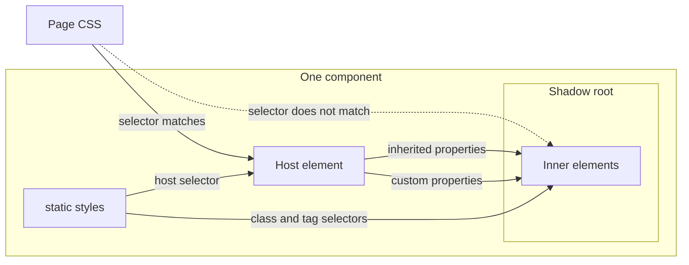
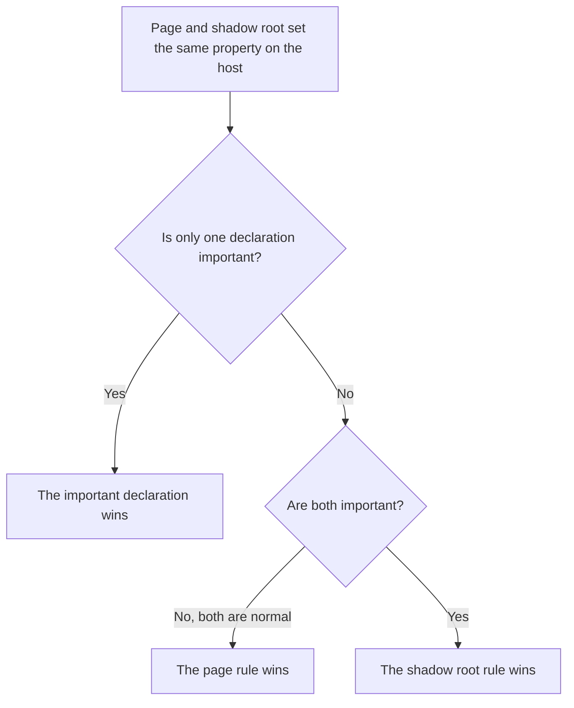

# 06 · Styles inside a component

> **What you learn here**
>
> - How `static styles` works, what the three shared style fragments do, and the rules for CSS
>   inside a component.
> - What crosses the shadow boundary, and which rule wins when the page and the component style the
>   same host.
> - How private and public custom properties work, how a template sets them, and what happens when
>   a `var()` value is not valid.
>
> **Read first:** [02 · Web components](02-web-components.md#shadow-dom) and
> [04 · Anatomy of a component](04-anatomy-of-a-component.md#stop-6-styles). **Time:** 45 minutes.
>
> Open work as of main @ e251d45, 2026-10-27.

This chapter is about the CSS inside a shadow root. Surfaces have their own chapter:
[12 · Surfaces and elevation](12-surfaces-and-elevation.md). The focus ring has its own chapter
too: [14 · The focus ring](14-the-focus-ring.md).

## Whiteboard

The diagram shows what goes from the page into a component and what stops at the shadow boundary.



Selectors stop at the shadow boundary. Inherited values cross it. Learn these two facts first,
because the rest of the chapter comes from them.

## Static styles

The CSS of a Lit component is in a static class field:

`Button.ts`, the start of `static styles`:

```ts
	static styles = [
		componentReset,
		focusRing,
		css`
```

The Lit styles page gives three facts that are important here.
[Source: Lit, Styles](https://lit.dev/docs/v3/components/styles/)

- The value can be one `css` template or an array of them. Grove always uses an array.
- Lit evaluates static styles one time for each class, and every instance shares them. Ten buttons
  on a page share one stylesheet.
- The `css` tag accepts only other `css` values and numbers inside `${…}`. Thus you cannot put the
  value of a property into static CSS. A value for one instance goes through a class (`classMap`),
  an inline style (`styleMap`) or a custom property.

The Lit styles page does not tell how Lit attaches the CSS. The source of Lit tells it, in
`@lit/reactive-element`, file `css-tag.js`. Lit makes one `CSSStyleSheet` for each `css` value with
`replaceSync()`. Then it adds that sheet to each shadow root through `adoptedStyleSheets`. A browser
without `adoptedStyleSheets` gets a `<style>` element in the shadow root.

> [!NOTE]
> **Lit box: the css tag**
>
> The `css` tag makes a `CSSResult`, not a string. Lit throws an error when you put a value into it
> that is not a `css` result or a number. This rule stops CSS injection through static styles.
> Grove example, `focus-ring.ts`: `` export const focusRing = css` ``.
>
> Lit docs: [Styles](https://lit.dev/docs/v3/components/styles/)

`src/lib/styles/` holds three Lit style fragments: `componentReset`, `focusRing` and
`visuallyHidden`. `src/lib/index.ts` exports all three. Thus a consumer can use them in an own Lit
component.

## The component reset

A reset in the page does not reach into a shadow root. Thus `componentReset` repeats the basics
inside every component. It always comes first in `static styles`.

`component-reset.ts`, `componentReset`, the two host rules:

```css
:host([hidden]:not([hidden='until-found'])) {
	display: none !important;
}

@media (prefers-reduced-motion: reduce) {
	:host,
	*,
	*::before,
	*::after {
		transition-duration: 0.01ms !important;
		transition-delay: 0s !important;
		animation-duration: 0.01ms !important;
		animation-delay: 0s !important;
		animation-iteration-count: 1 !important;
	}
}
```

The rest of the fragment sets `box-sizing: border-box`, `margin: 0`, `display: block` and
`max-width: 100%` on media, `font: inherit` on form controls and `overflow-wrap: break-word` on
paragraphs and headings.

The two host rules give two guarantees:

- **`hidden` always hides the host.** It hides the host also when the page gives the host a
  `display` value. [The shadow cascade](#the-shadow-cascade) tells why this rule needs
  `!important`.
- **Reduced motion ends each transition and animation almost at once.** The duration is `0.01ms`,
  not `0s`.

**Why `0.01ms` and not `0s`.** A transition with a duration of `0s` does not run, so the browser
fires no `transitionend` event. Code that waits for `transitionend` then waits for ever. With
`0.01ms`, the transition runs, and the event fires.
[Source: MDN, transition-duration](https://developer.mozilla.org/en-US/docs/Web/CSS/Reference/Properties/transition-duration)
[Source: MDN, prefers-reduced-motion](https://developer.mozilla.org/en-US/docs/Web/CSS/Reference/At-rules/@media/prefers-reduced-motion)

**Delays are zero too.** `transition-delay` and `animation-delay` become `0s`. A delay that a
component uses as a timer, for example a delay before a hover bubble shows, also goes away. Put time
that a person needs to read or to point in script, not in a CSS delay.

**`until-found` keeps the browser behaviour.** The selector leaves out `hidden="until-found"`. The
browser gives that value `content-visibility: hidden`, so the find-in-page feature can show the
content.
[Source: MDN, hidden](https://developer.mozilla.org/en-US/docs/Web/HTML/Reference/Global_attributes/hidden)
But `content-visibility` has no effect on an inline box.
[Source: MDN, content-visibility](https://developer.mozilla.org/en-US/docs/Web/CSS/Reference/Properties/content-visibility)

Four hosts have no `display` rule, so they are `inline`: `gv-button`, `gv-checkbox`,
`gv-icon-button` and `gv-todo-category-toggler`. On these four hosts, `hidden="until-found"` hides
nothing. Give such a host a `display`, for example `inline-block`, or put the attribute on a
wrapper element.

Two browser tests check the host rules: `src/lib/styles/host-hidden.browser.test.ts` and
`src/lib/styles/reduced-motion.browser.test.ts`. The `hidden` test runs on every tag in
`groveTags`, in each theme. [09 · Accessibility](09-accessibility.md#hidden-and-reduced-motion)
gives the accessibility side.

> [!IMPORTANT]
> **Open work: #45 — host rules in componentReset: hidden and reduced motion** (issue, open:
> behaviour on main, checks remain)
>
> The epic groups #35 (the `hidden` rule) and #42 (reduced motion). Both rules are on `main`, and
> both specs are closed. The epic stays open, because its first tests did not check all the
> requirements. PR #66 adds those tests and closes the epic. Each Lit component that adopts the
> public `componentReset` gets both rules, so a change to either rule is a change for consumers
> too. When #66 lands, close this box with the #66 box below.
> <https://github.com/edgarjaymez/grove-lit/issues/45>

> [!IMPORTANT]
> **Open work: #66 — componentReset tests for hidden and reduced motion** (open PR, no conflict with
> main on 2026-10-27)
>
> The PR closes epic #45. It adds tests only, plus text in `DESIGN_SYSTEM.md` and in the comment of
> `componentReset`. The new tests check focusable controls in nested shadow roots, the real Tab
> order, page rules with `!important`, and `until-found` as `content-visibility: hidden`.
>
> The motion test adds an `AT_REST` table of the timings that each component has today. It also
> checks that `transitionend` fires under reduced motion and that slotted light DOM keeps its own
> transitions. The comment then names the escape hatch on the host: `:host(…)`. When it lands, add
> these checks to the list of tests in this section, and add the `AT_REST` table to
> [17 · Tests](17-tests.md#change-detectors). <https://github.com/edgarjaymez/grove-lit/pull/66>

## The focus ring fragment

Each interactive component adopts `focusRing` second, after `componentReset`. The focusable element
inside the shadow root gets the class `gv-focusable`.

`focus-ring.ts`, `focusRing`:

```css
.gv-focusable:focus-visible {
	outline: var(--border-width-heavy, 2px) solid transparent;
	outline-offset: var(--soft-grid-4, 4px);
	box-shadow:
		var(--gv-focus-ring, var(--_ring-default, var(--ring-on-ground))), var(--_drop, 0 0 #0000);
}
```

The ring reads `--_drop`, so a control sets its own shadow through `--_drop` and never through
`box-shadow`. [14 · The focus ring](14-the-focus-ring.md#the-mechanism) explains the whole
mechanism and the order in which the ring colour resolves.

## The visually hidden fragment

`visuallyHidden` gives the class `.visually-hidden`. The text stays in the accessibility tree, but
the browser draws nothing.

`visually-hidden.ts`, `visuallyHidden`:

```css
.visually-hidden {
	position: absolute;
	width: 1px;
	height: 1px;
	margin: -1px;
	padding: 0;
	overflow: hidden;
	clip-path: inset(50%);
	white-space: nowrap;
	border: 0;
}
```

- The same rule goes to the page as `.visually-hidden` in `src/lib/styles/a11y.css`.
  `visually-hidden.test.ts` checks that the two copies have the same declarations.
- `gv-color-swatch` is the only component that uses it. It puts the class on its `role="status"`
  paragraph.
- Do not put the class on a focusable element. A keyboard user then has focus on something that
  they cannot see. [09 · Accessibility](09-accessibility.md#visually-hidden-text-and-skip-links)
  tells more.

## Rules for CSS inside a component

- **A block-level component starts with `:host { display: block; }`.** A custom element is `inline`
  by default. `MenuItem.ts` is an example. Inline components, such as `gv-button`, have no
  `display` rule on the host.
- **Use a token for every value**, for example `var(--soft-grid-16)`,
  `var(--semantic-color-text-on-ground-base)` or `var(--border-radius-8xl)`. Do not write hex
  colours or raw font sizes.
- **Use the `font` shorthand with a composite token, and set `letter-spacing` from its own token.**
  The `font` shorthand has no part for letter spacing. Each composite token thus has a
  `-letter-spacing` sub-token. Do not set `font-size`, `line-height` or `font-family` one by one.
  [11 · Design tokens](11-design-tokens.md#typography-composites) lists the composites.

  `Button.ts`, the medium size:

  ```css
  .btn--md {
  	gap: var(--soft-grid-6);
  	padding: var(--soft-grid-8) var(--soft-grid-16);
  	font: var(--typography-single-line-subtle-emphasis);
  	letter-spacing: var(--typography-single-line-subtle-emphasis-letter-spacing);
  }
  ```

- **Use flat selectors only**, for example `.btn--outlined.btn--sm`, not nested rules. This is a
  house rule for search and for clear specificity. It is not a browser limit.
- **Do not put a custom property in a `@media` condition.** `var()` works only in property values.
  Write the number, and write the token name in a comment:

  `BackButton.ts`, the laptop breakpoint:

  ```css
  			/* --breakpoints-laptop (1280px) — custom properties cannot be used in media queries */
  			@media (min-width: 1280px) {
  ```

  [Source: W3C, CSS Custom Properties Level 1](https://www.w3.org/TR/css-variables-1/#using-variables)

- **Never write `outline: none`.** `src/lib/styles/focus.test.ts` reads every component file and
  fails when it finds `outline: none` or `outline: 0`.
- **Put a rule last when it must win over a rule with the same specificity.** Then write a comment
  that says so. `Tooltip.ts` keeps `.tooltip--pressed` last, `MenuItem.ts` keeps the active hover
  rule last, and `ColorSwatch.ts` keeps the `data-dismissed` rule last.
- **Subtract a border from the padding, so the size does not change.** The outlined `gv-icon-button`
  has a border, and the other variants have none. Thus its padding is smaller by the border width:

  `IconButton.ts`, the outlined large size:

  ```css
  .icon-btn--outlined.icon-btn--lg {
  	padding: calc(var(--soft-grid-12) - var(--border-width-base));
  }
  ```

- **Know which box paints.** The host box and the painted box are not always the same. The
  `gv-tooltip` host paints nothing. Its inner `.tooltip` element has the background and the shadow.
  Thus padding on the host is transparent, but the pointer can still touch it.

> [!IMPORTANT]
> **Open work: #27 — gv-text-input non-colour error cue** (issue, blocked: Needs Figma Spec)
>
> In the error state, the underline changes from `--border-width-heavy` (2 px) to
> `--border-width-thick` (4 px). The bottom padding becomes smaller by the difference, so the height
> of the field does not change:
> `calc(var(--soft-grid-8) - (var(--border-width-thick) - var(--border-width-heavy)))`. Forced
> colours keep border widths, so the cue stays there. This is the padding rule above. When it lands,
> add the error rule as a second example. <https://github.com/edgarjaymez/grove-lit/issues/27>

> [!IMPORTANT]
> **Open work: #30 — gv-color-swatch hoverable, dismissible bubbles** (issue, blocked: #30 open
> decision 1, the name typography)
>
> Each bubble sits 8 px to the left of the column. When the pointer crosses that gap, the bubble
> hides. The fix uses the transparent host box of `gv-tooltip` as a bridge:
> `right: 100%; padding-right: var(--soft-grid-8)`. The painted bubble stays at the same pixels, but
> the area that the pointer can cross has no gap.
>
> Keep the physical `right` and `padding-right` as a pair, or change both to logical properties. The
> bubble also gets its own `:hover` in the reveal rules, and a hidden bubble stays
> `visibility: hidden`. When it lands, use the bridge as the example of the last rule above.
> <https://github.com/edgarjaymez/grove-lit/issues/30>

## What crosses the shadow boundary

The shadow root keeps the selectors of the page out. It does not keep inherited values out.
[Source: W3C, CSS Scoping Module Level 1](https://www.w3.org/TR/css-scoping-1/#inheritance)

| What                                                    | Crosses into the shadow root                                         | Grove example                                                                                        |
| ------------------------------------------------------- | -------------------------------------------------------------------- | ---------------------------------------------------------------------------------------------------- |
| A page selector, for example `.label` or `p`            | No. It matches only elements in the page tree, the host included     | Page typography classes do not reach a component, so components use tokens                           |
| An inherited property, for example `color` or `font`    | Yes. The top-level elements in the shadow root inherit from the host | `gv-checkbox` sets `color: inherit` on its control, so the label takes the text colour of the parent |
| A custom property, for example `--gv-focus-ring`        | Yes. Every custom property inherits                                  | A `.gv-surface-*` class sets `--gv-focus-ring`, and the ring inside reads it                         |
| A selector in `static styles`                           | Only into its own shadow root                                        | `.btn` in `Button.ts` matches nothing in the page                                                    |
| `:host` in `static styles`                              | Matches the host from the inside                                     | `:host { display: block; }`                                                                          |
| A selector in `static styles` against slotted light DOM | No. Slotted elements stay in the page tree                           | Slotted text keeps the transitions that the page gives it                                            |

A parent component uses the custom property row to control a child. `gv-button` sets two public
custom properties on its `gv-icon`, and the icon reads them inside its own shadow root.

`Button.ts`, the icon rule:

```css
.btn:not(:disabled):hover gv-icon {
	--gv-icon-regular-display: none;
	--gv-icon-fill-display: inline-flex;
}
```

Grove does not use `::part()` or `::slotted()` today. A page can thus style a component only through
the host, inherited properties and custom properties.
[Source: MDN, ::slotted](https://developer.mozilla.org/en-US/docs/Web/CSS/Reference/Selectors/::slotted)

## The shadow cascade

Sometimes the page and the component both style the host. For example, the page writes
`gv-title { display: grid }`, and `Title.ts` writes `:host { display: block; }`. The two rules come
from two different trees. The cascade compares the tree of each rule before it compares
specificity.
[Source: W3C, CSS Cascading and Inheritance Level 5](https://www.w3.org/TR/css-cascade-5/#cascade-context)

The diagram shows which declaration wins on the host.



The rule in words: for normal declarations, the outer tree wins. For important declarations, the
inner tree wins.
[Source: W3C, CSS Scoping Module Level 1](https://www.w3.org/TR/css-scoping-1/#shadow-cascading)

**Why the `hidden` rule needs `!important`.** The browser hides `[hidden]` with a rule in its own
stylesheet. Every author rule wins over a browser rule, so `:host { display: block; }` beats it.
Thus the component needs its own `display: none`. A normal `display: none` in the shadow root still
loses to a page rule such as `gv-title { display: grid }`. With `!important`, the shadow rule wins
over every page declaration, an important page declaration included.

**Specificity of `:host`.** Inside one shadow root, specificity works as usual. `:host` has the
specificity of one pseudo-class. `:host(…)` has the specificity of one pseudo-class plus the
specificity of its argument.
[Source: W3C, CSS Scoping Module Level 1](https://www.w3.org/TR/css-scoping-1/#host-selector)
[Source: MDN, :host()](https://developer.mozilla.org/en-US/docs/Web/CSS/Reference/Selectors/:host_function)

- `:host { display: block; }` has the specificity of one pseudo-class.
- `:host([hidden]:not([hidden='until-found']))` adds two more: the attribute and the `:not()`.
- The reduced-motion block selects `:host` and `*`. A component can win over it with its own
  `!important` rule in the same media query. On an inner element, a class selector is enough,
  because it is more specific than `*`. On the host, use `:host(…)`, because it is more specific
  than `:host`.

[Source: MDN, :host](https://developer.mozilla.org/en-US/docs/Web/CSS/Reference/Selectors/:host)

## Private and public custom properties

Grove uses two kinds of custom property.

| Kind    | Name        | Who sets it                            | Documented                                           |
| ------- | ----------- | -------------------------------------- | ---------------------------------------------------- |
| Private | `--_name`   | The component, for its own rules       | No. It can change in any release                     |
| Public  | `--gv-name` | An ancestor, the page or the component | Yes, with a `@cssprop` tag in the JSDoc of the class |

Private custom properties on `main`:

- `--_drop`: the drop shadow of a control, which the focus ring stacks on.
- `--_ring-default`: the default ring of `gv-menu-item`.
- `--_fill-light` and `--_fill-dark`: the two fills of `gv-isotype`.

Public custom properties with a `@cssprop` tag on `main`:

`Icon.ts`, the JSDoc block:

```ts
 * @cssprop --gv-icon-regular-display - `display` of the regular weight; an ancestor sets it to swap weights.
 * @cssprop --gv-icon-fill-display - `display` of the fill weight; an ancestor sets it to swap weights.
```

`Isotype.ts` documents `--gv-isotype-size` in the same way. The manifest analyzer reads the tags.
[15 · Metadata and the manifest](15-metadata-and-the-manifest.md#jsdoc-tags-the-manifest-reads)
tells how.

`--gv-focus-ring` is public too. The surface classes in `surfaces.css` set it, not a component.
[14 · The focus ring](14-the-focus-ring.md#inheritance-across-shadow-roots) explains it.

The underscore is a convention only. The browser does not stop a page that sets `--_drop` on a
host. An inner element that does not set `--_drop` itself then inherits the value of the page. Thus
give a private custom property a value on the element that reads it, when a page value must not
reach it.

## Custom properties from a template

Static styles are the same for all instances. A value that changes from one instance to the next
goes into the template. The `styleMap` directive writes an inline style on one element.

`Isotype.ts`, the SVG in `render()`:

```ts
				style=${styleMap({ '--_fill-light': light, '--_fill-dark': dark })}
```

The static styles then read the two private custom properties:

`Isotype.ts`, the fill rule:

```css
@supports (color: light-dark(#000, #fff)) {
	path {
		fill: light-dark(var(--_fill-light), var(--_fill-dark));
	}
}
```

This pattern keeps the CSS in `static styles` and puts only the values in the template.

`styleMap` changes the live inline style. It does not write a new `style` attribute each time. That
has a trap for normal properties: the browser ignores a value that it cannot parse. Then the old
value stays.

`Texture.ts`, `_validTint`:

```ts
	private get _validTint() {
		const tint = this.tint;
		if (!tint) return undefined;
		return typeof CSS === 'undefined' || CSS.supports('color', tint) ? tint : undefined;
	}
```

Thus `gv-texture` tests the tint with `CSS.supports()` first. An invalid tint gives `undefined`, and
`styleMap` removes the property. A custom property has no such check. The browser accepts almost
any value for it, and the problem shows only later.
[The next section](#invalid-at-computed-value-time) tells what happens then.

> [!NOTE]
> **Lit box: the styleMap directive**
>
> `styleMap` takes an object of CSS properties and values and sets them on the inline style of one
> element. A name that starts with `--` goes through `style.setProperty()`, so custom properties
> work. A value of `undefined` or `null` removes the property. Grove example, `Isotype.ts`:
> `style=${styleMap({ '--_fill-light': light, '--_fill-dark': dark })}`
>
> Lit docs: [Built-in directives](https://lit.dev/docs/v3/templates/directives/)

> [!IMPORTANT]
> **Open work: #65 — gv-texture colour variants and the night grain** (open PR, no conflict with
> main on 2026-10-27)
>
> The PR moves the default grain into two private custom properties, which the template sets:
> `'--_grain-day': grain.day` and `'--_grain-night': grain.night`, next to `opacity` in one
> `styleMap()`. The static styles then read
> `light-dark(var(--_grain-day), var(--_grain-night))`. The day values stay as `rgba()` literals
> from Figma, because they are also the fallback for old browsers. A review thread asks whether
> these literals duplicate tokens. When it lands, use Texture as the second example in this
> section. <https://github.com/edgarjaymez/grove-lit/pull/65>

## Invalid at computed-value time

The browser checks a `var()` reference only when it computes the value. The browser cannot check
it at parse time, because it does not know the value of the custom property then. Two cases make a
declaration "invalid at computed-value time":

- The custom property does not exist, and `var()` has no fallback.
- The value that `var()` gives is not valid for the property.

Then the property acts as `unset`. An inherited property takes the value of its parent. A property
that does not inherit takes its initial value.
[Source: W3C, CSS Custom Properties Level 1](https://www.w3.org/TR/css-variables-1/#invalid-at-computed-value-time)

This is why the fallbacks in `focusRing` matter. In
`var(--gv-focus-ring, var(--_ring-default, var(--ring-on-ground)))`, each fallback applies when the
custom property before it does not exist.

The trap is a property that does not inherit. `flood-color`, which colours an SVG filter, does not
inherit, and its initial value is black.
[Source: MDN, flood-color](https://developer.mozilla.org/en-US/docs/Web/CSS/Reference/Properties/flood-color) An invalid tint written as `flood-color: var(--missing)`
paints the grain black. Issue #20 found this trap. It also found that the SVG presentation attribute
`flood-color` does not resolve `var()`.

## The currentColor fallback

`gv-texture` avoids the black grain with `currentColor`. The `currentColor` keyword gives the value
of the `color` property of the same element.
[Source: MDN, the currentColor keyword](https://developer.mozilla.org/en-US/docs/Web/CSS/Reference/Values/color_value#currentcolor_keyword)
`color` is an inherited property. Thus an invalid value for `color` takes the colour of the parent,
not black.

`Texture.ts`, the flood in the filter:

```ts
						<feFlood
							flood-color="currentColor"
							style=${styleMap({ color: this._validTint })}
							result="color1Flood"
						/>
```

`Texture.ts`, the theme default on the SVG:

```css
svg {
	display: block;
	width: 100%;
	height: 100%;
	color: rgba(38, 77, 40, 0.1);
}
```

The chain works in three steps:

1. The SVG sets `color` to the default grain of the theme. A second rule, behind
   `@supports (color: light-dark(#000, #fff))`, changes the default at night.
2. `<feFlood>` paints with `currentColor`, so it paints the `color` of the flood element.
3. With a tint, the flood element gets that tint as `color`. Without a tint, the flood element
   inherits the default from the SVG. A tint that is invalid at computed-value time gives the same
   result.

Thus `tint="var(--gv-missing)"` gives the default grain, not black. `Texture.browser.test.ts` checks
this case. It also checks that the default grain in the light theme is pixel-identical to the
0.45.0 release.

> [!IMPORTANT]
> **Open work: #48 — gv-texture hidden from AT, tint and frequency** (issue, open: behaviour on
> main, checks remain)
>
> The epic groups #32 (closed) and #20. The tint, the frequency and the `currentColor` chain are on
> `main`. The decisions are final: there is no `--gv-texture-tint` custom property, and `tint`
> accepts `var()`, `color-mix()` and `light-dark()`. #20 FR-DT1, the night grain, is still open.
> PR #65 closes both issues, but it waits for the Figma questions. When #65 lands, add `color` to
> the chain above: the day and night defaults then come from `--_grain-day` and `--_grain-night`.
> <https://github.com/edgarjaymez/grove-lit/issues/48>

> [!IMPORTANT]
> **Open work: #20 — gv-texture tint and frequency** (issue, open: behaviour on main, checks remain)
>
> The spec asks for a tint and a grain frequency, and for the default output to stay the same, byte
> for byte (#20 FR-01). `main` has the tint, the frequency and the `currentColor` chain. The night
> grain on `main` is provisional. #20 FR-DT1 asks for the night value from the Figma library, and
> nobody has answered that question yet. PR #65 says "Closes #20", but a merge of #65 does not
> answer FR-DT1. Close the issue only when the night value has a recorded source. When it closes,
> remove the word "provisional" from the night grain text in this chapter.
> <https://github.com/edgarjaymez/grove-lit/issues/20>

## See it in the code

| File                                          | Look for                                                 |
| --------------------------------------------- | -------------------------------------------------------- |
| `src/lib/styles/component-reset.ts`           | The `hidden` rule, the reduced-motion block, the comment |
| `src/lib/styles/focus-ring.ts`                | The three fallbacks of the ring, `--_drop`               |
| `src/lib/styles/visually-hidden.ts`           | `.visually-hidden`                                       |
| `src/lib/styles/focus.test.ts`                | The `outline` ban                                        |
| `src/lib/components/Isotype/Isotype.ts`       | `styleMap` with `--_fill-light`, `@supports`, `@cssprop` |
| `src/lib/components/Texture/Texture.ts`       | `_validTint`, `flood-color="currentColor"`               |
| `src/lib/components/Tooltip/Tooltip.ts`       | `.tooltip--pressed`, the last rule                       |
| `src/lib/components/IconButton/IconButton.ts` | The outlined padding with `calc()`                       |
| `src/lib/components/BackButton/BackButton.ts` | The `@media` rule with a number                          |

## Sources

**Standards**

- [W3C, CSS Scoping Module Level 1](https://www.w3.org/TR/css-scoping-1/), sections
  `#shadow-cascading`, `#host-selector` and `#inheritance`. Read 2026-10-27.
- [W3C, CSS Cascading and Inheritance Level 5](https://www.w3.org/TR/css-cascade-5/#cascade-context).
  Read 2026-10-27.
- [W3C, CSS Custom Properties Level 1](https://www.w3.org/TR/css-variables-1/), sections
  `#using-variables` and `#invalid-at-computed-value-time`. Read 2026-10-27.

**Platform reference**

- [MDN, :host](https://developer.mozilla.org/en-US/docs/Web/CSS/Reference/Selectors/:host). Read
  2026-10-27.
- [MDN, :host()](https://developer.mozilla.org/en-US/docs/Web/CSS/Reference/Selectors/:host_function).
  Read 2026-10-27.
- [MDN, ::slotted](https://developer.mozilla.org/en-US/docs/Web/CSS/Reference/Selectors/::slotted).
  Read 2026-10-27.
- [MDN, hidden](https://developer.mozilla.org/en-US/docs/Web/HTML/Reference/Global_attributes/hidden).
  Read 2026-10-27.
- [MDN, content-visibility](https://developer.mozilla.org/en-US/docs/Web/CSS/Reference/Properties/content-visibility).
  Read 2026-10-27.
- [MDN, prefers-reduced-motion](https://developer.mozilla.org/en-US/docs/Web/CSS/Reference/At-rules/@media/prefers-reduced-motion).
  Read 2026-10-27.
- [MDN, transition-duration](https://developer.mozilla.org/en-US/docs/Web/CSS/Reference/Properties/transition-duration).
  Read 2026-10-27.
- [MDN, flood-color](https://developer.mozilla.org/en-US/docs/Web/CSS/Reference/Properties/flood-color).
  Read 2026-10-27.
- [MDN, the currentColor keyword](https://developer.mozilla.org/en-US/docs/Web/CSS/Reference/Values/color_value#currentcolor_keyword).
  Read 2026-10-27.

**Tool docs**

- [Lit, Styles](https://lit.dev/docs/v3/components/styles/). Read 2026-10-27.
- [Lit, Built-in directives](https://lit.dev/docs/v3/templates/directives/). Read 2026-10-27.

## Check yourself

Do [Lesson 4](syllabus.md#lesson-4-styles) in the syllabus. Then answer these questions:

1. A page writes `gv-title { display: grid !important }` and sets `hidden` on the title. Which
   declaration wins, and why?
2. Why does `componentReset` use `0.01ms` and not `0s`?
3. A page sets `--_drop` on a ghost `gv-icon-button`. Does the button show a shadow at rest? Read
   `IconButton.ts` to find out.
4. Why does `gv-texture` paint its grain with `currentColor` and not with `flood-color` directly?

[← 05 · Component catalogue](05-component-catalogue.md) · [Index](README.md) ·
[07 · Slots →](07-slots.md)
