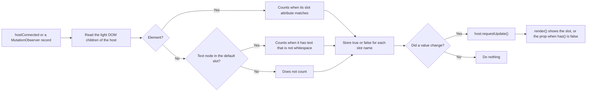
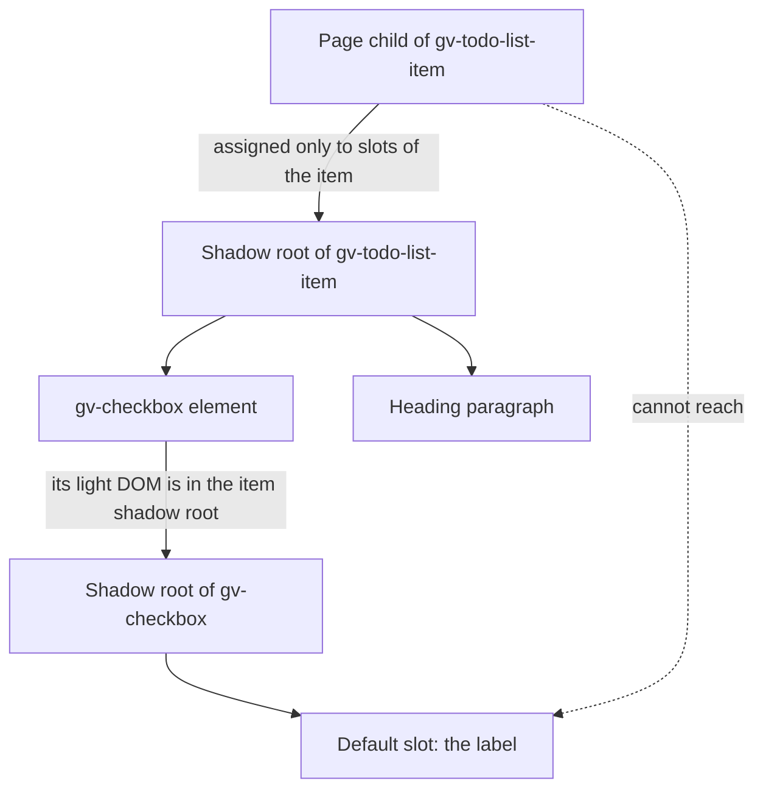

# 07 · Slots

> **What you learn here**
>
> - Why a native `<slot>` fallback does not work in Grove, and how the `SlotContent` controller
>   solves the problem.
> - When to give a component a property, a slot, or both, and which content may go in a slot.
> - Why a slot does not reach into a nested shadow root, and how the build and the tests check the
>   slots.
>
> **Read first:** [02 · Web components](02-web-components.md#slots) and
> [03 · Lit essentials](03-lit-essentials.md#controllers-and-mixins). **Time:** 35 minutes.
>
> Open work as of main @ e251d45, 2026-10-27.

A slot is the way that content from the page goes into a component. Six components on `main` have
slots: `gv-button`, `gv-checkbox`, `gv-feedback-strip`, `gv-menu-item`, `gv-title` and
`gv-tooltip`.

## Whiteboard

The diagram shows how `SlotContent` decides whether a component shows the slot or the fallback
prop.



## The whitespace problem

A native `<slot>` can hold fallback content. The browser shows it when the slot gets no nodes.
[Source: MDN, Using templates and slots](https://developer.mozilla.org/en-US/docs/Web/API/Web_components/Using_templates_and_slots)
It looks like the easy way to support both `<gv-button>Save</gv-button>` and
`<gv-button text="Save">`. But a text node can go in a slot, and whitespace is a text node.
[Source: WHATWG DOM, Shadow trees](https://dom.spec.whatwg.org/#shadow-trees)

Example:

```html
<gv-button text="Save"> </gv-button>
```

The line break between the two tags is a text node. The browser assigns that text node to the
default slot. Thus the fallback content never shows, and the button has no text. Grove must know
whether a slot has real content: an element, or text that is not only whitespace.
[Source: MDN, HTMLSlotElement.assignedNodes()](https://developer.mozilla.org/en-US/docs/Web/API/HTMLSlotElement/assignedNodes)

`slots.browser.test.ts` has a test for this case: "ignores whitespace between the tags, so the prop
still renders".

## Reactive controllers

Lit has a tool for logic that many components share and that must follow the lifecycle of the
host: the reactive controller. A controller is a plain object. Its constructor calls
`host.addController(this)`. Then Lit calls its hooks, for example `hostConnected()` and
`hostDisconnected()`. The controller can call `host.requestUpdate()` to make the host render again.

A controller is like a custom hook in React. It holds state and logic, but it renders nothing
itself. [03 · Lit essentials](03-lit-essentials.md#controllers-and-mixins) compares controllers
with mixins.

> [!NOTE]
> **Lit box: reactive controllers**
>
> A reactive controller connects to the lifecycle of its host. The host calls `hostConnected()`
> when it connects, `hostDisconnected()` when it disconnects, and `hostUpdate()` and
> `hostUpdated()` around each update. A controller implements only the hooks that it needs. Grove
> example, `slot-content.ts`: `host.addController(this);`
>
> Lit docs: [Reactive controllers](https://lit.dev/docs/v3/composition/controllers/)

## The SlotContent controller

`src/lib/utils/slot-content.ts` is the controller that Grove uses for slots.

`slot-content.ts`, the constructor and `has()`:

```ts
	/** `names` lists the slots to track; '' is the default slot. */
	constructor(host: ReactiveControllerHost & HTMLElement, names: readonly string[] = ['']) {
		this._host = host;
		this._names = names;
		host.addController(this);
	}

	/** Whether the named slot ('' for the default one) has content. */
	has(name = ''): boolean {
		return this._state.get(name) ?? false;
	}
```

The controller does these steps:

1. In `hostConnected()`, it reads the light DOM children of the host. This also runs when the host
   connects again. Thus the controller sees a change that occurred while the host was not connected.
2. It starts a `MutationObserver` on the host. The observer watches the child list, the subtree,
   text changes and the `slot` attribute.
3. For each tracked slot, it stores `true` or `false` in a `Map`.
4. When a value changes, it calls `this._host.requestUpdate()`. When no value changes, it does
   nothing.
5. In `hostDisconnected()`, it stops the observer.

The controller has no `hostUpdate()` and no `hostUpdated()`. It reads the children of the host, not
the slots in the shadow root. Thus it does not wait for the first render.

`slot-content.ts`, `_assigned()`:

```ts
	private _assigned(name: string) {
		return [...this._host.childNodes].filter((node) => {
			if (node instanceof Element) return (node.getAttribute('slot') ?? '') === name;
			return name === '' && node.nodeType === Node.TEXT_NODE && !!node.textContent?.trim();
		});
	}
```

A component uses the controller in two places.

`Button.ts`, the field:

```ts
	private readonly _slots = new SlotContent(this, ['']);
```

`Button.ts`, in `render()`:

```ts
				<slot></slot>${this._slots.has() ? nothing : this.text}
```

The prop renders next to the `<slot>`, not inside it. The `<slot>` element has no fallback
content. A component with named slots tracks them by name:

`FeedbackStrip.ts`, the field and the start of `render()`:

```ts
	private readonly _slots = new SlotContent(this, ['heading', 'message']);
```

```ts
const heading = this._slots.has('heading') ? nothing : this.heading;
const message = this._slots.has('message') ? nothing : this.message;
```

`utils/index.ts` is empty, and the package entry does not export `SlotContent`. The controller is
internal to Grove.

## Prop or slot

Each slot in Grove, except the label of `gv-checkbox`, has a fallback prop. The slotted content
wins. When the page removes the slotted content, the component shows the property again.

| Component           | Slot      | Fallback prop | Where the slot renders                                    |
| ------------------- | --------- | ------------- | --------------------------------------------------------- |
| `gv-button`         | default   | `text`        | Inside the inner `<button>`                               |
| `gv-checkbox`       | default   | none          | Inside the control, next to the box                       |
| `gv-feedback-strip` | `heading` | `heading`     | In the heading paragraph                                  |
| `gv-feedback-strip` | `message` | `message`     | In the message row; with neither, the row does not render |
| `gv-menu-item`      | default   | `label`       | Inside the inner `<a>`                                    |
| `gv-title`          | default   | `heading`     | Inside the `h{level}` element                             |
| `gv-tooltip`        | `heading` | `heading`     | In the heading of the complete type                       |
| `gv-tooltip`        | `message` | `message`     | In the message or the body                                |

Use these rules for a new component:

- Give a text position a property, so that one attribute can fill it: `<gv-title heading="Plan">`.
- Give the same position a slot when the content can need markup, for example `<strong>` or
  `<em>`.
- Make the slot and the property share the name of the position when you can. `gv-feedback-strip` and
  `gv-tooltip` use `heading` for both. `gv-button` uses the default slot and `text`.
- Never name a property `title`. Use `heading` and `message` for a heading and a body.
- Slotted content stays in the page tree. Thus page CSS styles it, and the page owns it.

The `<gv-checkbox>` label has no fallback prop on `main`. The label `<span>` renders only when the
slot has content:
``${this._slots.has() ? html`<span class="label"><slot></slot></span>` : nothing}``.

> [!IMPORTANT]
> **Open work: #19 — gv-journey-rail** (issue, blocked: Needs Figma Spec)
>
> The spec first planned a rail without slots, with a `stops` JSON attribute. A later comment on the
> issue changes the content model: the stops become slotted `<a>` children. The issue says that
> this "gives a working table of contents with JavaScript off and before upgrade". The JSON `stops`
> attribute becomes the fallback. This is a slot whose content is a list of links, not a short
> text. When it lands, add the rail to the table above.
> <https://github.com/edgarjaymez/grove-lit/issues/19>

## Text in a slot

`has()` answers one question: does the slot have content? It does not tell whether the content has
text. An element always counts, also an icon or a `hidden` element.

Example:

```html
<gv-button text="Save">
	<gv-icon name="floppy-disk"></gv-icon>
</gv-button>
```

The slot has content, so `has()` is `true`, and `text` does not render. The icon is decorative, so
the button now has no visible text and no accessible name. This matters for names: the name of a
control comes from text, not from any node.
[09 · Accessibility](09-accessibility.md#accessible-names-across-the-shadow-boundary) explains the
names.

On `main`, `SlotContent` has only `has()`. It has no `hasText()`.

> [!IMPORTANT]
> **Open work: #50 — accessible names across the shadow boundary** (branch, no PR)
>
> The #50 work branch, linked from epic #50, adds `hasText(name = '')` to `SlotContent`. It is
> `true` when the slot holds text that assistive technology reads: not whitespace, and not inside an
> element with `hidden` or `aria-hidden="true"`. The observer then also watches the `hidden` and
> `aria-hidden` attributes.
>
> The #50 review item R3 asked for this: the name order uses slotted text, not any slotted node.
> `gv-button` and `gv-checkbox` call `this._slots.hasText()` to decide whether they have a visible
> name. The branch waits for #68. When it lands, add `hasText()` to
> [The SlotContent controller](#the-slotcontent-controller), and change this section to describe
> both methods. <https://github.com/edgarjaymez/grove-lit/issues/50>

## Phrasing-only and container slots

HTML sorts content into categories. **Phrasing content** is the text of a paragraph and the
elements in that text, for example `<span>`, `<strong>`, `<em>` and `<a>`.
[Source: WHATWG HTML, Phrasing content](https://html.spec.whatwg.org/multipage/dom.html#phrasing-content)

Grove uses two words for slots:

- A **phrasing-only slot** accepts only text and phrasing content. A slot inside an interactive
  element must be phrasing-only, because HTML does not allow a control inside a `<button>` or an
  `<a>`. A slot in a popup must be phrasing-only too, because a user cannot reach a control there.
- A **container slot** accepts any content, form controls included. A card body or a form layout
  needs container slots.

On `main`, every slot is phrasing-only. `SlotContent` warns about a form control in any slot that it
tracks. All six components with slots are phrasing-only by design:

- `gv-button`, `gv-checkbox` and `gv-menu-item`: the slot is inside the control or the link.
- `gv-tooltip`: the slot is in a popup.
- `gv-title` and `gv-feedback-strip`: static page parts, by design.

The warning detects form controls only. An `<a>` in a slot does not cause a warning. But the
metadata of `gv-menu-item` says that its slot takes no link, because the slot is already inside an
`<a>`.

> [!IMPORTANT]
> **Open work: #68 — gv-button link mode and form association** (open PR, no conflict with main on
> 2026-10-27)
>
> The PR applies decision #49 C6: the slot rule splits by slot. `SlotContent` gets a third
> argument. A slot is a container by default. A component that needs a phrasing-only slot passes
> `{ phrasingOnly: true }`, and only then does the controller warn:
> `new SlotContent(this, [''], { phrasingOnly: true })`. All six current components pass it, so
> nothing changes at runtime today. When it lands, change "On `main`, every slot is phrasing-only"
> to the new default, and show the new constructor in
> [The SlotContent controller](#the-slotcontent-controller).
> <https://github.com/edgarjaymez/grove-lit/pull/68>

> [!IMPORTANT]
> **Open work: #53 — gv-status-chip and gv-card** (issue, blocked: Needs Figma Spec)
>
> The epic sorts the card slots with #49 C6. `body`, `meta` and the default slot are containers, so
> a `gv-button` or a link can go there. `heading` and `status` are phrasing-only. If the whole card
> becomes a link, every slot inside that link is phrasing-only, because HTML forbids interactive
> content inside `<a>`. The label slot of the status chip is phrasing-only.
>
> The text of #53 and of #54 still states the older ban on all controls in slots; #49 C6 replaces
> it. When it lands, add the card as the first component with container slots.
> <https://github.com/edgarjaymez/grove-lit/issues/53>

## Slots and nested shadow roots

A slot shows the light DOM children of its own host only. It does not reach into the shadow root of
a child component.

The diagram shows two trees: the page, and the shadow root of `gv-todo-list-item`, which holds a
`gv-checkbox` with its own shadow root.



Three facts follow from this rule:

- Only the code that renders `<gv-checkbox>` can fill its slot. In `gv-todo-list-item`, that is the
  template of the item.
- To pass a page child down, a parent must put a `<slot>` element inside the light DOM of the
  child. The browser then follows the chain when it flattens the slots.
  [Source: MDN, HTMLSlotElement.assignedNodes()](https://developer.mozilla.org/en-US/docs/Web/API/HTMLSlotElement/assignedNodes)
- `SlotContent` reads only the children of the host. A forwarded `<slot>` element is an element, so
  `has()` is always `true` for it, also when the slot gets no page child. The fallback prop then
  never renders.

ID references stop at a shadow boundary in the same way.
[02 · Web components](02-web-components.md#id-references-stay-in-one-tree) explains it. Form
association follows the DOM tree, not the slots.
[10 · Forms](10-forms.md#the-tree-rule) explains that rule.

> [!IMPORTANT]
> **Open work: #26 — gv-todo-list-item names its checkbox** (branch, no PR)
>
> The heading of the item is in the shadow root of the item. The focusable button is in the shadow
> root of the checkbox. No ID reference crosses between the two, so the checkbox has no name on
> `main`. The item could put its heading text in the slot of the checkbox, but that changes the
> layout, the focus ring and the row click. The #50 work branch renders
> `<gv-checkbox label=${this.heading}>` instead. When it lands, add this as the example of the
> choice between a slot and a property. <https://github.com/edgarjaymez/grove-lit/issues/26>

## What may go in a slot

On `main`, a slot takes text and phrasing content: text, `<strong>`, `<em>`, `<span>`, and a link
where the component allows one. Do not put a form control in a slot.

A slotted `<input>` stays in the light DOM of the page. Thus it takes part in a form around the
component, next to the control of the component. In development, `SlotContent` then logs one
console warning for each tag.

`slot-content.ts`, the test in `_warnOnFormControls()`:

```ts
			.find(
				(el) =>
					el.matches(FORM_CONTROLS) ||
					(el.constructor as { formAssociated?: boolean }).formAssociated === true
			);
```

- `FORM_CONTROLS` is `'input, button, select, textarea'`. The test also finds any element whose
  class has `formAssociated === true`.
- The test looks at each slotted element and at all of its descendants in the light DOM. It does
  not look into shadow roots.
- A `Set` of tag names makes sure that each tag warns one time only. `resetSlotWarnings()` empties
  the set for tests.
- The warning shows only when `warningsEnabled()` in `src/lib/utils/dev.ts` is true. It turns off
  when the bundler of the app sets `process.env.NODE_ENV` to `"production"`.
  [18 · Build and package](18-build-and-package.md#the-node_env-rule) tells more.

On `main`, a slotted `gv-button` does not cause a warning. Its tag does not match `FORM_CONTROLS`,
and its class is not form-associated.

> [!IMPORTANT]
> **Open work: #68 — gv-button link mode and form association** (open PR, no conflict with main on
> 2026-10-27)
>
> After #68, only a phrasing-only slot warns, and the warning text changes to "<tag> slots take text
> and phrasing content only. Place controls next to the component instead." `gv-button` becomes
> form-associated.
>
> A `gv-button` in a phrasing-only slot, for example in `gv-tooltip`, warns only in one case. The
> page appends a `gv-button` that is already upgraded, and the `MutationObserver` sees it. Parsed
> markup, for example `innerHTML = '<gv-tooltip><gv-button slot=…>'`, gives no warning. The check
> runs in `hostConnected()` of the tooltip before `gv-button` upgrades, and the upgrade does not
> change the light DOM.
>
> A container slot accepts controls without a warning. When it lands, change the first sentence of
> this section to "It depends on the slot". Keep the phrasing-only rule for the six current
> components. <https://github.com/edgarjaymez/grove-lit/pull/68>

## How slots are checked

- Each component lists its slots in JSDoc with `@slot` tags, for example
  ``@slot heading - The strip heading. Falls back to `heading` when empty.``
- Each metadata file lists the same slots in `composition.slots`. A component without slots has
  `slots: null`.
- `pnpm build` fails when the two lists differ. `scripts/check-manifest.mjs` does this check.
  [15 · Metadata and the manifest](15-metadata-and-the-manifest.md#when-check-manifest-fails)
  lists the failures.
- `src/lib/slots.browser.test.ts` renders every tag in `groveTags`. It checks these items:
  - a component renders only the slots that its metadata declares;
  - slotted content wins over the property, and the property comes back when the content goes;
  - a change while the host is not connected shows after it connects again;
  - whitespace between the tags does not hide the property;
  - slotted text names the button and the link, and fills the heading;
  - a slot with a form control warns one time for each component.

## See it in the code

| File                                                | Look for                                                           |
| --------------------------------------------------- | ------------------------------------------------------------------ |
| `src/lib/utils/slot-content.ts`                     | `has()`, `hostConnected()`, `_assigned()`, `_warnOnFormControls()` |
| `src/lib/utils/dev.ts`                              | `warningsEnabled()`                                                |
| `src/lib/components/Button/Button.ts`               | `new SlotContent(this, [''])`, the slot and `text`                 |
| `src/lib/components/FeedbackStrip/FeedbackStrip.ts` | Two named slots, the message row                                   |
| `src/lib/components/Checkbox/Checkbox.ts`           | The label slot without a fallback                                  |
| `src/lib/slots.browser.test.ts`                     | The whitespace test, the warning test                              |

## Sources

**Standards**

- [WHATWG DOM, Shadow trees](https://dom.spec.whatwg.org/#shadow-trees). Read 2026-10-27.
- [WHATWG HTML, Phrasing content](https://html.spec.whatwg.org/multipage/dom.html#phrasing-content).
  Read 2026-10-27.

**Platform reference**

- [MDN, Using templates and slots](https://developer.mozilla.org/en-US/docs/Web/API/Web_components/Using_templates_and_slots).
  Read 2026-10-27.
- [MDN, HTMLSlotElement.assignedNodes()](https://developer.mozilla.org/en-US/docs/Web/API/HTMLSlotElement/assignedNodes).
  Read 2026-10-27.

**Tool docs**

- [Lit, Reactive controllers](https://lit.dev/docs/v3/composition/controllers/). Read 2026-10-27.

## Check yourself

Do [Lesson 5 Slots](syllabus.md#lesson-5-slots) in the syllabus. Then answer these questions:

1. Why does `<gv-button text="Save"> </gv-button>` still show "Save"?
2. A page writes `<gv-button text="Save"><gv-icon name="x"></gv-icon></gv-button>`. What does the
   button show, and what is its name?
3. Why can a page not fill the label slot of the checkbox inside `gv-todo-list-item`?
4. Sort the planned card slots of #53 into phrasing-only and container slots.

[← 06 · Styles inside a component](06-styles-inside-a-component.md) · [Index](README.md) ·
[08 · Events →](08-events.md)
