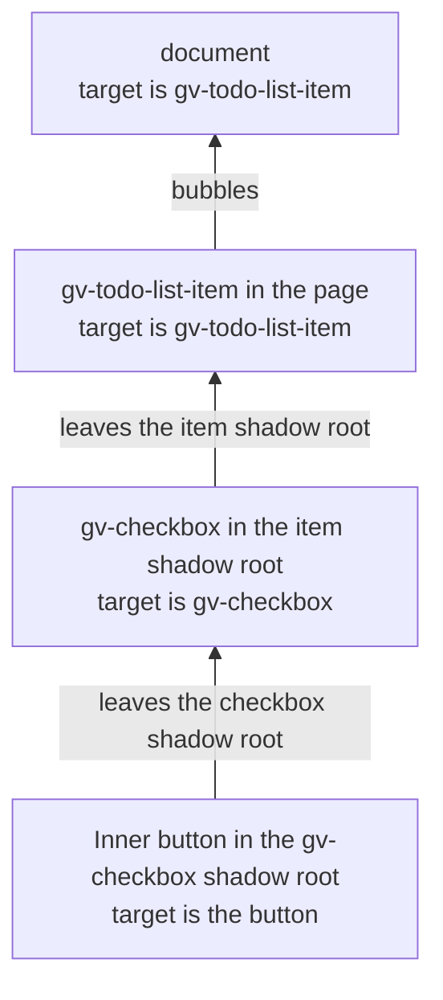
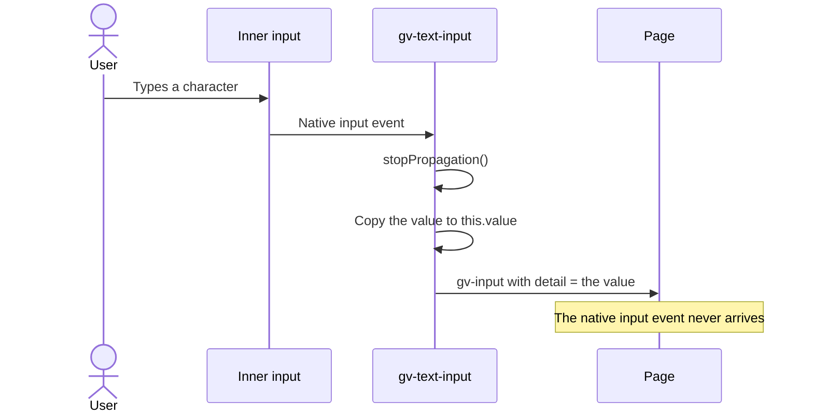
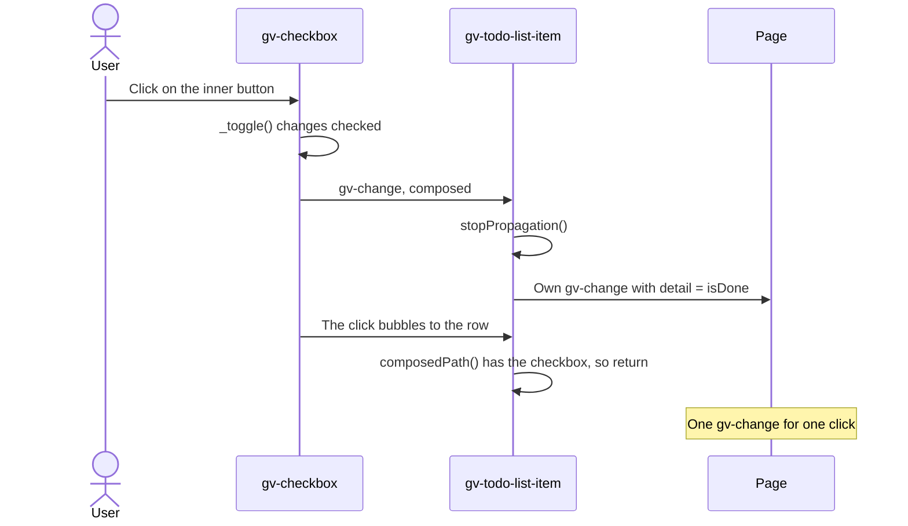
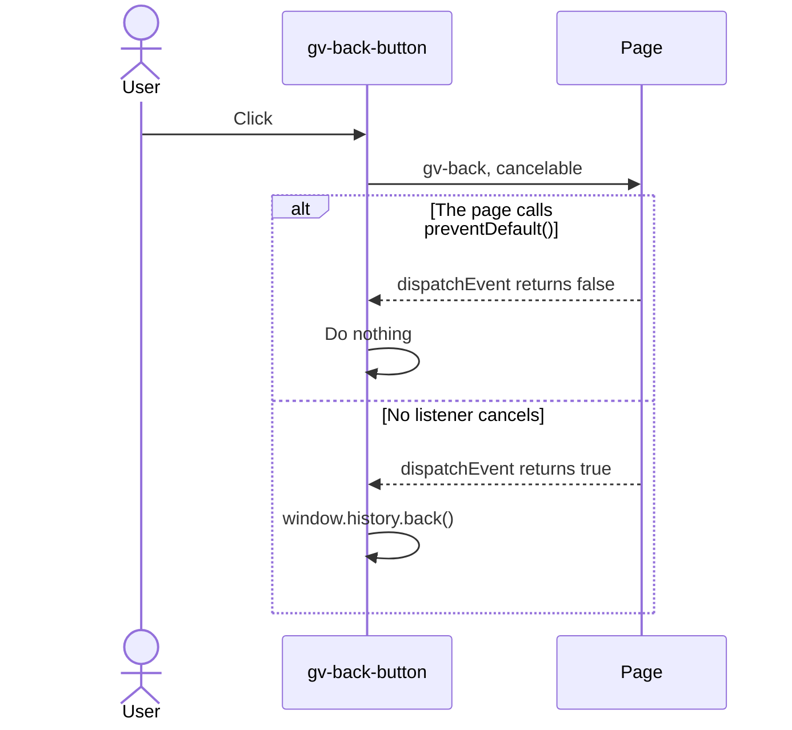
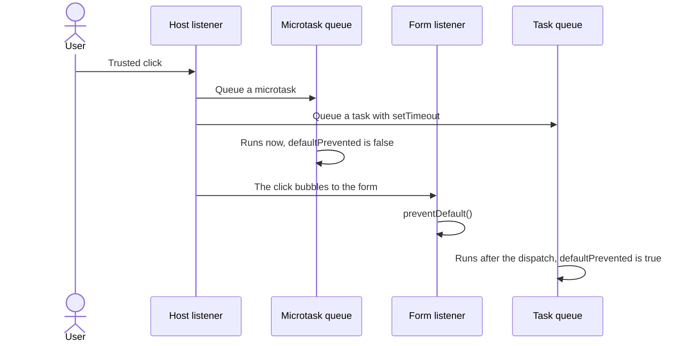

# 08 · Events

> **What you learn here**
>
> - The rules for every Grove event, and what the browser does to an event when it leaves a shadow
>   root.
> - The three event patterns in Grove: wrap a native input, forward a child event, and guard a
>   default action.
> - Trusted and untrusted events, and why a form action waits for the next task.
> - How to listen on a form and on the document, and how the types and the tests check the events.
>
> **Read first:** [02 · Web components](02-web-components.md#shadow-dom) and
> [05 · Component catalogue](05-component-catalogue.md#leaves-and-composites). **Time:** 50
> minutes.
>
> Open work as of main @ e251d45, 2026-10-27.

A slot brings content into a component. An event tells the page that something occurred in the
component. [07 · Slots](07-slots.md) covers the first direction. This chapter covers the second.

## Whiteboard

The diagram shows one click on the button inside `gv-checkbox`, inside `gv-todo-list-item`. At each
level, a listener sees a different `event.target`.



The browser hides the inside of a component from the page. It does this for events too.

## The event rules

Every Grove event obeys these rules:

- It is a `CustomEvent`, and its name starts with `gv-`: `gv-back`, `gv-change`, `gv-copy`,
  `gv-input` or `gv-toggle`.
- It carries its data in `detail`, for example the new value.
- It has `bubbles: true` and `composed: true`.
- It has `cancelable: true` only when it guards a default action. `gv-back` is the only one.

`composed: true` lets the event leave the shadow root. `bubbles: true` lets every ancestor get it.
Thus a listener on a `<form>` or on `document` gets the event.
[Source: Lit, Events](https://lit.dev/docs/v3/components/events/)
[Source: MDN, Event.composed](https://developer.mozilla.org/en-US/docs/Web/API/Event/composed)

`Checkbox.ts`, `_toggle()`:

```ts
	private _toggle() {
		this.checked = !this.checked;
		this.dispatchEvent(
			new CustomEvent('gv-change', { detail: this.checked, bubbles: true, composed: true })
		);
	}
```

The `gv-` prefix keeps Grove events apart from the native ones. Earlier versions used names without
the prefix: `change`, `toggle`, `input` and `back`. `events.browser.test.ts` listens for the old
names too, and it fails when one of them leaves a Grove element.

The event goes out in the same call that changes `checked`. A listener thus reads the new value of
`checked`, but Lit has not rendered the shadow root again. A test that reads the shadow root after
the event must wait first: `await el.updateComplete`.

> [!NOTE]
> **Lit box: the update is asynchronous**
>
> When a reactive property changes, Lit does not render at once. It batches the changes and renders
> in a microtask. `updateComplete` is a promise that resolves after that render. Grove example,
> `events.browser.test.ts`: `await el.updateComplete;`
>
> Lit docs: [Lifecycle](https://lit.dev/docs/v3/components/lifecycle/)

## Event targets across shadow roots

When a composed event leaves a shadow root, the browser **retargets** it. A listener outside sees
the host as `event.target`, for example `gv-checkbox`, not the inner `<button>`.
[Source: WHATWG DOM, retarget](https://dom.spec.whatwg.org/#retarget)

To find the real origin, call `event.composedPath()`. It returns each node that the event goes
through, from the inner target to the window. A listener can call it only while the event is in
dispatch.
[Source: MDN, Event.composedPath()](https://developer.mozilla.org/en-US/docs/Web/API/Event/composedPath)

`ToDoListItem.ts`, `_handleItemClick()`:

```ts
	private _handleItemClick(e: MouseEvent) {
		const checkbox = this.shadowRoot?.querySelector('gv-checkbox');
		if (checkbox && e.composedPath().includes(checkbox)) return;
		this.isDone = !this.isDone;
		this.dispatchEvent(
			new CustomEvent('gv-change', { detail: this.isDone, bubbles: true, composed: true })
		);
	}
```

The row listens for `click`. A click on the checkbox also bubbles to the row. The path then holds
the checkbox, so the row does nothing. The checkbox itself handles that click.

## Listeners

In a page, or in a framework, a consumer adds a listener to the host.

Example:

```ts
document.querySelector('gv-checkbox')!.addEventListener('gv-change', (e) => {
	console.log(e.detail); // true or false
});
```

In a Lit template, use the `@` binding.

`ToDoListItem.ts`, in `render()`:

```ts
				<gv-checkbox ?checked=${this.isDone} @gv-change=${this._onCheckboxChange}></gv-checkbox>
```

Three components dispatch no `gv-*` event: `gv-button`, `gv-icon-button` and `gv-menu-item`. The
page still gets a `click` on the host. A click from the user is a composed event, so it leaves the
shadow root of the component, retargeted to the host.
[20 · Grove in an app](20-grove-in-an-app.md#listen-to-events) shows the consumer side.

> [!NOTE]
> **Lit box: event listener bindings**
>
> `@name=${handler}` adds a listener to the element in the template. Lit calls the handler with
> `this` set to the component, so a private method works without `bind()`. Grove example,
> `Checkbox.ts`: `@click=${this._toggle}`
>
> Lit docs: [Events](https://lit.dev/docs/v3/components/events/)

## Pattern 1 Wrap a native input

A component that wraps a native `<input>` stops the native `input` and `change` events. Then it
dispatches `gv-input` and `gv-change` with the value as `detail`.

`TextInput.ts`, `_handleInput()` and `_handleChange()`:

```ts
	private _handleInput(e: Event) {
		e.stopPropagation();
		this.value = (e.target as HTMLInputElement).value;
		this.dispatchEvent(
			new CustomEvent('gv-input', { detail: this.value, bubbles: true, composed: true })
		);
	}

	private _handleChange(e: Event) {
		e.stopPropagation();
		this.value = (e.target as HTMLInputElement).value;
		this.dispatchEvent(
			new CustomEvent('gv-change', { detail: this.value, bubbles: true, composed: true })
		);
	}
```

The sequence diagram shows one key press in `gv-text-input`.



Two facts explain why the component stops both events:

- The native `input` event is composed. Without `stopPropagation()`, it leaves the shadow root next
  to `gv-input`, and the page gets two events for one key press.
- The native `change` event is not composed, so it stops at the shadow root in any case. The
  component stops it too, so the rule is the same for both.

`events.browser.test.ts` types "ab" with `userEvent.type()` and checks that the page gets exactly
two `gv-input` events and one `gv-change`, and no native name.

## Pattern 2 Forward a child event

A composite that wraps a Grove child stops the event of the child and sends its own. Without the
stop, the page gets two events for one click: the event of the checkbox and the event of the item.

`ToDoListItem.ts`, `_onCheckboxChange()`:

```ts
	private _onCheckboxChange(e: CustomEvent<boolean>) {
		// The inner checkbox's own composed gv-change would otherwise escape the host too, so each
		// toggle would reach the page twice.
		e.stopPropagation();
		this.isDone = e.detail;
		this.dispatchEvent(
			new CustomEvent('gv-change', { detail: this.isDone, bubbles: true, composed: true })
		);
	}
```

The sequence diagram shows one click on the checkbox inside the item.



The composed `gv-change` of the checkbox leaves the shadow root of the checkbox and then the
shadow root of the item. `composed: true` takes it through every shadow boundary, not only one. Thus
the forward pattern needs `stopPropagation()`.

`events.browser.test.ts` checks this pattern: "gv-todo-list-item dispatches exactly one gv-change
per toggle", for a click on the checkbox and for a click on the row.

> [!IMPORTANT]
> **Open work: #26 — gv-todo-list-item names its checkbox** (branch, no PR)
>
> The single `gv-change` is on `main`: the `stopPropagation()` above and its test fix the double
> event that the spec described. The rest of #26 is on the #50 work branch, linked from epic #50:
> the item renders `<gv-checkbox label=${this.heading}>`, so the checkbox gets a name. The event
> pattern does not change. The body of #26 still says `change`, the old event name. When it lands,
> add the `label` binding to the code above.
> <https://github.com/edgarjaymez/grove-lit/issues/26>

## Pattern 3 A cancelable event

An event that guards a default action is cancelable. `gv-back` goes out before `gv-back-button`
calls `history.back()`. A listener that calls `event.preventDefault()` stops the navigation.

`BackButton.ts`, `handleClick()`:

```ts
	private handleClick() {
		const event = new CustomEvent('gv-back', {
			bubbles: true,
			composed: true,
			cancelable: true
		});
		if (this.dispatchEvent(event)) {
			window.history.back();
		}
	}
```

`dispatchEvent()` returns `false` when a listener called `preventDefault()` on a cancelable event.
The code reads that value at once, after all listeners ran. Thus a listener must call
`preventDefault()` in its own synchronous code. A call after an `await` comes too late.



Add `cancelable` only when the component has a default action to skip.

## Trusted and untrusted events

The browser marks each event with `isTrusted`. An event that the browser makes from user input is
trusted (`true`). An event that script makes with `dispatchEvent()` is untrusted (`false`). A call
to `el.click()` also gives an untrusted `click`.
[Source: MDN, Event.isTrusted](https://developer.mozilla.org/en-US/docs/Web/API/Event/isTrusted)

| How the event starts                                             | `isTrusted` | Where Grove uses it                                                        |
| ---------------------------------------------------------------- | ----------- | -------------------------------------------------------------------------- |
| A real user click or key press                                   | `true`      | In the app                                                                 |
| `userEvent.click()`, `userEvent.type()` in a Vitest browser test | `true`      | `events.browser.test.ts` for `gv-text-input`                               |
| `el.click()`                                                     | `false`     | `events.browser.test.ts` for the checkbox, the toggler and the back button |
| `el.dispatchEvent(new CustomEvent(…))`                           | `false`     | Every `gv-*` event                                                         |

Vitest `userEvent` sends real input through the browser automation protocol. Thus the browser
treats it as user input.
[Source: Vitest, Interactivity API](https://vitest.dev/api/browser/interactivity)

No Grove component reads `isTrusted`. But trusted and untrusted clicks do not run microtasks at the
same time.
[The next section](#activation-in-the-next-task) shows why that is important. When a test must copy
the behaviour of a real user, use `userEvent`.
[17 · Tests](17-tests.md#trusted-input) tells more.

## Activation in the next task

A native submit button acts on its form after the `click` has reached every listener. It does
nothing when one listener called `preventDefault()`. A custom element that acts on a form must wait
for the same moment.

On `main`, no Grove component acts on a form. `gv-back-button` acts in its own `click` handler, but
its guard is its own `gv-back` event, and that dispatch ends before the handler continues.

The browser runs microtasks at a different time for trusted and untrusted events:

- **Trusted click.** The browser calls each listener as a separate callback. After each callback,
  the script stack is empty, so the browser runs the microtask queue. A microtask from one listener
  thus runs before the next listener.
- **Untrusted click from `el.click()`.** The script that called `el.click()` is still on the stack.
  Microtasks wait until the whole dispatch ends.

[Source: WHATWG HTML, Clean up after running script](https://html.spec.whatwg.org/multipage/webappapis.html#clean-up-after-running-script)
[Source: WHATWG HTML, Event loops](https://html.spec.whatwg.org/multipage/webappapis.html#event-loops)

The sequence diagram shows a trusted click on a host with a listener on the host and a listener on
the form.



Thus a microtask is not late enough. A task from `setTimeout()` runs after the whole dispatch, for
trusted and untrusted clicks alike.

> [!IMPORTANT]
> **Open work: #68 — gv-button link mode and form association** (open PR, no conflict with main on
> 2026-10-27)
>
> The PR applies #40 OD2(b): the button acts in the next task. The `FormControl` mixin adds one
> `click` listener to the host. It ignores an event that is not a `MouseEvent`, and it calls
> `setTimeout(() => this._activate(event))`. `_activate()` returns when `event.defaultPrevented` is
> true. Then it calls `form.requestSubmit()` or `form.reset()`.
>
> A consequence: code that calls `el.click()` and checks the form at once sees nothing yet. The
> tests use `userEvent` and a `nextTask` helper. When it lands, change "On `main`, no Grove component acts on a form" to name
> `gv-button`. [10 · Forms](10-forms.md#submit-and-reset-timing) gives the full flow.
> <https://github.com/edgarjaymez/grove-lit/pull/68>

## Events on a form

Every Grove event is composed and bubbles. Thus one listener on a `<form>` gets the events of all
the Grove fields in it. At the form, `event.target` is the host of the field.

Example, in a Lit template:

```ts
html`<form @gv-change=${(e: Event) => this._onFieldChange(e)}>
	<gv-text-input name="email"></gv-text-input>
	<gv-checkbox>Send me news</gv-checkbox>
</form>`;
```

Know these facts before you use this pattern on `main`:

- A listener for the native `change` on the form never sees a Grove field. `gv-text-input` stops
  its native `change` and `input`, and `gv-checkbox` has no native input.
- `gv-text-input` has a `name` property, but the property does not reflect. `gv-checkbox` has no
  `name` and no `value`. Thus a delegated listener cannot always tell the fields apart by
  `e.target.name`.
- No Grove field is form-associated. `new FormData(form)` holds no Grove value.
  [10 · Forms](10-forms.md#forms-on-main-today) explains why.

> [!IMPORTANT]
> **Open work: #51 — gv-text-input as a real form field** (issue, blocked: Needs Figma Spec)
>
> The epic groups #18 and #27, and both specs have the "Needs Figma Spec" label. It names the
> delegated pattern: one `@gv-change` on the `<form>` that reads `e.target.name` and the value. Thus
> the host must expose a reflected `name` and a `value`, as a native field does. The docs must also
> say that a form-level `@change` does not see Grove fields.
>
> Decision #51 F2 says that Enter submits through the mixin, not through a direct
> `requestSubmit()`. The epic waits for #68 and #50. When it lands, remove the second fact from the
> list above. <https://github.com/edgarjaymez/grove-lit/issues/51>

## Document-level keys

Some keys must work when focus is not in the component. Then the component listens on `document`.
No Grove component does this on `main`. #30 plans the first one, for Escape in `gv-color-swatch`.

Use these rules for a key listener on `document`:

1. Add the listener in `connectedCallback()`, and remove it in `disconnectedCallback()`. Call
   `super` in both. Then a component that leaves the DOM leaves no listener.
2. Act only when the component has something to close. Leave the key alone in all other cases.
3. Call `preventDefault()` only when focus is on a control of the component itself. In that case
   the key was for the component. With focus in a different place, the page still gets the key.
4. Never call `stopPropagation()`. Other listeners in the page need the key too.

Example, not repo code:

```ts
private _onKeydown = (e: KeyboardEvent) => {
	if (e.key !== 'Escape' || !this._bubbleIsShown()) return;
	this._hideBubbles();
	if (this.shadowRoot?.activeElement) e.preventDefault();
};

connectedCallback() {
	super.connectedCallback();
	document.addEventListener('keydown', this._onKeydown);
}

disconnectedCallback() {
	document.removeEventListener('keydown', this._onKeydown);
	super.disconnectedCallback();
}
```

`this.shadowRoot.activeElement` is the focused element inside the shadow root, or `null` when focus
is outside the component.

> [!IMPORTANT]
> **Open work: #30 — gv-color-swatch hoverable, dismissible bubbles** (issue, blocked: #30 open
> decision 1, the name typography)
>
> The plan adds a `keydown` listener on `document`, one for each swatch or one for all swatches. It
> must be on `document`, because a hovered bubble must close also when focus is in a different part
> of the page. Escape hides each bubble that shows at that moment and leaves focus and the pointer
> where they are.
>
> The swatch calls `preventDefault()` only when focus is on one of its own buttons.
> Then a modal `<dialog>` around it stays open for that first press. It never calls
> `stopPropagation()`. When it lands, use the swatch code in place of the example above.
> <https://github.com/edgarjaymez/grove-lit/issues/30>

## Event types

TypeScript must know that `gv-change` on a checkbox carries a `CustomEvent<boolean>`. Two layers
give the types.

**The global map.** `src/lib/events.ts` lists every Grove event. A `declare global` block merges the
list into the event maps of the DOM. Thus `addEventListener('gv-copy', …)` has a type on any
element, on `document` and on `window`.

`events.ts`, `GroveEventMap` and the merge:

```ts
export interface GroveEventMap {
	'gv-back': CustomEvent<void>;
	'gv-change': CustomEvent<string | boolean>;
	'gv-copy': CustomEvent<ColorSwatchCopyDetail>;
	'gv-input': CustomEvent<string>;
	'gv-toggle': CustomEvent<boolean>;
}

/* eslint-disable @typescript-eslint/no-empty-object-type -- merges Grove's events into the DOM maps */
declare global {
	interface HTMLElementEventMap extends GroveEventMap {}
	interface DocumentEventMap extends GroveEventMap {}
	interface WindowEventMap extends GroveEventMap {}
}
```

`gv-change` is shared. It carries a `boolean` from `gv-checkbox` and `gv-todo-list-item`, and a
`string` from `gv-text-input`. Thus the global map can only say `string | boolean`.

**A map for each element.** An element map gives the exact type when you hold a reference to one
element. `Checkbox.ts`, `TextInput.ts` and `ToDoListItem.ts` each declare one, for example
`CheckboxEventMap`. Then an interface with the same name as the class adds the
`addEventListener()` and `removeEventListener()` overloads. TypeScript merges an interface into a
class with the same name. TypeScript calls this "declaration merging".

`Checkbox.ts`, the map and the first overload:

```ts
export interface CheckboxEventMap extends HTMLElementEventMap {
	'gv-change': CustomEvent<boolean>;
}

/* eslint-disable @typescript-eslint/no-unsafe-declaration-merging -- typed listener overloads only */
export interface Checkbox {
	addEventListener<K extends keyof CheckboxEventMap>(
		type: K,
		listener: (this: Checkbox, event: CheckboxEventMap[K]) => unknown,
		options?: boolean | AddEventListenerOptions
	): void;
```

- The `eslint-disable` comments are correct here. The lint rule warns about "declaration
  merging", and the overloads need it.
- Only the three components that dispatch `gv-change` need an element map. For the other events,
  the global map already has the exact type.
- `src/lib/index.ts` exports `GroveEventMap`, `CheckboxEventMap`, `TextInputEventMap` and
  `ToDoListItemEventMap` as types.
- The tag map gives `document.querySelector('gv-checkbox')` the type `Checkbox | null`. Thus the
  overloads apply to the result.

## How events are checked

- **The JSDoc tag.** Each dispatched event needs a typed tag on the class, for example
  ``@fires {CustomEvent<boolean>} gv-change - with the new `checked`.`` `pnpm build` fails when a
  dispatched `CustomEvent` has no typed tag.
  [15 · Metadata and the manifest](15-metadata-and-the-manifest.md#when-check-manifest-fails) lists
  the check.
- **The browser test.** `src/lib/events.browser.test.ts` clicks and types in each component that
  dispatches an event. It records every event that reaches `document` with a `gv-*` target, under
  the old names and the new names. It also checks the single `gv-change` of `gv-todo-list-item`
  and that `gv-back` is cancelable.
- **The type fixture.** `src/test/events.types.ts` never runs. It holds typed listener calls, and
  some lines have `// @ts-expect-error`. `pnpm check` fails when the event types become looser or
  wrong.

`events.types.ts`, two lines:

```ts
// @ts-expect-error gv-checkbox's gv-change carries a boolean
checkbox.addEventListener('gv-change', (e) => e.detail.toUpperCase());
```

> [!IMPORTANT]
> **Open work: #17 — gv-textarea** (issue, blocked: Needs Figma Spec)
>
> The bodies of five specs use the old event names. #17 and #18 say `input` and `change`. #25 and
> #26 say `change`, and #29 says `toggle`. The code on `main` uses the `gv-` names, and the event
> test fails on an old name. Thus read each of these specs with the `gv-` prefix. When somebody
> builds a spec, its events must be `gv-input`, `gv-change` or `gv-toggle`.
> [23 · Known drift](23-known-drift.md#specs-that-lag-the-code) lists this drift.
> <https://github.com/edgarjaymez/grove-lit/issues/17>

## See it in the code

| File                                              | Look for                                        |
| ------------------------------------------------- | ----------------------------------------------- |
| `src/lib/events.ts`                               | `GroveEventMap`, the `declare global` block     |
| `src/lib/components/Checkbox/Checkbox.ts`         | `_toggle()`, `CheckboxEventMap`, the overloads  |
| `src/lib/components/TextInput/TextInput.ts`       | `_handleInput()`, `_handleChange()`             |
| `src/lib/components/ToDoListItem/ToDoListItem.ts` | `_onCheckboxChange()`, `_handleItemClick()`     |
| `src/lib/components/BackButton/BackButton.ts`     | `handleClick()`                                 |
| `src/lib/components/ColorSwatch/ColorSwatch.ts`   | `gv-copy`, dispatched after the clipboard write |
| `src/lib/events.browser.test.ts`                  | `OLD`, `NEW`, the one-event test                |
| `src/test/events.types.ts`                        | The `@ts-expect-error` lines                    |

## Sources

**Standards**

- [WHATWG DOM, retarget](https://dom.spec.whatwg.org/#retarget). Read 2026-10-27.
- [WHATWG HTML, Event loops](https://html.spec.whatwg.org/multipage/webappapis.html#event-loops).
  Read 2026-10-27.
- [WHATWG HTML, Clean up after running script](https://html.spec.whatwg.org/multipage/webappapis.html#clean-up-after-running-script).
  Read 2026-10-27.

**Platform reference**

- [MDN, Event.composed](https://developer.mozilla.org/en-US/docs/Web/API/Event/composed). Read
  2026-10-27.
- [MDN, Event.composedPath()](https://developer.mozilla.org/en-US/docs/Web/API/Event/composedPath).
  Read 2026-10-27.
- [MDN, Event.isTrusted](https://developer.mozilla.org/en-US/docs/Web/API/Event/isTrusted). Read
  2026-10-27.

**Tool docs**

- [Lit, Events](https://lit.dev/docs/v3/components/events/). Read 2026-10-27.
- [Lit, Lifecycle](https://lit.dev/docs/v3/components/lifecycle/). Read 2026-10-27.
- [Vitest, Interactivity API](https://vitest.dev/api/browser/interactivity). Read 2026-10-27.

## Check yourself

Do [Lesson 6 Events](syllabus.md#lesson-6-events) in the syllabus. Then answer these questions:

1. A listener on `document` gets a `click` from a checkbox inside `gv-todo-list-item`. What is
   `event.target`, and how does the listener find the inner button?
2. Remove `e.stopPropagation()` from `_onCheckboxChange()`. How many `gv-change` events does the
   page get for one click, and which test fails?
3. Why is a microtask too early to check `defaultPrevented` after a trusted click?
4. Why must a document-level Escape listener never call `stopPropagation()`?

[← 07 · Slots](07-slots.md) · [Index](README.md) · [09 · Accessibility →](09-accessibility.md)
