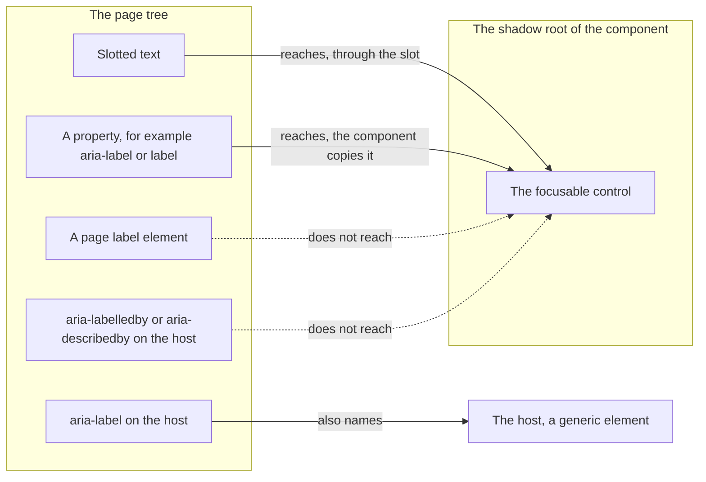
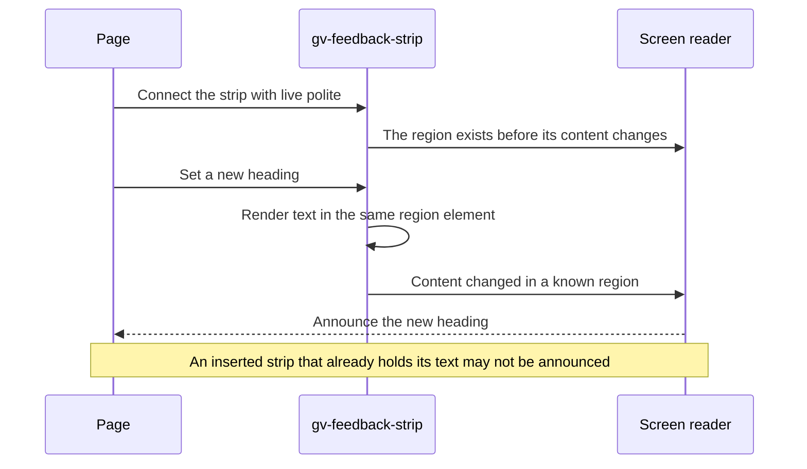
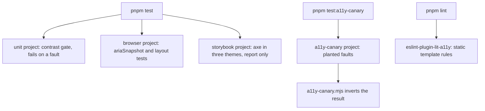

# 09 · Accessibility

> **What you learn here**
>
> - Which WCAG 2.2 success criteria Grove targets, and where each one meets the code.
> - Why an accessible name does not cross the shadow boundary by itself, and what Grove does on
>   `main` today.
> - How images, live regions, colour, forced colours, target size, language, `hidden` and motion
>   work in Grove components.
> - How the contrast gate, the Storybook a11y checks and the a11y canary check the library.
>
> **Read first:** [02 · Web components](02-web-components.md),
> [06 · Styles inside a component](06-styles-inside-a-component.md) and
> [07 · Slots](07-slots.md). **Time:** 60 minutes.
>
> Open work as of main @ e251d45, 2026-10-27.

This chapter carries the most open work in the guide. The body tells what `main` does. Each
open-work box tells what an open PR, a branch or an issue changes.

## Whiteboard

The diagram shows which name sources reach the focusable control inside a shadow root on `main`,
and which ones stop at the shadow boundary.



Every interactive Grove component has its focusable element (a `<button>`, an `<input>` or an `<a>`)
inside its shadow root. Thus most of this chapter is about the boundary between the page and that
element.

## The target WCAG 2.2 AA

Grove targets WCAG 2.2 at level AA.
[Source: Web Content Accessibility Guidelines (WCAG) 2.2](https://www.w3.org/TR/WCAG22/) Three
places in the repo show the target:

- Each `*.metadata.ts` file sets `accessibility.wcag` to `'AA'`.
- The Storybook a11y addon runs only the axe rules with the tags `wcag2a`, `wcag2aa`, `wcag21a`,
  `wcag21aa` and `wcag22aa` (`.storybook/preview.ts`, `parameters.a11y`).
- The contrast gate uses the AA ratios (`src/lib/tokens/contrast.test.ts`).

A green automated check is not a conformance claim. axe checks only a part of WCAG 2.2. Thus the
keyboard, zoom and screen reader checks stay manual. #33 states this rule. WCAG 3 is only a draft,
and Grove makes no WCAG 3 claim.
[Source: W3C Accessibility Guidelines (WCAG) 3.0](https://www.w3.org/TR/wcag-3.0/)

The table lists the success criteria (SC) that this chapter and [10 · Forms](10-forms.md) use. The
guide always writes an SC with its number, its name and its level.

| SC                                                                                                            | Level | Where it meets Grove                                     |
| ------------------------------------------------------------------------------------------------------------- | ----- | -------------------------------------------------------- |
| [1.1.1 Non-text Content](https://www.w3.org/WAI/WCAG22/Understanding/non-text-content)                        | A     | `gv-icon`, `gv-isotype`, `gv-texture`                    |
| [1.3.1 Info and Relationships](https://www.w3.org/WAI/WCAG22/Understanding/info-and-relationships)            | A     | Labels and descriptions across the shadow boundary       |
| [1.3.5 Identify Input Purpose](https://www.w3.org/WAI/WCAG22/Understanding/identify-input-purpose)            | AA    | `autocomplete` on `gv-text-input` (#27)                  |
| [1.4.1 Use of Color](https://www.w3.org/WAI/WCAG22/Understanding/use-of-color)                                | A     | Error and selected states                                |
| [1.4.3 Contrast (Minimum)](https://www.w3.org/WAI/WCAG22/Understanding/contrast-minimum)                      | AA    | The contrast gate: 4.5:1 for text                        |
| [1.4.11 Non-text Contrast](https://www.w3.org/WAI/WCAG22/Understanding/non-text-contrast)                     | AA    | The contrast gate: 3:1 for rings and the input underline |
| [1.4.13 Content on Hover or Focus](https://www.w3.org/WAI/WCAG22/Understanding/content-on-hover-or-focus)     | AA    | `gv-color-swatch` tooltips (#30)                         |
| [2.3.3 Animation from Interactions](https://www.w3.org/WAI/WCAG22/Understanding/animation-from-interactions)  | AAA   | Reduced motion in `componentReset`                       |
| [2.4.1 Bypass Blocks](https://www.w3.org/WAI/WCAG22/Understanding/bypass-blocks)                              | A     | The skip link (#39)                                      |
| [2.4.7 Focus Visible](https://www.w3.org/WAI/WCAG22/Understanding/focus-visible)                              | AA    | The focus ring, `.visually-hidden`                       |
| [2.4.11 Focus Not Obscured (Minimum)](https://www.w3.org/WAI/WCAG22/Understanding/focus-not-obscured-minimum) | AA    | The skip link (#39)                                      |
| [2.5.3 Label in Name](https://www.w3.org/WAI/WCAG22/Understanding/label-in-name)                              | A     | Visible text always names the control (#54 D1)           |
| [2.5.8 Target Size (Minimum)](https://www.w3.org/WAI/WCAG22/Understanding/target-size-minimum)                | AA    | `gv-menu-item`, `gv-checkbox`                            |
| [3.1.2 Language of Parts](https://www.w3.org/WAI/WCAG22/Understanding/language-of-parts)                      | AA    | `lang` on the host, `hreflang`                           |
| [3.3.1 Error Identification](https://www.w3.org/WAI/WCAG22/Understanding/error-identification)                | A     | Error text for `gv-text-input` (#27, #51)                |
| [3.3.2 Labels or Instructions](https://www.w3.org/WAI/WCAG22/Understanding/labels-or-instructions)            | A     | A label mechanism for each control                       |
| [4.1.2 Name, Role, Value](https://www.w3.org/WAI/WCAG22/Understanding/name-role-value)                        | A     | The name of each focusable control                       |
| [4.1.3 Status Messages](https://www.w3.org/WAI/WCAG22/Understanding/status-messages)                          | AA    | `gv-feedback-strip`, the `gv-color-swatch` copy status   |

2.3.3 Animation from Interactions is level AAA. WCAG 2.2 AA does not require it. Grove meets it
because `componentReset` stops motion under `prefers-reduced-motion: reduce` (see
[Hidden and reduced motion](#hidden-and-reduced-motion)).

## Accessible names across the shadow boundary

An accessible name is the text that assistive technology announces for a control. The browser
computes it with the accessible name algorithm.
[Source: Accessible Name and Description Computation 1.2](https://www.w3.org/TR/accname-1.2/) In
Grove, the control that takes focus is inside the shadow root, but the page writes its markup on the
host. Three rules of the platform decide what reaches the control.

### Rule 1 ID references stay in their own tree

`<label for>`, `aria-labelledby` and `aria-describedby` hold ID values. The browser looks up each ID
in the tree of the element that carries it. The HTML standard says that the `for` value must be the
ID of a labelable element "in the same tree as the label element".
[Source: HTML Standard, the label element](https://html.spec.whatwg.org/multipage/forms.html#attr-label-for)
`getElementById()` also searches one tree only.
[Source: DOM Standard, getElementById()](https://dom.spec.whatwg.org/#dom-nonelementparentnode-getelementbyid)

Thus code inside a shadow root cannot find a page ID. The page cannot find an ID inside a shadow
root. [02 · Web components](02-web-components.md#id-references-stay-in-one-tree)
explains trees.

An ID reference works when both ends are in one shadow root. `gv-color-swatch` uses this. Its copy
buttons point `aria-describedby` at the IDs of `gv-tooltip` elements in the same shadow root:

`ColorSwatch.ts`, `render()`:

```ts
						aria-label="Copy hex value"
						aria-describedby="hex-tip"
```

### Rule 2 A label element labels only a labelable element

A `<label>` names its labeled control: the element that `for` points to, or the first labelable
descendant. A custom element is labelable only when it is a form-associated custom element.
[Source: HTML Standard, labelable elements](https://html.spec.whatwg.org/multipage/forms.html#category-label)
On `main`, no Grove component is form-associated. Thus a `<label>` around a Grove control, or a
`<label for>` that points to one, does not name it.
[10 · Forms](10-forms.md#forms-on-main-today) tells the other effects.

### Rule 3 An aria-label on the host names the host

The host has no role, so the browser exposes it as a generic element. WAI-ARIA 1.2 gives the
`generic` role "Name From: prohibited", so authors must not name it.
[Source: WAI-ARIA 1.2, generic role](https://www.w3.org/TR/wai-aria-1.2/#generic) When a page puts
`aria-label` on a host, the host becomes a named generic. The control inside does not get the name,
unless the component copies it.

### What does cross

- **Slotted text.** Slotted nodes stay in the light DOM, but the browser renders them in the slot.
  The name of a control can come from its content, and that content includes the slotted text. Thus
  `<gv-button>Save</gv-button>` gives the inner `<button>` the name "Save".
- **A property that the component copies.** The component renders the value as an attribute on the
  control, in the same shadow root. `gv-back-button` renders `label` as the `aria-label` of its
  button.
- **ARIA element reflection, in one direction.** `ariaLabelledByElements` takes element references
  instead of IDs.
  [Source: MDN, Element: ariaLabelledByElements](https://developer.mozilla.org/en-US/docs/Web/API/Element/ariaLabelledByElements)
  A reference can point to an element in the same tree or in an ancestor tree of the shadow root.
  It cannot point into a nested shadow root.
  [Source: HTML Standard, attr-associated element](https://html.spec.whatwg.org/multipage/common-dom-interfaces.html#attr-associated-element)
  No component on `main` uses it.

The ARIA APG, the W3C guide to ARIA patterns, explains names and descriptions in general.
[Source: ARIA APG, Providing Accessible Names and Descriptions](https://www.w3.org/WAI/ARIA/apg/practices/names-and-descriptions/)

### Names on main today

| Component           | Where the name comes from on `main`                                        | Trap                                                                                                       |
| ------------------- | -------------------------------------------------------------------------- | ---------------------------------------------------------------------------------------------------------- |
| `gv-button`         | Slotted text, else `text`; or `aria-label`, copied to the inner `<button>` | The host keeps `aria-label`, so the host is a named generic too                                            |
| `gv-icon-button`    | `aria-label`, copied to the inner `<button>`                               | The same host trap. It also renders `aria-disabled="false"` when it is enabled                             |
| `gv-back-button`    | `label`, default `'Go back'`, as the `aria-label` of the inner `<button>`  | None                                                                                                       |
| `gv-checkbox`       | Slotted text only. The slot is inside the `<button role="checkbox">`       | Without slotted text, it has no name. A page `<label>` and a host `aria-label` do nothing                  |
| `gv-todo-list-item` | Nothing names its inner `gv-checkbox`                                      | The `heading` text is in a different shadow root from the checkbox button                                  |
| `gv-text-input`     | `aria-label`, copied to the inner `<input>`                                | `aria-describedby` is copied as an ID and resolves to nothing. `input-id` with `<label for>` names nothing |
| `gv-menu-item`      | Slotted text, else `label`, inside the `<a>`                               | Here `label` is visible text, not an invisible name                                                        |
| `gv-color-swatch`   | Fixed `aria-label` values on its buttons                                   | None. Its in-root `aria-describedby` works                                                                 |

An accessibility audit of `main` @ 4015556 measured these traps in Chrome's own accessibility tree
(#21). The `gv-checkbox` label slot shipped after that audit. Thus
`<gv-checkbox>Subscribe</gv-checkbox>` has a name on `main`, but a `gv-checkbox` without slotted
text does not.

> [!IMPORTANT]
> **Open work: #21 — accessible names and descriptions across the shadow boundary** (branch, no
> PR)
>
> The spec compares four options:
>
> - **A.** Form association, `ElementInternals` and `delegatesFocus`. The host becomes labelable.
> - **B.** Properties rendered inside the shadow root, such as `label` and `description`.
> - **C.** ARIA element reflection from the inner control to elements in the page.
> - **D.** Reference Target: the shadow root sends ID references for the host to an inner element.
>   This is a proposal, not shipped.
>   [Source: WICG, Reference Target explainer (proposal, not shipped)](https://github.com/WICG/webcomponents/blob/gh-pages/proposals/reference-target-explainer.md)
>
> The decisions of #21:
>
> - **#21 OD1** chose #54 D1, plus page labels through the `FormControl` mixin.
> - **#21 OD3**, as amended, keeps the host `aria-label` as a fallback for one minor. A development
>   warning shows.
> - **#21 OD4** adds one `description` property.
> - **#21 OD5** adds a warning for a control with no name.
> - **#21 OD6** reads Chrome's own tree for the tests.
>
> The #50 work branch implements all of them. When it lands, rewrite the table above.
> <https://github.com/edgarjaymez/grove-lit/issues/21>

> [!IMPORTANT]
> **Open work: #50 — accessible names across the shadow boundary** (branch, no PR)
>
> The #50 work branch, linked from epic #50, applies #54 D1 as amended on 2026-10-08. The order is:
> visible text (slotted text or the `text` prop), then a page `<label>`, then `label`, the invisible
> name. With none of them, the control has no name, and a development warning shows once per tag.
> As built:
>
> - The `FormControl` mixin sets `internals.role = 'none'`, so the host never carries a name.
> - It opens the shadow root with `delegatesFocus`, so a label click and `host.focus()` reach the
>   inner control.
> - It copies the text of the page labels into the `aria-label` of the inner control. It does not
>   use `ariaLabelledByElements`, because axe cannot follow a cross-root reference: Chrome
>   serializes it as `aria-labelledby=""`. Also, Chrome read the name twice for a label around
>   the control.
> - The precedence uses slotted text, not any slotted node (#50 R3). An icon alone is not a name.
> - `description` renders in a `hidden` span with an in-root `aria-describedby` (#50 R5).
>
> The branch starts from #68 @ cbaa7b0, not from the current head of #68. Thus treat its mixin
> details as provisional. When it lands, rewrite this section and the table above.
> <https://github.com/edgarjaymez/grove-lit/issues/50>

### How a test reads a name

On `main`, browser tests read the accessibility tree with the `ariaSnapshot` command
(`vite.config.ts`, `ariaSnapshot`). It returns the YAML snapshot that Playwright computes.
[Source: Playwright, ARIA snapshots](https://playwright.dev/docs/aria-snapshots) That computation is
Playwright's own. It is not the tree that Chrome exposes to assistive technology.
[17 · Tests](17-tests.md#names-in-the-accessibility-tree) explains the test commands.

> [!IMPORTANT]
> **Open work: #50 — accessible names across the shadow boundary** (branch, no PR)
>
> This box is about the name tests. #50 R2 found that `ariaSnapshot` cannot meet #21 FR-17, which asks for the browser's own tree. The
> snapshot never shows a named role-less host, and it misses names set through element references
> across a shadow boundary. The branch adds an `axNodes` browser command. It reads Chrome's nodes
> over the DevTools protocol, and a self-test pins the cases where the two disagree.
> [Source: Chrome DevTools Protocol, Accessibility domain](https://chromedevtools.github.io/devtools-protocol/tot/Accessibility/)
> When it lands, describe `axNodes` here and in chapter 17.
> <https://github.com/edgarjaymez/grove-lit/issues/50>

> [!IMPORTANT]
> **Open work: #25 — give the checkbox an accessible name** (branch, no PR)
>
> On `main`, only slotted text names `gv-checkbox`. #25 OD1 sets the order: slotted text, then a
> page `<label>` or `<label for>`, then `label`. The checkbox joins the `FormControl` mixin for the
> page labels. The tick stays `aria-hidden`. The state comes from `aria-checked`, never from the
> glyph.
>
> The #25 comments still name `ariaLabelledByElements`, but the branch copies the label text instead
> (#50). When it lands, update the table above.
> [10 · Forms](10-forms.md#field-state-and-validity) tells the form part.
> <https://github.com/edgarjaymez/grove-lit/issues/25>

> [!IMPORTANT]
> **Open work: #26 — gv-todo-list-item names its checkbox** (branch, no PR)
>
> The `heading` rename, the single `gv-change` event and the hidden category glyph are on `main`
> (#26 FR-07 to FR-12). The name is still open work. #50 R4 rejected one idea: the title in the
> slot of the inner checkbox. Then the focus ring and the row click would move.
>
> The branch renders `<gv-checkbox label=${heading}>`. Then the name is the same as the visible
> title, so 2.5.3 Label in Name (A) holds. With `heading=""`, the checkbox has no name. When it
> lands, update the table above. <https://github.com/edgarjaymez/grove-lit/issues/26>

## ARIA properties

A component that copies an ARIA attribute uses one pattern on `main`:

- The type is `string | null`, and the default is `null`.
- The component sets the attribute name by hand, for example `attribute: 'aria-label'`. Lit would
  otherwise use `arialabel`.
- The template writes `?? nothing`, so a `null` value removes the attribute.

`Button.ts`, `ariaLabel`:

```ts
	@property({ type: String, attribute: 'aria-label' }) ariaLabel: string | null = null;
```

`Button.ts`, `render()`:

```ts
				aria-label=${this.ariaLabel ?? nothing}
```

`gv-button`, `gv-icon-button` and `gv-text-input` use this pattern. `gv-text-input` also copies
`aria-describedby`, which does not work across the boundary (Rule 1).

The trap: `HTMLElement` already has an `ariaLabel` property that reflects the `aria-label`
attribute. [Source: MDN, Element: ariaLabel](https://developer.mozilla.org/en-US/docs/Web/API/Element/ariaLabel)
The Lit property replaces that built-in property. Thus `el.ariaLabel = 'Close'` from script sets the
Lit property and names the inner button, but it writes no host attribute. The attribute in markup
names the host as well (Rule 3).
[03 · Lit essentials](03-lit-essentials.md#aria-properties-and-reflection) tells more.

> [!NOTE]
> **Lit box: an attribute name set by hand**
>
> By default, Lit uses the lowercase property name as the attribute name. The `attribute` option
> sets a different name. Grove example, `Button.ts`, `ariaLabel`:
> `@property({ type: String, attribute: 'aria-label' }) ariaLabel: string | null = null;`
>
> Lit docs: [Reactive properties](https://lit.dev/docs/v3/components/properties/)

In Lit 3, `ifDefined(value)` is the same as `value ?? nothing` (`lit-html`,
`directives/if-defined.js`). Thus both forms remove the attribute for `null` and for `undefined`.
Grove writes `?? nothing` for ARIA properties and `ifDefined()` for optional strings, as a house
rule.

> [!IMPORTANT]
> **Open work: #50 — accessible names across the shadow boundary** (branch, no PR)
>
> This box is about properties named after ARIA attributes. Epic #50 records the trap above: the
> reactive `ariaLabel` replaces the built-in ARIA reflection. The branch removes the `ariaLabel`
> and `ariaDescribedby` properties from `gv-button`, `gv-icon-button` and `gv-text-input`.
>
> The new rule: never declare a property named after an ARIA attribute. Use `label` and
> `description` (`src/lib/utils/accessible-name.ts` on the branch). For one minor, a host
> `aria-label` still names a control with no other name, and a development warning shows.
>
> #50 R6 adds a second trap. Without the reactive property, `el.ariaLabel = 'x'` writes the host
> attribute again. Thus the warning reads the attribute, not a property. When it lands, replace the
> pattern above with the new rule. <https://github.com/edgarjaymez/grove-lit/issues/50>

## Decorative and meaningful images

1.1.1 Non-text Content (A) asks for a text alternative for an image that gives information. Hide a
decorative image from assistive technology.

- **`gv-icon` is decorative by default.** The `ph-*` glyph elements always have
  `aria-hidden="true"`. When `label` has text that is not blank, the wrapper `span.glyph` gets
  `role="img"` and `aria-label`. The host does not change.
- **`gv-isotype`** renders its SVG with `role="img"` and `aria-label` when `label` is set. Without
  `label`, the SVG has `aria-hidden="true"`.
- **`gv-texture`** is always decorative. Its SVG has `aria-hidden="true"`.
- **Inside a control**, a glyph is decorative. The name of the control comes from its text or its
  label. Five components also put `aria-hidden="true"` on their `gv-icon` host: `gv-back-button`,
  `gv-menu-item`, `gv-title`, `gv-feedback-strip` and `gv-tooltip`.

`Icon.ts`, `render()`:

```ts
const label = this.label?.trim() ? this.label : undefined;
return staticHtml`<span
			class="glyph"
			role=${label ? 'img' : nothing}
			aria-label=${label ?? nothing}
		>${glyph}</span>`;
```

The two stacked weights of a `fill-in-hover` icon are both inside one `span.glyph`. Thus a labelled
glyph is exactly one image node, at rest and on hover.

> [!IMPORTANT]
> **Open work: #47 — gv-icon decorative by default and the glyph warning** (issue, open: behaviour
> on main, checks remain)
>
> The code shipped with #55. The epic closes only after the manual checks P1 to P4 in Firefox and
> Safari inspectors, VoiceOver with Safari and NVDA with Chrome.
>
> PR #64 (gv-icon glyph tests and the dist gate) adds more checks. A test compares the glyphs that
> each component draws with its `phosphor` metadata field. Parity tests cover `Home.mdx` and
> `browser-setup.ts`. `scripts/check-dist.mjs` fails `pnpm build` when no `dist/*.js` file reads
> `process.env.NODE_ENV`. Thus the bundler of the consumer still controls the development warning.
> When the checks pass, remove this box. <https://github.com/edgarjaymez/grove-lit/issues/47>

## Live regions

4.1.3 Status Messages (AA) asks that a status message reach assistive technology without a move of
focus. A live region does this. The ARIA `aria-live` attribute marks a region and its politeness.
[Source: MDN, aria-live](https://developer.mozilla.org/en-US/docs/Web/Accessibility/ARIA/Reference/Attributes/aria-live)

`gv-feedback-strip` has a `live` property: `polite`, `assertive` or `off`. When `live` is not set,
the role follows `type`: `role="status"` for `success` and `information`, and `role="alert"` for
`danger`. `off` renders no live region.

`FeedbackStrip.ts`, `REGIONS` and `render()`:

```ts
const REGIONS = {
	polite: { role: 'status', ariaLive: 'polite' },
	assertive: { role: 'alert', ariaLive: 'assertive' },
	off: { role: undefined, ariaLive: undefined }
} as const;
```

```ts
const live = this.live && Object.hasOwn(REGIONS, this.live) ? this.live : TYPES[t].live;
```

The sequence diagram shows when a screen reader is most likely to announce a strip.



Follow these rules:

- **The region must exist before its content changes.** WCAG technique ARIA22 describes a status
  container that is in the page before the message shows.
  [Source: WCAG 2.2 Techniques, ARIA22](https://www.w3.org/WAI/WCAG22/Techniques/aria/ARIA22) The
  strip never makes its region element again when `heading` or `message` changes. Thus the reliable
  pattern is: keep one strip connected and change its text.
- **Do not nest live regions.** ARIA does not define how nested regions announce. Do not wrap a
  strip in your own `role="status"` element, and do not set `role` or `aria-live` on the host.
- **Use `off` only for a notice that is part of the page,** or for a strip that gets focus when it
  shows. `off` on a status message that shows without a move of focus fails 4.1.3 Status Messages
  (AA).

`gv-color-swatch` keeps a persistent live region. The `<p>` is always in the shadow root, and the
component fills it only after a copy:

`ColorSwatch.ts`, `render()`:

```ts
				<p class="visually-hidden" role="status" aria-live="polite">
					${this.copied ? `Copied ${this.copied} value` : ''}
				</p>
```

> [!NOTE]
> **Lit box: ifDefined removes an attribute**
>
> `ifDefined(value)` renders the attribute when the value has one. It removes the attribute when the
> value is `undefined` or `null`, because in Lit 3 it is `value ?? nothing`. Thus `live="off"`
> leaves no empty `role` attribute. Grove example, `FeedbackStrip.ts`, `render()`:
> `role=${ifDefined(region.role)}`
>
> Lit docs: [Built-in directives](https://lit.dev/docs/v3/templates/directives/)

> [!IMPORTANT]
> **Open work: #37 — choose how gv-feedback-strip announces** (issue, open: behaviour on main,
> checks remain)
>
> The `live` property is on `main`. The screen reader matrix is open: NVDA with Firefox and Chrome,
> and VoiceOver with Safari. It records four cases for `polite`, `assertive` and `off`:
>
> - an inserted strip;
> - a changed strip;
> - a strip in the server HTML that upgrades later;
> - a strip inside a consumer `role="status"` wrapper.
>
> Until then, the metadata says that an announcement on insertion is not guaranteed. For open
> decision 1 of #37, the spec recommends (a): document it only. When the matrix is done, update the
> metadata note and this section. <https://github.com/edgarjaymez/grove-lit/issues/37>

## Colour is never the only cue

1.4.1 Use of Color (A) forbids colour as the only visual means to convey information. The failure
technique F81 describes an error or a required field that only a colour change shows.
[Source: WCAG 2.2 Techniques, F81](https://www.w3.org/WAI/WCAG22/Techniques/failures/F81)

Grove components on `main` show these cues:

| Component                  | State    | Cues other than colour                                   |
| -------------------------- | -------- | -------------------------------------------------------- |
| `gv-checkbox`              | Checked  | The tick glyph                                           |
| `gv-menu-item`             | Active   | The emphasis font weight, the Fill glyph, `aria-current` |
| `gv-feedback-strip`        | Type     | The heading text. The icon is `aria-hidden`              |
| `gv-text-input`            | Error    | None. Only the colours change, plus `aria-invalid`       |
| `gv-todo-category-toggler` | Selected | A small lightness step in dark, plus a different shadow  |

A page that signals an error only with the `error` attribute of `gv-text-input` fails 1.4.1 Use of
Color (A). Put the error text on the page next to the field.

> [!IMPORTANT]
> **Open work: #27 — gv-text-input non-colour error cue** (issue, blocked: Needs Figma Spec)
>
> In the error state, the underline grows from `--border-width-heavy` (2 px) to
> `--border-width-thick` (4 px). The bottom padding shrinks by the same amount, so the height stays
> the same. Border widths survive forced colours, so the cue shows there too. The spec also adds an
> error message line, `autocomplete`, `inputmode` and `required`. It asks for the message as a
> description, because support for `aria-errormessage` alone is weaker. #51 groups it with #18. When
> it lands, update the table above. <https://github.com/edgarjaymez/grove-lit/issues/27>

> [!IMPORTANT]
> **Open work: #29 — gv-todo-category-toggler selected cue** (issue, blocked: Needs Figma Spec)
>
> In dark, the selected toggler and the toggler at rest differ by only 1.14 to 1.83:1. In forced
> colours, they are the same, pixel for pixel.
>
> The spec adds an inline SVG tick in `currentColor`, with `aria-hidden`, when selected. The tick
> needs 3:1 against its neighbours under
> 1.4.11 Non-text Contrast (AA). 1.4.11 does not cover a colour change between the states of one
> component, but a new indicator must meet it. An author `outline` would replace the focus
> outline, which fails 2.4.7 Focus Visible (AA). When it lands, update the table above.
> <https://github.com/edgarjaymez/grove-lit/issues/29>

> [!IMPORTANT]
> **Open work: #16 — gv-status-chip** (issue, blocked: Needs Figma Spec)
>
> The chip is a dot and a label. The label carries the status in words, so colour is not the only
> cue. The dot is `aria-hidden`. The 500 step of the primitives fails at night (2.00 to 3.13:1). The
> spec recommends new semantic status tokens, so that the contrast gate measures them with no extra
> test. The spec uses `label` for visible text, which conflicts with #54 D1.
> <https://github.com/edgarjaymez/grove-lit/issues/16>

> [!IMPORTANT]
> **Open work: #19 — gv-journey-rail** (issue, blocked: Needs Figma Spec)
>
> The rail shows its stops as visited, active or not yet visited, with dots and a trail. Each
> needs 3:1 against the surface behind it, under 1.4.11 Non-text Contrast (AA). The active stop
> also carries `aria-current`, so the state does not depend on colour alone.
> <https://github.com/edgarjaymez/grove-lit/issues/19>

## Forced colours

In forced colours mode, the browser replaces author colours with the system colours of the user.
`box-shadow` and `text-shadow` compute to `none`.
[Source: CSS Color Adjustment Module Level 1, properties affected by forced colors mode](https://www.w3.org/TR/css-color-adjust-1/#forced-colors-properties)
The `forced-colors` media feature tells a page that the mode is on.
[Source: MDN, forced-colors](https://developer.mozilla.org/en-US/docs/Web/CSS/Reference/At-rules/@media/forced-colors)

On `main`, no file in `src/lib` has a `@media (forced-colors: active)` rule. The components survive
the mode in these ways:

- **The focus ring.** It is a `box-shadow`, so the mode removes it. The `focusRing` fragment also
  sets a transparent `outline`. The mode paints that outline in a system colour, so it becomes the
  indicator. `focus-ring.browser.test.ts` checks this with
  `emulateMedia({ forcedColors: 'active' })`.
  [14 · The focus ring](14-the-focus-ring.md#forced-colours) explains it.
- **Strokes in `currentColor`.** The checkbox tick uses `stroke="currentColor"`, so it takes the
  forced text colour. Checked and unchecked still differ.
- **Border widths.** The mode keeps widths and changes only colours. #27 uses this for its error
  cue.
- **Fills and shadows.** These change or go away. The toggler loses its selected state (#29), and
  the text input loses its error state (#27).

## Target size

2.5.8 Target Size (Minimum) (AA) asks for a target of at least 24 by 24 CSS pixels, or enough space
around a smaller target. The Understanding page lists the exceptions.

- **`gv-menu-item`.** Each row has `min-block-size: var(--soft-grid-24)`, at both sizes.
  `MenuItem.browser.test.ts` checks that a one-line row is at least 24 px tall.
- **`gv-checkbox`.** The box is 24 by 24 px, or 28 by 28 px with `responsive="xl"`.

`MenuItem.ts`, `.item`:

```css
/* WCAG 2.2 SC 2.5.8: every row is at least 24 CSS px tall, at either size. */
min-block-size: var(--soft-grid-24);
```

> [!IMPORTANT]
> **Open work: #46 — gv-menu-item 24 px target and hreflang** (issue, open: behaviour on main,
> checks remain)
>
> The code is on `main`. The epic stays open for three items:
>
> - Manual checks: `:lang(es)` in Firefox and Safari, the accessibility tree, VoiceOver and NVDA.
> - The 0.46.0 release note: `sm` rows grow from 20 px to 24 px.
> - A 24 px SubMenuItem in Figma.
>
> When they are done, remove this box. <https://github.com/edgarjaymez/grove-lit/issues/46>

> [!IMPORTANT]
> **Open work: #63 — gv-menu-item a11y check and metadata** (open PR, no conflict with main on
> 2026-10-27)
>
> Under `test: 'todo'`, a target-size regression passed `pnpm test`. The PR sets
> `parameters: { a11y: { test: 'error' } }` in `MenuItem.stories.ts`, so the stories of this
> component fail on any axe violation. `preview.ts` stays at `'todo'`, with a comment about the
> opt-in for each stories file.
>
> The PR also changes `requiredProps` from `['label', 'href']` to `['href']`, because slotted
> content can replace `label`. It adds `link-attributes.test.ts`, with five cases for
> `linkAttribute`. PR #68 contains the commits of #63. When it lands, update
> [The a11y checks in Storybook](#the-a11y-checks-in-storybook).
> <https://github.com/edgarjaymez/grove-lit/pull/63>

## Language of parts

3.1.2 Language of Parts (AA) asks that the page mark the language of each passage. The `lang`
attribute does this.
[Source: MDN, lang](https://developer.mozilla.org/en-US/docs/Web/HTML/Reference/Global_attributes/lang)

Put `lang` on the host. An element in a shadow root whose parent is the shadow root takes the
language of the host.
[Source: HTML Standard, the lang and xml:lang attributes](https://html.spec.whatwg.org/multipage/dom.html#the-lang-and-xml:lang-attributes)
Thus the shadow `<a>` of `gv-menu-item` gets the language of its host, and a screen reader can
change its voice.

`lang` is not a Lit property in any component. `HTMLElement` already has a native `lang` accessor
that reflects the attribute. `MenuItem.browser.test.ts` sets `el.lang = 'es'` and checks that the
shadow link matches `:lang(es)`.

`hreflang` is different. It names the language of the target of a link.
[Source: MDN, the a element, hreflang](https://developer.mozilla.org/en-US/docs/Web/HTML/Reference/Elements/a#hreflang)
`gv-menu-item` forwards `hreflang` to its `<a>` only when `href` is set:

`MenuItem.ts`, `render()`:

```ts
				hreflang=${ifDefined(linkAttribute(this.href, this.hreflang))}
```

`linkAttribute(href, value)` in `src/lib/utils/link-attributes.ts` returns `undefined` without an
`href` or an empty value. Then `ifDefined` removes the attribute.

> [!IMPORTANT]
> **Open work: #68 — gv-button link mode and form association** (open PR, no conflict with main on
> 2026-10-27)
>
> The PR gives `gv-button` a link mode with `href`, `target`, `rel` and `hreflang`. It uses the same
> `linkAttribute` helper, plus a new `linkRel`. It also adds `target` and `rel` to `gv-menu-item`.
> Then both link components forward the same three link attributes. When it lands, add `gv-button`
> to this section.
> [10 · Forms](10-forms.md#link-mode) explains link mode.
> <https://github.com/edgarjaymez/grove-lit/pull/68>

## Hidden and reduced motion

`componentReset` gives every component two host guarantees.
[06 · Styles inside a component](06-styles-inside-a-component.md#the-component-reset) explains
the CSS.

`component-reset.ts`, `componentReset`:

```css
:host([hidden]:not([hidden='until-found'])) {
	display: none !important;
}
```

- **`hidden` hides the host.** A page rule such as `display: flex` on the host would otherwise win,
  so the rule needs `!important`. `hidden="until-found"` keeps the browser behaviour.
  [Source: MDN, hidden](https://developer.mozilla.org/en-US/docs/Web/HTML/Reference/Global_attributes/hidden)
  A hidden element leaves the accessibility tree and the tab order.
- **Reduced motion ends motion at once.** Under `prefers-reduced-motion: reduce`, every transition
  and animation lasts `0.01ms`, delays are `0s`, and an animation runs one time.
  [Source: MDN, prefers-reduced-motion](https://developer.mozilla.org/en-US/docs/Web/CSS/Reference/At-rules/@media/prefers-reduced-motion)
  The value is `0.01ms`, not `0s`, so that `transitionend` still fires. A transition still ends at
  its final value.

This meets 2.3.3 Animation from Interactions (AAA), which is above the AA target.
`host-hidden.browser.test.ts` and `reduced-motion.browser.test.ts` check both guarantees.

> [!IMPORTANT]
> **Open work: #66 — componentReset tests for hidden and reduced motion** (open PR, no conflict
> with main on 2026-10-27)
>
> The PR changes no rule, and it closes #45. It adds tests, the shared helper `src/test/shadow.ts`
> and documentation. The tests check the real Tab order, an upgrade from an inert document, and the
> ARIA snapshot before, during and after `hidden`. They also add an `AT_REST` table of motion times.
>
> The PR documents one limit: `hidden="until-found"` hides nothing on the four inline hosts
> (`gv-button`, `gv-checkbox`, `gv-icon-button`, `gv-todo-category-toggler`). When it lands, add
> the `until-found` limit to this section.
> <https://github.com/edgarjaymez/grove-lit/pull/66>

## Visually hidden text and skip links

`.visually-hidden` keeps text in the accessibility tree and draws nothing. It is a 1 by 1 px box
with `clip-path: inset(50%)`. It never uses `display: none` or `visibility: hidden`, because those
remove the text from the tree. Grove ships it in two forms:

- `src/lib/styles/a11y.css`, for the light DOM. `grove.css` imports it.
- The `visuallyHidden` style fragment, for a shadow root. `src/lib/index.ts` exports it.

`visually-hidden.test.ts` checks that the two have the same declarations.
[06 · Styles inside a component](06-styles-inside-a-component.md#the-visually-hidden-fragment)
explains the fragment.

> [!NOTE]
> **Lit box: a shared fragment in static styles**
>
> `static styles` takes an array, so a component can adopt shared `css` fragments next to its own
> styles. Grove example, `ColorSwatch.ts`, `static styles`: the array lists `componentReset,`,
> `focusRing,` and `visuallyHidden,`, and then the `css` block of the component.
>
> Lit docs: [Styles](https://lit.dev/docs/v3/components/styles/)

Obey two rules:

- **Never put `.visually-hidden` on a focusable element.** The element would take focus while it is
  not visible. That fails 2.4.7 Focus Visible (AA).
- **It does not hide text from assistive technology.** For content that must be hidden from all
  users, such as a spam honeypot, also set `aria-hidden="true"` on the wrapper and `tabindex="-1"`
  on the field.

A skip link lets a keyboard user go past repeated blocks, which 2.4.1 Bypass Blocks (A) asks for.
Grove has no skip link on `main`. A skip link must be light-DOM HTML with CSS, not a custom element.
A custom element renders nothing until its script runs, and a keyboard user can reach the link
before that.

> [!IMPORTANT]
> **Open work: #39 — the skip link utility** (issue, blocked: Needs Figma Spec)
>
> The `.visually-hidden` part of #39 is on `main`. The skip link is not started. The spec asks for
> a `.skip-link` class with these properties:
>
> - It is hidden at rest and shows on `:focus`, not only on `:focus-visible`.
> - It is fixed at the block-start and inline-start corner, with logical properties.
> - It has no transitions, it has a border in forced colours, and it wraps at a 320 px viewport.
>
> The consumer recipe: the link is the first focusable element in `<body>`, and the target has
> `tabindex="-1"`.
>
> The spec lists six open decisions. The `.visually-hidden` class on `main` uses the unprefixed
> name, which answers the class-name decision for that class. The other five decisions are:
>
> - the surface: accent summit, brand summit, or Ground with a border and the summit shadow;
> - the ring over an unknown backdrop;
> - a z-index value (no token exists), and `position: fixed` or `absolute`;
> - `!important` on the visually hidden declarations;
> - a separate export for `a11y.css`.
>
> The SC that apply:
>
> - 2.4.1 Bypass Blocks (A) and
>   [2.4.3 Focus Order](https://www.w3.org/WAI/WCAG22/Understanding/focus-order) (A).
> - 2.4.7 Focus Visible (AA) and 2.4.11 Focus Not Obscured (Minimum) (AA).
> - 1.4.3 Contrast (Minimum) (AA) and 2.5.8 Target Size (Minimum) (AA).
> - [1.4.4 Resize Text](https://www.w3.org/WAI/WCAG22/Understanding/resize-text) (AA),
>   [1.4.10 Reflow](https://www.w3.org/WAI/WCAG22/Understanding/reflow) (AA) and
>   [1.4.12 Text Spacing](https://www.w3.org/WAI/WCAG22/Understanding/text-spacing) (AA).
>
> When it lands, describe the class here. <https://github.com/edgarjaymez/grove-lit/issues/39>

## The contrast gate

`src/lib/tokens/contrast.test.ts` reads the generated `tokens.css` and measures the colour tokens
in the light theme and the dark theme. It reads the sRGB baseline blocks (the first `:root` and the
first `[data-theme="dark"]`) and rounds each colour to 8 bits, as a screen shows it. It runs in the
`unit` project, so `pnpm test` runs it each time. It checks these items:

- **Every text-on pair is readable.** Each `--semantic-color-text-on-*` token must have 4.5:1
  against its surface, for 1.4.3 Contrast (Minimum) (AA). Base and subtle text on a terrace is also
  measured against Ground, because transparent buttons and the gray text input put it there.
- **Every focus ring has 3:1.** The ring stroke must have 3:1 against the ring gap, which has the
  colour of the surface, for 1.4.11 Non-text Contrast (AA).
- **The text-input underline has 3:1** against the input fill and against Ground, for 1.4.11
  Non-text Contrast (AA).
- **Every shadow uses a palette colour.** This is a drift guard.
- **`tokens.css` matches the JSON sources.** If you edit a JSON file and do not run
  `pnpm build-tokens`, the test fails.
- **The theme cascade obeys its rules.** For example, OS dark and `[data-theme="dark"]` give the
  same values, and `<html data-theme="light">` opts out of OS dark at every breakpoint.
  [13 · Themes and page CSS](13-themes-and-page-css.md#how-themes-layer-in-one-file) explains the
  cascade.
- **Coverage.** Every text-on token and every ring token in `tokens.css` must be in the measured
  list.

APCA is a supplementary measure, not a W3C standard. The gate also holds each text pair to an APCA
Bronze floor. The floor is Lc 75 for base text on Ground or a terrace, and Lc 60 for other text.
[Source: Accessible Perceptual Contrast Algorithm, ARC](https://readtech.org/ARC/) The test uses the
unmodified `apca-w3` package, which is a test-only dependency.
[Source: apca-w3 on GitHub](https://github.com/Myndex/apca-w3) An advisory test also records each
ring against the aurora of its track. It annotates the run and never fails
(`records each ring against its track aurora (advisory)`).

`contrast.test.ts`, the text pair check:

<!-- prettier-ignore -->
```ts
return Math.abs(signed) >= minLc && cr >= 4.5
```

To run the gate alone, use the unit project:

```sh
pnpm vitest run --project unit src/lib/tokens/contrast.test.ts
```

The colour helpers (`parseOklch`, `toRgb`, `ratio`, `lc` and the others) are private functions
inside `contrast.test.ts`. No other file can import them.
[12 · Surfaces and elevation](12-surfaces-and-elevation.md#contrast-on-summit-and-aurora) uses the
gate to explain contrast on summit and aurora surfaces.

> [!IMPORTANT]
> **Open work: #51 — gv-text-input as a real form field** (issue, blocked: Needs Figma Spec)
>
> #51 F5 asks for the colours of the new error underline and message in a sibling
> `*.contrast.test.ts`, with helpers that "#23's PR" extracted. That extraction never happened.
> #16 and #30 also propose a sibling contrast test, and #58 plans to reuse the private helpers of
> `contrast.test.ts`. The first of these items to land must move the helpers out of
> `contrast.test.ts` into a shared test module. When that happens, describe the module here.
> [23 · Known drift](23-known-drift.md#specs-that-lag-the-code) lists this drift.
> <https://github.com/edgarjaymez/grove-lit/issues/51>

## The a11y checks in Storybook

The diagram shows the accessibility checks on `main` and the command that runs each one.



`@storybook/addon-a11y` runs axe on each story. The `storybook` test project runs every story in
three themes: light, dark and OS dark.
[16 · Storybook](16-storybook.md#how-a-test-picks-a-theme) tells how each run gets its theme.

The `a11y.test` parameter has three values: `'off'`, `'todo'` and `'error'`. With `'todo'`, a
violation shows as a warning. With `'error'`, a violation fails the test. You can set the parameter
in the preview, in the meta of a stories file, or on one story.
[Source: Storybook 10 docs, Accessibility tests (read 2026-10-27)](https://storybook.js.org/docs/writing-tests/accessibility-testing)

`.storybook/preview.ts`, `parameters.a11y`:

```ts
		// Report-only until the known violations are fixed (#50: checkbox names); then 'error'.
		// The rule set matches the audit in #33, so results compare one to one.
		a11y: {
			test: 'todo',
```

Thus on `main`, no story fails on an axe violation. Only `A11yCanary.stories.ts` sets
`test: 'error'`, for the canary.

On 2026-10-27, a run of the `storybook` project with the preview at `'error'` gave 63 failed tests
of 363. The 63 failures are 21 stories in each of the three themes:

| Stories file              | Stories | Rules                                               |
| ------------------------- | ------- | --------------------------------------------------- |
| `Checkbox.stories.ts`     | 6       | `button-name`                                       |
| `ToDoListItem.stories.ts` | 2       | `button-name`                                       |
| `FocusRing.stories.ts`    | 13      | `button-name`; also `color-contrast` on two stories |

The `button-name` violation is on a `gv-checkbox` with no slotted text. Each FocusRing story shows
such a checkbox. The `color-contrast` violations are on Accent Summit in light, and on Over Aurora
in all three themes.

Static lint is the other check. `eslint.config.js` adds the recommended rules of
`eslint-plugin-lit-a11y` to every `.ts` file. It finds template faults, but it cannot see computed
names or rendered contrast.

> [!IMPORTANT]
> **Open work: #33 — Storybook static builds and the a11y gate** (issue, open: behaviour on main,
> checks remain)
>
> The harness, the static smoke test and the canary are on `main`. The gate is still report-only.
> #54 D5 says: fix known violations first, with no baselines, then flip `preview.ts` to `'error'`.
> The flip waits for three items: #46 (PR #63), #50, and a decision about the FocusRing stories.
>
> On the #50 work branch with the gate at `'error'`, no name violation remains. Four
> `color-contrast` failures remain in the FocusRing stories:
>
> - the hex and OKLCH text of `gv-color-swatch` on Accent Summit, in light;
> - the same swatch text and the label of `gv-menu-item` over Aurora, in all three themes.
>
> Neither component adapts its text to those surfaces. That is surface support (#52), not a name
> problem. Until the flip, a clean component opts in for each stories file, as #63 does for
> `gv-menu-item`.
> [22 · Cookbook](22-cookbook.md#recipe-17-make-a-stories-file-fail-on-a11y-violations) has the
> steps. When the flip lands, rewrite this section.
> <https://github.com/edgarjaymez/grove-lit/issues/33>

## The a11y canary

A check that never fails proves nothing. The canary proves that the axe gate can still fail, in
the light DOM and inside a shadow root.

- `src/stories/A11yCanary.stories.ts` plants two 1.4.3 Contrast (Minimum) (AA) failures. Both are
  grey text on white. One is in the light DOM (`#canary-light`). The other is inside the open shadow
  root of a small test element (`#canary-shadow`).
- The story always sets `a11y.test: 'error'`. Its tags `['!dev', '!autodocs', 'a11y-canary']` keep
  it out of the sidebar, the docs and the normal run.
- The `a11y-canary` project exists only when the `GROVE_A11Y_CANARY` environment variable is set
  (`vite.config.ts`).
- `scripts/a11y-canary.mjs` runs that project with the JSON reporter and inverts the result. It
  exits with 0 only when the planted story failed three times, one time for each theme, and each
  failure names both planted nodes.

`a11y-canary.mjs`, the constants:

```js
const THEMES = ['light', 'dark', 'os-dark'];
const NODES = ['#canary-light', '#canary-shadow'];
```

Run it with this command:

```sh
pnpm test:a11y-canary
```

The result is `a11y canary: OK (both planted nodes reported in 3 themes)`. If a change stops axe or
hides shadow roots from it, the canary fails.

## See it in the code

| File                                                           | Look for                                                          |
| -------------------------------------------------------------- | ----------------------------------------------------------------- |
| `src/lib/components/Button/Button.ts`                          | `ariaLabel`, `aria-label=${this.ariaLabel ?? nothing}`            |
| `src/lib/components/Checkbox/Checkbox.ts`                      | The slot inside `<button role="checkbox">`, the `aria-hidden` box |
| `src/lib/components/TextInput/TextInput.ts`                    | `ariaDescribedby`, `aria-invalid`                                 |
| `src/lib/components/Icon/Icon.ts`                              | `span.glyph`, `role="img"` only with a label                      |
| `src/lib/components/FeedbackStrip/FeedbackStrip.ts`            | `REGIONS`, `live`                                                 |
| `src/lib/components/ColorSwatch/ColorSwatch.ts`                | The in-root `aria-describedby`, the persistent live region        |
| `src/lib/components/MenuItem/MenuItem.ts`                      | `min-block-size`, `linkAttribute`, the `lang` comment             |
| `src/lib/styles/component-reset.ts`                            | The `hidden` rule, the reduced-motion block                       |
| `src/lib/styles/a11y.css`, `visually-hidden.ts`                | `.visually-hidden`                                                |
| `src/lib/tokens/contrast.test.ts`                              | `PAIRS`, `RINGS`, `floor`, the private colour helpers             |
| `.storybook/preview.ts`                                        | `parameters.a11y`                                                 |
| `src/stories/A11yCanary.stories.ts`, `scripts/a11y-canary.mjs` | The planted faults, the inverted result                           |

## Sources

Read 2026-10-27.

**Standards**

- [Web Content Accessibility Guidelines (WCAG) 2.2](https://www.w3.org/TR/WCAG22/).
- [W3C Accessibility Guidelines (WCAG) 3.0](https://www.w3.org/TR/wcag-3.0/), a draft.
- [WAI-ARIA 1.2, generic role](https://www.w3.org/TR/wai-aria-1.2/#generic).
- [Accessible Name and Description Computation 1.2](https://www.w3.org/TR/accname-1.2/).
- [HTML Standard, the label element](https://html.spec.whatwg.org/multipage/forms.html#attr-label-for).
- [HTML Standard, labelable elements](https://html.spec.whatwg.org/multipage/forms.html#category-label).
- [HTML Standard, attr-associated element](https://html.spec.whatwg.org/multipage/common-dom-interfaces.html#attr-associated-element).
- [HTML Standard, the lang and xml:lang attributes](https://html.spec.whatwg.org/multipage/dom.html#the-lang-and-xml:lang-attributes).
- [DOM Standard, getElementById()](https://dom.spec.whatwg.org/#dom-nonelementparentnode-getelementbyid).
- [CSS Color Adjustment Module Level 1, properties affected by forced colors mode](https://www.w3.org/TR/css-color-adjust-1/#forced-colors-properties).
- Understanding WCAG 2.2:
  [1.1.1](https://www.w3.org/WAI/WCAG22/Understanding/non-text-content),
  [1.3.1](https://www.w3.org/WAI/WCAG22/Understanding/info-and-relationships),
  [1.3.5](https://www.w3.org/WAI/WCAG22/Understanding/identify-input-purpose),
  [1.4.1](https://www.w3.org/WAI/WCAG22/Understanding/use-of-color),
  [1.4.3](https://www.w3.org/WAI/WCAG22/Understanding/contrast-minimum),
  [1.4.4](https://www.w3.org/WAI/WCAG22/Understanding/resize-text),
  [1.4.10](https://www.w3.org/WAI/WCAG22/Understanding/reflow),
  [1.4.11](https://www.w3.org/WAI/WCAG22/Understanding/non-text-contrast),
  [1.4.12](https://www.w3.org/WAI/WCAG22/Understanding/text-spacing),
  [1.4.13](https://www.w3.org/WAI/WCAG22/Understanding/content-on-hover-or-focus),
  [2.3.3](https://www.w3.org/WAI/WCAG22/Understanding/animation-from-interactions),
  [2.4.1](https://www.w3.org/WAI/WCAG22/Understanding/bypass-blocks),
  [2.4.3](https://www.w3.org/WAI/WCAG22/Understanding/focus-order),
  [2.4.7](https://www.w3.org/WAI/WCAG22/Understanding/focus-visible),
  [2.4.11](https://www.w3.org/WAI/WCAG22/Understanding/focus-not-obscured-minimum),
  [2.5.3](https://www.w3.org/WAI/WCAG22/Understanding/label-in-name),
  [2.5.8](https://www.w3.org/WAI/WCAG22/Understanding/target-size-minimum),
  [3.1.2](https://www.w3.org/WAI/WCAG22/Understanding/language-of-parts),
  [3.3.1](https://www.w3.org/WAI/WCAG22/Understanding/error-identification),
  [3.3.2](https://www.w3.org/WAI/WCAG22/Understanding/labels-or-instructions),
  [4.1.2](https://www.w3.org/WAI/WCAG22/Understanding/name-role-value),
  [4.1.3](https://www.w3.org/WAI/WCAG22/Understanding/status-messages).
- [WCAG 2.2 Techniques, F81](https://www.w3.org/WAI/WCAG22/Techniques/failures/F81).
- [WCAG 2.2 Techniques, ARIA22](https://www.w3.org/WAI/WCAG22/Techniques/aria/ARIA22).
- [ARIA APG, Providing Accessible Names and Descriptions](https://www.w3.org/WAI/ARIA/apg/practices/names-and-descriptions/).
- [WICG, Reference Target explainer](https://github.com/WICG/webcomponents/blob/gh-pages/proposals/reference-target-explainer.md),
  proposal, not shipped.
- [Accessible Perceptual Contrast Algorithm, ARC](https://readtech.org/ARC/). A supplementary
  measure, not a W3C standard.

**Platform reference**

- [MDN, Element: ariaLabelledByElements](https://developer.mozilla.org/en-US/docs/Web/API/Element/ariaLabelledByElements).
- [MDN, Element: ariaLabel](https://developer.mozilla.org/en-US/docs/Web/API/Element/ariaLabel).
- [MDN, aria-live](https://developer.mozilla.org/en-US/docs/Web/Accessibility/ARIA/Reference/Attributes/aria-live).
- [MDN, forced-colors](https://developer.mozilla.org/en-US/docs/Web/CSS/Reference/At-rules/@media/forced-colors).
- [MDN, lang](https://developer.mozilla.org/en-US/docs/Web/HTML/Reference/Global_attributes/lang).
- [MDN, the a element, hreflang](https://developer.mozilla.org/en-US/docs/Web/HTML/Reference/Elements/a#hreflang).
- [MDN, hidden](https://developer.mozilla.org/en-US/docs/Web/HTML/Reference/Global_attributes/hidden).
- [MDN, prefers-reduced-motion](https://developer.mozilla.org/en-US/docs/Web/CSS/Reference/At-rules/@media/prefers-reduced-motion).

**Tool docs**

- [Lit, Reactive properties](https://lit.dev/docs/v3/components/properties/).
- [Lit, Built-in directives](https://lit.dev/docs/v3/templates/directives/).
- [Lit, Styles](https://lit.dev/docs/v3/components/styles/).
- [Playwright, ARIA snapshots](https://playwright.dev/docs/aria-snapshots).
- [Chrome DevTools Protocol, Accessibility domain](https://chromedevtools.github.io/devtools-protocol/tot/Accessibility/).
- [Storybook 10 docs, Accessibility tests](https://storybook.js.org/docs/writing-tests/accessibility-testing)
  (read 2026-10-27).
- [apca-w3 on GitHub](https://github.com/Myndex/apca-w3).

## Check yourself

Do [Lesson 7 Accessibility](syllabus.md#lesson-7-accessibility) in the syllabus. Then answer these
questions from the code on `main`:

1. Why does `<label>Agree <gv-checkbox></gv-checkbox></label>` not name the checkbox?
2. Which two nodes carry the name in `<gv-button aria-label="Close">`?
3. Which `gv-feedback-strip` pattern gives the most reliable announcement?
4. Why does the reset use `0.01ms` and not `0s`?
5. What must the canary report before `pnpm test:a11y-canary` passes?

[← 08 · Events](08-events.md) · [Index](README.md) · [10 · Forms →](10-forms.md)
