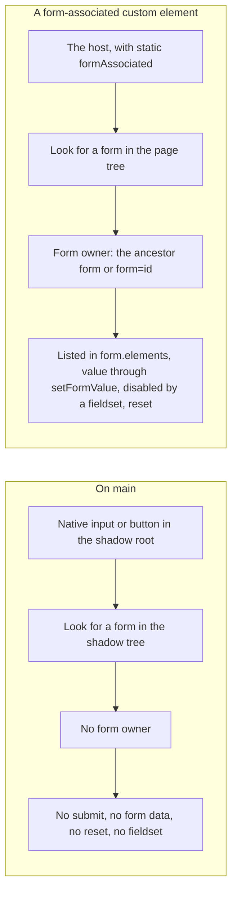
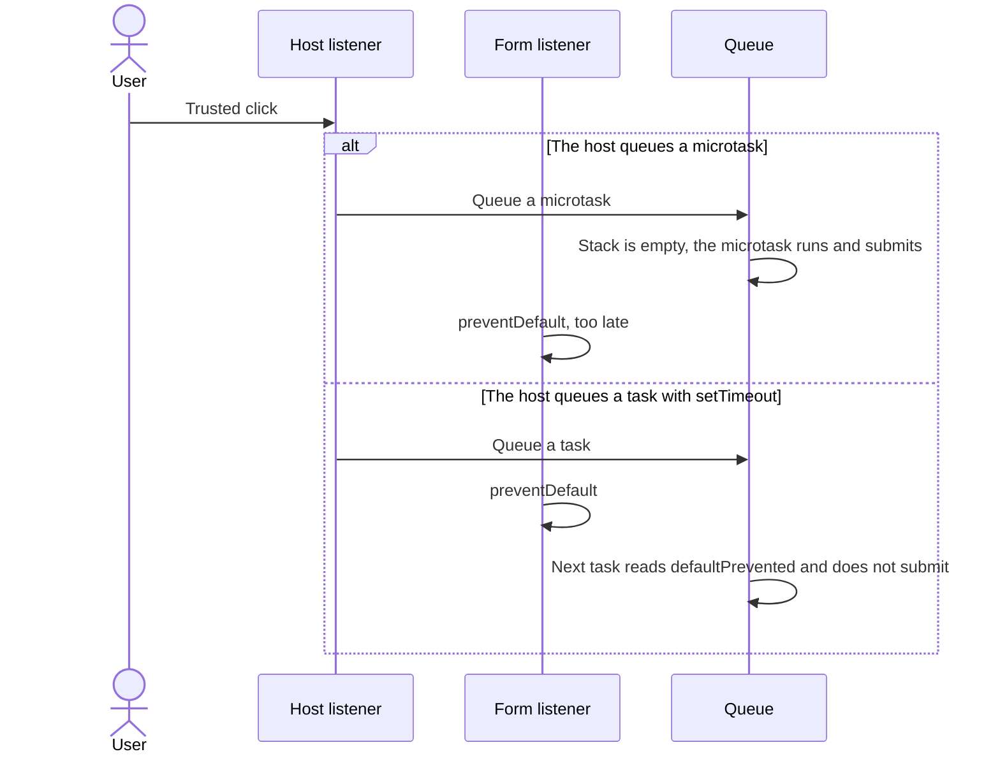
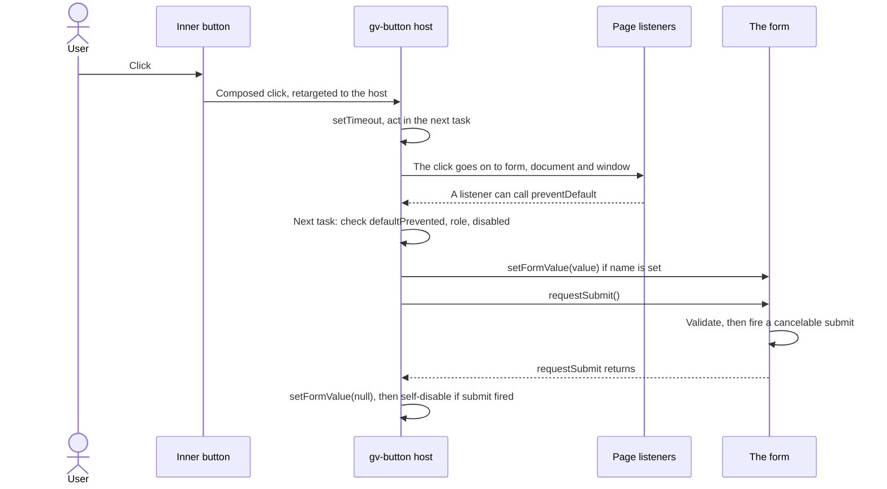
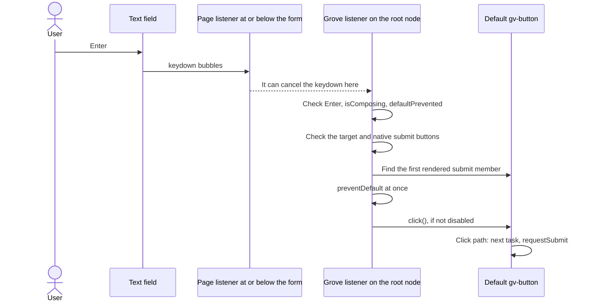
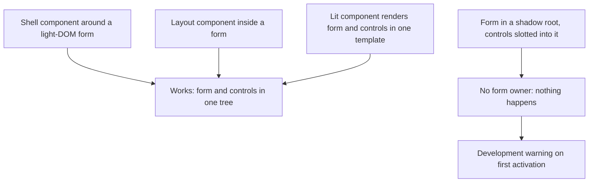

# 10 · Forms

> **What you learn here**
>
> - Why no Grove control takes part in a page form on `main`, and what that breaks.
> - How a form-associated custom element joins a form: `static formAssociated`, `ElementInternals`
>   and the form callbacks.
> - How the `FormControl` mixin of PR #68 proposes to make Grove controls act like native ones.
>   The topics are submit and reset, Enter, self-disable, fieldsets, the tree rule and link mode.
> - What the open specs add for field values, validity, IME input, hidden fields and the textarea.
>
> **Read first:** [08 · Events](08-events.md) and [09 · Accessibility](09-accessibility.md).
> **Time:** 75 minutes.
>
> Open work as of main @ e251d45, 2026-10-27.

Almost all of the Grove form code is open work. Thus each section of this chapter has the same
order. First the section teaches the platform concept. Then it tells what `main` does. Last, an
open-work box tells the Grove design. Where the design is too long for a box, the body text under
the box starts with "PR #68 proposes" or a similar sentence. None of that text describes `main`.

## Whiteboard

The diagram compares two controls in a page `<form>`: a native control inside a shadow root, as on
`main`, and a form-associated host.



The left side is `main`. The right side is the platform feature. PR #68 uses it for `gv-button`
only. The #50 work branch and #51 add more controls later.

## Forms on main today

No Grove component is form-associated on `main`. This command searches the library:

```sh
grep -rn -E "formAssociated|attachInternals" src/lib
```

The only result is in `src/lib/utils/slot-content.ts`. `SlotContent` reads `formAssociated` to find
a form-associated element in a slot, so that it can warn. No component sets it.

A control belongs to its form owner: the form that its `form` attribute names, else its nearest
ancestor `<form>`. The browser looks for both in the tree of the control.
[Source: HTML Standard, form owner](https://html.spec.whatwg.org/multipage/form-control-infrastructure.html#form-owner)
The `<input>` of `gv-text-input` and the `<button>` of `gv-button` are in their shadow roots. A
shadow root of a Grove component has no `<form>`. Thus these inner controls have no form owner.

`TextInput.ts`, `render()`:

```ts
				name=${ifDefined(this.name)}
```

The `name` goes to the inner `<input>`, where no form can see it. These are the results on `main`:

- **`<gv-button type="submit">` does not submit, and `type="reset"` does not reset.** The inner
  `<button>` gets the `type`, but it has no form.
- **`gv-text-input` adds nothing to `FormData`.** `form.reset()` does not clear it. Native
  validation does not see it, and it has no `required` property.
- **`<fieldset disabled>` does not disable a Grove control.** The control stays enabled and
  focusable.
- **A page `<label>` does not name or activate a Grove control.**
  [09 · Accessibility](09-accessibility.md#accessible-names-across-the-shadow-boundary) tells why.
- **Enter has no Grove default button.** A form with one native text field and no native submit
  button still submits on Enter. The browser does that by itself, and no `gv-button` takes part.
  With two or more native text fields, Enter does nothing. Enter in a `gv-text-input` does nothing,
  because its `<input>` has no form.
- **A form-level `change` listener does not hear `gv-text-input`.** The component stops the native
  `input` and `change` events and dispatches `gv-input` and `gv-change` from the host.
  [08 · Events](08-events.md#events-on-a-form) explains the pattern.

A page on `main` uses native controls in its forms, or it copies Grove values into native fields by
script. [20 · Grove in an app](20-grove-in-an-app.md#forms-in-an-app) shows the
options.

> [!NOTE]
> **Lit box: a property binding**
>
> A binding that starts with a dot sets a property, not an attribute. The `value` attribute of an
> `<input>` sets only its default value, so the component binds the `value` property. Grove example,
> `TextInput.ts`, `render()`: `.value=${this.value}`
>
> Lit docs: [Expressions](https://lit.dev/docs/v3/templates/expressions/)

> [!IMPORTANT]
> **Open work: #68 — gv-button link mode and form association** (open PR, no conflict with main on
> 2026-10-27)
>
> The PR makes `gv-button` a form-associated custom element through a new `FormControl` mixin.
> `gv-checkbox` and `gv-text-input` stay without form association. It closes #14 and #40, and it
> is part of epic #49. It also contains the commits of #63. The release note for 0.46.0 must tell
> consumers three facts:
>
> - A `type="submit"` gv-button in a form now submits it.
> - A page click bridge that calls `requestSubmit()` and does not cancel the click submits two
>   times.
> - A page that handles `submit` itself must set `disabled = false` again (see
>   [Self-disable](#self-disable)).
>
> When it lands, change the first sentence of this section to: "On `main`, `gv-button` is
> form-associated. `gv-checkbox` and `gv-text-input` are not." Then rewrite the first, third and
> fifth results above for `gv-button`. <https://github.com/edgarjaymez/grove-lit/pull/68>

## Form-associated custom elements

A custom element joins forms when its class sets `static formAssociated = true` and the element
calls `attachInternals()`.
[Source: HTML Standard, form-associated custom elements](https://html.spec.whatwg.org/multipage/custom-elements.html#form-associated-custom-elements)
The browser then treats the host as a form control:

- It has a form owner, in its own tree, with the same rules as a native control.
- It is a listed element, so `form.elements` and `fieldset.elements` contain it.
  [Source: HTML Standard, listed elements](https://html.spec.whatwg.org/multipage/forms.html#category-listed)
- It is submittable and resettable, so it can add form data and take part in a reset.
- It is labelable, so a page `<label>` can point to it
  ([09 · Accessibility](09-accessibility.md#accessible-names-across-the-shadow-boundary)).
- A `disabled` attribute on the host, or a disabled ancestor fieldset, disables it.
  [Source: HTML Standard, disabled form controls](https://html.spec.whatwg.org/multipage/form-control-infrastructure.html#concept-fe-disabled)
  It then matches `:disabled`.

Example, not from the repo:

```ts
class PlainField extends HTMLElement {
	static formAssociated = true;
	#internals = this.attachInternals();

	set value(v: string) {
		this.#internals.setFormValue(v);
	}
}
customElements.define('plain-field', PlainField);
```

The browser reads `formAssociated` and the form callbacks from the class when
`customElements.define()` runs. A change after that time has no effect.
[Source: HTML Standard, define()](https://html.spec.whatwg.org/multipage/custom-elements.html#dom-customelementregistry-define) `attachInternals()` throws
a `NotSupportedError` when you call it two times on one element.
[Source: MDN, HTMLElement: attachInternals()](https://developer.mozilla.org/en-US/docs/Web/API/HTMLElement/attachInternals)
An explainer on web.dev shows a full example (secondary).
[Source: web.dev, More capable form controls (secondary)](https://web.dev/articles/more-capable-form-controls)

A form-associated host is never a "submit button" in the HTML sense. Only a native `<button>`,
`<input type="submit">` or `<input type="image">` is one. This fact controls
[Submit and reset timing](#submit-and-reset-timing) and [Implicit submission](#implicit-submission).

## ElementInternals

`attachInternals()` returns an `ElementInternals` object. It is the private connection between the
element and the browser.
[Source: HTML Standard, the ElementInternals interface](https://html.spec.whatwg.org/multipage/custom-elements.html#the-elementinternals-interface)
[Source: MDN, ElementInternals](https://developer.mozilla.org/en-US/docs/Web/API/ElementInternals)

| Member                                                            | What it does                                                                                       |
| ----------------------------------------------------------------- | -------------------------------------------------------------------------------------------------- |
| `form`                                                            | The form owner, or `null`                                                                          |
| `setFormValue(value, state)`                                      | Sets the submission value and, as an option, a restore state. `null` adds nothing to the form data |
| `setValidity(flags, message, anchor)`                             | Marks the element invalid with a message. The browser can use `anchor` to show the problem         |
| `validity`, `willValidate`, `checkValidity()`, `reportValidity()` | The constraint validation API, as on a native control                                              |
| `labels`                                                          | The `<label>` elements that point to the host                                                      |
| `states`                                                          | A `CustomStateSet`. CSS selects each state with `:state(name)`                                     |
| `role`, `ariaLabel` and the other ARIA members                    | Default ARIA semantics for the host. A page attribute on the host overrides them                   |

[Source: MDN, ElementInternals: setFormValue()](https://developer.mozilla.org/en-US/docs/Web/API/ElementInternals/setFormValue)
[Source: MDN, ElementInternals: setValidity()](https://developer.mozilla.org/en-US/docs/Web/API/ElementInternals/setValidity)
[Source: MDN, ElementInternals: labels](https://developer.mozilla.org/en-US/docs/Web/API/ElementInternals/labels)
[Source: HTML Standard, accessibility semantics](https://html.spec.whatwg.org/multipage/custom-elements.html#accessibility-semantics)

A custom state works like a pseudo-class that the element turns on and off. The page can write
`gv-button:state(submitting)` in CSS, or `form.querySelector(':state(submitting)')` in script.
[Source: HTML Standard, custom state pseudo-class](https://html.spec.whatwg.org/multipage/custom-elements.html#custom-state-pseudo-class)
[Source: MDN, :state()](https://developer.mozilla.org/en-US/docs/Web/CSS/Reference/Selectors/:state)
[Source: MDN, CustomStateSet](https://developer.mozilla.org/en-US/docs/Web/API/CustomStateSet)

On `main`, no component calls `attachInternals()`.

> [!IMPORTANT]
> **Open work: #68 — gv-button link mode and form association** (open PR, no conflict with main on
> 2026-10-27)
>
> This box tells what `gv-button` uses from `ElementInternals` in the PR. The mixin attaches the
> internals one time, in a field: `protected readonly internals = this.attachInternals();`. It uses
> `form`, `setFormValue()` and `states`.
>
> - `setFormValue(value)` runs only around its own `requestSubmit()` call, and
>   `setFormValue(null)` runs right after (#40 OD1 b).
> - `states.add('submitting')` is in a `try` block, for engines without `CustomStateSet`.
> - `setValidity()` is for fields later (#51). The #50 work branch adds `role` and `labels`.
>
> When it lands, add a "used by" column to the table above.
> <https://github.com/edgarjaymez/grove-lit/pull/68>

## The form callbacks

A form-associated element can define four callbacks. The browser calls them as custom element
reactions.
[Source: HTML Standard, custom element reactions](https://html.spec.whatwg.org/multipage/custom-elements.html#custom-element-reactions)

| Callback                                | When the browser calls it                                               |
| --------------------------------------- | ----------------------------------------------------------------------- |
| `formAssociatedCallback(form)`          | The form owner changes, also to `null`                                  |
| `formDisabledCallback(disabled)`        | The disabled state changes, from the host attribute or a fieldset       |
| `formResetCallback()`                   | The form resets                                                         |
| `formStateRestoreCallback(state, mode)` | The browser restores a value. `mode` is `'restore'` or `'autocomplete'` |

These are plain methods on the class. Lit does not wrap them. Because the browser reads them at
definition time, they must be on the class chain of the element. A Lit reactive controller is a
separate object that the element holds. The browser never reads callbacks from it.
[03 · Lit essentials](03-lit-essentials.md#controllers-and-mixins) compares controllers and
mixins.

On `main`, no component has a form callback.

> [!IMPORTANT]
> **Open work: #68 — gv-button link mode and form association** (open PR, no conflict with main on
> 2026-10-27)
>
> This box tells which form callbacks the PR uses. The mixin implements three callbacks:
>
> - `formAssociatedCallback()` updates the form membership.
> - `formDisabledCallback()` requests a Lit update, because the render reads the disabled state.
> - `formResetCallback()` ends a self-disable and calls the `onFormReset()` hook.
>
> It has no `formStateRestoreCallback()`. #18 FR-10 asks for it in `gv-text-input`, and the #50
> follow-ups list it for `gv-checkbox`. When it lands, add the column "Grove use" to the table
> above.
> <https://github.com/edgarjaymez/grove-lit/pull/68>

## The FormControl mixin

A mixin is a function that takes a class and returns a subclass. Lit components use mixins to share
code that must live on the class of the element.
[Source: Lit, Mixins](https://lit.dev/docs/v3/composition/mixins/) On `main`, no Grove component
uses a mixin.

> [!IMPORTANT]
> **Open work: #68 — gv-button link mode and form association** (open PR, no conflict with main on
> 2026-10-27)
>
> This box is about the `FormControl` mixin. The PR adds `src/lib/utils/form-control.ts`. It is the
> one way for a Grove control to join a form (#49 C5). `gv-button` uses it now. `gv-checkbox`
> (#50), `gv-text-input` (#51) and `gv-textarea` (#17) adopt it later.
>
> The mixin stays internal: `src/lib/index.ts` does not export it until #50 and #51 have used its
> hooks. The text below the box describes the PR. When it lands, change the text to describe
> `main`, and keep the hooks table.
> [22 · Cookbook](22-cookbook.md#recipe-19-build-on-the-formcontrol-mixin) has the steps for a new
> control. <https://github.com/edgarjaymez/grove-lit/pull/68>

PR #68 proposes this class declaration for `gv-button`:

`Button.ts` at #68 head (ccba0a3), the class:

```ts
export class Button extends FormControl(LitElement) {
	private readonly _slots = new SlotContent(this, [''], { phrasingOnly: true });
```

Why a mixin and not a controller: the browser reads `static formAssociated` and the `form*Callback`
methods from the class when the tag is defined. Thus the code must be in the class chain.

> [!NOTE]
> **Lit box: a class mixin**
>
> A mixin takes a base class and returns a subclass, so several components can share code that must
> sit on the element class itself. Grove example at the head of PR #68, `Button.ts`:
> `export class Button extends FormControl(LitElement) {`
>
> Lit docs: [Mixins](https://lit.dev/docs/v3/composition/mixins/)

At #68 head, the mixin does the form work. Each component tells it what it is through `protected`
hooks. Each hook has `@internal`, so the manifest leaves it out.

| Hook                    | Default   | `gv-button` at #68 head                                  |
| ----------------------- | --------- | -------------------------------------------------------- |
| `formRole()`            | `null`    | `'submit'` or `'reset'` from `type`; `null` in link mode |
| `renderedControl()`     | the host  | The inner `.btn` element, checked for visibility         |
| `submissionValue()`     | `null`    | `value` when `name` is set                               |
| `honoursFormDisabled()` | `true`    | `false` in link mode                                     |
| `onFormReset()`         | no action | Not used                                                 |

`FormRole` is `'submit' | 'reset' | 'field' | null`. A `'field'` member is a text field that Enter
submits from, for `gv-text-input` in #51.

Other parts of the design at #68 head:

- **The mixin owns `disabled`.** It declares `@property({ type: Boolean, reflect: true })` on a
  getter and setter pair. The setter sees each write, so it can end a self-disable.
- **`effectivelyDisabled`** is `disabled`, or a disabled fieldset around the host. The render reads
  it.
- **The `form` getter** returns `internals.form` only when it is a real `HTMLFormElement` (#49 C4).
  Else it returns `null` and warns one time.
- **The inner `<button>` always has `type="button"`.** The host does the form work, so the shadow
  button never has a second activation path.
- **TypeScript.** The mixin returns
  `FormControlElement as unknown as Constructor<FormControlInterface> & T`. `FormControlInterface`
  is a `declare class` that types the protected members.

> [!NOTE]
> **Lit box: @property on an accessor**
>
> `@property` can decorate a getter and setter pair. Lit wraps the setter and requests an update
> after each write. Grove example at the head of PR #68, `form-control.ts`, `disabled`: the line
> `@property({ type: Boolean, reflect: true })` sits above `get disabled(): boolean {`.
>
> Lit docs: [Reactive properties](https://lit.dev/docs/v3/components/properties/)

> [!IMPORTANT]
> **Open work: #50 — accessible names across the shadow boundary** (branch, no PR)
>
> This box is about names and focus in the `FormControl` mixin. The #50 work branch adds three
> parts to the mixin:
>
> - `internals.role = 'none'`;
> - a shadow root with `delegatesFocus`;
> - page label text, copied into the inner control.
>
> It also adds the `hasVisibleName()` hook, and `gv-checkbox` adopts the mixin. The branch starts
> from #68 @ cbaa7b0, where the component still declared `disabled` itself. At the current head of
> #68, the mixin owns `disabled`. Treat the mixin details of the branch as provisional until
> somebody rebases it.
> [Source: MDN, ShadowRoot: delegatesFocus](https://developer.mozilla.org/en-US/docs/Web/API/ShadowRoot/delegatesFocus)
> <https://github.com/edgarjaymez/grove-lit/issues/50>

## Submit and reset timing

A native submit button submits its form in its activation behavior. The browser runs activation
behavior after the event has gone to every listener, and only when no listener cancelled the event.
[Source: DOM Standard, activation behavior](https://dom.spec.whatwg.org/#eventtarget-activation-behavior)
Thus a `click` listener anywhere on the path can stop a submit with `preventDefault()`.

`form.requestSubmit()` submits a form as a submit button does: it runs validation, then fires a
cancelable `submit` event.
[Source: HTML Standard, requestSubmit()](https://html.spec.whatwg.org/multipage/forms.html#dom-form-requestsubmit)
Its optional `submitter` argument must be a native submit button. Else it throws a `TypeError`.
[Source: MDN, HTMLFormElement: requestSubmit()](https://developer.mozilla.org/en-US/docs/Web/API/HTMLFormElement/requestSubmit)
Thus a form-associated host cannot be the submitter, and `SubmitEvent.submitter` stays `null`.
[Source: MDN, SubmitEvent: submitter](https://developer.mozilla.org/en-US/docs/Web/API/SubmitEvent/submitter)

A custom element cannot add activation behavior. It must wait until the click has finished. A
microtask is not late enough:

- After the browser calls a listener, it cleans up after the script. When the JavaScript stack is
  then empty, it runs a microtask checkpoint.
  [Source: HTML Standard, clean up after running script](https://html.spec.whatwg.org/multipage/webappapis.html#clean-up-after-running-script)
- For a real (trusted) click, the browser calls each listener from native code. Thus microtasks
  run between two listeners.
- For `el.click()` from script, the stack is not empty, so microtasks run after all listeners.

The sequence diagram shows why a microtask at the host runs too early for a real click.



[08 · Events](08-events.md#activation-in-the-next-task) explains the event loop.

On `main`, no Grove control submits or resets a form.

> [!IMPORTANT]
> **Open work: #40 — gv-button type="submit" and type="reset" act on the form** (open PR, no
> conflict with main on 2026-10-27)
>
> PR #68 implements #40. Two decisions of 2026-10-08 apply:
>
> - **#40 OD1 (b).** `name` and `value` go into the form data through `setFormValue()`, only during
>   the own submission of the button.
> - **#40 OD2 (b).** The host acts in the next task, with `setTimeout`. The spec rejected a
>   microtask. A consumer bridge that cancels the click at the form would run after the microtask.
>   Then the form would submit two times.
>
> The trap: only trusted input shows the difference. The 32 tests in `form-control.browser.test.ts`
> use an untrusted `submitter.click()`, so they still pass when `setTimeout` becomes
> `queueMicrotask` (a run on 2026-10-27 at ccba0a3). Two `userEvent` tests in
> `Button.browser.test.ts` guard the next-task timing: FR-11 and FR-12. They fail with a microtask.
> [08 · Events](08-events.md#trusted-and-untrusted-events) explains trusted input.
>
> When it lands, move the text below the box into the body.
> <https://github.com/edgarjaymez/grove-lit/issues/40>

PR #68 proposes this flow. The host listens for `click` in its constructor. It ignores an event
that is not a `MouseEvent`, because a plain `Event` named `click` does not activate a native button
either. It acts in the next task.

`form-control.ts` at #68 head (ccba0a3), the constructor and `_activate()`:

```ts
this.addEventListener('click', (event) => {
	// A plain Event named click doesn't activate a native button either.
	if (event instanceof MouseEvent) setTimeout(() => this._activate(event));
});
```

```ts
		private _activate(event: MouseEvent) {
			const role = this.formRole();
			if (event.defaultPrevented || (role !== 'submit' && role !== 'reset')) return;
			if (this.effectivelyDisabled) return;
			const form = this.form;
			if (!form) this._warnIfSlottedIntoForm();
			else if (role === 'reset') form.reset();
			else this._submit(form);
		}
```

The sequence diagram shows a submit from a click at #68 head.



The PR has these results:

- A `stopPropagation()` in a page listener cannot stop the submit. A `window` listener can still
  cancel it.
- `el.click()` submits in the next task, not at once. A test waits with `nextTask()` from
  `src/test/forms.ts`.
- `dispatchEvent(new Event('click'))` does nothing, as on a native button.
- Form data built during the submission has `name=value`. Form data built later, after an `await`,
  does not.

## Implicit submission

Implicit submission is the Enter key in a field that submits its form. The HTML standard defines it
with the default button of the form: the first submit button in tree order.
[Source: HTML Standard, implicit submission](https://html.spec.whatwg.org/multipage/form-control-infrastructure.html#implicit-submission)

- When the form has a default button that is not disabled, Enter fires a `click` at it.
- When the form has no submit button, Enter submits the form only if it has at most one field that
  blocks implicit submission.
- A field that blocks implicit submission is an `<input>` of a text or date type. The types are
  Text, Search, Telephone, URL, Email, Password, Date, Month, Week, Time, Local Date and Time, and
  Number.
- A `<textarea>` is not such a field. Enter in it adds a line break.

Two traps apply to custom elements. First, a form-associated host is never a submit button, so it
is never the default button. Second, during an IME composition, Enter confirms a candidate. The
`keydown` then has `isComposing` set to `true`.
[Source: MDN, KeyboardEvent: isComposing](https://developer.mozilla.org/en-US/docs/Web/API/KeyboardEvent/isComposing)

On `main`, Grove takes no part in implicit submission
([Forms on main today](#forms-on-main-today)).

> [!IMPORTANT]
> **Open work: #49 — gv-button link mode and form association** (open PR, no conflict with main on
> 2026-10-27)
>
> PR #68 implements the Enter rules of epic #49:
>
> - **#49 S1.** One listener owns Enter. `gv-text-input` joins it in #51 with the `'field'` role,
>   not with its own `requestSubmit()`.
> - **#49 S2.** Skip a button that is not rendered, with `checkVisibility()`.
> - **#49 S3.** No native form control as a fallback child. A fallback `<button type="submit">` is
>   a native submit button, so it hands Enter to the browser.
> - **#49 C7.** The check is on the inner control, so a `display: contents` host still counts.
>
> When it lands, move the text below the box into the body.
> <https://github.com/edgarjaymez/grove-lit/issues/49>

PR #68 proposes one `keydown` listener for each form, on the root node of the form (the document or
a shadow root). The mixin keeps a registry of members. The listener acts only when all of these
items are true:

1. The key is Enter, `isComposing` is false, and no earlier listener cancelled the event.
2. The target blocks implicit submission. It is a native `<input>` of such a type in the same form,
   or a member with the `'field'` role.
3. The form has no native submit button. The check also finds `<input type="image">`, which
   `form.elements` does not list.
4. A default member exists: the first submit member in `form.elements` order whose rendered control
   passes `checkVisibility()`.
   [Source: MDN, Element: checkVisibility()](https://developer.mozilla.org/en-US/docs/Web/API/Element/checkVisibility)

`form-control.ts` at #68 head (ccba0a3), `onEnter`:

```ts
const onEnter = (form: HTMLFormElement) => (event: Event) => {
	const key = event as KeyboardEvent;
	if (key.key !== 'Enter' || key.isComposing || key.defaultPrevented) return;
	if (!blocksImplicitSubmission(key.target, form) || hasNativeSubmit(form)) return;
	const member = defaultButton(form);
	if (!member) return;
	key.preventDefault();
	if (!member.disabled()) member.activate();
};
```

The listener calls `preventDefault()` at once. Without that, the browser would also submit a form
with one field by itself, and the form would submit two times. Then `activate()` calls
`this.click()` on the default member. Thus Enter takes the same path as a click: validation, the
cancelable `click` and `submit`, and self-disable. A disabled default member blocks Enter, as a
disabled native default button does (#40 FR-25).

The sequence diagram shows Enter in a field at #68 head.



At #68 head, a page can stop Enter only before the Grove listener runs. Cancel the `keydown` on the
field, on the form or on an ancestor up to the root node, or in the capture phase. A bubble
listener on `window` runs too late (#40 FR-22, as amended).

## Self-disable

A user can click a submit button two times while the page sends the form. Many pages disable the
button after the first submit. When a focused control becomes disabled, the browser moves focus to
the viewport. This is the focus fixup rule.
[Source: HTML Standard, focus fixup rule](https://html.spec.whatwg.org/multipage/webappapis.html#focus-fixup-rule)
[14 · The focus ring](14-the-focus-ring.md#focus-after-a-control-disables-itself) tells what this
does to the ring.

On `main`, `gv-button` never changes its own `disabled` property.

> [!IMPORTANT]
> **Open work: #40 — gv-button type="submit" and type="reset" act on the form** (open PR, no
> conflict with main on 2026-10-27)
>
> This box is about self-disable. #40 FR-28 to FR-34 add self-disable, and the maintainer
> confirmed it again on 2026-10-08. #49 R6 adds `:state(submitting)`. A page that cancels `submit` and sends the form with `fetch` must set
> `disabled = false` when the request settles (#40 FR-34). The release note for #68 must say this.
> When it lands, move the text below the box into the body.
> <https://github.com/edgarjaymez/grove-lit/issues/40>

PR #68 proposes these rules:

- **When.** Around its own `requestSubmit()` call, the button listens for `submit` in the capture
  phase. If `submit` fired, the button sets its public `disabled` to `true` and adds the
  `submitting` state. This also happens when the page cancels the `submit`. If validation stopped
  the submit, the button stays enabled.
- **Not when the page wrote `disabled`.** If a `submit` listener sets `disabled` during the
  submission, the button keeps that value.
- **Only its own submissions.** `form.requestSubmit()` from the page, or a native submit button,
  never disables the gv-button (#40 FR-33).
- **Release.** The state ends in three cases. The page sets `disabled = false` or removes the
  attribute. The form fires a `reset` that is not cancelled. Or the page comes back from the
  back/forward cache (`pageshow` with `persisted`).
  [Source: MDN, Window: pageshow event](https://developer.mozilla.org/en-US/docs/Web/API/Window/pageshow_event)
- **Focus.** The inner `<button>` becomes disabled, so focus goes to the page body. The page must
  move focus to its status message.

The PR changes `DESIGN_SYSTEM.md` with this page pattern. It uses `@query` from Lit, in page code.

`DESIGN_SYSTEM.md` at #68 head (ccba0a3), "Forms and Slots":

```ts
@query('gv-button[type=submit]') private _send!: Button;
@query('#status') private _status!: HTMLElement; // a status message with tabindex="-1"

private async _onSubmit(event: SubmitEvent) {
	event.preventDefault();
	const data = new FormData(event.target as HTMLFormElement); // at once, before any await
	try {
		await fetch('/contact', { method: 'POST', body: data });
		this._status.focus(); // focus left the disabled button for the page body
	} finally {
		this._send.disabled = false;
	}
}
```

Without the `finally` block, a form that the user sends more than one time without a page load
keeps a dead button. Search forms and filters are examples.

## Disabled fieldsets

A form control is disabled when its `disabled` attribute is set. It is also disabled when it is in
a disabled `<fieldset>`, unless it is inside the first `<legend>` child of that fieldset.
[Source: HTML Standard, disabled form controls](https://html.spec.whatwg.org/multipage/form-control-infrastructure.html#concept-fe-disabled)
[Source: HTML Standard, the fieldset element](https://html.spec.whatwg.org/multipage/form-elements.html#concept-fieldset-disabled)
A disabled control gets no click events from the user. It is also barred from constraint
validation, and the form data leaves it out.
[Source: MDN, the fieldset element](https://developer.mozilla.org/en-US/docs/Web/HTML/Reference/Elements/fieldset)

For a form-associated host, the browser calls `formDisabledCallback(disabled)` and the host matches
`:disabled`. The inner control does not change by itself. The component must render it disabled.

On `main`, a Grove control in a disabled fieldset stays enabled and focusable.

> [!IMPORTANT]
> **Open work: #40 — gv-button type="submit" and type="reset" act on the form** (open PR, no
> conflict with main on 2026-10-27)
>
> This box is about disabled fieldsets. #40 FR-15: in `<fieldset disabled>`, the button renders disabled, the host matches `:disabled`,
> and the public `disabled` property stays `false`. A gv-button in the first `<legend>` stays
> enabled. PR #68 implements it. When it lands, move the text below the box into the body.
> <https://github.com/edgarjaymez/grove-lit/issues/40>

PR #68 proposes that the render read `effectivelyDisabled`. The fieldset never writes the public
`disabled` property. The mixin finds the fieldset state with its own function, because `:disabled`
can be stale while Lit renders:

`form-control.ts` at #68 head (ccba0a3), `inDisabledFieldset`:

```ts
const inDisabledFieldset = (el: Element) => {
	for (
		let fieldset = el.parentElement?.closest('fieldset');
		fieldset;
		fieldset = fieldset.parentElement?.closest('fieldset')
	) {
		if (!fieldset.disabled) continue;
		const legend = [...fieldset.children].find((child) => child instanceof HTMLLegendElement);
		if (!legend?.contains(el)) return true;
	}
	return false;
};
```

The function applies the first-legend rule: the legend is the first `<legend>` child, and a control
inside it stays enabled. At #68 head, `disabled` reflects to the host attribute. This is important,
because the platform disabled state of a form-associated host follows that attribute.

## The tree rule

A slot changes where content shows. It does not change the tree that the content is in. The form
owner, `<fieldset disabled>`, `<label for>` and the default button all come from the DOM tree,
never through a slot. Events are different: they follow the composed path, so a listener can hear
an event from a slotted control. [07 · Slots](07-slots.md#slots-and-nested-shadow-roots) explains
slots and trees.

On `main`, `SlotContent` warns in development when any slot holds a form control: an `<input>`,
`<button>`, `<select>`, `<textarea>` or a form-associated element. The warning shows one time for
each tag. [07 · Slots](07-slots.md#what-may-go-in-a-slot) tells the slot rules on `main`.

> [!IMPORTANT]
> **Open work: #49 — gv-button link mode and form association** (open PR, no conflict with main on
> 2026-10-27)
>
> This box is about the tree rule. The plan of 2026-10-08 in #49 sets these rules, and PR #68 implements them:
>
> - **#49 C1.** Form association follows the DOM tree, not slots.
> - **#49 C2.** Three compositions are supported and tested:
>   - a shell component around a slotted light-DOM `<form>`;
>   - a layout component inside a `<form>`;
>   - a Lit component that renders the `<form>` and its controls in one template.
> - **#49 C3.** A `<form>` in a shadow root with controls slotted into it is not supported. In
>   development, a submit or reset gv-button with no form, but with a `<form>` among its flat-tree
>   ancestors, warns one time on its first activation.
> - **#49 C4.** The `form` getter returns `internals.form` only when it is an `HTMLFormElement`.
> - **#49 C6.** The slot rule splits by slot. `SlotContent(…, { phrasingOnly: true })` warns about
>   controls. Every other slot is a container and accepts controls. All six current components opt
>   in to `phrasingOnly`.
>
> #50 notes one result: the inner checkbox of `gv-todo-list-item` cannot join a page form, because
> it is in the shadow root of the item. When it lands, move these rules into the body, and update
> chapter 07. <https://github.com/edgarjaymez/grove-lit/issues/49>

The diagram shows the four compositions of #49 C2 and #49 C3.



## Link mode

An `<a>` element with an `href` is a link. Without `href`, it has no link role and it is not
focusable.
[Source: MDN, the a element](https://developer.mozilla.org/en-US/docs/Web/HTML/Reference/Elements/a)
A link has no native disabled state. An `<a>` that wraps a button is also broken, because the
innermost interactive element takes the click. A consumer reports that Firefox does nothing at all
for that markup (#14).

On `main`, `gv-button` always renders a `<button>`. `gv-menu-item` renders an `<a>`.

> [!IMPORTANT]
> **Open work: #14 — gv-button href renders a real link** (open PR, no conflict with main on
> 2026-10-27)
>
> PR #68 implements #14 and the link rules of #49:
>
> - **#49 L1.** A link-mode gv-button in a disabled fieldset stays a link that works, as a native
>   `<a>` does.
> - **#49 L2.** Link mode never submits or resets, whatever its `type`. It is never the Enter
>   default.
> - **#49 L3.** Link mode still shows in `form.elements`, because `static formAssociated` cannot
>   change for one instance.
>
> Manual checks in Firefox and Safari remain for #14 FR-10 and #49 L1. When it lands, move the text
> below the box into the body. <https://github.com/edgarjaymez/grove-lit/issues/14>

PR #68 proposes these rules for link mode:

- With `href`, the shadow root renders one real `<a>` with the same `classMap` as the button. Thus
  both modes look the same. The class `btn--disabled` replaces the `:disabled` selector, because an
  `<a>` cannot match `:disabled`.
- A disabled link renders with no `href`, with `role="link"` and `aria-disabled="true"`. It leaves
  the tab order and goes nowhere.
- `target`, `rel` and `hreflang` go to the link only while it has an `href`. `target="_blank"`
  without `rel` gets `rel="noopener noreferrer"` (`linkRel` in `link-attributes.ts`).
- Activation is fully native: middle click, modified clicks and the context menu work (#14 FR-10).
  The anchor is the only focusable element (#14 FR-11).
- `formRole()` returns `null` and `honoursFormDisabled()` returns `false` in link mode.
- In a disabled fieldset, the host matches `:disabled` but the link still works. Style the disabled
  look with `gv-button[disabled]`, not with `:disabled`.

`Button.ts` at #68 head (ccba0a3), `render()`, the link branch:

```ts
const href = disabled ? undefined : this.href;
return html`<a
	class=${classes}
	href=${ifDefined(href)}
	target=${ifDefined(linkAttribute(href, this.target))}
	rel=${ifDefined(linkRel(href, this.target, this.rel))}
	hreflang=${ifDefined(linkAttribute(href, this.hreflang))}
	role=${disabled ? 'link' : nothing}
	aria-disabled=${disabled ? 'true' : nothing}
	aria-label=${this.ariaLabel ?? nothing}
	>${content}</a
>`;
```

## Field state and validity

A form-associated field reports its value with `setFormValue()`. A `null` value adds nothing to
the form data. A native checkbox submits its `value` (default `on`) only when it is checked.
[Source: MDN, input type="checkbox"](https://developer.mozilla.org/en-US/docs/Web/HTML/Reference/Elements/input/checkbox#value)
A field reports a problem with `setValidity(flags, message, anchor)`. The `anchor` is the inner
element that the browser can focus to show the message. `formStateRestoreCallback()` gets the value
back after a navigation or an autofill.
[Source: HTML Standard, setFormValue()](https://html.spec.whatwg.org/multipage/custom-elements.html#dom-elementinternals-setformvalue)
[Source: HTML Standard, setValidity()](https://html.spec.whatwg.org/multipage/custom-elements.html#dom-elementinternals-setvalidity)

On `main`, no Grove field reports a value, a validity or a restore state.

> [!IMPORTANT]
> **Open work: #25 — give the checkbox an accessible name** (branch, no PR)
>
> This box is about the checkbox in a form. On the #50 work branch, `gv-checkbox` adopts the
> `FormControl` mixin (#25 OD3). It has `name` (reflected) and `value` (default `'on'`). It calls
> `setFormValue(checked ? value : null)`.
>
> `form.reset()` restores the `checked` state from the first connection, because `checked` reflects
> and its attribute cannot hold the default (#50 R8). Reset fires no `gv-change`. `formRole()` is
> `null`, so Enter toggles the box and never submits (#50 R9). `required`, validity and
> `formStateRestoreCallback()` are a follow-up. When it lands, describe the checkbox here.
> <https://github.com/edgarjaymez/grove-lit/issues/25>

> [!IMPORTANT]
> **Open work: #51 — gv-text-input as a real form field** (issue, blocked: Needs Figma Spec)
>
> The epic groups #18 and #27, and waits for #68, #50 and the Figma spec of #18 and #27. It adopts
> the mixin with `formRole()` `'field'`, `renderedControl()` as the inner `<input>`, and
> `onFormReset()`. It adds its own `setFormValue()`, `setValidity()` and
> `formStateRestoreCallback()`. It forwards `autocomplete`, `inputmode` and `required` (#27). The
> review corrections:
>
> - **#51 F1.** #18 FR-04 merges a page `aria-describedby` into the shadow root. That ID cannot
>   resolve there. Take the description as text.
> - **#51 F2.** Enter goes through the mixin, not a direct `requestSubmit()`. Else self-disable is
>   skipped, and a form with one field submits two times.
> - **#51 F3.** A `required` field that is not rendered blocks the submit with no visible cue (see
>   [Hidden required fields](#hidden-required-fields)).
> - **#51 F4.** No native form controls as fallback children.
> - **#51 F5.** The colours go in a sibling contrast test
>   ([09 · Accessibility](09-accessibility.md#the-contrast-gate)).
>
> The host must expose a reflected `name` and a `value`, so one delegated `@gv-change` listener on
> the `<form>` can read them from `e.target`. A page `<label for>` names the host only when the
> label is in the same tree as the host. <https://github.com/edgarjaymez/grove-lit/issues/51>

> [!IMPORTANT]
> **Open work: #18 — gv-text-input visible label, helper text and form association** (issue,
> blocked: Needs Figma Spec)
>
> - **#18 FR-10** restores the value, also after an autofill, through
>   `formStateRestoreCallback()`.
> - **#18 FR-11** calls `setValidity(flags, message, innerInput)`. The message is text from the
>   page, never the default text of the browser. The anchor is the inner `<input>`. Thus
>   `form.reportValidity()` puts the caret in the first invalid field.
> - **#18 FR-12** asks that Enter submits, through the mixin (#51 F2).
>
> The token set has no danger text role on Ground. There is also a name conflict: #18 uses `label`
> for a visible label, but #54 D1 says `label` is always an invisible name. The visible label prop
> needs another name. #51 asks for one API decision for the text lines, in line with `heading` and
> `message`. [23 · Known drift](23-known-drift.md#specs-that-lag-the-code) lists the
> conflict. <https://github.com/edgarjaymez/grove-lit/issues/18>

## Text input and IME

An input method editor (IME) lets a user type text through a composition, for example Japanese
characters. Enter often confirms a candidate. During the composition, `KeyboardEvent.isComposing`
is `true`, so a form must not submit on that Enter.
[Source: MDN, KeyboardEvent: isComposing](https://developer.mozilla.org/en-US/docs/Web/API/KeyboardEvent/isComposing)
The `autocomplete` attribute tells the browser the purpose of a field, for 1.3.5 Identify Input
Purpose (AA).
[Source: MDN, autocomplete](https://developer.mozilla.org/en-US/docs/Web/HTML/Reference/Attributes/autocomplete)
[Source: Understanding 1.3.5 Identify Input Purpose](https://www.w3.org/WAI/WCAG22/Understanding/identify-input-purpose)

`gv-text-input` on `main`:

- It binds `.value=${this.value}` to the inner `<input>`.
- On each native `input`, it stops the event, copies the value and dispatches `gv-input`. On each
  native `change`, it does the same with `gv-change`. Both have the value string as `detail`.
- `disabled` renders `readonly` and `aria-disabled="true"`, so the field stays focusable and
  readable.
- It has no `autocomplete`, `inputmode` or `required` property. An `autocomplete` attribute on the
  host does nothing (#27).
- It does not handle Enter. Its inner `<input>` has no form, so Enter does nothing.

`TextInput.ts`, `_handleInput`:

```ts
	private _handleInput(e: Event) {
		e.stopPropagation();
		this.value = (e.target as HTMLInputElement).value;
		this.dispatchEvent(
			new CustomEvent('gv-input', { detail: this.value, bubbles: true, composed: true })
		);
	}
```

PR #68 already checks `isComposing` in its Enter listener (see
[Implicit submission](#implicit-submission)). #18 asks for the same guard, and #51 delivers it
through the mixin. Autofill in a shadow root is not confirmed. #27 asks for a manual check in
Chrome, Safari and Firefox.

> [!IMPORTANT]
> **Open work: #17 — gv-textarea** (issue, blocked: Needs Figma Spec)
>
> The textarea mirrors `gv-text-input`, plus `rows` (default 4) and vertical resize only. It is in
> wave 4, after #51, and it adopts the mixin. Enter never submits from it (#40 FR-22), because a
> textarea does not block implicit submission. It must not override `color-scheme`, so that the
> resize grip and the scrollbar follow the theme.
> [Source: MDN, color-scheme](https://developer.mozilla.org/en-US/docs/Web/CSS/Reference/Properties/color-scheme)
> The body of #17 is stale in two places. Its events must be `gv-input` and `gv-change`, and
> `ariaLabel` and `ariaDescribedby` become `label` and `description` under #54 D1.
> [13 · Themes and page CSS](13-themes-and-page-css.md#color-scheme-and-native-widgets) explains
> `color-scheme`. <https://github.com/edgarjaymez/grove-lit/issues/17>

## Hidden required fields

When a user submits a form, the browser validates its controls. For an invalid control, it shows a
message and can focus the control. For a form-associated element, it uses the validation anchor
instead.
[Source: HTML Standard, interactively validate the constraints](https://html.spec.whatwg.org/multipage/form-control-infrastructure.html#interactively-validate-the-constraints)
A control that is not rendered cannot take focus. Thus a `required` field that is empty and not
rendered can block the submit, and the user sees no message.

Not confirmed: this guide did not test the result in each browser. Check: put an empty `required`
input in a form, hide it with `display: none`, and submit the form in Chrome, Firefox and Safari.

A disabled control is barred from constraint validation
([Disabled fieldsets](#disabled-fieldsets)). Thus the fix is to remove `required` from a field
that you do not render, or to disable it.

On `main`, no Grove field has `required`. The trap applies to native fields in a page today.

> [!IMPORTANT]
> **Open work: #51 — gv-text-input as a real form field** (issue, blocked: Needs Figma Spec)
>
> This box is about hidden required fields. #51 F3 became wider on 2026-10-08 (review item R8). Any
> `required` field that is not rendered blocks the submit with no visible cue. The cases are
> `hidden`, `display: none` and an unassigned slot.
>
> The rule: remove `required` from, or set `disabled` on, a field that you do not render. #51 must
> test it and document it. `componentReset` makes `hidden` hide every Grove host, so a
> hidden Grove field is also not rendered
> ([09 · Accessibility](09-accessibility.md#hidden-and-reduced-motion)). When it lands, add the
> Grove test to this section. <https://github.com/edgarjaymez/grove-lit/issues/51>

## See it in the code

On `main`:

| File                                        | Look for                                                             |
| ------------------------------------------- | -------------------------------------------------------------------- |
| `src/lib/components/TextInput/TextInput.ts` | `name=${ifDefined(this.name)}`, `_handleInput`, `_handleChange`      |
| `src/lib/components/Button/Button.ts`       | `type=${this.type}` on the inner `<button>`                          |
| `src/lib/utils/slot-content.ts`             | `FORM_CONTROLS`, the `formAssociated` check in `_warnOnFormControls` |

At the head of PR #68. Read each file with `git show ccba0a3:<path>` after
`git fetch origin pull/68/head`:

| File                                               | Look for                                                                                                           |
| -------------------------------------------------- | ------------------------------------------------------------------------------------------------------------------ |
| `src/lib/utils/form-control.ts`                    | `FormControl`, `onEnter`, `defaultButton`, `inDisabledFieldset`, `_submit`                                         |
| `src/lib/components/Button/Button.ts`              | The four hooks, the link branch of `render()`                                                                      |
| `src/lib/utils/form-control.browser.test.ts`       | "self-disable and release", "Enter through the default member" (untrusted clicks)                                  |
| `src/lib/components/Button/Button.browser.test.ts` | The trusted FR-11 and FR-12 tests that guard the next-task timing, "supported compositions", "link mode in a form" |
| `src/test/forms.ts`                                | `nextTask`, `recordSubmits`, `cancelFormSubmits`, `settle`                                                         |

## Sources

Read 2026-10-27.

**Standards**

- [HTML Standard, form-associated custom elements](https://html.spec.whatwg.org/multipage/custom-elements.html#form-associated-custom-elements).
- [HTML Standard, the ElementInternals interface](https://html.spec.whatwg.org/multipage/custom-elements.html#the-elementinternals-interface).
- [HTML Standard, setFormValue()](https://html.spec.whatwg.org/multipage/custom-elements.html#dom-elementinternals-setformvalue).
- [HTML Standard, setValidity()](https://html.spec.whatwg.org/multipage/custom-elements.html#dom-elementinternals-setvalidity).
- [HTML Standard, accessibility semantics](https://html.spec.whatwg.org/multipage/custom-elements.html#accessibility-semantics).
- [HTML Standard, custom state pseudo-class](https://html.spec.whatwg.org/multipage/custom-elements.html#custom-state-pseudo-class).
- [HTML Standard, define()](https://html.spec.whatwg.org/multipage/custom-elements.html#dom-customelementregistry-define).
- [HTML Standard, custom element reactions](https://html.spec.whatwg.org/multipage/custom-elements.html#custom-element-reactions).
- [HTML Standard, form owner](https://html.spec.whatwg.org/multipage/form-control-infrastructure.html#form-owner).
- [HTML Standard, listed elements](https://html.spec.whatwg.org/multipage/forms.html#category-listed).
- [HTML Standard, disabled form controls](https://html.spec.whatwg.org/multipage/form-control-infrastructure.html#concept-fe-disabled).
- [HTML Standard, the fieldset element](https://html.spec.whatwg.org/multipage/form-elements.html#concept-fieldset-disabled).
- [HTML Standard, requestSubmit()](https://html.spec.whatwg.org/multipage/forms.html#dom-form-requestsubmit).
- [HTML Standard, implicit submission](https://html.spec.whatwg.org/multipage/form-control-infrastructure.html#implicit-submission).
- [HTML Standard, interactively validate the constraints](https://html.spec.whatwg.org/multipage/form-control-infrastructure.html#interactively-validate-the-constraints).
- [HTML Standard, clean up after running script](https://html.spec.whatwg.org/multipage/webappapis.html#clean-up-after-running-script).
- [HTML Standard, focus fixup rule](https://html.spec.whatwg.org/multipage/webappapis.html#focus-fixup-rule).
- [DOM Standard, activation behavior](https://dom.spec.whatwg.org/#eventtarget-activation-behavior).
- [Understanding 1.3.5 Identify Input Purpose](https://www.w3.org/WAI/WCAG22/Understanding/identify-input-purpose).

**Platform reference**

- [MDN, HTMLElement: attachInternals()](https://developer.mozilla.org/en-US/docs/Web/API/HTMLElement/attachInternals).
- [MDN, ElementInternals](https://developer.mozilla.org/en-US/docs/Web/API/ElementInternals).
- [MDN, ElementInternals: setFormValue()](https://developer.mozilla.org/en-US/docs/Web/API/ElementInternals/setFormValue).
- [MDN, ElementInternals: setValidity()](https://developer.mozilla.org/en-US/docs/Web/API/ElementInternals/setValidity).
- [MDN, ElementInternals: labels](https://developer.mozilla.org/en-US/docs/Web/API/ElementInternals/labels).
- [MDN, :state()](https://developer.mozilla.org/en-US/docs/Web/CSS/Reference/Selectors/:state).
- [MDN, CustomStateSet](https://developer.mozilla.org/en-US/docs/Web/API/CustomStateSet).
- [MDN, HTMLFormElement: requestSubmit()](https://developer.mozilla.org/en-US/docs/Web/API/HTMLFormElement/requestSubmit).
- [MDN, SubmitEvent: submitter](https://developer.mozilla.org/en-US/docs/Web/API/SubmitEvent/submitter).
- [MDN, Element: checkVisibility()](https://developer.mozilla.org/en-US/docs/Web/API/Element/checkVisibility).
- [MDN, KeyboardEvent: isComposing](https://developer.mozilla.org/en-US/docs/Web/API/KeyboardEvent/isComposing).
- [MDN, Window: pageshow event](https://developer.mozilla.org/en-US/docs/Web/API/Window/pageshow_event).
- [MDN, the fieldset element](https://developer.mozilla.org/en-US/docs/Web/HTML/Reference/Elements/fieldset).
- [MDN, input type="checkbox"](https://developer.mozilla.org/en-US/docs/Web/HTML/Reference/Elements/input/checkbox#value).
- [MDN, the a element](https://developer.mozilla.org/en-US/docs/Web/HTML/Reference/Elements/a).
- [MDN, autocomplete](https://developer.mozilla.org/en-US/docs/Web/HTML/Reference/Attributes/autocomplete).
- [MDN, color-scheme](https://developer.mozilla.org/en-US/docs/Web/CSS/Reference/Properties/color-scheme).
- [MDN, ShadowRoot: delegatesFocus](https://developer.mozilla.org/en-US/docs/Web/API/ShadowRoot/delegatesFocus).
- [web.dev, More capable form controls](https://web.dev/articles/more-capable-form-controls),
  secondary.

**Tool docs**

- [Lit, Expressions](https://lit.dev/docs/v3/templates/expressions/).
- [Lit, Mixins](https://lit.dev/docs/v3/composition/mixins/).
- [Lit, Reactive properties](https://lit.dev/docs/v3/components/properties/).

## Check yourself

Do [Lesson 8 Forms](syllabus.md#lesson-8-forms) in the syllabus. Then answer these questions:

1. On `main`, why does `<gv-text-input name="email">` add nothing to `new FormData(form)`?
2. Why can a controller not make an element form-associated?
3. For a trusted click, why does a microtask at the host run before a listener on the form?
4. At the head of PR #68, why does the Enter listener call `preventDefault()` before it clicks the
   default button?
5. A page hides a `required` field. What does the user see when they submit, and what is the fix?

[← 09 · Accessibility](09-accessibility.md) · [Index](README.md) ·
[11 · Design tokens →](11-design-tokens.md)
