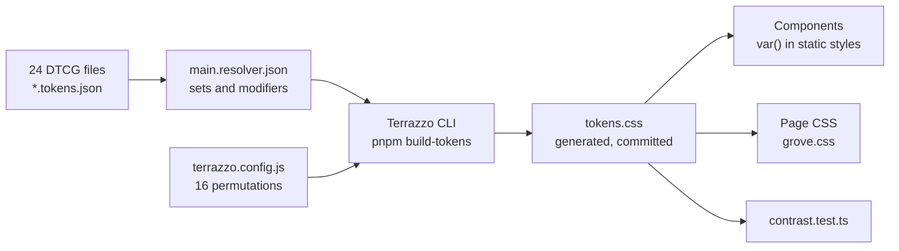
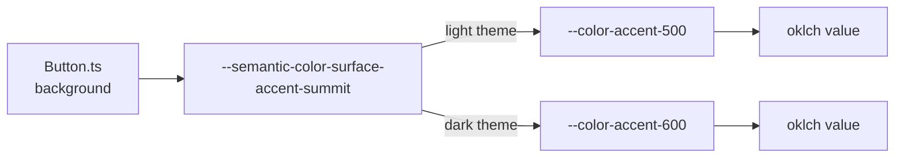

# 11 · Design tokens

> **What you learn here**
>
> - How the token JSON files become `src/lib/tokens/tokens.css`, and how a JSON path becomes a CSS
>   variable name.
> - The difference between primitive and semantic tokens, and why a component uses only semantic
>   names.
> - The token families: colour, spacing, border, effects and typography, and the DTCG types behind
>   them.
> - Where the token set has gaps today, and which open work fills them.
>
> **Read first:** [06 · Styles inside a component](06-styles-inside-a-component.md). **Time:** 45
> minutes.
>
> Open work as of main @ e251d45, 2026-10-27.

Open `src/lib/tokens/` next to this chapter. Themes and the page CSS are in
[13 · Themes and page CSS](13-themes-and-page-css.md). The contrast gate is in
[09 · Accessibility](09-accessibility.md#the-contrast-gate).

## Whiteboard

The diagram shows the token pipeline. JSON files go into the resolver, Terrazzo reads the resolver
and its config, and one CSS file comes out.



The second diagram shows one alias chain. A component names a role. The role points to a primitive,
and the primitive holds the raw value.



## What a token is

A token is a named design value, for example "the Ground surface colour", "16 px of space" or "the
body text style". Grove writes each token once in JSON. The build turns it into a CSS custom
property, for example `--semantic-color-surface-ground`.

Components never use raw values. They use the custom property through `var()`. When a token changes,
every component that uses it changes too. No component file changes.

> [!NOTE]
> **Lit box: tokens in static styles**
>
> The `css` tag of Lit accepts only other `css` values and numbers inside `${…}`. Thus a component
> cannot put a runtime value into its static styles. It reads tokens through `var()`, and the
> browser resolves them at runtime. Grove example, `Button.ts`, `.btn--filled.btn--accent`:
> `background: var(--semantic-color-surface-accent-summit);`
>
> Lit docs: [Styles](https://lit.dev/docs/v3/components/styles/)

## The pipeline

The token files use the DTCG format. Each token is an object with a `$value`. Groups nest by name,
and a `$type` on a group applies to every token in it.
[Source: Design Tokens Format Module 2025.10](https://www.designtokens.org/tr/2025.10/format/)

| Part          | File                                | What it does                                                      |
| ------------- | ----------------------------------- | ----------------------------------------------------------------- |
| The sources   | `src/lib/tokens/**/*.tokens.json`   | Hold the values, in DTCG JSON                                     |
| The resolver  | `src/lib/tokens/main.resolver.json` | Lists the `sets` that always load and the `modifiers` that swap   |
| The config    | `terrazzo.config.js`                | Wraps each combination of contexts in a selector or a media query |
| The generator | `@terrazzo/cli` 2.2.0, `plugin-css` | Reads the resolver and the config, and writes `tokens.css`        |
| The output    | `src/lib/tokens/tokens.css`         | About 13,200 lines of custom properties                           |

The resolver follows the DTCG Resolver Module. It has `"version": "2025.10"`, five sets, three
modifiers and a `resolutionOrder`.
[Source: Design Tokens Resolver Module 2025.10](https://www.designtokens.org/tr/2025.10/resolver/)

`main.resolver.json`, `resolutionOrder`:

```json
	"resolutionOrder": [
		{ "$ref": "#/sets/spacing" },
		{ "$ref": "#/sets/border" },
		{ "$ref": "#/modifiers/breakpoint" },
		{ "$ref": "#/sets/palette-primitives" },
		{ "$ref": "#/modifiers/theme" },
		{ "$ref": "#/sets/font" },
		{ "$ref": "#/modifiers/media" },
		{ "$ref": "#/sets/text" }
	]
```

The package script `build-tokens` runs `tz build`. `pnpm build` runs `build-tokens` first, then the
Vite build, then the manifest steps.
[Source: Terrazzo CLI](https://terrazzo.app/docs/reference/cli/)

The config also turns on one lint rule. `core/consistent-naming` with `format: 'camelCase'` fails
the build when a token id is not in camelCase.
[Source: Terrazzo config](https://terrazzo.app/docs/reference/config/)

Terrazzo generates `tokens.css`. Do not edit it. Edit the JSON and run `pnpm build-tokens`. The
repo keeps the file in git, because Storybook, the Vercel deploy and the unit tests read it from
`src/`. It is in `.prettierignore`, so Prettier never changes it.

> [!CAUTION]
> Do not edit `src/lib/tokens/tokens.css` by hand. The next `pnpm build-tokens` overwrites your
> change, and `contrast.test.ts` fails when the CSS and the JSON do not agree.

## The folders

`src/lib/tokens/` has 24 DTCG files in five folders:

| Folder     | Files                                                                                                                                                 |
| ---------- | ----------------------------------------------------------------------------------------------------------------------------------------------------- |
| `palette/` | `color.tokens.json` (the primitives in OKLCH) and `semantic-color.{light,dark}.tokens.json`                                                           |
| `effects/` | The drop shadows `drop-shadow-under.{light,dark}` and the focus rings `ring-on.{light,dark}`                                                          |
| `spacing/` | `soft-grid`, `breakpoints` and one layout grid for each breakpoint: `grid.{mobile,tablet,laptop,desktop}`                                             |
| `border/`  | `border-radius` and `border-width`                                                                                                                    |
| `text/`    | `font-family`, `font-weight`, `typography` (the composites), and `font-size`, `line-height` and `letter-spacing` in a `digital` and a `print` version |

The folder also holds `main.resolver.json`, the generated `tokens.css`, `contrast.test.ts` and
`apca-w3.d.ts`. The last file gives types to the APCA package that the contrast test uses.

## Primitive and semantic colours

A **primitive token** holds a raw value and names only a hue and a step, for example
`--color-brand-500`. `palette/color.tokens.json` has 69 primitives: six families of eleven steps
(50, 100 to 900 and 950) and three base colours (`light`, `dark` and `night`). The families are
`brand`, `accent`, `gray`, `information`, `danger` and `success`.

A **semantic token** names a role, for example `--semantic-color-surface-ground`. The semantic files
contain only aliases. Each `$value` is a reference to a primitive, in curly braces.

`palette/semantic-color.light.tokens.json`, the start of `semanticColor.surface`:

```json
		"surface": {
			"ground": { "$value": "{color.base.light}" },
			"brand": {
				"terrace": { "$value": "{color.brand.100}" },
				"path": { "$value": "{color.brand.200}" },
				"summit": { "$value": "{color.brand.500}" },
				"aurora": { "$value": "{color.brand.700}" }
			},
```

The semantic colours have five groups. Each group name reads as part of a sentence:

| Group            | Example CSS name                              | Reads as                        |
| ---------------- | --------------------------------------------- | ------------------------------- |
| `surface`        | `--semantic-color-surface-brand-terrace`      | the brand terrace surface       |
| `textOn`         | `--semantic-color-text-on-accent-summit-base` | base text on the accent summit  |
| `borderAround`   | `--semantic-color-border-around-ground`       | the border around a Ground item |
| `dividerOn`      | `--semantic-color-divider-on-ground`          | a divider on Ground             |
| `selectedTextOn` | `--semantic-color-selected-text-on-ground`    | selected text on Ground         |

The light file has 145 semantic tokens. The dark file has the same names with different targets. A
primitive has the same value in both themes. Only the semantic aliases change. Thus a component that
uses semantic names follows the theme with no theme code of its own.

Use the rule in `DESIGN_SYSTEM.md`: do not use a primitive for a UI element. Primitives are for SVG
art, such as `gv-isotype`. Art that must change with the theme pairs two primitives in
`light-dark()`. [13 · Themes and page CSS](13-themes-and-page-css.md#the-light-dark-function) shows
how.

## Three modifiers

`main.resolver.json` has three modifiers. Each modifier is a context with a default and
alternatives:

| Modifier     | Default   | Alternatives                  | What it swaps                                           |
| ------------ | --------- | ----------------------------- | ------------------------------------------------------- |
| `theme`      | `light`   | `dark`                        | The semantic colours, the drop shadows, the focus rings |
| `breakpoint` | `mobile`  | `tablet`, `laptop`, `desktop` | The layout grid: columns, gutters and margins           |
| `media`      | `digital` | `print`                       | Font sizes, line heights and letter spacing             |

`terrazzo.config.js` lists 16 permutations of these contexts. Each permutation writes the tokens for
one combination into one CSS block. The blocks are: the base, light, dark, three breakpoints with
their dark and light variants, and print with its three breakpoints.
[Source: Terrazzo, resolvers](https://terrazzo.app/docs/guides/resolvers/)
[13 · Themes and page CSS](13-themes-and-page-css.md#how-themes-layer-in-one-file) explains the
order of the blocks.

## From JSON path to CSS name

The CSS name of a token is its JSON path. Each camelCase segment becomes kebab-case, and hyphens
join the segments. The `variableName` line in `terrazzo.config.js` is a comment, so the plugin uses
its default name. The Terrazzo page documents the option but not the default, so `tokens.css` is
the proof of the rule.
[Source: Terrazzo, CSS](https://terrazzo.app/docs/integrations/css/)

| JSON path                                   | CSS name                                         |
| ------------------------------------------- | ------------------------------------------------ |
| `color.gray.50`                             | `--color-gray-50`                                |
| `semanticColor.surface.ground`              | `--semantic-color-surface-ground`                |
| `semanticColor.textOn.ground.unvisitedLink` | `--semantic-color-text-on-ground-unvisited-link` |
| `softGrid.16`                               | `--soft-grid-16`                                 |
| `letterSpacing.extraLoose`                  | `--letter-spacing-extra-loose`                   |
| `dropShadowUnder.brand.summit`              | `--drop-shadow-under-brand-summit`               |
| `ringOn.ground`                             | `--ring-on-ground`                               |

A primitive becomes a value. `palette/color.tokens.json`, `color.gray.50`:

```json
			"50": {
				"$value": {
					"colorSpace": "oklch",
					"components": [0.93, 0.006, 70],
					"alpha": 1,
					"hex": "#EAE7E4"
				}
			},
```

`tokens.css`, the base `:root` block:

```css
--color-gray-50: oklch(93% 0.006 70);
```

An alias becomes a `var()` reference to its target. `semanticColor.surface.ground` has the value
`{color.base.light}`, and `tokens.css` has:

```css
--semantic-color-surface-ground: var(--color-base-light);
```

Thus the browser, not Terrazzo, resolves the last step of each alias chain. A page can override a
primitive, and every alias that points to it follows.

## OKLCH and wide gamut

All colour tokens use OKLCH. OKLCH has three components: lightness, chroma and hue. It is
perceptually uniform, so equal steps in lightness look like equal steps to the eye.
[Source: CSS Color 4, OKLab and OKLCH](https://www.w3.org/TR/css-color-4/#ok-lab)
[Source: MDN, oklch()](https://developer.mozilla.org/en-US/docs/Web/CSS/Reference/Values/color_value/oklch)

A JSON colour gives `colorSpace`, `components`, `alpha` and a `hex` value. DTCG defines this object
form. [Source: Design Tokens Color Module 2025.10](https://www.designtokens.org/tr/2025.10/color/)

Some primitives are outside the sRGB gamut. For these, Terrazzo writes three values:

1. The base block gets a value mapped into sRGB.
2. A `@media (color-gamut: p3)` block gets a value mapped into Display P3.
3. A `@media (color-gamut: rec2020)` block gets a value mapped into Rec. 2020.

[Source: MDN, color-gamut](https://developer.mozilla.org/en-US/docs/Web/CSS/Reference/At-rules/@media/color-gamut)
[Source: CSS Color 4, gamut mapping](https://www.w3.org/TR/css-color-4/#gamut-mapping)

`color.accent.900` is `[0.28, 0.16, 316]` in the JSON. `tokens.css` has these three values for it:

| Block                           | Value                        |
| ------------------------------- | ---------------------------- |
| `:root` (sRGB)                  | `oklch(29.22% 0.1441 314.7)` |
| `@media (color-gamut: p3)`      | `oklch(28.65% 0.1507 315.1)` |
| `@media (color-gamut: rec2020)` | `oklch(28% 0.16 316)`        |

A colour inside sRGB, such as `color.brand.500`, gets one value only. In the base `:root` block, 24
of the 69 primitives are mapped values. The wide-gamut blocks also repeat each alias of a mapped
colour.

The contrast test reads only the sRGB baseline blocks. Thus the gate measures the colours that every
screen can show.

> [!IMPORTANT]
> **Open work: #58 — an illustrations palette** (issue, not started)
>
> The spec adds 10 families of 11 steps (110 primitives) for illustrations, in a new
> `illustrations.tokens.json` in the resolver. The values are "hex first": each is an 8-bit sRGB
> hex, and the OKLCH text comes from it. Thus every value is in sRGB, and the baseline `:root` block
> keeps it unchanged.
>
> A parity test compares the built CSS, the DTCG hex and the Figma variables. Open decisions include
> the names (`--color-*` or `--illustration-*`), UI use and wide gamut. The Figma collection does
> not exist yet. When it lands, add the set to the folder table and the primitive count.
> <https://github.com/edgarjaymez/grove-lit/issues/58>

## Spacing and grids

**The soft grid** is a spacing scale, not a CSS grid. `spacing/soft-grid.tokens.json` has 27 steps
from `softGrid.0` to `softGrid.96`. The number is the size in pixels at a 16 px root font size. The
value is in `rem`, so it follows the font size that the user sets.

`tokens.css`, the base `:root` block:

```css
--soft-grid-16: 1rem;
```

The steps go up by 1 or 2 at small sizes and by 4 or 8 at large sizes. `DESIGN_SYSTEM.md` sorts them
into four groups:

| Group     | Range    | Typical use                                   |
| --------- | -------- | --------------------------------------------- |
| Micro     | 0–8 px   | Space inside a component, such as an icon gap |
| Component | 12–24 px | Padding of a component, gaps in a group       |
| Layout    | 32–64 px | Gaps between sections, card margins           |
| Section   | 72–96 px | Vertical rhythm of a page                     |

Many other tokens are aliases of the soft grid: border widths, radii, font sizes and the shadow
offsets.

**The breakpoints** are in `spacing/breakpoints.tokens.json`: `mobile` 0 px, `tablet` 768 px,
`laptop` 1280 px and `desktop` 1536 px. They become `--breakpoints-tablet: 768px` and so on.

A custom property cannot go in a media query condition. Thus a component writes the number, with a
comment that names the token.
[06 · Styles inside a component](06-styles-inside-a-component.md#rules-for-css-inside-a-component)
shows the `BackButton.ts` example.

**The layout grid** changes with the `breakpoint` modifier. Each breakpoint file sets `grid.columns`
and two presets, `system` and `landing`, each with a `margin` and a `gutter`:

| Breakpoint | `--grid-columns` | System margin / gutter | Landing margin / gutter |
| ---------- | ---------------- | ---------------------- | ----------------------- |
| mobile     | 4                | 16 / 16 px             | 16 / 16 px              |
| tablet     | 8                | 24 / 16 px             | 32 / 24 px              |
| laptop     | 12               | 32 / 20 px             | 64 / 32 px              |
| desktop    | 12               | 32 / 24 px             | 96 / 48 px              |

The System preset is for product UI. The Landing preset has wider margins for landing pages and
documentation. The grid tokens are mainly for page layout. One component reads them:
`FeedbackStrip.ts` sets `padding-inline: var(--grid-system-margin);`, so the strip lines up with the
page margin.

## Border

`border/border-width.tokens.json` has five widths. Four are aliases of the soft grid. One,
`hairline`, is a raw `0.03125rem` (0.5 px):

| Token                     | Value                |
| ------------------------- | -------------------- |
| `--border-width-none`     | `var(--soft-grid-0)` |
| `--border-width-hairline` | `0.03125rem`         |
| `--border-width-base`     | `var(--soft-grid-1)` |
| `--border-width-heavy`    | `var(--soft-grid-2)` |
| `--border-width-thick`    | `var(--soft-grid-4)` |

`border/border-radius.tokens.json` has 13 radii, from `--border-radius-none` (`soft-grid-0`) through
`sm`, `base`, `md`, `lg`, `xl` and `2xl` to `--border-radius-12xl` (`soft-grid-64`). For example,
`--border-radius-base` is `var(--soft-grid-8)`. Button uses `--border-radius-8xl`.

The colour of a border is not a border token. It is a semantic colour:
`--semantic-color-border-around-<surface>`, or `--semantic-color-divider-on-<surface>` for a line
between items.

## Effects

The effects folder has two token families. Both have the DTCG type `shadow`, and both change with
the theme.
[Source: Design Tokens Format Module 2025.10, shadow](https://www.designtokens.org/tr/2025.10/format/#shadow)

### Drop shadows

`dropShadowUnder` has a terrace and a summit shadow for each of the six tracks: 12 tokens. Each
shadow has two layers in the hue of its track.

`tokens.css`, the base `:root` block:

<!-- prettier-ignore -->
```css
--drop-shadow-under-brand-summit: var(--soft-grid-4) var(--soft-grid-4) var(--soft-grid-8) var(--soft-grid-2) oklch(48% 0.075 145 / 0.04), var(--soft-grid-1) var(--soft-grid-1) var(--soft-grid-4) var(--soft-grid-1) oklch(38% 0.075 145 / 0.12);
--drop-shadow-under-brand-terrace: var(--soft-grid-16) var(--soft-grid-16) var(--soft-grid-32) var(--soft-grid-4) oklch(48% 0.075 145 / 0.04), var(--soft-grid-4) var(--soft-grid-4) var(--soft-grid-16) var(--soft-grid-2) oklch(38% 0.075 145 / 0.08);
```

Be careful with the names:

- **The Summit shadow is the tight one.** It has small offsets and blur. Use it for cards, panels,
  buttons and inputs.
- **The Terrace shadow is the wide one.** Use it for modals, sheets and popovers.

Thus a card on a terrace surface gets the Summit shadow. Choose a shadow by the size that you need,
not by the depth in its name.

At night a shadow does not show well on a dark ground. Thus the dark file draws a 1 px rim in the
colour of the track plus a soft glow (Summit) or a deep shadow (Terrace).

The shadow colours are OKLCH literals in the JSON, not aliases. `contrast.test.ts` checks that each
shadow colour is a palette colour ("draws every shadow in a palette colour (drift guard)").

A component sets its shadow through the private property `--_drop`, never through `box-shadow`.
[14 · The focus ring](14-the-focus-ring.md#the-mechanism) tells why.

### Focus rings

`ringOn` has one ring for each resting surface: 15 tokens. There is no ring for an aurora. Each ring
is a two-layer shadow: a 4 px gap in the surface colour, then a 4 px ring.

`effects/ring-on.light.tokens.json`, `dimensions`:

```json
	"dimensions": {
		"$type": "dimension",
		"base": {
			"offsetX": { "$value": "{softGrid.0}" },
			"offsetY": { "$value": "{softGrid.0}" },
			"blur": { "$value": "{softGrid.0}" },
			"spread": { "$value": "{softGrid.8}" }
		},
		"offset": {
			"offsetX": { "$value": "{softGrid.0}" },
			"offsetY": { "$value": "{softGrid.0}" },
			"blur": { "$value": "{softGrid.0}" },
			"spread": { "$value": "{softGrid.4}" }
		}
	},
```

The gap layer has a 4 px spread, and the ring layer has an 8 px spread. The first shadow in a list
paints on top, so the gap covers the inner half of the ring.
[Source: CSS Backgrounds 3, shadow layers](https://www.w3.org/TR/css-backgrounds-3/#shadow-layers)
The `dimensions` group also becomes tokens, for example `--dimensions-offset-offset-x`.

The ring colour depends on the surface and the theme:

| Surface                             | Light        | Dark         |
| ----------------------------------- | ------------ | ------------ |
| Ground, any path, any other terrace | `accent/500` | `accent/300` |
| Any other summit                    | `accent/100` | `accent/100` |
| Accent terrace                      | `brand/500`  | `brand/300`  |
| Accent summit                       | `brand/100`  | `brand/100`  |

On the accent track, the ring uses the `brand` family in place of `accent`. The contrast gate checks
that each ring has 3:1 against its gap, in both themes.

## Typography composites

A **composite token** holds a full type style. `text/typography.tokens.json` has the type
`typography`. Each composite has five parts: font family, font size, font weight, letter spacing and
line height.
[Source: Design Tokens Format Module 2025.10, typography](https://www.designtokens.org/tr/2025.10/format/#typography)

`text/typography.tokens.json`, `typography.singleLine.base.base`:

```json
			"base": {
				"base": {
					"$value": {
						"fontFamily": "{fontFamily.sansSerif}",
						"fontSize": "{fontSize.md}",
						"fontWeight": "{fontWeight.regular}",
						"letterSpacing": "{letterSpacing.base}",
						"lineHeight": "{lineHeight.singleLine.md}"
					}
				},
```

Terrazzo writes one variable for each part, plus one value for the CSS `font` shorthand.

`tokens.css`, the base `:root` block:

<!-- prettier-ignore -->
```css
--typography-single-line-base-base-font-family: var(--font-family-sans-serif);
--typography-single-line-base-base-font-size: var(--font-size-md);
--typography-single-line-base-base-font-weight: var(--font-weight-regular);
--typography-single-line-base-base-letter-spacing: var(--letter-spacing-base);
--typography-single-line-base-base-line-height: var(--line-height-single-line-md);
--typography-single-line-base-base: var(--typography-single-line-base-base-font-weight) var(--typography-single-line-base-base-font-size)/var(--typography-single-line-base-base-line-height) var(--typography-single-line-base-base-font-family);
```

The `font` shorthand sets the style, weight, size, line height and family. It has no place for
letter spacing.
[Source: MDN, font](https://developer.mozilla.org/en-US/docs/Web/CSS/Reference/Properties/font) Thus
Grove CSS always pairs `font:` with the `-letter-spacing` part.

`Button.ts`, `.btn--md`:

```css
.btn--md {
	gap: var(--soft-grid-6);
	padding: var(--soft-grid-8) var(--soft-grid-16);
	font: var(--typography-single-line-subtle-emphasis);
	letter-spacing: var(--typography-single-line-subtle-emphasis-letter-spacing);
}
```

Do not set `font-size`, `line-height` or `font-family` one at a time.

**The names** follow `--typography-{single-line|multi-line}-{level}-{variant}`.

- **Single-line** composites have tight line heights for one line of UI text. **Multi-line**
  composites have more space between lines, for paragraphs.
- The 11 levels are `hero`, `display`, `title`, `heading`, `subheading`, `base`, `subtle`, `quote`,
  `label`, `caption` and `footnote`.
- The variants are `base` and `emphasis`. `emphasis` changes only the font weight. `hero` and
  `display` have no `emphasis` variant.
- `hero` and `display` use the display font, Cakra. The other levels use Inclusive Sans.

| Level        | Font size token | Digital size |
| ------------ | --------------- | ------------ |
| `hero`       | `fontSize.4xl`  | 15rem        |
| `display`    | `fontSize.3xl`  | 80 px        |
| `title`      | `fontSize.2xl`  | 40 px        |
| `heading`    | `fontSize.xl`   | 32 px        |
| `subheading` | `fontSize.lg`   | 24 px        |
| `base`       | `fontSize.md`   | 20 px        |
| `quote`      | `fontSize.md`   | 20 px        |
| `subtle`     | `fontSize.base` | 16 px        |
| `label`      | `fontSize.sm`   | 14 px        |
| `caption`    | `fontSize.xs`   | 12 px        |
| `footnote`   | `fontSize.2xs`  | 10 px        |

> [!CAUTION]
> Do not think that the `base` level uses `--font-size-base`. The body level `base` uses
> `fontSize.md` (20 px). `--font-size-base` (16 px) is the size of the `subtle` level.

The font weights are `extraLight` 200, `regular` 400 and `semiBold` 600. `subtle` uses `extraLight`,
but `fonts.css` loads Inclusive Sans with weights 300 to 700. This difference is deliberate.
[23 · Known drift](23-known-drift.md#deliberate-and-left-alone) lists it.

## Digital and print

The `media` modifier swaps three file pairs: `font-size`, `line-height` and `letter-spacing`. The
print file uses smaller sizes. For example, `fontSize.md` is `softGrid.20` (20 px) in digital and
`softGrid.12` (12 px) in print. The line heights also change. The two `letter-spacing` files have
the same values today.

The print block in `tokens.css` is `@media print { :root, [data-theme] { … } }`. It also forces the
light theme. [13 · Themes and page CSS](13-themes-and-page-css.md#print) explains why.

## DTCG types

Each token has a DTCG type, set on the token or on its group. Terrazzo turns each type into CSS in a
fixed way. [Source: Terrazzo, DTCG tokens](https://terrazzo.app/docs/guides/dtcg/)

| `$type`      | Example in Grove               | JSON form                                | CSS output                 |
| ------------ | ------------------------------ | ---------------------------------------- | -------------------------- |
| `color`      | `color.gray.50`                | `{ colorSpace, components, alpha, hex }` | `oklch(93% 0.006 70)`      |
| `dimension`  | `softGrid.16`                  | `{ "value": 1, "unit": "rem" }`          | `1rem`                     |
| `number`     | `grid.columns`, `lineHeight.*` | a plain number                           | `4`                        |
| `fontFamily` | `fontFamily.sansSerif`         | an array of names                        | a font list                |
| `fontWeight` | `fontWeight.regular`           | a number                                 | `400`                      |
| `shadow`     | `ringOn.ground`                | an array of layers                       | a `box-shadow` list        |
| `typography` | `typography.singleLine.*`      | an object of five parts                  | five parts and a shorthand |

[Source: Design Tokens Format Module 2025.10, dimension](https://www.designtokens.org/tr/2025.10/format/#dimension)
[Source: Design Tokens Format Module 2025.10, color](https://www.designtokens.org/tr/2025.10/format/#color)

Grove has no motion tokens yet. Two DTCG types are for motion:

- **`duration`.** The value is an object with a number and a unit, `"ms"` or `"s"`. It has the same
  form as a `dimension` in `soft-grid.tokens.json`.
  [Source: Design Tokens Format Module 2025.10, duration](https://www.designtokens.org/tr/2025.10/format/#duration)
- **`cubicBezier`.** The value is an array of four numbers, `[P1x, P1y, P2x, P2y]`. There is no
  keyword form, such as `ease-in-out`.
  [Source: Design Tokens Format Module 2025.10, cubic-bezier](https://www.designtokens.org/tr/2025.10/format/#cubic-bezier)

Example (a DTCG motion file, not in the repo):

```json
{
	"motion": {
		"duration": {
			"$type": "duration",
			"base": { "$value": { "value": 300, "unit": "ms" } }
		},
		"easing": {
			"$type": "cubicBezier",
			"standard": { "$value": [0.42, 0, 0.58, 1] }
		}
	}
}
```

Terrazzo writes the duration as `300ms` and the easing as `cubic-bezier(0.42, 0, 0.58, 1)`. The
transforms are in `@terrazzo/token-tools`, `transformDuration` and `transformCubicBezier`.

> [!IMPORTANT]
> **Open work: #67 — motion tokens** (issue, not started)
>
> The spec adds a DTCG `motion` set: durations `quick` 200ms and `base` 300ms, easings `standard`
> (ease-in-out) and `exit` (ease-out). Nine components read them through `var()`, with today's
> values as fallbacks. A page can then retime Grove, because custom properties inherit into shadow
> roots. The reduced-motion `!important` rule still wins.
>
> The trap: FR-03 says that `AT_REST` "passes unchanged". `AT_REST` is a table in
> `reduced-motion.browser.test.ts`, and it exists only in PR #66 (componentReset tests for hidden
> and reduced motion).
>
> The table compares computed strings, such as `'0.3s'` and `'ease-in-out'`. A `cubicBezier`
> token makes the computed easing `cubic-bezier(0.42, 0, 0.58, 1)`, so those rows fail unless the
> test normalises the easing.
> The durations still compute as `'0.3s'`. Thus #67 depends on #66. Open decisions: the names and
> the scale, whether the checkbox's 200ms `ease` is deliberate, and public or internal tokens. When
> it lands, add the `motion` folder, the set and the CSS names to this chapter.
> <https://github.com/edgarjaymez/grove-lit/issues/67>

## Literals and tokens

A literal is a raw value in a component, such as `rgba(38, 77, 40, 0.1)`. A token is a named value.
The house rule is: use a token for each colour, space and font value.

Three kinds of literal are on `main` and are permitted:

- **The "no shadow" value.** Components write `--_drop: 0 0 #0000` to remove a shadow, for example
  on `:active`. `#0000` is transparent.
- **Fallbacks in `var()`.** `focus-ring.ts` writes `var(--border-width-heavy, 2px)`. The literal
  applies only when the page has no `tokens.css`.
- **Numbers in a media query**, because a custom property cannot go there.

One more literal is on `main`: the day grain of `gv-texture`, `color: rgba(38, 77, 40, 0.1)` in
`Texture.ts`. It is a value from the Figma file, kept as a literal.

> [!IMPORTANT]
> **Open work: #65 — gv-texture colour variants and the night grain** (open PR, no conflict with
> main on 2026-10-27)
>
> The PR adds a `color` property with six day tones. The tones are `rgba` literals from Figma, for
> example `brand: 'rgba(38, 77, 40, 0.1)'`. The night fallbacks are OKLCH literals copied from
> `tokens.css`. A drift guard test checks that each day tone is within 1/255 of
> `--color-{track}-700`.
>
> The automated review found two problems that stop the merge. First, `color` duplicates what `tint` and
> the tokens already do. Second, the Figma literals duplicate tokens, and the same palette is in
> four places. The PR also has the "Needs Figma Spec" label, so it waits for answers to its two
> questions. If it lands as it is, add `Texture.ts` to the literals above. If the
> tones come from tokens, delete this box. <https://github.com/edgarjaymez/grove-lit/pull/65>

## Token gaps

A token gap is a design need that no token covers. Do not fill a gap with a literal in a component.
Add a token through the JSON, or wait for the design. Each gap below has an open spec.

| Gap                                                      | Where it shows                        | Item |
| -------------------------------------------------------- | ------------------------------------- | ---- |
| No semantic status colours                               | The dot and label of a status chip    | #16  |
| No danger text role on Ground                            | An error message under a text field   | #18  |
| No z-index token                                         | A skip link that floats over the page | #39  |
| No outlined border that reaches 3:1 on summit and aurora | Outlined buttons on dark surfaces     | #44  |

> [!IMPORTANT]
> **Open work: #16 — gv-status-chip** (issue, blocked: Needs Figma Spec)
>
> The spec read its colours from the `--color-*-500` primitives. Primitives do not change with the
> theme, and the 500 step gives 2.00 to 3.13:1 at night. The pair that works is label 600 by day and
> 300 at night, dot 500 and 400. The spec recommends new semantic status tokens, which the contrast
> gate measures for free, not `light-dark()` pairs in the component. When it lands, add the status
> group to the semantic table. <https://github.com/edgarjaymez/grove-lit/issues/16>

> [!IMPORTANT]
> **Open work: #18 — gv-text-input visible label, helper text and form association** (issue,
> blocked: Needs Figma Spec)
>
> The `text-on-ground` roles are `base`, `subtle`, `emphasis` and two link roles. There is no
> danger-coloured text role on Ground, so a red error message has no token. The options are a new
> semantic token with a light and a dark value, or a neutral role with the non-colour cue of #27.
> The Figma spec decides. Most of #18 now moves into #51. When a token lands, add it to the semantic
> table. <https://github.com/edgarjaymez/grove-lit/issues/18>

> [!IMPORTANT]
> **Open work: #39 — the skip link utility** (issue, blocked: Needs Figma Spec)
>
> `tokens.css` has no `--z-index*` token. The skip link floats over the page, so it needs a z-index
> value. Open decision 4 asks for a value, whether it becomes a token in the Terrazzo sources, and
> `position: fixed` or `absolute`. When it lands, add the z-index token to this chapter.
> <https://github.com/edgarjaymez/grove-lit/issues/39>

> [!IMPORTANT]
> **Open work: #44 — outlined and ghost buttons on any surface** (issue, blocked: Needs Figma Spec)
>
> On summit and aurora, no border token reaches 3:1 for the outlined variant. Measured: 1.34 to
> 2.87:1, under 1.4.11 Non-text Contrast (AA). The options are a new token, `currentColor`, no
> border, or no support for those surfaces. #52 deferred this as a known gap.
> [12 · Surfaces and elevation](12-surfaces-and-elevation.md#contrast-on-summit-and-aurora) has the
> details. <https://github.com/edgarjaymez/grove-lit/issues/44>

## Churn in the generated file

`pnpm build` runs `pnpm build-tokens` first. Thus each build writes `tokens.css` again. Sometimes
the generator changes the order or the format with no real change. On 2026-10-27, a run on a clean
checkout gave no churn, but do the check each time.

Do these steps before you commit:

1. Look at the change:

   ```sh
   git diff --stat src/lib/tokens/tokens.css
   ```

2. If you did not edit a token JSON file, discard the change:

   ```sh
   git checkout -- src/lib/tokens/tokens.css
   ```

   Result: `git status` does not show `tokens.css`.

[22 · Cookbook](22-cookbook.md#recipe-11-undo-churn-in-the-generated-tokens) has the same recipe.
[Recipe 5](22-cookbook.md#recipe-5-add-or-change-a-token) tells how to add or change a token.

## The design doc and the generated file

`DESIGN_SYSTEM.md` explains the design language: which surface to use, how elevation works, and
which text level fits where. Use it for intent. It was last checked against `tokens.css` on
2026-10-07, and its header says that `tokens.css` wins when the two disagree.

When the doc names a token or a value that `tokens.css` does not have, `tokens.css` is correct. Do
not copy the value from the doc into code. Report the drift, so that somebody fixes the doc.
[README · When two sources disagree](README.md#when-two-sources-disagree) gives the full order of
trust.

## See it in the code

| File                                                      | Look for                                                       |
| --------------------------------------------------------- | -------------------------------------------------------------- |
| `src/lib/tokens/main.resolver.json`                       | `sets`, `modifiers`, `resolutionOrder`                         |
| `terrazzo.config.js`                                      | The lint rule, the 16 permutations, the comment on the cascade |
| `src/lib/tokens/palette/color.tokens.json`                | `color.gray.50`, `color.accent.900`                            |
| `src/lib/tokens/palette/semantic-color.light.tokens.json` | The five groups, all aliases                                   |
| `src/lib/tokens/effects/ring-on.light.tokens.json`        | `dimensions`, `ringOn.ground`                                  |
| `src/lib/tokens/text/typography.tokens.json`              | `typography.singleLine.base.base`                              |
| `src/lib/tokens/tokens.css`                               | The base `:root` block, the `@media (color-gamut: p3)` block   |
| `src/lib/components/Button/Button.ts`                     | `.btn--md`, `.btn--filled.btn--accent`                         |

## Sources

**Standards**

- [Design Tokens Format Module 2025.10](https://www.designtokens.org/tr/2025.10/format/), sections
  [color](https://www.designtokens.org/tr/2025.10/format/#color),
  [dimension](https://www.designtokens.org/tr/2025.10/format/#dimension),
  [duration](https://www.designtokens.org/tr/2025.10/format/#duration),
  [cubic-bezier](https://www.designtokens.org/tr/2025.10/format/#cubic-bezier),
  [shadow](https://www.designtokens.org/tr/2025.10/format/#shadow) and
  [typography](https://www.designtokens.org/tr/2025.10/format/#typography). Read 2026-10-27.
- [Design Tokens Color Module 2025.10](https://www.designtokens.org/tr/2025.10/color/). Read
  2026-10-27.
- [Design Tokens Resolver Module 2025.10](https://www.designtokens.org/tr/2025.10/resolver/). Read
  2026-10-27.
- [CSS Color 4, OKLab and OKLCH](https://www.w3.org/TR/css-color-4/#ok-lab) and
  [gamut mapping](https://www.w3.org/TR/css-color-4/#gamut-mapping). Read 2026-10-27.
- [CSS Backgrounds 3, shadow layers](https://www.w3.org/TR/css-backgrounds-3/#shadow-layers). Read
  2026-10-27.

**Platform reference**

- [MDN, oklch()](https://developer.mozilla.org/en-US/docs/Web/CSS/Reference/Values/color_value/oklch).
  Read 2026-10-27.
- [MDN, color-gamut](https://developer.mozilla.org/en-US/docs/Web/CSS/Reference/At-rules/@media/color-gamut).
  Read 2026-10-27.
- [MDN, font](https://developer.mozilla.org/en-US/docs/Web/CSS/Reference/Properties/font). Read
  2026-10-27.

**Tool docs**

- [Lit, Styles](https://lit.dev/docs/v3/components/styles/). Read 2026-10-27.
- [Terrazzo CLI](https://terrazzo.app/docs/reference/cli/). Read 2026-10-27.
- [Terrazzo config](https://terrazzo.app/docs/reference/config/). Read 2026-10-27.
- [Terrazzo, resolvers](https://terrazzo.app/docs/guides/resolvers/). Read 2026-10-27.
- [Terrazzo, CSS](https://terrazzo.app/docs/integrations/css/). Read 2026-10-27.
- [Terrazzo, DTCG tokens](https://terrazzo.app/docs/guides/dtcg/). Read 2026-10-27.

## Check yourself

Do [Lesson 9 Tokens](syllabus.md#lesson-9-tokens) in the syllabus. Then answer these questions from
the files: Which CSS name does `semanticColor.selectedTextOn.ground` get? Why does
`--color-accent-900` appear three times in the light theme? Which typography level uses
`--font-size-base`? Which shadow do you put on a modal?

[← 10 · Forms](10-forms.md) · [Index](README.md) ·
[12 · Surfaces and elevation →](12-surfaces-and-elevation.md)
