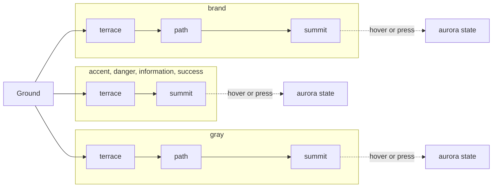
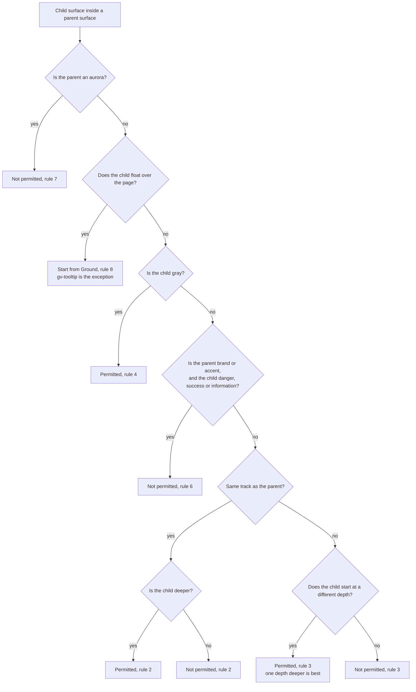

# 12 · Surfaces and elevation

> **What you learn here**
>
> - The surface model: six tracks, four depths and the aurora state.
> - The eight nesting rules, and how to check a composition against them.
> - What a `.gv-surface-*` class sets, and the TypeScript types for surfaces.
> - Which text colour goes on which surface, and where contrast is weak today.
>
> **Read first:** [11 · Design tokens](11-design-tokens.md). **Time:** 35 minutes.
>
> Open work as of main @ e251d45, 2026-10-27.

A **surface** is a painted area with a known background, text colour and ring colour. Each surface
has its own text, border, divider, shadow and focus ring tokens, so that content on it stays
readable. `DESIGN_SYSTEM.md`, section "Elevation", is the design source for this chapter. The code
source is `src/lib/surfaces.ts` and `src/lib/styles/surfaces.css`.

## Whiteboard

The diagram shows the tracks and the depths. Each track can start on Ground. Path exists only on the
brand and gray tracks. Aurora is a state of a resting surface, not a level of its own.



The second diagram is a decision flow. Use it to check if a child surface can go inside a parent
surface.



## Tracks and depths

A **track** is a colour family of surfaces. There are six tracks:

| Track         | Use                                       |
| ------------- | ----------------------------------------- |
| `brand`       | The main brand colour                     |
| `accent`      | Actions with high priority, and links     |
| `gray`        | Neutral surfaces, the default for most UI |
| `danger`      | Errors and destructive actions            |
| `success`     | Confirmation and positive feedback        |
| `information` | Notices and help                          |

A **depth** is the level of a surface: Ground, Terrace, Path or Summit. The further a surface is
from Ground, the more prominent it is. By day that means darker. At night it means lighter.

| Depth   | Light step   | Dark step    | Role                                                  |
| ------- | ------------ | ------------ | ----------------------------------------------------- |
| Ground  | `base/light` | `base/night` | The base of the page                                  |
| Terrace | `100`        | `900`        | Containers, cards, sections                           |
| Path    | `200`        | `800`        | Items inside containers. Brand and gray only          |
| Summit  | `500`        | `600`        | The most prominent depth: controls with high priority |
| Aurora  | `700`        | `500`        | The hover and press state of a summit                 |

For example, on the brand track at night the OKLCH lightness goes from 0.16 (Ground) to 0.28, 0.33,
0.43 and 0.48 (Aurora). These steps come from `semantic-color.dark.tokens.json` and
`color.tokens.json`.

Each track and depth pair has one surface token: `--semantic-color-surface-<track>-<depth>`. Ground
has no track: `--semantic-color-surface-ground`. Thus there are 21 surfaces: Ground, six terraces,
two paths, six summits and six auroras.

## The nesting rules

`DESIGN_SYSTEM.md` gives eight composition rules. They decide which surface can go inside which.

1. **Ground is the base.** Every layout starts on Ground. All tracks can go on Ground.
2. **In a track, go forward only.** Go from Terrace to Path to Summit. You can skip a depth. You
   cannot go back, and you cannot repeat a depth.
3. **A new track starts at a different depth.** Prefer one depth deeper. From Terrace, start the new
   track at Path or Summit. From Path, start at Summit or go back to Ground. From Summit, go back to
   Ground.
4. **Gray can go anywhere.** Gray can go inside any track at any depth.
5. **Accent can go inside gray.** For example, an accent button on a gray card.
6. **Brand and accent never contain a status track.** Do not put danger, success or information
   inside brand or accent.
7. **Aurora is a state, not a container.** It is never the parent of another depth.
8. **An element that floats starts again from Ground.** Modals and popovers start from Ground.
   `gv-tooltip` is the exception: it is a small accent or gray summit bubble with its summit shadow.

Examples (from `DESIGN_SYSTEM.md`, rule 3):

```
gray/terrace
  └── brand/path      ✓ one depth deeper, preferred
gray/terrace
  └── brand/summit    ✓ permitted, not preferred
gray/terrace
  └── brand/terrace   ✗ same depth, no contrast
brand/summit
  └── gray/ground     ✓ back to Ground
```

No test checks these rules. They are design rules for the person who writes the page or the story.

## Proportions

The 60/25/10/5 guideline gives the visual share of each depth in a typical page:

| Depth           | Share | Typical use                             |
| --------------- | ----- | --------------------------------------- |
| Ground          | 60 %  | The page background                     |
| Terrace         | 25 %  | Cards, sections, sidebars               |
| Path and Summit | 10 %  | Nested items, buttons, highlighted rows |
| Aurora          | 5 %   | Hover and press states only             |

A page with too much summit is heavy, and it tires the eye. Keep the saturated surfaces for the
items that need attention.

## Surface classes

`src/lib/styles/surfaces.css` is part of `grove.css`. It has one class for each surface. A page puts
the classes on its own containers.

`surfaces.css`, `.gv-surface-brand-terrace`:

```css
.gv-surface-brand-terrace {
	background-color: var(--semantic-color-surface-brand-terrace);
	color: var(--semantic-color-text-on-brand-terrace-base);
	--gv-focus-ring: var(--ring-on-brand-terrace);
}
```

Each resting class sets three things:

1. **The background**, from the surface token.
2. **The base text colour**, from the `text-on` token of the same surface.
3. **`--gv-focus-ring`**, the ring that each Grove control inside the container draws.

The aurora classes set only the first two. A control that has focus over an aurora keeps the ring of
the resting surface under it. [14 · The focus ring](14-the-focus-ring.md#rings-over-aurora) explains
this.

Example:

```html
<section class="gv-surface-gray-terrace">
	<h2>Settings</h2>
	<gv-button text="Save"></gv-button>
</section>
```

The section paints the gray terrace. The heading gets the base text colour by inheritance. The
button draws `--ring-on-gray-terrace` when it has keyboard focus.

The classes are light-DOM CSS. Page classes do not go into a shadow root, so a component never uses
them inside its template. A component uses the tokens directly, as `Title.ts` does.

`src/lib/styles/focus.test.ts` checks the classes:

- Each class paints its surface and its base text, and every token it names is in `tokens.css`.
- Each resting class sets `--gv-focus-ring: var(--ring-on-<surface>);`. No aurora class sets it.
- The file has a class for each value of `GroveSurface`, and no other surface class.

## The surface types in TypeScript

`src/lib/surfaces.ts` spells each surface the same way as its token.

`surfaces.ts`, the types:

```ts
/** The six colour tracks a surface can belong to. */
export type GroveTrack = 'accent' | 'brand' | 'danger' | 'gray' | 'information' | 'success';

/**
 * Every Grove surface, in token spelling: `--semantic-color-surface-{surface}`. Aurora surfaces are
 * transient (a highlight, hover or press over a resting surface), never a resting container.
 */
export type GroveSurface =
	| 'ground'
	| `${GroveTrack}-terrace`
	| 'brand-path'
	| 'gray-path'
	| `${GroveTrack}-summit`
	| `${GroveTrack}-aurora`;
```

`surfaces.ts`, the runtime values:

```ts
/** Every GroveSurface, resting ones first. */
export const GROVE_SURFACES: readonly GroveSurface[] = [
	'ground',
	...TRACKS.map((t) => `${t}-terrace` as const),
	'brand-path',
	'gray-path',
	...TRACKS.map((t) => `${t}-summit` as const),
	...TRACKS.map((t) => `${t}-aurora` as const)
];

/** Whether a surface is a transient aurora highlight rather than a resting container. */
export const isAurora = (surface: GroveSurface) => surface.endsWith('-aurora');
```

- `GROVE_SURFACES` has 21 values. The resting surfaces come first, then the six auroras.
- `isAurora()` tells a resting surface from an aurora.
- `TRACKS` is a private constant in the module. The package does not export it.
- `src/lib/index.ts` exports `GROVE_SURFACES`, `isAurora`, `GroveSurface` and `GroveTrack`.

Code that uses the types:

| File                   | Use                                                                |
| ---------------------- | ------------------------------------------------------------------ |
| `Title.ts`             | `TitleSurface = GroveSurface`, and the `surface` property          |
| `focus.test.ts`        | Compares the classes in `surfaces.css` with `GROVE_SURFACES`       |
| `FocusRing.stories.ts` | The `surface` control, with the auroras filtered out by `isAurora` |

`gv-title` is the only component with a `surface` property. It has one CSS rule for each surface,
with the full token names. In `render()`, it checks the value against `GROVE_SURFACES`:

`Title.ts`, `render()`:

```ts
const surface = GROVE_SURFACES.includes(this.surface) ? this.surface : 'ground';
```

Thus an unknown value renders as Ground. The check is case-sensitive, so `Brand-Terrace` also
renders as Ground.

> [!NOTE]
> **Lit box: a reflected string property**
>
> `reflect: true` copies the property value back to the attribute. Then page CSS can select
> `gv-title[surface="brand-summit"]`. Lit does not check the value against the type at runtime, so
> the component checks it in `render()`. Grove example, `Title.ts`, `surface`:
> `@property({ type: String, reflect: true }) surface: TitleSurface = 'ground';`
>
> Lit docs: [Reactive properties](https://lit.dev/docs/v3/components/properties/)

> [!IMPORTANT]
> **Open work: #65 — gv-texture colour variants and the night grain** (open PR, no conflict with
> main on 2026-10-27)
>
> The PR adds a `color` property to `gv-texture` with one value for each track. It has the "Needs
> Figma Spec" label and waits for two questions. Question 2 asks if Grove keeps `color` or keeps
> only `tint`. The automated review proposes this: if Grove keeps `color`, take the tones from
> tokens, and export a new `GROVE_TRACKS` constant from `surfaces.ts` in place of the private
> `TRACKS`. If that lands, add `GROVE_TRACKS` to the export list above. <https://github.com/edgarjaymez/grove-lit/pull/65>

> [!IMPORTANT]
> **Open work: #52 — one surface property for the library** (issue, blocked: a Figma spec for #44)
>
> The epic gives the `surface` property, typed as `GroveSurface`, to more components. Its first part
> is issue #36. It shipped in PR #55 as the `gv-title` property above. Its second part, #44, adds
> `surface` to the outlined and ghost variants of `gv-button`. Decision #54 D2 makes it an explicit
> property with the token names.
>
> The maintainer deferred #44 OD1, the outlined border on summit and aurora, as a known gap
> (2026-09-28). The epic waits for the Figma spec of #44. An inherited `surface="auto"` comes
> later, if it is necessary. When #44 lands, add `Button.ts` to
> the table of code that uses the types. <https://github.com/edgarjaymez/grove-lit/issues/52>

## Aurora is a state

An **aurora** is the highlight state of a surface. A summit control shows its aurora on `:hover` or
`:active`. A section can also show an aurora for a short time, as a highlight over the surface under
it.

`DESIGN_SYSTEM.md`, section "Aurora":

```css
.button-primary {
	background-color: var(--semantic-color-surface-brand-summit);
}
.button-primary:hover {
	background-color: var(--semantic-color-surface-brand-aurora);
}
```

Decision #54 D2 (2026-09-28) set these rules:

- One `GroveSurface` type, with the same names as the tokens, includes the six aurora values.
- The type and the docs mark the auroras as transient: a highlight, hover or press state.
- An aurora is never a resting container and never the parent of another depth. The decision
  changed the words of rule 7 to say this. It did not remove the rule.

An aurora has fewer tokens than a resting surface:

- It has no `emphasis` text role and no link roles.
- It has no focus ring token.
- It has no drop shadow.

Thus a `gv-title` with `surface="brand-aurora"` is a correct highlight section. A card inside it is
not correct.

## Text on a surface

Each surface has paired text colours. The token name is `--semantic-color-text-on-<surface>-<role>`.
The roles are:

| Role            | Use                                   |
| --------------- | ------------------------------------- |
| `emphasis`      | The top of the hierarchy: headings    |
| `base`          | Body text                             |
| `subtle`        | Captions, hints, timestamps           |
| `unvisitedLink` | A link that the user did not open yet |
| `visitedLink`   | A link that the user opened           |

Not every surface has every role:

| Role       | Ground | Terrace | Path | Summit | Aurora |
| ---------- | ------ | ------- | ---- | ------ | ------ |
| `emphasis` | ✓      | ✓       | ✗    | ✗      | ✗      |
| `base`     | ✓      | ✓       | ✓    | ✓      | ✓      |
| `subtle`   | ✓      | ✓       | ✓    | ✓      | ✓      |
| Link roles | ✓      | ✓       | ✓    | ✗      | ✗      |

Summit and aurora are end points. They carry labels, not headings or links.

Use the text token that matches the surface under the text. For example, text on the accent summit
uses `--semantic-color-text-on-accent-summit-base`. On summit and aurora, `base` is `base/light` and
`subtle` is `<track>/50` in both themes.

The contrast gate measures every text pair. It also measures terrace text directly on Ground,
because transparent buttons and the gray text input draw terrace text on Ground.
[09 · Accessibility](09-accessibility.md#the-contrast-gate) describes the gate.

## Contrast on summit and aurora

Two WCAG 2.2 criteria apply to surfaces:

- [1.4.3 Contrast (Minimum) (AA)](https://www.w3.org/WAI/WCAG22/Understanding/contrast-minimum):
  text needs 4.5:1 against its background, or 3:1 for large text.
- [1.4.11 Non-text Contrast (AA)](https://www.w3.org/WAI/WCAG22/Understanding/non-text-contrast):
  the visual parts of a control, such as a border or a focus ring, need 3:1 against the colours next
  to them.

[Source: WCAG 2.2](https://www.w3.org/TR/WCAG22/)

`contrast.test.ts` checks every text-on pair at 4.5:1 and at an APCA floor. APCA is a supplementary
measure, not a W3C standard. Grove uses the ARC Bronze floors: Lc 75 for body text on Ground or a
terrace, and Lc 60 for other text.
[Source: ARC, the APCA readability criterion](https://readtech.org/ARC/)
[Source: apca-w3](https://github.com/Myndex/apca-w3) WCAG 3 has no contrast method yet, so the gate
uses what is measurable today. [Source: WCAG 3.0 Working Draft](https://www.w3.org/TR/wcag-3.0/)

The gate checks the tokens. It does not check how a component uses them. A component with a
transparent background, such as an outlined or ghost button, draws its text on whatever surface is
under it. On summit and aurora, those surfaces are mid-tone or dark solids, and contrast falls.

> [!IMPORTANT]
> **Open work: #44 — outlined and ghost buttons on any surface** (issue, blocked: Needs Figma Spec)
>
> Today, the outlined and ghost buttons use terrace text colours. On a summit or an aurora their
> label and border lose contrast. The outlined border measures 1.34 to 2.87:1, under 1.4.11 Non-text
> Contrast (AA). The fix gives the button a `surface` property: on summit and aurora, the resting
> label becomes `text-on-<surface>-base` (at least 5.82:1). Ground, terrace and path do not change,
> and filled and tonal ignore `surface`.
>
> Epic #52 ships the label fix only. The border stays a documented gap, and the metadata says:
> prefer ghost on summit and aurora. The issue also waits for epic #49, because #68 changes
> `Button.ts`. When it lands, replace this paragraph with the new table of colours.
> <https://github.com/edgarjaymez/grove-lit/issues/44>

The ring has the same problem over an aurora. A control over an aurora keeps the ring of the resting
surface. The terrace and path rings measure 1.30 to 2.55:1 against the aurora fills. The gate
records these values in an advisory test ("records each ring against its track aurora"). It does not
fail on them.

Primitives do not change with the theme. A component that reads a primitive for text can pass by day
and fail at night.

> [!IMPORTANT]
> **Open work: #16 — gv-status-chip** (issue, blocked: Needs Figma Spec)
>
> The spec reads the dot and the label from `--color-*-500`. At night, the 500 step gives 2.00 to
> 3.13:1. That is under 4.5:1 for text and mostly under 3:1 for the dot. On a terrace it also fails
> by day. The spec recommends semantic status tokens, so that the contrast gate measures them. When
> it lands, add the status tokens to the text-on section.
> <https://github.com/edgarjaymez/grove-lit/issues/16>

> [!IMPORTANT]
> **Open work: #15 — gv-card** (issue, blocked: Needs Figma Spec)
>
> The spec has `surface: 'light' | 'dark'`. Here "dark" means a dark surface on a light page, not
> the dark theme. Under #54 D2 the property becomes `GroveSurface`, and "light" becomes `ground`,
> which is dark at night. The "deep fill and 1 px brand border" of the dark card names no token, and
> at night the page is already dark. Thus the Figma spec must draw the card in both themes and name
> its tokens. When it lands, add `gv-card` to the table of code that uses the types.
> <https://github.com/edgarjaymez/grove-lit/issues/15>

The `FocusRing` stories put every control on several surfaces, so they also show weak contrast.

> [!IMPORTANT]
> **Open work: #50 — accessible names across the shadow boundary** (branch, no PR)
>
> The #50 work branch, linked from epic #50, fixes the name violations. The gate stays report-only
> on the branch. With the gate set to `'error'`, four `color-contrast` failures remain in the
> `FocusRing` stories. They are the `gv-color-swatch` text on the accent summit, and the
> `gv-color-swatch` and `gv-menu-item` text over an aurora. The branch treats them as surface
> support (#52), not as a name problem. The gate stays report-only until a decision on these
> failures. When
> the decision lands, record it here. <https://github.com/edgarjaymez/grove-lit/issues/50>

## See it in the code

| File                                                      | Look for                                                             |
| --------------------------------------------------------- | -------------------------------------------------------------------- |
| `src/lib/surfaces.ts`                                     | `GroveTrack`, `GroveSurface`, `TRACKS`, `GROVE_SURFACES`, `isAurora` |
| `src/lib/styles/surfaces.css`                             | A resting class and an aurora class                                  |
| `src/lib/styles/focus.test.ts`                            | `describe('surface classes (#22 OD3)')`                              |
| `src/lib/components/Title/Title.ts`                       | `TitleSurface`, the `surface` property, the check in `render()`      |
| `src/lib/tokens/palette/semantic-color.light.tokens.json` | `surface`, `textOn`                                                  |
| `src/lib/tokens/contrast.test.ts`                         | The text pairs, the advisory aurora test                             |
| `DESIGN_SYSTEM.md`                                        | "Elevation", "Composition Rules", "Text-on"                          |

## Sources

**Standards**

- [WCAG 2.2](https://www.w3.org/TR/WCAG22/). Read 2026-10-27.
- [Understanding 1.4.3 Contrast (Minimum)](https://www.w3.org/WAI/WCAG22/Understanding/contrast-minimum).
  Read 2026-10-27.
- [Understanding 1.4.11 Non-text Contrast](https://www.w3.org/WAI/WCAG22/Understanding/non-text-contrast).
  Read 2026-10-27.
- [WCAG 3.0 Working Draft](https://www.w3.org/TR/wcag-3.0/). Read 2026-10-27.

**Platform reference**

- [ARC, the APCA readability criterion](https://readtech.org/ARC/). APCA is a supplementary measure,
  not a W3C standard. Read 2026-10-27.
- [apca-w3](https://github.com/Myndex/apca-w3), the package that the contrast test uses. Read
  2026-10-27.

**Tool docs**

- [Lit, Reactive properties](https://lit.dev/docs/v3/components/properties/). Read 2026-10-27.

## Check yourself

Do [Lesson 10 Surfaces and themes](syllabus.md#lesson-10-surfaces-and-themes) in the syllabus. Then
check these compositions against the rules:

- A brand path inside a gray terrace.
- A brand terrace inside a brand path.
- A danger terrace inside a brand terrace.
- A card inside a brand aurora.

Which three things does `.gv-surface-accent-summit` set? Which of them does
`.gv-surface-accent-aurora` leave out?

[← 11 · Design tokens](11-design-tokens.md) · [Index](README.md) ·
[13 · Themes and page CSS →](13-themes-and-page-css.md)
