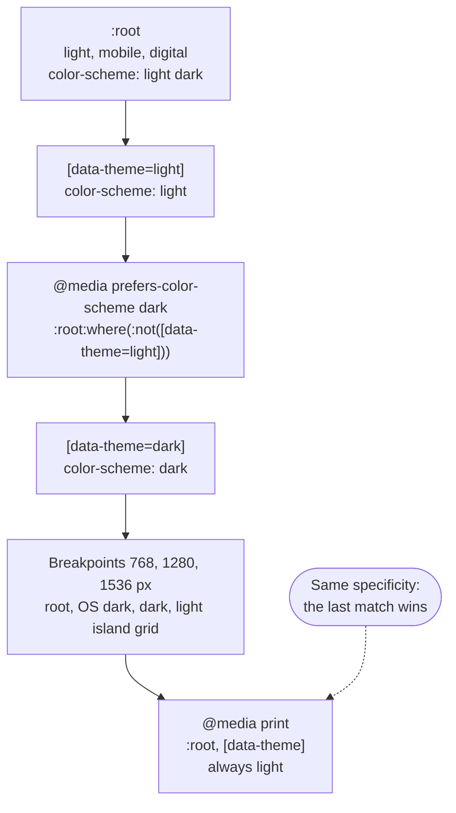
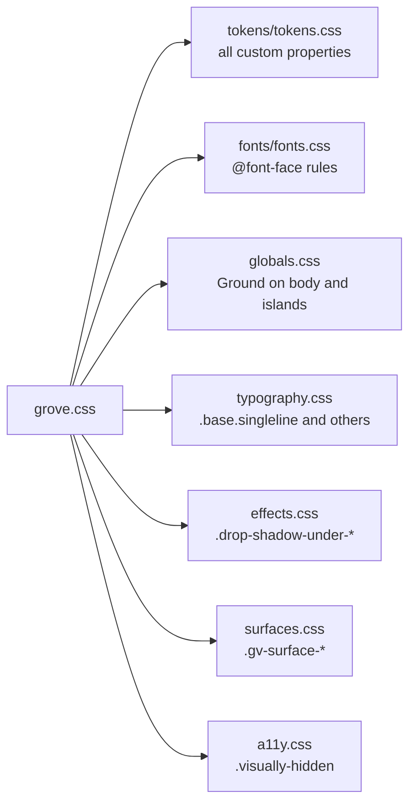

# 13 · Themes and page CSS

> **What you learn here**
>
> - How one `tokens.css` file holds both themes, OS dark, the breakpoints and print.
> - Why the cascade picks the correct block.
> - How `data-theme` forces a theme on a page or on one region of it.
> - What each file of the page CSS gives the page, and what happens without it.
> - How `light-dark()` and `color-scheme` make art and native widgets follow the theme.
>
> **Read first:** [11 · Design tokens](11-design-tokens.md) and
> [12 · Surfaces and elevation](12-surfaces-and-elevation.md). **Time:** 35 minutes.
>
> Open work as of main @ e251d45, 2026-10-27.

A **theme** is light or dark. Grove has no theme code in its components. All theme work happens in
`tokens.css` and in the page CSS. Button, for example, contains no `[data-theme]` rule and no
`prefers-color-scheme` query.

## Whiteboard

The diagram shows the main blocks of `tokens.css` in source order. Each block has the same
specificity, so a later block that matches wins over an earlier one.



The second diagram shows what `grove.css` imports. A page that imports `grove.css` gets all of these
files, in this order.



## How themes layer in one file

`tokens.css` declares the full token set many times, once for each context. The CSS cascade then
picks the values for each element. `terrazzo.config.js` writes each block from one permutation.
[11 · Design tokens](11-design-tokens.md#three-modifiers) lists the permutations.

| Block in `tokens.css`                                                                   | Applies when                                     |
| --------------------------------------------------------------------------------------- | ------------------------------------------------ |
| `:root { color-scheme: light dark; … }`                                                 | Always. Light, mobile and digital values         |
| `[data-theme="light"] { color-scheme: light; … }`                                       | An element has `data-theme="light"`              |
| `@media (prefers-color-scheme: dark) { :root:where(:not([data-theme="light"])) { … } }` | The OS is dark, and the page did not force light |
| `[data-theme="dark"] { color-scheme: dark; … }`                                         | An element has `data-theme="dark"`               |
| `@media (width >= 768px)`, `(width >= 1280px)`, `(width >= 1536px)`                     | Tablet, laptop, desktop                          |
| `@media print { :root, [data-theme] { color-scheme: light; … } }`                       | The page prints. Always light                    |

[Source: MDN, prefers-color-scheme](https://developer.mozilla.org/en-US/docs/Web/CSS/Reference/At-rules/@media/prefers-color-scheme)
[Source: Media Queries 5, prefers-color-scheme](https://www.w3.org/TR/mediaqueries-5/#prefers-color-scheme)

Each breakpoint has more than one block. For example, at 768 px there is a `:root` block, an OS dark
block, a `[data-theme="dark"]` block and a grid-only block for light islands. Colours that are
outside sRGB also get `@media (color-gamut: p3)` and `(color-gamut: rec2020)` blocks after each
block. [11 · Design tokens](11-design-tokens.md#oklch-and-wide-gamut) explains them.

For a page, this gives three choices:

- Do nothing. Grove follows the light or dark preference of the OS.
- Put `data-theme="light"` or `data-theme="dark"` on `<html>`. Grove then ignores the OS preference.
- Put `data-theme` on an inner element. That element becomes a theme island.

[20 · Grove in an app](20-grove-in-an-app.md#themes-in-an-app) shows these choices from
the side of an app.

Storybook uses the same mechanism. Its Theme toolbar sets or removes `data-theme` on `<html>`, and
its test project runs each story in light, dark and OS dark.
[16 · Storybook](16-storybook.md#how-a-test-picks-a-theme) explains how.

`contrast.test.ts` checks the cascade ("theme cascade (terrazzo.config.js)"):

- Dark declares the same tokens as light.
- OS dark and `[data-theme="dark"]` have the same values.
- Each OS dark block uses the selector `:root:where(:not([data-theme="light"]))`, at each
  breakpoint.
- The grid blocks for light islands come before the print block.
- Each theme block sets its `color-scheme`, and print is light.

## Why where matters

Every block has the specificity (0,1,0): one class, attribute or pseudo-class. When two rules with
the same specificity match an element, the rule that comes later in the source wins.
[Source: CSS Cascade 5, cascade sort](https://www.w3.org/TR/css-cascade-5/#cascade-sort)

This rule shapes the OS dark selector. Look at `<html data-theme="light">` on a dark OS:

1. The `[data-theme="light"]` block matches `<html>`.
2. An OS dark block with a plain `:root` selector also matches `<html>`. It comes later, so it wins,
   and the page is dark. An earlier version of the config had this bug.
3. The selector `:root:where(:not([data-theme="light"]))` does not match
   `<html data-theme="light">`. Thus the light block applies.

`:where()` always has zero specificity.
[Source: MDN, :where()](https://developer.mozilla.org/en-US/docs/Web/CSS/Reference/Selectors/:where)
Thus the OS dark selector keeps the (0,1,0) of `:root`, the same as every other block. Source order
alone then decides between the blocks.

`terrazzo.config.js`, the comment above `OS_DARK_ROOT`:

```js
/*
 * Theme cascade. Every permutation below re-declares the full token set at the same specificity
 * (0,1,0), so source order decides — and that shapes three selectors:
 *
 * - The OS-dark blocks select `:root:where(:not([data-theme="light"]))`. `:where()` adds no
 *   specificity, so `<html data-theme="light">` opts out of OS dark instead of losing to it (a
 *   plain `:root` there beat the earlier `[data-theme="light"]` block on every dark-OS machine).
 * - A nested `[data-theme="light"]` island only gets mobile values from its base block, so each
 *   breakpoint re-declares the breakpoint-dependent tokens (`grid.**`) for light islands too.
 * - Print always renders light — pages and `[data-theme]` islands alike, `color-scheme` included.
 */
const OS_DARK_ROOT = ':root:where(:not([data-theme="light"]))';
```

## Theme islands

A **theme island** is an element with `data-theme` that sets its own theme. It can be in the middle
of a page in the other theme.

Example:

```html
<html>
	<body>
		<p>This text follows the OS.</p>
		<section data-theme="dark">
			<p>This section is always dark.</p>
			<gv-button text="Save"></gv-button>
		</section>
	</body>
</html>
```

The island works in three steps:

1. The `[data-theme="dark"]` block declares every token on the `<section>` itself. Its children
   inherit these values.
2. `globals.css` paints the island as a fresh Ground: the background and the base text colour.
3. `globals.css` resets `--gv-focus-ring` on the island. A control inside then draws the Ground ring
   of the island theme, not a surface ring from outside.

`src/lib/styles/globals.css`:

```css
/* A `[data-theme]` island is a fresh Ground: it repaints the surface and resets inherited text. */
body,
[data-theme] {
	background-color: var(--semantic-color-surface-ground);
	color: var(--semantic-color-text-on-ground-base);
}

/* ...and its focus ring: controls inside fall back to the Ground ring of the island's own theme. */
[data-theme] {
	--gv-focus-ring: initial;
}
```

[14 · The focus ring](14-the-focus-ring.md#theme-islands-and-the-ring) explains the ring reset.

A light island inside a dark page has one more problem. The `[data-theme="light"]` block has only
the mobile grid values. The island declares them on itself, so it does not inherit the larger grid
of the page. Thus each breakpoint has a small block that declares the `grid.**` tokens again for
light islands. Dark islands do not need it, because each breakpoint already has a full
`[data-theme="dark"]` block.

## Print

The print blocks select `:root, [data-theme]` and set `color-scheme: light`. Thus a printed page is
light, and each island in it is light too. The print blocks also hold the print sizes from the
`media` modifier: smaller font sizes and their line heights.

The print blocks come last in the file, so they win over the theme and island blocks with the same
specificity. `contrast.test.ts` checks that print is light.

## The page-level CSS

`tokens.css` only declares custom properties. It paints nothing. The package also ships CSS for the
page itself. `src/lib/styles/grove.css` imports all of it:

`src/lib/styles/grove.css`:

```css
@import '../tokens/tokens.css';
@import '../fonts/fonts.css';
@import './globals.css';
@import './typography.css';
@import './effects.css';
@import './surfaces.css';
@import './a11y.css';
```

[Source: MDN, @import](https://developer.mozilla.org/en-US/docs/Web/CSS/Reference/At-rules/@import)

| File             | What it gives the page                                                                                                           |
| ---------------- | -------------------------------------------------------------------------------------------------------------------------------- |
| `tokens.css`     | Every custom property, in every context                                                                                          |
| `fonts.css`      | `@font-face` for Cakra (display, weight 400) and Inclusive Sans (300 to 700, upright and italic), all with `font-display: block` |
| `globals.css`    | Ground background and text on `body` and on each `[data-theme]` island, and the ring reset                                       |
| `typography.css` | Classes such as `.base.multiline` that apply a composite and its letter spacing                                                  |
| `effects.css`    | Drop-shadow classes such as `.drop-shadow-under-accent-summit`                                                                   |
| `surfaces.css`   | The `.gv-surface-*` classes. [12 · Surfaces and elevation](12-surfaces-and-elevation.md#surface-classes)                         |
| `a11y.css`       | `.visually-hidden`. [09 · Accessibility](09-accessibility.md#visually-hidden-text-and-skip-links)                                |

The relative paths work in the package too. The build copies the files so that `dist/` has the same
layout as `src/lib/`: `dist/styles/grove.css` imports `dist/tokens/tokens.css`.

A page imports `@edgarjaymez/grove/grove.css` one time. A page that wants less can import
`@edgarjaymez/grove/tokens.css` and `@edgarjaymez/grove/fonts.css`. The other files have no export
of their own, so `grove.css` is the only way to get them.
[20 · Grove in an app](20-grove-in-an-app.md#load-the-css) has the import lines.

Inside the repo, two places do not use `grove.css`. `.storybook/preview.ts` imports the files one at
a time. `src/test/browser-setup.ts` imports only `tokens.css`, `globals.css` and `typography.css`.

> [!IMPORTANT]
> **Open work: #39 — the skip link utility** (issue, blocked: Needs Figma Spec)
>
> The `.visually-hidden` half of #39 shipped as `a11y.css`. The skip link half did not. A skip link
> must be light-DOM CSS in `grove.css`, because a custom element renders nothing before its script
> runs. The spec hides it at rest and shows it on `:focus`, not only `:focus-visible`, fixed at the
> top start of the page. Open decisions include the class names, the surface, the ring, a z-index
> value, `!important`, and a separate `./a11y.css` export. When it lands, add the skip link class to
> the file table. <https://github.com/edgarjaymez/grove-lit/issues/39>

## Typography and effect classes

The page classes are for light-DOM HTML that a page writes itself.

**Typography classes** combine a level and a line mode: `.base.singleline`, `.label.multiline` and
so on. Each sets `font` from the composite and `letter-spacing` from its part.

`typography.css`, `.base.singleline`:

```css
.base.singleline {
	font: var(--typography-single-line-base-base);
	letter-spacing: var(--typography-single-line-base-base-letter-spacing);
}
```

The `.emphasis` class goes with a level, for example `.title.emphasis`. It changes only
`font-weight`. It reads the single-line emphasis weight, also for multi-line text, because the
weight is the same. `hero` and `display` have no emphasis class.

**Effect classes** are `.drop-shadow-under-{track}-{depth}`, for the terrace and summit depths of
the six tracks. Each sets `box-shadow` from the token with the same name.

Page classes do not go into a shadow root. Thus a component never uses `.base.singleline` or
`.drop-shadow-under-*` in its template. It uses the tokens directly.

> [!NOTE]
> **Lit box: styles stop at the shadow root, custom properties do not**
>
> A page selector cannot select an element inside a shadow root. A custom property inherits through
> the shadow boundary, as any inherited property does. Thus a component reads the tokens of the
> page, and not its classes. Grove example, `Button.ts`, `.btn--md`:
> `font: var(--typography-single-line-subtle-emphasis);`
>
> Lit docs: [Styles](https://lit.dev/docs/v3/components/styles/)

## Without the page CSS

A component still registers and renders without the page CSS. But each `var(--…)` in its styles
refers to a custom property that does not exist. A declaration with such a `var()` is invalid at
computed-value time. The property then gets its inherited value or its initial value.
[Source: CSS Variables 1, invalid at computed-value time](https://www.w3.org/TR/css-variables-1/#invalid-at-computed-value-time)

The result: no surface colours, no token spacing, no composite fonts and no focus ring colour. The
components look unstyled. A few rules have literal fallbacks, for example the outline width in
`focus-ring.ts`, but most have none.
[06 · Styles inside a component](06-styles-inside-a-component.md#invalid-at-computed-value-time)
explains the rule in more detail.

Thus always load `tokens.css`, alone or through `grove.css`, before you judge how a component looks.

## The light-dark function

`light-dark(a, b)` gives `a` when the used colour scheme of the element is light, and `b` when it is
dark. The colour scheme comes from the `color-scheme` property, which inherits.
[Source: MDN, light-dark()](https://developer.mozilla.org/en-US/docs/Web/CSS/Reference/Values/color_value/light-dark)
[Source: CSS Color 5, light-dark()](https://www.w3.org/TR/css-color-5/#light-dark)

Grove needs it only where a component uses primitives, because semantic tokens already change with
the theme. Two components use it, each behind `@supports` with the light value as the fallback.
[Source: MDN, @supports](https://developer.mozilla.org/en-US/docs/Web/CSS/Reference/At-rules/@supports)

`Isotype.ts`, the fill rules:

```css
/* light-dark() follows the inherited color-scheme, which every theme block in tokens.css
			   sets. Browsers without it keep the light fill. */
path {
	fill: var(--_fill-light);
}

@supports (color: light-dark(#000, #fff)) {
	path {
		fill: light-dark(var(--_fill-light), var(--_fill-dark));
	}
}
```

`gv-isotype` sets the two private properties from its `color` property, for example
`var(--color-brand-500)` by day and `var(--color-brand-50)` at night. With `tone="light"` or
`tone="dark"`, both ends get the same fill, so the logo does not change with the theme.

`Texture.ts` does the same for its grain. By day it uses `rgba(38, 77, 40, 0.1)`. Inside the
`@supports` block, the night value is
`color-mix(in srgb, var(--color-brand-50, oklch(93% 0.035 145)) 10%, transparent)`.

> [!IMPORTANT]
> **Open work: #65 — gv-texture colour variants and the night grain** (open PR, no conflict with
> main on 2026-10-27)
>
> On `main`, the night grain of #20 is provisional. The PR makes it final. A new `color` property
> picks a track. The grain is `{track}/700` at 10 % by day and `{track}/50` at 10 % at night. The
> rule becomes `color: light-dark(var(--_grain-day), var(--_grain-night));` inside the same
> `@supports` block, and the day value stays the fallback. The two private properties come from
> `styleMap`.
>
> The PR also adds a "Texture grain" row to the dark theme table in `DESIGN_SYSTEM.md`. It waits for
> question 1: does the Figma library define a night grain? When it lands, replace the `Texture.ts`
> paragraph above with the new rule. <https://github.com/edgarjaymez/grove-lit/pull/65>

## Color scheme and native widgets

The `color-scheme` property tells the browser which schemes an element can use. The browser then
draws native parts in that scheme: scrollbars, form controls and the resize grip of a text area. It
also decides what `light-dark()` gives.
[Source: MDN, color-scheme](https://developer.mozilla.org/en-US/docs/Web/CSS/Reference/Properties/color-scheme)
[Source: CSS Color Adjustment 1, color-scheme](https://www.w3.org/TR/css-color-adjust-1/#color-scheme-prop)

Each theme block in `tokens.css` sets `color-scheme`:

| Block                  | `color-scheme` |
| ---------------------- | -------------- |
| `:root`                | `light dark`   |
| `[data-theme="light"]` | `light`        |
| OS dark                | `dark`         |
| `[data-theme="dark"]`  | `dark`         |
| Print                  | `light`        |

`light dark` on `:root` means: the page supports both, and the browser uses the OS preference. Thus
native widgets, `light-dark()` and the tokens all follow the same theme. No component sets
`color-scheme`. A component inherits it from the page.

> [!IMPORTANT]
> **Open work: #17 — gv-textarea** (issue, blocked: Needs Figma Spec)
>
> A text area has native parts: the resize grip and the scrollbar. The browser draws them from
> `color-scheme`. Thus the component must not set `color-scheme` itself, or those parts stay light
> at night (FR-DT3). The spec also comes after #51 in the chain #49 → #50 → #51 → #17. When it
> lands, add `gv-textarea` as the first component with a native resize grip.
> <https://github.com/edgarjaymez/grove-lit/issues/17>

## See it in the code

| File                                    | Look for                                                           |
| --------------------------------------- | ------------------------------------------------------------------ |
| `terrazzo.config.js`                    | The comment on the cascade, `OS_DARK_ROOT`, the print permutations |
| `src/lib/tokens/tokens.css`             | The selectors at the start of each block                           |
| `src/lib/tokens/contrast.test.ts`       | `describe('theme cascade (terrazzo.config.js)')`                   |
| `src/lib/styles/grove.css`              | The seven imports                                                  |
| `src/lib/styles/globals.css`            | `body, [data-theme]` and the ring reset                            |
| `src/lib/styles/typography.css`         | The single-line, multi-line and emphasis classes                   |
| `src/lib/components/Isotype/Isotype.ts` | `light-dark()` behind `@supports`                                  |
| `src/lib/components/Texture/Texture.ts` | The day grain and the night grain                                  |
| `.storybook/preview.ts`                 | The CSS imports, `withTheme`                                       |

## Sources

**Standards**

- [CSS Cascade 5, cascade sort](https://www.w3.org/TR/css-cascade-5/#cascade-sort). Read 2026-10-27.
- [CSS Variables 1, invalid at computed-value time](https://www.w3.org/TR/css-variables-1/#invalid-at-computed-value-time).
  Read 2026-10-27.
- [CSS Color 5, light-dark()](https://www.w3.org/TR/css-color-5/#light-dark). Read 2026-10-27.
- [CSS Color Adjustment 1, color-scheme](https://www.w3.org/TR/css-color-adjust-1/#color-scheme-prop).
  Read 2026-10-27.
- [Media Queries 5, prefers-color-scheme](https://www.w3.org/TR/mediaqueries-5/#prefers-color-scheme).
  Read 2026-10-27.

**Platform reference**

- [MDN, prefers-color-scheme](https://developer.mozilla.org/en-US/docs/Web/CSS/Reference/At-rules/@media/prefers-color-scheme).
  Read 2026-10-27.
- [MDN, :where()](https://developer.mozilla.org/en-US/docs/Web/CSS/Reference/Selectors/:where). Read
  2026-10-27.
- [MDN, @import](https://developer.mozilla.org/en-US/docs/Web/CSS/Reference/At-rules/@import). Read
  2026-10-27.
- [MDN, light-dark()](https://developer.mozilla.org/en-US/docs/Web/CSS/Reference/Values/color_value/light-dark).
  Read 2026-10-27.
- [MDN, @supports](https://developer.mozilla.org/en-US/docs/Web/CSS/Reference/At-rules/@supports).
  Read 2026-10-27.
- [MDN, color-scheme](https://developer.mozilla.org/en-US/docs/Web/CSS/Reference/Properties/color-scheme).
  Read 2026-10-27.

**Tool docs**

- [Lit, Styles](https://lit.dev/docs/v3/components/styles/). Read 2026-10-27.

## Check yourself

Do [Lesson 10 Surfaces and themes](syllabus.md#lesson-10-surfaces-and-themes) in the syllabus. Then
answer: On a dark OS, which block sets the colours of `<html data-theme="light">`, and why does the
OS dark block not match? Why does a light island need extra grid blocks, but a dark island does not?
What does a component look like on a page that does not load `tokens.css`?

[← 12 · Surfaces and elevation](12-surfaces-and-elevation.md) · [Index](README.md) ·
[14 · The focus ring →](14-the-focus-ring.md)
