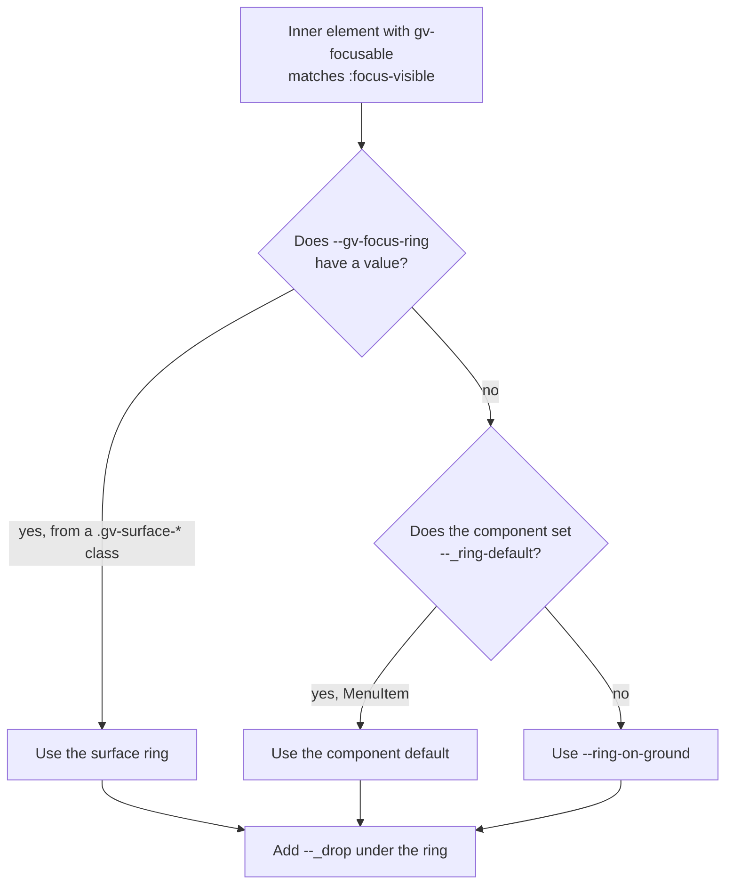
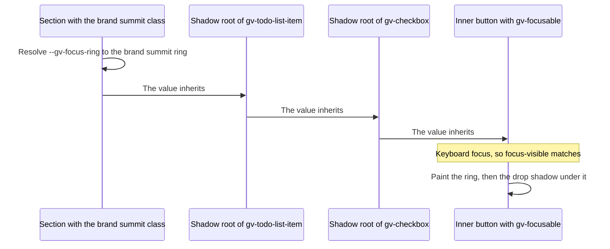

# 14 · The focus ring

> **What you learn here**
>
> - How one shared style fragment draws the focus ring in every interactive component.
> - How the ring finds its colour: from the surface, from a component default, or from Ground.
> - Why the ring still works across shadow roots, over aurora, in theme islands and in forced
>   colours.
> - Which tests guard the ring, and the checklist for a new interactive component.
>
> **Read first:** [06 · Styles inside a component](06-styles-inside-a-component.md) and
> [12 · Surfaces and elevation](12-surfaces-and-elevation.md). **Time:** 30 minutes.
>
> Open work as of main @ e251d45, 2026-10-27.

The **focus ring** is the visible focus indicator of a Grove control. It shows when the user moves
focus with the keyboard. WCAG 2.2 requires a visible indicator:
[2.4.7 Focus Visible (AA)](https://www.w3.org/WAI/WCAG22/Understanding/focus-visible). The ring
also needs 3:1 against the surface under it, under
[1.4.11 Non-text Contrast (AA)](https://www.w3.org/WAI/WCAG22/Understanding/non-text-contrast).

Issue #22 (closed) wired the `--ring-on-*` tokens into every focusable control. Decision #54 D3
chose this path, "Path A", and keeps the ring tokens public.

## Whiteboard

The diagram shows how a control finds its ring. The browser tries each custom property in order and
takes the first one that has a value. Then it adds the control's own drop shadow under the ring.



The sequence diagram shows the ring value as it moves from a page section into a nested shadow root.



## The mechanism

The ring has three parts that work together:

1. The style fragment `focusRing` in `src/lib/styles/focus-ring.ts`.
2. The class `gv-focusable` on the inner element that takes focus.
3. The private custom property `--_drop`, which holds the control's own shadow.

`focus-ring.ts`, `focusRing`:

```ts
export const focusRing = css`
	.gv-focusable:focus-visible {
		outline: var(--border-width-heavy, 2px) solid transparent;
		outline-offset: var(--soft-grid-4, 4px);
		box-shadow:
			var(--gv-focus-ring, var(--_ring-default, var(--ring-on-ground))), var(--_drop, 0 0 #0000);
	}
`;
```

- **`:focus-visible`** matches when the browser decides that the user needs to see focus. That is
  keyboard focus for a button. A text field matches it on a click too.
  [Source: MDN, :focus-visible](https://developer.mozilla.org/en-US/docs/Web/CSS/Reference/Selectors/:focus-visible)
- **The ring is a `box-shadow`**, not an outline. Each `--ring-on-*` token is a two-layer shadow: a
  4 px gap in the surface colour, then a 4 px ring.
  [11 · Design tokens](11-design-tokens.md#effects) shows the token.
- **`--_drop` comes after the ring.** The first shadow in a list paints on top, so the ring paints
  over the drop shadow.
  [Source: CSS Backgrounds 3, shadow layers](https://www.w3.org/TR/css-backgrounds-3/#shadow-layers)
- **The outline is transparent.** It draws nothing in normal mode. [Forced colours](#forced-colours)
  tells why it is there.

The ring is on the inner element, never on the host. Eight components adopt the fragment:
`BackButton`, `Button`, `Checkbox`, `ColorSwatch`, `IconButton`, `MenuItem`, `TextInput` and
`ToDoCategoryToggler`. `ToDoListItem` does not, because its inner `gv-checkbox` takes the focus.

**Why `--_drop` and never `box-shadow`.** A control sets its shadow only through `--_drop`. The
focus rule writes `box-shadow` with the ring and then `--_drop`, so the shadow stays while the ring
shows. If a control wrote `box-shadow` directly, one rule would replace the other. The focus rule
would remove the shadow, or the control rule would remove the ring.

`Button.ts`, `.btn` and the pressed accent variant:

```css
			.btn {
				box-shadow: var(--_drop, 0 0 #0000);
```

```css
.btn--filled.btn--accent:not(:disabled):active {
	background: var(--semantic-color-surface-accent-aurora);
	color: var(--semantic-color-text-on-accent-aurora-base);
	--_drop: 0 0 #0000;
}
```

The `.btn` rule draws the shadow when the button has no focus. On `:active`, the variant sets
`--_drop` to a transparent shadow, so the pressed button looks flat. Button sets no
`--_ring-default`, so outside a surface class it draws the Ground ring. Button also has a 300 ms
`box-shadow` transition, so its ring fades in.

> [!NOTE]
> **Lit box: the class that the ring selects**
>
> `classMap` builds the `class` attribute from an object. Each key with a true value becomes a
> class. Button always adds `gv-focusable` to its inner `<button>`, so the fragment selects it.
> Grove example, `Button.ts`, `render()`: `'gv-focusable': true,`
>
> Lit docs: [Built-in directives](https://lit.dev/docs/v3/templates/directives/)

## The resolution order

Read the `box-shadow` value from the left to the right:

| Step | Custom property    | Where it comes from                                              |
| ---- | ------------------ | ---------------------------------------------------------------- |
| 1    | `--gv-focus-ring`  | The nearest `.gv-surface-*` class, or a page rule that sets it   |
| 2    | `--_ring-default`  | The component, when it knows the surface that it usually sits on |
| 3    | `--ring-on-ground` | The last fallback: the Ground ring                               |
| 4    | `--_drop`          | After the comma: the control's own shadow, under the ring        |

`var(--a, fallback)` uses the fallback when `--a` has no value. Steps 1 to 3 are a chain of these
fallbacks. Step 4 is a second shadow in the same list.

A page can also set the ring without a surface class. `DESIGN_SYSTEM.md` permits
`--gv-focus-ring: var(--ring-on-…)` next to the page's own background.

Example:

```html
<div
	style="background: var(--semantic-color-surface-success-terrace); --gv-focus-ring: var(--ring-on-success-terrace)"
>
	<gv-button text="Save"></gv-button>
</div>
```

The innermost declaration wins, because each element inherits from its nearest ancestor.

## Inheritance across shadow roots

A page selector does not go into a shadow root. But inherited properties do, and every custom
property inherits. Thus `--gv-focus-ring` from a section reaches the controls in the section, and
also controls inside nested shadow roots.
[Source: CSS Variables 1](https://www.w3.org/TR/css-variables-1/)
[Source: CSS Scoping 1](https://www.w3.org/TR/css-scoping-1/)

`focus-ring.browser.test.ts` checks this with a `gv-todo-list-item` on a brand summit. The focus
goes to the `gv-checkbox` inside the item, two shadow roots down. The test expects
`--ring-on-brand-summit` ("takes the ring of the innermost surface, including through a nested
shadow root").

One detail is important for themes. The computed value of a custom property has its `var()`
references already replaced. Thus the section resolves `var(--ring-on-brand-summit)` in its own
context, and the controls inherit the result. The fallback `--ring-on-ground` is different: it
resolves inside the component, in the theme of the component.

## The private default ring

`--_ring-default` is a private custom property. A component sets it when it nearly always sits on
one known surface. Only one component does this today.

`MenuItem.ts`, `.item`:

```css
			/* Transparent row — the parent paints the brand terrace surface. */
			.item {
				--_ring-default: var(--ring-on-brand-terrace);
```

A menu item is usually on a brand terrace sidebar. Thus, with no surface class around it, the item
draws the brand terrace ring and not the Ground ring. A surface class still wins, because
`--gv-focus-ring` comes first. The test "falls back to the brand-terrace ring" checks this.

The underscore at the start of the name marks the property as private.
[06 · Styles inside a component](06-styles-inside-a-component.md#private-and-public-custom-properties)
explains the rule for these names.

## Rings over aurora

An aurora is a state, not a resting surface. Thus there is no aurora ring token, and the aurora
classes do not set `--gv-focus-ring`. A control that has focus over an aurora keeps the ring of the
resting surface under the aurora.

Example:

```html
<div class="gv-surface-brand-terrace">
	<div class="gv-surface-brand-aurora">
		<gv-button text="Save"></gv-button>
	</div>
</div>
```

The aurora section paints its own background and text. It sets no ring, so the button inherits
`--ring-on-brand-terrace` from the outer section. The test "keeps the resting surface ring over an
aurora highlight" and the `OverAurora` story show this case.

This is a decision of #52 (2026-09-28), recorded on #22: no aurora ring tokens. The cost is
contrast. The terrace and path rings measure 1.30 to 2.55:1 against the aurora fills. The contrast
test records these values as advisory, not as failures.
[12 · Surfaces and elevation](12-surfaces-and-elevation.md#contrast-on-summit-and-aurora) has the
details.

> [!IMPORTANT]
> **Open work: #39 — the skip link utility** (issue, blocked: Needs Figma Spec)
>
> A skip link floats over the page, so its backdrop is unknown. A ring is chosen by the surface that
> the control sits on. Open decision 3 asks which ring to use, and says `--ring-on-ground` is the
> likeliest. The link also uses `position: fixed`, so a sticky header must not cover it:
> [2.4.11 Focus Not Obscured (Minimum) (AA)](https://www.w3.org/WAI/WCAG22/Understanding/focus-not-obscured-minimum).
> The link shows on `:focus`, not only on `:focus-visible`, because a focused element must never be
> invisible. When it lands, add the skip link to the list of elements that draw the ring.
> <https://github.com/edgarjaymez/grove-lit/issues/39>

## Theme islands and the ring

A theme island is an element with `data-theme`. It starts a fresh Ground in its own theme.
[13 · Themes and page CSS](13-themes-and-page-css.md#theme-islands) explains islands.

Without a reset, a control in a dark island inside a light terrace would inherit the light terrace
ring. That value was resolved outside the island, so it has the wrong surface and the wrong theme.
`globals.css` prevents this.

`globals.css`, the ring reset:

```css
[data-theme] {
	--gv-focus-ring: initial;
}
```

The initial value of a custom property is the guaranteed-invalid value. A `var()` that reads it uses
its fallback.
[Source: CSS Variables 1, guaranteed-invalid value](https://www.w3.org/TR/css-variables-1/#guaranteed-invalid)
Thus a control in the island falls back to `--_ring-default` or `--ring-on-ground`, and that value
resolves in the island theme. A surface class inside the island still sets a new ring.

The test "gives a [data-theme] island its own Ground ring" checks this. The test "updates the ring
colour when the theme changes while focused" checks that the ring follows a theme change.

## Forced colours

In forced colours mode, for example a Windows contrast theme, the browser replaces author colours
with system colours. It forces `box-shadow` to `none`. Thus the ring disappears.
[Source: MDN, forced-colors](https://developer.mozilla.org/en-US/docs/Web/CSS/Reference/At-rules/@media/forced-colors)
[Source: CSS Color Adjustment 1, properties affected by forced colours](https://www.w3.org/TR/css-color-adjust-1/#forced-colors-properties)

The same rule also sets a transparent outline, 2 px wide with a 4 px offset. In forced colours mode,
the browser paints that outline in a system colour. Thus the outline becomes the focus indicator.

The test "shows a system-colour outline under forced colours, and no outline otherwise" emulates
`forcedColors: 'active'`. It expects `outlineStyle` to be `solid` and `outlineColor` not to be
transparent. [09 · Accessibility](09-accessibility.md#forced-colours) covers forced colours for the
whole library.

> [!CAUTION]
> Do not write `outline: none` or `outline: 0` in a component. The transparent outline is the only
> indicator in forced colours mode, and `focus.test.ts` fails on these values.

## Focus after a control disables itself

When the element with focus becomes disabled, the browser removes focus from it, and focus goes to
`<body>`. A keyboard user or a screen reader user then loses the place in the page.
[Source: HTML Standard, focus fixup rule](https://html.spec.whatwg.org/multipage/webappapis.html#focus-fixup-rule)
No repo test checks this. On 2026-10-28, a probe in Chromium 141 gave the same result for a
`<button>` in the light DOM and for a `<button>` inside a shadow root: `document.activeElement`
became `<body>`.

On `main`, no component disables itself. A page can still set `disabled` on a `gv-button` that has
focus. The inner `<button>` gets the `disabled` attribute, and focus goes to `<body>`. In that case,
the page must move focus to a sensible place.

`gv-text-input` avoids the problem. Its `disabled` state renders `readonly` and `aria-disabled` on
the inner `<input>`, so the field keeps focus and keeps its ring. The test "keeps the ring on the
text input when disabled (readonly) and in error" checks this.

> [!IMPORTANT]
> **Open work: #68 — gv-button link mode and form association** (open PR, no conflict with main on
> 2026-10-27)
>
> The PR delivers #40. After its own submission, `gv-button` disables itself and matches
> `:state(submitting)`, so a second click sends nothing. The inner `<button>` becomes disabled, so
> focus goes to `<body>`.
>
> The PR adds an accessibility note to `Button.metadata.ts`. It says that a page that handles the
> submission moves focus to its status message. The page also sets `disabled = false` when the
> request settles. The status message needs `tabindex="-1"` to take focus. When it lands, change "no
> component disables itself" to name `gv-button`, and link to
> [10 · Forms](10-forms.md#self-disable). <https://github.com/edgarjaymez/grove-lit/pull/68>

## Checks

| Check                                       | What it guards                                                                                                                                                                                                       |
| ------------------------------------------- | -------------------------------------------------------------------------------------------------------------------------------------------------------------------------------------------------------------------- |
| `src/lib/styles/focus.test.ts` (unit)       | No component source matches `outline: none`, `outline: 0` or `outline-style: none`. Each surface class paints its surface, its text and (except aurora) its ring. No class exists for a value outside `GroveSurface` |
| `src/lib/styles/focus-ring.browser.test.ts` | The ring in real Chromium, in light, dark and OS dark                                                                                                                                                                |
| `src/lib/tokens/contrast.test.ts` (unit)    | Each ring has 3:1 against the surface it sits on. The aurora values are advisory                                                                                                                                     |
| `src/stories/FocusRing.stories.ts`          | A visual check: "Foundations/Focus ring"                                                                                                                                                                             |

`focus.test.ts` reads each component file as text and applies this pattern:

```ts
expect(text).not.toMatch(/outline(-style)?\s*:\s*(none|0)\b/);
```

`focus-ring.browser.test.ts` runs its first group once for each theme in `src/test/themes.ts`. In
each theme it checks these cases:

- Each of eight controls draws the Ground ring on keyboard focus and drops it on blur.
- `gv-menu-item` falls back to the brand terrace ring.
- A control takes the ring of the innermost surface, through a nested shadow root too.
- A ring set directly with `--gv-focus-ring` applies, and Ground comes back without it.
- A control over an aurora keeps the resting ring.
- A `[data-theme]` island gives its own Ground ring.
- The ring paints over the drop shadow, and the shadow stays.
- No host paints a ring, also under the old `.surface-ground` class.

A second group checks behaviour:

- Buttons draw no ring on pointer focus, but the text input does.
- The ring changes colour when the theme changes during focus.
- The text input keeps its ring when disabled or in error.
- Disabled controls are out of the tab order.
- Forced colours show a system-colour outline.

The test moves focus with real keyboard input. Its helper `tabTo()` puts a native button before the
target, focuses it, and presses Tab. Thus focus arrives from the keyboard, as it does for a user.

The `FocusRing` story file puts every focusable control on one surface and focuses one of them with
`focus({ focusVisible: true })`. Its stories are `Ground`, `BrandTerrace`, `GrayPath`,
`AccentSummit`, eight `Focused*` stories (for example `FocusedCheckbox`) and `OverAurora`. Use the Theme toolbar to
check both themes.

> [!IMPORTANT]
> **Open work: #66 — componentReset tests for hidden and reduced motion** (open PR, no conflict
> with main on 2026-10-27)
>
> On the PR branch, one ring test is flaky: "focus ring in OS dark › `<gv-color-swatch>` draws the
> Ground ring on keyboard focus". It failed in 2 of 17 full `pnpm test` runs, and in 0 of 8 runs
> with the test files of `main`. It never failed in browser-project-only runs. It shows only under
> full parallel load, and the PR found no cause. If it comes back, look first at how long `tabTo()`
> takes under load. When the cause is known, record it in [17 · Tests](17-tests.md#flaky-tests).
> <https://github.com/edgarjaymez/grove-lit/pull/66>

> [!IMPORTANT]
> **Open work: #64 — gv-icon glyph tests and the dist gate** (open PR, no conflict with main on
> 2026-10-27)
>
> The PR moves the local helpers of `focus-ring.browser.test.ts` into `src/test/shadow.ts`.
> `settle()` becomes `settleDeep(host)`, and `frame()` becomes `frames(2)`. #66 adds the same
> `shadow.ts`. The ring checks do not change. When it lands, use the new helper names in this
> chapter. <https://github.com/edgarjaymez/grove-lit/pull/64>

## Checklist for a new interactive component

Do these steps for each component that takes focus:

1. Add `focusRing` to `static styles`, directly after `componentReset`.
2. Put the class `gv-focusable` on the inner element that takes focus, such as the `<button>`, the
   `<a>` or the `<input>`.
3. Set the control's shadow with `--_drop`. Do not set `box-shadow`.
4. If the component nearly always sits on one surface, set `--_ring-default` to the ring of that
   surface.
5. Do not write `outline: none` or `outline: 0`.
6. Add the component to `CONTROLS` in `focus-ring.browser.test.ts`.
7. Add the component to the `FocusRing` stories.
8. Run the unit and browser tests:

   ```sh
   pnpm vitest run --project unit src/lib/styles/focus.test.ts
   pnpm vitest run --project browser src/lib/styles/focus-ring.browser.test.ts
   ```

   Result: both files pass.

[22 · Cookbook](22-cookbook.md#recipe-14-add-an-interactive-surface-aware-component) has the full
recipe.

## See it in the code

| File                                        | Look for                                                          |
| ------------------------------------------- | ----------------------------------------------------------------- |
| `src/lib/styles/focus-ring.ts`              | `focusRing` and its JSDoc comment                                 |
| `src/lib/components/Button/Button.ts`       | `focusRing` in `static styles`, `'gv-focusable': true`, `--_drop` |
| `src/lib/components/MenuItem/MenuItem.ts`   | `--_ring-default` on `.item`                                      |
| `src/lib/styles/surfaces.css`               | `--gv-focus-ring` in the resting classes, none in aurora classes  |
| `src/lib/styles/globals.css`                | `[data-theme] { --gv-focus-ring: initial; }`                      |
| `src/lib/styles/focus.test.ts`              | The `outline` pattern                                             |
| `src/lib/styles/focus-ring.browser.test.ts` | `CONTROLS`, `tabTo()`, the forced colours test                    |
| `src/stories/FocusRing.stories.ts`          | `OverAurora`, the `play` function                                 |

## Sources

**Standards**

- [HTML Standard, focus fixup rule](https://html.spec.whatwg.org/multipage/webappapis.html#focus-fixup-rule).
  Read 2026-10-28.
- [Understanding 2.4.7 Focus Visible](https://www.w3.org/WAI/WCAG22/Understanding/focus-visible).
  Read 2026-10-27.
- [Understanding 1.4.11 Non-text Contrast](https://www.w3.org/WAI/WCAG22/Understanding/non-text-contrast).
  Read 2026-10-27.
- [Understanding 2.4.11 Focus Not Obscured (Minimum)](https://www.w3.org/WAI/WCAG22/Understanding/focus-not-obscured-minimum).
  Read 2026-10-27.
- [CSS Backgrounds 3, shadow layers](https://www.w3.org/TR/css-backgrounds-3/#shadow-layers). Read
  2026-10-27.
- [CSS Variables 1](https://www.w3.org/TR/css-variables-1/), and its
  [guaranteed-invalid value](https://www.w3.org/TR/css-variables-1/#guaranteed-invalid). Read
  2026-10-27.
- [CSS Scoping 1](https://www.w3.org/TR/css-scoping-1/). Read 2026-10-27.
- [CSS Color Adjustment 1, properties affected by forced colours](https://www.w3.org/TR/css-color-adjust-1/#forced-colors-properties).
  Read 2026-10-27.

**Platform reference**

- [MDN, :focus-visible](https://developer.mozilla.org/en-US/docs/Web/CSS/Reference/Selectors/:focus-visible).
  Read 2026-10-27.
- [MDN, forced-colors](https://developer.mozilla.org/en-US/docs/Web/CSS/Reference/At-rules/@media/forced-colors).
  Read 2026-10-27.

**Tool docs**

- [Lit, Built-in directives](https://lit.dev/docs/v3/templates/directives/). Read 2026-10-27.

## Check yourself

Do [Lesson 11 Focus ring](syllabus.md#lesson-11-focus-ring) in the syllabus. Then answer: Which ring
does a `gv-menu-item` draw inside a `.gv-surface-gray-terrace`, and which does it draw with no
surface class? Which ring does a button draw over a brand aurora inside a brand path? Why does a
dark island need `--gv-focus-ring: initial`? What is the focus indicator in forced colours mode?

[← 13 · Themes and page CSS](13-themes-and-page-css.md) · [Index](README.md) ·
[15 · Metadata and the manifest →](15-metadata-and-the-manifest.md)
