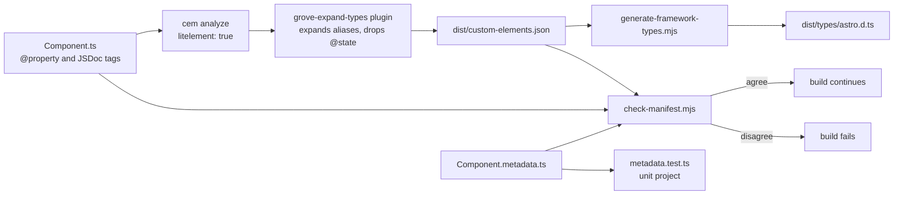

# 15 · Metadata and the manifest

> **What you learn here**
>
> - What a `*.metadata.ts` file holds, and which parts of it the type, the tests and the build
>   check.
> - How the build writes `dist/custom-elements.json` and `dist/types/astro.d.ts`.
> - How to fix each failure that `check-manifest.mjs` can report.
>
> **Read first:** [04 · Anatomy of a component](04-anatomy-of-a-component.md) and
> [07 · Slots](07-slots.md). **Time:** 35 minutes.
>
> Open work as of main @ e251d45, 2026-10-27.

Each component has two descriptions next to its code. The metadata file is a description of each
component for tools and AI assistants, written by hand. The manifest is a standard JSON description
that the build writes from the code. The build compares the two with the code, and it fails when
they do not agree.

## Whiteboard

The diagram shows how the sources become the manifest, how the checks read it, and which typings
come from it.



`pnpm build` runs the three manifest steps last, as `pnpm build-manifest`. You can run
`pnpm build-manifest` alone, because none of its steps reads the bundle.
[18 · Build and package](18-build-and-package.md#the-build-steps) shows the full build.

## Component metadata

Every component directory has a `*.metadata.ts` file. It exports one object, for example
`ButtonMetadata`, and `src/lib/index.ts` exports that object from the package. Thus a tool in a
consumer project can read it too. The object tells what the component is for, when not to use it,
its slots, states, keyboard behaviour and example markup. Tools and other programs read the metadata
and the manifest to learn about a component, so keep both correct in every component change.

`src/lib/components/metadata.ts`, `ComponentMetadata`:

```ts
export interface ComponentMetadata {
	component: {
		name: string;
		tag?: string;
		category: string;
		description: string;
		type: string;
		path: string;
		version: string;
		created: string;
		modified: string;
	};
	phosphor: PhosphorGlyphs;
	composition: {
		/** Every slot the component renders; null when it projects nothing. */
		slots: readonly GroveSlot[] | null;
		[key: string]: unknown;
	};
	[section: string]: unknown;
}
```

The type requires three sections: `component`, `phosphor` and `composition.slots`. The index
signature `[section: string]: unknown` lets a file add more sections, and TypeScript does not check
them. Each slot is a `GroveSlot`: a `name` (`''` is the default slot), a `description` and the
`fallback` property, or `null`.

Each file ends with `} satisfies ComponentMetadata;`. The `satisfies` operator checks that the
object matches the type, but it does not change the type of the object.
[Source: TypeScript 4.9, The satisfies operator](https://www.typescriptlang.org/docs/handbook/release-notes/typescript-4-9.html#the-satisfies-operator)
Thus `ButtonMetadata.variants.size.options` keeps its real type, and a tool can read it. An
annotation such as `: ComponentMetadata` would change every free section to `unknown`.

`Button.metadata.ts`, the `component` section:

```ts
	component: {
		name: 'Button',
		category: 'atoms',
		description:
			'Primary interactive element for triggering actions. Supports visual hierarchy through style and color variants, optional leading icon, and three sizes.',
		type: 'interactive',
		path: 'src/lib/components/Button/Button.ts',
		version: '1.2.0',
		created: '2026/03/08',
		modified: '2026/09/28'
	},
```

The free sections follow the same pattern in all fifteen files. When you add a component, copy the
metadata file of a different component, and replace every section.

| Section in `ButtonMetadata` | What it holds                                                                       |
| --------------------------- | ----------------------------------------------------------------------------------- |
| `usage`                     | `useCases`, `requiredProps`, `commonPatterns` (with example markup), `antiPatterns` |
| `composition`               | `slots`, `nestedComponents`, `commonPartners`, `parentConstraints`                  |
| `behavior`                  | `states` and `interactions`                                                         |
| `variants`                  | One key for each attribute with options, for example `size`                         |
| `accessibility`             | Role, keyboard support, screen reader notes, focus, the WCAG level                  |
| `aiHints`                   | Priority, keywords and a short context                                              |

Write example markup with attribute names, as HTML does. Do not use property names. The
`page-level-cta` pattern in `ButtonMetadata` has this `composition`:

`Button.metadata.ts`, `usage.commonPatterns`:

<!-- prettier-ignore -->
```ts
composition: `<gv-button text="Get Started" variant="filled" color="accent" size="lg"></gv-button>`
```

A multi-word property has a kebab-case attribute, for example `is-selected` for `isSelected`. A
snippet with `isSelected` fails two checks: `metadata.test.ts` and the build.

## The phosphor field

Grove draws icons with the Phosphor web components. The consumer app must register each glyph that a
page shows. [20 · Grove in an app](20-grove-in-an-app.md#phosphor-glyphs) tells how. The
`phosphor` field tells the app which glyphs a component can show.

`src/lib/components/metadata.ts`, `PhosphorGlyphs`:

```ts
export interface PhosphorGlyphs {
	/** The attribute that sets the glyph, or null when none does. */
	prop: string | null;
	/** Rendered when that attribute is omitted, or null. */
	default: string | null;
	/** Rendered regardless of props; not overridable. */
	fixed: readonly string[];
}
```

`ButtonMetadata.phosphor` is `{ prop: 'icon', default: null, fixed: [] }`. Thus Button shows a glyph
only when the `icon` attribute names one, and the page must register that glyph.

On `main`, four places hold the same glyph names:

1. The default value in the component source, for example `icon` in `MenuItem.ts`.
2. The `phosphor` field of the metadata.
3. The glyph recipe in `src/stories/Home.mdx`.
4. The glyph imports in `src/test/browser-setup.ts`.

On `main`, a test checks only the second copy. `metadata.test.ts` makes sure that each `default` and
`fixed` glyph exists in the Phosphor package. When you change a default glyph, update all four
copies by hand. [22 · Cookbook](22-cookbook.md#recipe-18-add-a-glyph-a-component-draws) gives the
steps.

> [!IMPORTANT]
> **Open work: #64 — gv-icon glyph tests and the dist gate** (open PR, no conflict with main on
> 2026-10-27)
>
> The PR adds guards for the other copies. `glyphs.browser.test.ts` renders every tag with no glyph
> attribute, and one time for each variant value. The glyphs that it draws must be exactly `default`
> plus `fixed`. A probe element `ph-metadata-probe` proves that `prop` is the attribute that changes
> the glyph. A `variantAliases` table maps a variant key to its attribute, for example the `style`
> key of `gv-button` to `variant`.
>
> Two parity tests in `metadata.test.ts` compare the metadata with the `Home.mdx` recipe and with
> `browser-setup.ts`. A new helper, `src/test/component-metadata.ts`, gives `metadataByTag`. The PR
> also gives four metadata files a patch bump. Epic #47 stays open until somebody does its manual
> checks in Firefox, Safari, VoiceOver and NVDA. When the PR lands, change the paragraph "On `main`,
> a test checks only the second copy" to name the three guards.
> <https://github.com/edgarjaymez/grove-lit/pull/64>

## Required props

`usage.requiredProps` lists the properties that a valid render needs. It is a free section, so the
type does not check it, and no test reads it. `ButtonMetadata` has `requiredProps: ['text']`.

Slots change this rule. A component that shows text takes it from the slot or from the fallback
prop. Thus a fallback prop with a slot is not required. On `main`, two files still list such a prop:
`ButtonMetadata` lists `text`, and `MenuItemMetadata` lists `label` and `href`. The `slotted-label`
pattern in `MenuItem.metadata.ts` sets no `label`, so the file contradicts itself.

> [!IMPORTANT]
> **Open work: #63 — gv-menu-item a11y check and metadata** (open PR, no conflict with main on
> 2026-10-27)
>
> The PR changes `MenuItemMetadata.usage.requiredProps` from `['label', 'href']` to `['href']`. The
> `screenReader` note then names the slotted content first and `label` second. The metadata version
> goes from 1.2.0 to 1.2.1, and `modified` changes too. When the PR lands, remove `MenuItemMetadata`
> from the paragraph above. <https://github.com/edgarjaymez/grove-lit/pull/63>

> [!IMPORTANT]
> **Open work: #68 — gv-button link mode and form association** (open PR, no conflict with main on
> 2026-10-27)
>
> The PR changes `ButtonMetadata.usage.requiredProps` from `['text']` to `[]`, and the version from
> 1.2.0 to 1.3.0. #68 contains the commits of #63. When the PR lands, remove the last example from
> the paragraph above. <https://github.com/edgarjaymez/grove-lit/pull/68>

## Metadata versions

`component.version` is the version of the component itself. It is not the package version. On
`main`, the package is 0.45.0, `ButtonMetadata` is 1.2.0 and `IconMetadata` is 2.1.0. The dates
`created` and `modified` use the form `YYYY/MM/DD`.

Obey these rules when you change a component or its metadata:

1. Change `version` and `modified` in the same commit.
2. For a change to the text only, increase the patch number, for example 1.2.0 to 1.2.1.
3. For a new property, state or behaviour, increase the minor number, for example 1.2.0 to 1.3.0.

#63 and #64 give patch bumps for text changes. #68 gives Button a minor bump for link mode and form
association. No test checks the versions, so a reviewer must check them.

## Metadata tests

`src/lib/components/metadata.test.ts` runs in the `unit` project. It reads every metadata file with
`import.meta.glob`.

`metadata.test.ts`, the count:

```ts
it('covers all 15 components', () => expect(metadata).toHaveLength(15));
```

| Test                                                | What it checks                                                                       |
| --------------------------------------------------- | ------------------------------------------------------------------------------------ |
| `covers all 15 components`                          | There are fifteen metadata exports. Change the number when you add a component       |
| `declares its Phosphor glyphs, and each one exists` | `prop` is a string or `null`; each `default` and `fixed` glyph has a Phosphor module |
| `snippets use no camelCase attribute`               | Each `usage.commonPatterns[].composition` uses kebab-case attribute names            |
| `keys its variants by attribute name`               | Each key of `variants` is kebab-case                                                 |

These tests do not know which attributes a tag declares. The build does that check:
[When check-manifest fails](#when-check-manifest-fails) lists it. `scripts/manifest-types.test.mjs`
tests the alias expansion with the fixture `scripts/fixtures/aliased-union.ts`.
[17 · Tests](17-tests.md#the-test-inventory) lists every test file.

## The custom elements manifest

A custom elements manifest is a JSON file in a standard format. It describes the elements of a
package: tags, attributes, properties, events, slots and CSS custom properties.
[Source: Custom Elements Manifest schema](https://github.com/webcomponents/custom-elements-manifest/blob/main/schema.json)
Editors and framework tools read it.

Grove writes the manifest to `dist/custom-elements.json`. The package exports it as
`@edgarjaymez/grove/custom-elements.json`. The `customElements` field of `package.json` points to
it. That field occurs two times in `package.json`, with the same value.
[23 · Known drift](23-known-drift.md#leftovers-in-the-code) lists this.

No file in `.storybook/` loads the manifest. Thus the Storybook docs pages come from the stories,
their `args` and their `argTypes`, not from the manifest.

## How the manifest is built

`pnpm build-manifest` runs three commands in this order.

`package.json`, `scripts.build-manifest`:

```json
		"build-manifest": "cem analyze --config custom-elements-manifest.config.mjs && node scripts/generate-framework-types.mjs && node scripts/check-manifest.mjs",
```

`custom-elements-manifest.config.mjs`:

```js
export default {
	globs: ['src/lib/components/*/*.ts'],
	exclude: [
		'src/lib/components/**/*.stories.ts',
		'src/lib/components/**/*.test.ts',
		'src/lib/components/**/*.metadata.ts',
		'src/lib/components/Icon/phosphor.ts'
	],
	outdir: 'dist',
	litelement: true,
	plugins: [expandTypesPlugin()]
};
```

1. **The analyzer.** `@custom-elements-manifest/analyzer` reads each component file. With
   `litelement: true`, it reads `@property` options, so it knows each attribute name.
   [Source: Custom Elements Manifest analyzer, Configuration](https://custom-elements-manifest.open-wc.org/analyzer/config/)
2. **The plugin.** `expandTypesPlugin()` comes from `scripts/manifest-types.mjs`. The analyzer reads
   one file at a time, so it writes an alias such as `ButtonSize` as a bare name. The plugin uses
   the TypeScript checker to write the union `'lg' | 'md' | 'sm'` in its place. It also removes each
   `@state` field, because internal state is not public.
3. **The typings.** `scripts/generate-framework-types.mjs` writes `dist/types/astro.d.ts` from the
   manifest. [Framework types](#framework-types) explains it.
4. **The check.** `scripts/check-manifest.mjs` compares the manifest with the sources.

The plugin runs in the `packageLinkPhase` hook. That hook runs after the analyzer has read every
module, before it writes the file.
[Source: Custom Elements Manifest analyzer, Plugins](https://custom-elements-manifest.open-wc.org/analyzer/plugins/intro/)
Thus the plugin can make one TypeScript program over all the component files.

> [!NOTE]
> **Lit box: internal state stays out of the public API**
>
> A field with `@state()` is reactive like a `@property`, but it has no attribute. Lit treats it as
> private to the component. Grove example, `ColorSwatch.ts`:
> `@state() private copied: ColorSpace | null = null;` The plugin removes such a field from the
> manifest, and `check-manifest.mjs` fails if one comes back.
>
> Lit docs: [Reactive properties](https://lit.dev/docs/v3/components/properties/)

> [!IMPORTANT]
> **Open work: #68 — gv-button link mode and form association** (open PR, no conflict with main on
> 2026-10-27)
>
> The PR adds `src/lib/utils/form-control.ts` to the analyzer `globs`. Then the manifest lists the
> `FormControl` mixin, its public `form` getter and its `disabled` property as inherited by
> `gv-button`. The same file goes into the `dts()` include in `vite.config.ts`.
> [18 · Build and package](18-build-and-package.md#the-vite-library-build) tells why. When the PR
> lands, add the second glob to the config block above.
> <https://github.com/edgarjaymez/grove-lit/pull/68>

## JSDoc tags the manifest reads

The analyzer learns attributes and properties from `@property`. It learns slots, events and public
custom properties from the JSDoc block above the class.
[Source: Custom Elements Manifest analyzer, Supported JSDoc](https://custom-elements-manifest.open-wc.org/analyzer/getting-started/#supported-jsdoc)

| Tag                            | Grove example                                                                                  |
| ------------------------------ | ---------------------------------------------------------------------------------------------- |
| `@slot -`                      | `Button.ts`: `@slot - The button text. Falls back to \`text\` when empty.`                     |
| `@slot name`                   | `FeedbackStrip.ts`: `@slot heading - The strip heading. Falls back to \`heading\` when empty.` |
| `@fires {CustomEvent<T>} gv-*` | `Checkbox.ts`: `@fires {CustomEvent<boolean>} gv-change - with the new \`checked\`.`           |
| `@cssprop --gv-*`              | `Icon.ts`: `@cssprop --gv-icon-fill-display - \`display\` of the fill weight; …`               |

The type in `@fires` must be `CustomEvent<…>`. A plain `@fires gv-change` does not pass the check.
Button dispatches no custom event, so it has no `@fires` tag.
[08 · Events](08-events.md#how-events-are-checked) tells how the build checks events.

> [!IMPORTANT]
> **Open work: #68 — gv-button link mode and form association** (open PR, no conflict with main on
> 2026-10-27)
>
> The PR uses two more tags in `Button.ts`.
> `@attr {string} form - The id of the <form> this button belongs to, …` declares an attribute that
> has no `@property`, because the browser handles it. Then the Astro typings accept
> `<gv-button form="checkout">`, and a metadata snippet can use it. `/** @internal */` on a member
> keeps it out of the manifest. The form hooks in `Button.ts` and in the mixin use it. When the PR
> lands, add `@attr {type} name` and `@internal` to the table above.
> <https://github.com/edgarjaymez/grove-lit/pull/68>

## When check-manifest fails

`check-manifest.mjs` prints `[grove] manifest drift:` and one line for each problem. Each line
starts with the file. When all agree, it prints
`[grove] manifest matches the sources (15 elements)`.

| The message says                                                | Fix                                                                                                |
| --------------------------------------------------------------- | -------------------------------------------------------------------------------------------------- |
| `<gv-*> is missing from the manifest`                           | Make sure the file matches the analyzer `globs`. Write `@customElement('gv-*')` with single quotes |
| `attribute "…" is missing from <gv-*> in the manifest`          | Check the `@property` options. The check reads each `attribute: '…'` in the file                   |
| `<gv-*> dispatches "gv-*" without a typed @fires tag`           | Add `@fires {CustomEvent<T>} gv-* - description` to the JSDoc block of the class                   |
| `snippet sets "…" on <gv-*>, which declares no such attribute`  | Use the real attribute name in the metadata markup, not the property name                          |
| `snippet uses unknown element <gv-*>`                           | Correct the tag in the metadata markup                                                             |
| `composition.slots [...] differ from <gv-*>'s @slot tags [...]` | Make the `@slot` tags and `composition.slots` name the same slots                                  |
| `<gv-*> field "…" is typed SomeAlias, not its union (…)`        | Make the alias a plain union of literals that the checker can expand                               |
| `@state field "…" is in <gv-*>'s manifest entry`                | Write the field as `@state() private name`, so the plugin can find it                              |

Some details of the check are not easy to see:

- The snippet check reads every `<gv-*>` tag in the metadata file as text, not only the
  `composition` strings. Global attributes, such as `class`, `slot`, `lang`, `aria-*` and `data-*`,
  are always permitted.
- The slot check finds `composition.slots` with a text pattern that expects the Prettier format of
  the file. Format a new metadata file with Prettier before you run the build.
- The alias check knows every `type Name =` that starts a line in `src/lib`.

`pnpm check` does not run any of these checks. TypeScript accepts a component with no `@fires` tag.
Thus run `pnpm build` before you call a component change done.

## Framework types

`generate-framework-types.mjs` writes `dist/types/astro.d.ts`. The file adds one entry for each tag
to `astroHTML.JSX.IntrinsicElements`. The attribute names come from the manifest. The value types
come from the TypeScript checker. The package exports the file as `@edgarjaymez/grove/astro`, with
types only.

`generate-framework-types.mjs`, `attributeType`:

```js
for (const t of parts) {
	if (t.flags & ts.TypeFlags.BooleanLike) out.add('true');
	else if (t.flags & ts.TypeFlags.NumberLiteral) out.add(`${t.value}`).add(`'${t.value}'`);
	else if (t.flags & ts.TypeFlags.Number) out.add('number').add('`${number}`');
	else if (t.flags & ts.TypeFlags.StringLiteral) out.add(`'${t.value}'`);
	else out.add('string');
}
```

- **A boolean accepts only `true`.** The comment in the script gives the reason. Astro renders
  `{false}` on a custom element as the string `"false"`, and Lit reads any present attribute as
  true. [20 · Grove in an app](20-grove-in-an-app.md#boolean-attributes) tells the
  consumer what to do.
- **A number also accepts a numeric string.** An attribute value is always text in HTML.
- **A string union stays a union.** `size` accepts only `'lg' | 'md' | 'sm'`.
- Each attribute also accepts `null` and `undefined`.

TypeScript does not check unknown property names that contain a dash. Thus the typings do not catch
a misspelled dashed attribute, but they catch a camelCase name and a `false` boolean. A consumer
turns the typings on with one line in `src/env.d.ts`:
`/// <reference types="@edgarjaymez/grove/astro" />`.
[20 · Grove in an app](20-grove-in-an-app.md#astro-types) shows it.

## The generated AI index

`src/.ai/` holds seven committed `.toon` files: an index of the components, their relations and
their token use. No package script writes them. The generated AI index, which the maintainer
regenerates, is not needed to build, test or release.

Never edit a file in `src/.ai/` by hand. #64 reverted a hand edit to one of them. When the index
looks stale, follow [22 · Cookbook](22-cookbook.md#recipe-13-the-ai-index-looks-stale).
[01 · Repo map](01-repo-map.md#generated-but-committed) lists the other generated files.

## See it in the code

| File                                            | Look for                                                                 |
| ----------------------------------------------- | ------------------------------------------------------------------------ |
| `src/lib/components/metadata.ts`                | `ComponentMetadata`, `PhosphorGlyphs`, `GroveSlot`                       |
| `src/lib/components/Button/Button.metadata.ts`  | `version`, `phosphor`, `requiredProps`, `composition.slots`, `satisfies` |
| `src/lib/components/metadata.test.ts`           | The count of 15, the glyph test, the two kebab-case tests                |
| `custom-elements-manifest.config.mjs`           | `globs`, `exclude`, `litelement`, `expandTypesPlugin()`                  |
| `scripts/manifest-types.mjs`                    | `expandManifest`, `isStateField`, `packageLinkPhase`                     |
| `scripts/check-manifest.mjs`                    | The list of checks in the first comment, `GLOBAL`, `problems`            |
| `scripts/generate-framework-types.mjs`          | `attributeType`, the header of the generated file                        |
| `src/lib/components/ColorSwatch/ColorSwatch.ts` | The two `@state()` fields that the manifest leaves out                   |

## Sources

**Standards**

- [Custom Elements Manifest schema](https://github.com/webcomponents/custom-elements-manifest/blob/main/schema.json).
  Read 2026-10-27.

**Tool docs**

- [Custom Elements Manifest analyzer, Supported JSDoc](https://custom-elements-manifest.open-wc.org/analyzer/getting-started/#supported-jsdoc).
  Read 2026-10-27.
- [Custom Elements Manifest analyzer, Configuration](https://custom-elements-manifest.open-wc.org/analyzer/config/).
  Read 2026-10-27.
- [Custom Elements Manifest analyzer, Plugins](https://custom-elements-manifest.open-wc.org/analyzer/plugins/intro/).
  Read 2026-10-27.
- [TypeScript 4.9, The satisfies operator](https://www.typescriptlang.org/docs/handbook/release-notes/typescript-4-9.html#the-satisfies-operator).
  Read 2026-10-27.
- [Lit, Reactive properties](https://lit.dev/docs/v3/components/properties/). Read 2026-10-27.

## Check yourself

Do [Lesson 12 Metadata and manifest](syllabus.md#lesson-12-metadata-and-manifest) in the syllabus.
In `Button.metadata.ts`, find the three sections that the type requires. Then tell which build
message shows when you change `size="lg"` to `buttonSize="lg"` in a snippet.

[← 14 · The focus ring](14-the-focus-ring.md) · [Index](README.md) ·
[16 · Storybook →](16-storybook.md)
