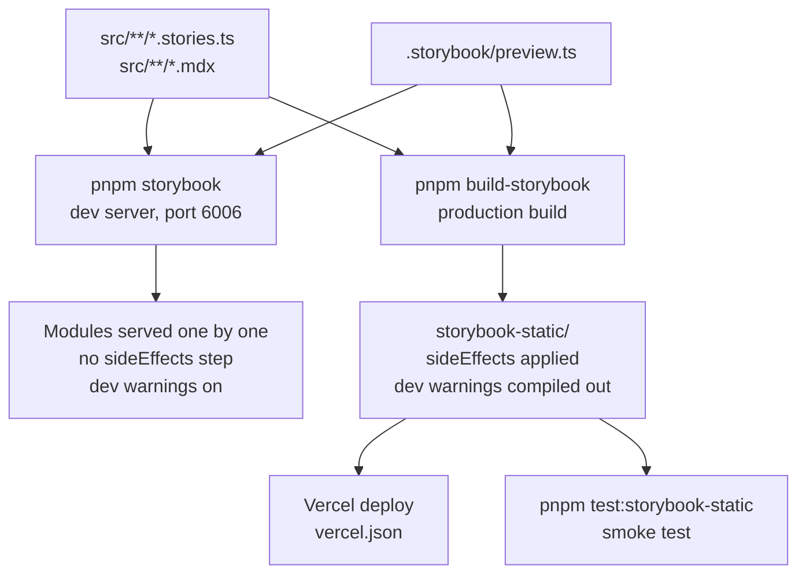
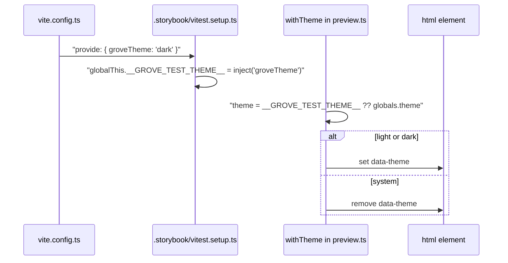

# 16 · Storybook

> **What you learn here**
>
> - How to write a stories file, and what the global preview gives to every story.
> - How each Storybook test run picks a theme.
> - Why the static build is different from the dev server, and how the smoke test proves that the
>   static build registers every component.
>
> **Read first:** [04 · Anatomy of a component](04-anatomy-of-a-component.md) and
> [13 · Themes and page CSS](13-themes-and-page-css.md). **Time:** 35 minutes.
>
> Open work as of main @ e251d45, 2026-10-27.

Grove uses Storybook 10 with the `@storybook/web-components-vite` framework. Storybook shows each
component alone, in the three themes, with the page CSS that a consumer loads.
[Source: Storybook 10 docs, Web components with Vite (read 2026-10-27)](https://storybook.js.org/docs/get-started/frameworks/web-components-vite)
The same stories are also tests: [17 · Tests](17-tests.md#the-four-test-projects) runs each of them
three times.

## Whiteboard

The diagram shows the two ways to run Storybook and what each one does with the stories.



The two paths can give different results for the same code. Test the static path when you change how
a component registers.

## A story file

Each component has a `ComponentName.stories.ts` file next to it. It uses Component Story Format
(CSF): the default export describes the component, and each named export is one story.
[Source: Storybook 10 docs, Component Story Format (read 2026-10-27)](https://storybook.js.org/docs/api/csf)

`Button.stories.ts`, the imports:

```ts
import type { Meta, StoryObj } from '@storybook/web-components-vite';
import { html } from 'lit';
import { ifDefined } from 'lit/directives/if-defined.js';
import './Button.js';
```

`Button.stories.ts`, the start of `meta`:

```ts
const meta: Meta<Args> = {
	title: 'Components/gv-button',
	tags: ['autodocs'],
	render: ({ text, variant, color, size, icon, disabled }) => html`
```

`Button.stories.ts`, the end of `meta` and the stories:

```ts
	args: {
		text: 'Button',
		variant: 'filled',
		color: 'accent',
		size: 'md',
		disabled: false
	}
};
export default meta;

type Story = StoryObj<Args>;

export const Default: Story = {};
export const Tonal: Story = { args: { variant: 'tonal' } };
```

- **`import './Button.js';`** registers the tag. It is the same side-effect import as in a
  component. A story file imports with `.js` too.
  [Story registration and side effects](#story-registration-and-side-effects) tells why this import
  needs care.
- **`title: 'Components/gv-button'`** puts the stories under _Components_ and names them by the tag.
- **`tags: ['autodocs']`** makes a docs page from the stories, their `args` and their `argTypes`.
- **`render`** returns a Lit `html` template. Each story changes only `args`. Button has ten
  stories: `Default`, `Tonal`, `Outlined`, `Ghost`, `Gray`, `Large`, `Small`, `WithIcon`, `Disabled`
  and `Slotted`.
- **`Slotted`** writes the label as light DOM: `>Save changes</gv-button`. A component with events
  can add a listener in the template with `@gv-*=${…}`.
- **`argTypes`** gives each control, for example `{ control: 'select', options: [...] }`.

> [!NOTE]
> **Lit box: a story is a Lit template**
>
> The `render` function returns an `html` template, the same kind that a component returns. A
> binding with `?` adds or removes a boolean attribute. Grove example, `Button.stories.ts`, `meta`:
> `?disabled=${disabled}`. Lit renders the template into the story root.
>
> Lit docs: [Expressions](https://lit.dev/docs/v3/templates/expressions/)

> [!IMPORTANT]
> **Open work: #68 — gv-button link mode and form association** (open PR, no conflict with main on
> 2026-10-27)
>
> The PR raises the Button stories from ten to eighteen. It adds link stories, and `InForm` and
> `NamedSubmits` with a visible event log. A story can render the page around the component:
> `InForm` puts `gv-button` in a `<form>`, cancels `submit`, and writes each event into an
> `<output>`. Its handler enables the button again after a stand-in request of one second. The link
> stories use `href="#…"`, so the Storybook iframe never goes to a different page. When the PR
> lands, change "ten stories" in this section and add the `InForm` pattern.
> <https://github.com/edgarjaymez/grove-lit/pull/68>

## The global preview

`.storybook/preview.ts` gives every story the same start as a consumer page:

- **The page CSS.** It imports `tokens.css`, `globals.css`, `typography.css`, `effects.css`,
  `surfaces.css`, `a11y.css` and `fonts.css` from `src/lib`.
- **All Phosphor glyphs.** `import '@phosphor-icons/webcomponents';` registers every glyph, so each
  icon name works in Storybook. A real app registers only the glyphs that it uses.
  [20 · Grove in an app](20-grove-in-an-app.md#phosphor-glyphs) tells how.
- **The `withTheme` decorator.** It sets `data-theme` on `<html>`, as a consumer does. For "System"
  it removes the attribute, so `prefers-color-scheme` decides. It wraps each story in a
  `display: contents` element with the Ground text colour.
- **The theme toolbar.** It has three items: System, Light and Dark. The default is `system`.
- **The background.** One background, `ground`, uses `var(--semantic-color-surface-ground)`, so the
  canvas always matches the active theme.
- **The sort order.** `storySort` puts Home first, then Components, Primitives and Layout.
- **The a11y addon.** It runs axe with the WCAG 2.0, 2.1 and 2.2 A and AA rule tags.

`.storybook/preview.ts`, the a11y parameters:

```ts
		a11y: {
			test: 'todo',
			options: {
				runOnly: {
					type: 'tag',
					values: ['wcag2a', 'wcag2aa', 'wcag21a', 'wcag21aa', 'wcag22aa']
				}
			}
		},
```

The `test` parameter has three values. `'off'` runs no check. `'todo'` shows each violation as a
warning. `'error'` makes each violation fail the test.
[Source: Storybook 10 docs, Accessibility tests (read 2026-10-27)](https://storybook.js.org/docs/writing-tests/accessibility-testing)

A stories file can set the parameter in its `meta`, and one story can set it again. On `main`, the
value is `'todo'` everywhere, except in the canary story. Thus the axe checks report, but they do
not fail. [09 · Accessibility](09-accessibility.md#the-a11y-checks-in-storybook) tells why.

> [!IMPORTANT]
> **Open work: #63 — gv-menu-item a11y check and metadata** (open PR, no conflict with main on
> 2026-10-27)
>
> The PR adds `parameters: { a11y: { test: 'error' } }` to the `meta` of `MenuItem.stories.ts`. The
> global default stays `'todo'` until #50 fixes the names. Under `'todo'`, a regression of 2.5.8
> Target Size (Minimum) (AA) passed `pnpm test`. The PR proved the gate with a mutation check:
> without `min-block-size`, the `Sidebar` story fails in the three themes. #68 contains the same
> commits. When the PR lands, change "On `main`, the value is `'todo'` everywhere" to name the
> opt-in. [22 · Cookbook](22-cookbook.md#recipe-17-make-a-stories-file-fail-on-a11y-violations)
> gives the steps. <https://github.com/edgarjaymez/grove-lit/pull/63>

## Repo-level pages

`src/stories/` holds pages that are not about one component.

| File                    | What it shows                                                                                                      |
| ----------------------- | ------------------------------------------------------------------------------------------------------------------ |
| `Home.mdx`              | The landing page: install, glyph imports, templates, the component grid. See [The landing page](#the-landing-page) |
| `Accessibility.mdx`     | `.visually-hidden` from `a11y.css`, under the title _Foundations/Accessibility utilities_                          |
| `FocusRing.stories.ts`  | Every focusable control with its focus ring on each surface                                                        |
| `A11yCanary.stories.ts` | Two planted contrast failures that prove the a11y check can fail                                                   |

The canary story has the tags `['!dev', '!autodocs', 'a11y-canary']`. Thus it is not in the sidebar,
not in the docs and not in the normal test run. Its `meta` sets `a11y: { test: 'error' }`, so it
fails whatever the global value is. [09 · Accessibility](09-accessibility.md#the-a11y-canary)
explains the canary.

## How a test picks a theme

The `storybook` test project runs every story in three browser instances: `light`, `dark` and
`os-dark`. Each instance must render the story in its own theme, but the toolbar does not exist in a
test. Thus the config gives each instance a value, and the decorator reads it.

The sequence diagram shows how the theme goes from `vite.config.ts` to `<html>`.



`.storybook/vitest.setup.ts`, the last line:

```ts
globalThis.__GROVE_TEST_THEME__ = inject('groveTheme');
```

| Instance  | `groveTheme` | Browser colour scheme | What it tests                          |
| --------- | ------------ | --------------------- | -------------------------------------- |
| `light`   | `light`      | light                 | `[data-theme="light"]`                 |
| `dark`    | `dark`       | light                 | `[data-theme="dark"]` on a light OS    |
| `os-dark` | `system`     | dark                  | The `prefers-color-scheme: dark` block |

`.storybook/globals.d.ts` declares the type of `__GROVE_TEST_THEME__`. In the Storybook UI, the
variable is `undefined`, so the toolbar value applies.

## Dev and static builds

`pnpm storybook` starts the dev server on port 6006. `pnpm build-storybook` runs `storybook build`
and writes a static web app to `storybook-static/`, which git ignores.
[Source: Storybook 10 docs, Publish Storybook (read 2026-10-27)](https://storybook.js.org/docs/sharing/publish-storybook)

The static build is a production build. This has two results:

1. **No development warnings.** The production build replaces `process.env.NODE_ENV` with
   `"production"`. Then the gate in `src/lib/utils/dev.ts` returns false, and the deployed Storybook
   never logs the warning for an unregistered glyph. The `Unregistered` story in `Icon.stories.ts`
   shows the warning only under `pnpm storybook`. In the output of `pnpm build-storybook`, the
   compiled gate is `try{return!1}catch{return!0}`, so it always returns false.
2. **Side-effect hints apply.** Vite reads the `sideEffects` field of `package.json` only when it
   builds. The next section explains the result.

[18 · Build and package](18-build-and-package.md#the-node_env-rule) explains the `NODE_ENV` rule.

## Story registration and side effects

A story registers its component with an import that binds no name, for example
`import './Button.js';`. A bundler can remove such an import when `package.json` says that the
module has no side effects.
[Source: webpack, Tree shaking (secondary)](https://webpack.js.org/guides/tree-shaking/)

`package.json`, `sideEffects`:

```json
	"sideEffects": [
		"**/*.css",
		"**/*.js",
		"./src/lib/components/**/*.ts"
	],
```

The first two patterns match no `.ts` file. Before #33, the list had only those two. Thus the static
build dropped every component module, and the deployed Storybook showed empty `gv-*` tags. The dev
server and the Vitest browser runs serve modules without that step, so they looked correct. #33
added the third pattern. It matters only for the repo's own Storybook build, because the package
ships only `dist/`. [18 · Build and package](18-build-and-package.md#the-package-fields) tells more.

> [!IMPORTANT]
> **Open work: #33 — Storybook static builds and the a11y gate** (issue, open: behaviour on main,
> checks remain)
>
> The registration fix, the smoke test, the three-theme test project and the canary are on `main`.
> The gate is still report-only: `preview.ts` sets `test: 'todo'`. The gate changes to `'error'`
> after #46 (PR #63), after #50, and after a decision on the four contrast failures in the FocusRing
> stories. When the gate changes, update [The global preview](#the-global-preview).
> <https://github.com/edgarjaymez/grove-lit/issues/33>

## The static smoke test

`pnpm test:storybook-static` runs `pnpm build-storybook --quiet`, then
`node scripts/storybook-static-smoke.mjs`. The script does these steps:

1. It serves `storybook-static/` on a free local port.
2. It reads `storybook-static/index.json` and takes every entry of type `story`, except the canary.
3. It opens each story in Chromium with Playwright.
4. It walks the story root and every open shadow root below it.
5. It records each tag with a dash that has no registration, and each `gv-*` element with no shadow
   root.

A story with the tag `missing-glyph` can render an unregistered `ph-*` tag on purpose. The script
permits that one problem. When all stories pass, it prints
`storybook static smoke: OK (… stories, every custom element defined)`.

The Vitest `storybook` project cannot catch this bug, because it serves modules as the dev server
does. Run the smoke test after you change `sideEffects`, an import of a stories file or the
Storybook config. It needs Chromium for Playwright: `pnpm exec playwright install chromium`.

## Deploy

Vercel builds and hosts the static Storybook. `vercel.json` tells it what to run.

`vercel.json`:

```json
{
	"$schema": "https://openapi.vercel.sh/vercel.json",
	"buildCommand": "pnpm build-storybook",
	"devCommand": "pnpm storybook",
	"installCommand": "pnpm install",
	"framework": null,
	"outputDirectory": "./storybook-static"
}
```

The deploy build does not run the smoke test. Thus a build that drops registrations can deploy. Run
`pnpm test:storybook-static` on your machine before you merge a change of that kind. `static/` holds
the favicons and the web manifest, and `.storybook/main.ts` serves it with
`staticDirs: ['../static']`.

## The landing page

`src/stories/Home.mdx` is the first page of Storybook. It is the install guide that a consumer
reads. It pins `data-theme="light"` on its own root element. It has these parts:

- **Install.** `pnpm add @edgarjaymez/grove`, then `import '@edgarjaymez/grove/grove.css';` one
  time.
- **Glyphs.** One import for each glyph that the app names, and a list of the glyphs that some
  components draw by default or always.
- **Templates.** Kebab-case attributes, the Astro typings, booleans as `undefined` (never `false`),
  and typed `gv-*` events.
- **Components.** A grid of fifteen cards, one for each component.
- **Pillars and themes.** The design principles, and a light and dark theme island.

The glyph list in `Home.mdx` is one of the four copies of the glyph names.
[15 · Metadata and the manifest](15-metadata-and-the-manifest.md#the-phosphor-field) lists them. No
check compares the other snippets in `Home.mdx` with the manifest. The manifest check reads only the
metadata snippets.

> [!IMPORTANT]
> **Open work: #57 — docs sweep for 0.45** (issue, open: behaviour on main, checks remain)
>
> The first pass is on `main` (PR #55): the `grove.css` install, the grid of fifteen cards and the
> pillars. The final pass asks for these changes. Add cards for `gv-textarea` (#17),
> `gv-status-chip` and `gv-card` (#53) and `gv-journey-rail` (#19) when they land. Update `Home.mdx`
> for the link mode and form behaviour of `gv-button` (#49) and for the text-input field (#51).
> Decide if a surface decorator in `preview.ts` replaces the `gv-surface-*` wrappers in each story.
> Check every `Home.mdx` snippet against the attribute names in the manifest.
> <https://github.com/edgarjaymez/grove-lit/issues/57>

> [!IMPORTANT]
> **Open work: #64 — gv-icon glyph tests and the dist gate** (open PR, no conflict with main on
> 2026-10-27)
>
> The PR adds a test that compares the glyph list in `Home.mdx` with the `phosphor` metadata. Each
> import line must name, in its comment, the tags that draw that glyph. The PR also updates the
> `Unregistered` story: it says that the warning shows under `pnpm storybook` only. When the PR
> lands, say in this section that a test guards the glyph list.
> <https://github.com/edgarjaymez/grove-lit/pull/64>

## See it in the code

| File                                          | Look for                                                         |
| --------------------------------------------- | ---------------------------------------------------------------- |
| `src/lib/components/Button/Button.stories.ts` | `import './Button.js'`, `meta`, the ten stories, `Slotted`       |
| `.storybook/main.ts`                          | `addons`, `framework`, `staticDirs`, `stories`                   |
| `.storybook/preview.ts`                       | The CSS imports, `withTheme`, `globalTypes`, `a11y`, `storySort` |
| `.storybook/vitest.setup.ts`                  | `inject('groveTheme')`                                           |
| `vite.config.ts`                              | `themeInstances`, `storybookProject`                             |
| `src/stories/A11yCanary.stories.ts`           | The tags, `a11y: { test: 'error' }`, the two planted nodes       |
| `scripts/storybook-static-smoke.mjs`          | `walk`, the `missing-glyph` exception                            |
| `package.json`                                | `sideEffects`, `build-storybook`, `test:storybook-static`        |
| `vercel.json`                                 | `buildCommand`, `outputDirectory`                                |

## Sources

**Tool docs**

- [Storybook 10 docs, Web components with Vite](https://storybook.js.org/docs/get-started/frameworks/web-components-vite)
  (read 2026-10-27).
- [Storybook 10 docs, Component Story Format](https://storybook.js.org/docs/api/csf) (read
  2026-10-27).
- [Storybook 10 docs, Accessibility tests](https://storybook.js.org/docs/writing-tests/accessibility-testing)
  (read 2026-10-27).
- [Storybook 10 docs, Publish Storybook](https://storybook.js.org/docs/sharing/publish-storybook)
  (read 2026-10-27).
- [webpack, Tree shaking](https://webpack.js.org/guides/tree-shaking/), secondary: the source of the
  `sideEffects` field. Read 2026-10-27.
- [Lit, Expressions](https://lit.dev/docs/v3/templates/expressions/). Read 2026-10-27.

## Check yourself

Do [Lesson 13 Storybook and tests](syllabus.md#lesson-13-storybook-and-tests) in the syllabus. Then
answer: which pattern in `sideEffects` keeps `import './Button.js';` in the static build? Which file
turns the `groveTheme` value into a global variable?

[← 15 · Metadata and the manifest](15-metadata-and-the-manifest.md) · [Index](README.md) ·
[17 · Tests →](17-tests.md)
