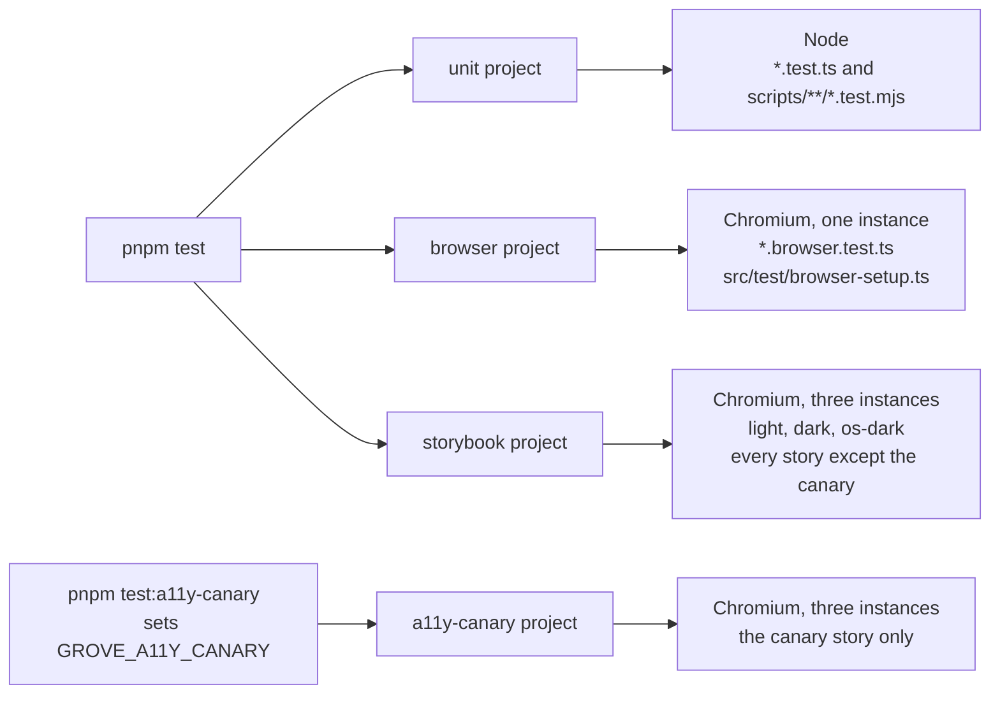
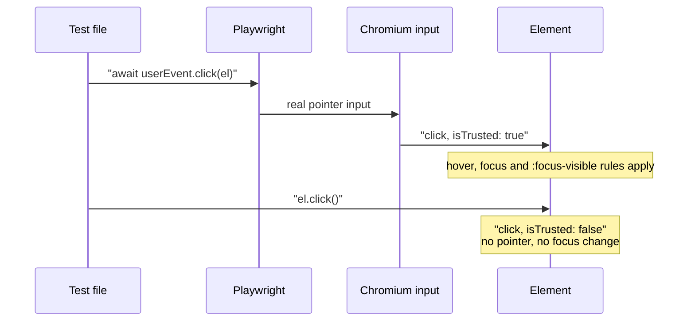

# 17 · Tests

> **What you learn here**
>
> - The four test projects: what each one runs, and in which environment.
> - How to run all tests, one project or one file, and why watch mode depends on who runs it.
> - How to write a browser test, and the techniques that the Grove tests use.
>
> **Read first:** [16 · Storybook](16-storybook.md) and [03 · Lit essentials](03-lit-essentials.md).
> **Time:** 50 minutes.
>
> Open work as of main @ e251d45, 2026-10-27.

All tests run on Vitest 4. `vite.config.ts` holds the test config, and the repo has no separate
Vitest config file. The config defines projects. Each project has its own files and its own
environment. [Source: Vitest, Test projects](https://vitest.dev/guide/projects)

## Whiteboard

The diagram shows the four projects and the environment that each one runs in.



Each Chromium run is headless, and Playwright drives it.

## The four test projects

| Project       | Files                                                                                          | Environment                                           |
| ------------- | ---------------------------------------------------------------------------------------------- | ----------------------------------------------------- |
| `unit`        | `src/**/*.{test,spec}.{js,ts}` and `scripts/**/*.test.mjs`, but not `src/**/*.browser.test.ts` | Node                                                  |
| `browser`     | `src/**/*.browser.test.ts`, with the setup file `src/test/browser-setup.ts`                    | Chromium through Playwright, one instance             |
| `storybook`   | Every story, except the stories with the tag `a11y-canary`                                     | Chromium, three instances: `light`, `dark`, `os-dark` |
| `a11y-canary` | Only the stories with the tag `a11y-canary`                                                    | The same three instances                              |

Lit components run in the browser, so the Lit team recommends tests in a real browser, not in a DOM
shim. [Source: Lit, Testing](https://lit.dev/docs/v3/tools/testing/) Thus each test that renders a
component is a `*.browser.test.ts`. The `unit` project holds only tests that read files or check
logic. [Source: Vitest, Browser mode](https://vitest.dev/guide/browser/)

**Every test must assert something.** The root config sets `expect: { requireAssertions: true }`.
Then a test with no `expect` call fails, as if each test started with `expect.hasAssertions()`.
[Source: Vitest, expect.requireAssertions](https://vitest.dev/config/expect#expect-requireassertions)
The two Storybook projects turn it off. The a11y addon calls `expect()` only when it finds a
violation, so a clean story has no assertion.

The Storybook projects also set `passWithNoTests: false`. If the plugin finds no stories, the run
fails. [16 · Storybook](16-storybook.md#how-a-test-picks-a-theme) tells how each instance picks its
theme.

**The a11y canary.** The `a11y-canary` project exists only when the environment has the variable
`GROVE_A11Y_CANARY`. `pnpm test:a11y-canary` sets it, runs the project and inverts the result. It
passes only if the canary story failed in all three themes, and axe reported both planted nodes,
`#canary-light` and `#canary-shadow`, each time.
[09 · Accessibility](09-accessibility.md#the-a11y-canary) explains why.

## Watch mode and agents

`pnpm test:unit` runs `vitest` with no arguments. Vitest then decides if it watches the files. In
Vitest 4.1, the default comes from three conditions.

`node_modules/vitest/dist/chunks/defaults.*.js`, the `watch` default (Vitest 4.1.7):

```js
	watch: !isCI && process.stdin.isTTY && !isAgent,
```

The flags `isCI` and `isAgent` come from the `std-env` package. Vitest watches only when it is not
in CI, the input is a terminal, and it detects no AI agent.
[Source: Vitest, watch](https://vitest.dev/config/watch)

`pnpm test` runs `pnpm test:unit -- --run`. The `--run` flag asks for one run with no watch. But
pnpm gives the `--` to Vitest as an argument, and Vitest puts each argument after `--` aside. Thus
the `--run` has no effect.

The maintainer ran `pnpm test` in a pseudo-terminal with no CI or agent variables on 2026-10-27. All
projects ran one time: 65 test files passed, Vitest skipped 3, and 960 tests passed in about 25
seconds. Then Vitest printed
`PASS  Waiting for file changes... press h to show help, press q to quit` and stayed in watch mode.
In CI or under a detected AI agent, Vitest turns watch off, and the same command stops after one
run. [23 · Known drift](23-known-drift.md#leftovers-in-the-code) lists this script.

> [!TIP]
> In a terminal, run `pnpm vitest run` for one run, or press `q` to stop watch mode. Add
> `--project <name>` or a file path to narrow the run.

## Commands

| Command                                                       | What it does                                                                                                                                                          |
| ------------------------------------------------------------- | --------------------------------------------------------------------------------------------------------------------------------------------------------------------- |
| `pnpm test`                                                   | The `unit`, `browser` and `storybook` projects, one time. In a terminal, it then stays in watch mode (press `q`). See [Watch mode and agents](#watch-mode-and-agents) |
| `pnpm test:unit`                                              | `vitest` for all projects. It watches in a terminal, despite its name                                                                                                 |
| `pnpm vitest run`                                             | All projects, one time                                                                                                                                                |
| `pnpm vitest run --project browser`                           | One project                                                                                                                                                           |
| `pnpm vitest run --project unit src/lib/styles/focus.test.ts` | One file in one project                                                                                                                                               |
| `pnpm test:a11y-canary`                                       | Proves that the a11y check still finds planted faults                                                                                                                 |
| `pnpm test:storybook-static`                                  | Builds the static Storybook and checks that each story upgrades its elements                                                                                          |
| `pnpm check`                                                  | Type check. It also checks the type fixture `src/test/events.types.ts`                                                                                                |

The browser projects need Chromium for Playwright. Install it one time:
`pnpm exec playwright install chromium`.
[Source: Vitest, Playwright provider](https://vitest.dev/config/browser/playwright)
[22 · Cookbook](22-cookbook.md#recipe-8-run-tests-selectively) shows more selections.

## The test helpers

`src/test/` holds helpers that tests import. It holds no tests.

| File               | What it gives                                                                                                                                                        |
| ------------------ | -------------------------------------------------------------------------------------------------------------------------------------------------------------------- |
| `browser-setup.ts` | The setup file of the `browser` project. It loads `tokens.css`, `globals.css` and `typography.css`, and registers the eight default and fixed glyphs of the metadata |
| `themes.ts`        | `themes` (light, dark, OS dark) and `applyTheme()`, which sets `data-theme` and the colour scheme                                                                    |
| `grove-tags.ts`    | `groveTags`: every tag that `src/lib/index.ts` registers, read from the registry                                                                                     |
| `events.types.ts`  | A type fixture with `@ts-expect-error` lines. `pnpm check` checks it, and no test runs it                                                                            |
| `commands.d.ts`    | The types of the two custom browser commands                                                                                                                         |

`vite.config.ts` defines the two custom commands. A test calls them through `commands` from
`vitest/browser`. [Source: Vitest, Commands](https://vitest.dev/api/browser/commands)

- **`emulateMedia`** sets `reducedMotion`, `colorScheme` or `forcedColors` for the page. It calls
  the Playwright method `page.emulateMedia()`.
  [Source: Playwright, page.emulateMedia](https://playwright.dev/docs/api/class-page#page-emulate-media)
- **`ariaSnapshot`** returns the ARIA snapshot that Playwright makes for a selector.
  [Names in the accessibility tree](#names-in-the-accessibility-tree) tells its limits.

`groveTags` reads the tags from `src/lib/index.ts`. Thus a component that is not exported there is
not in the shared tests. `slots`, `host-hidden` and `reduced-motion` loop over `groveTags`.

> [!IMPORTANT]
> **Open work: #64 — gv-icon glyph tests and the dist gate** (open PR, no conflict with main on
> 2026-10-27)
>
> The PR adds two helpers. `src/test/shadow.ts` gives `deepElements()`, `settleDeep()` and
> `frames()`. `src/test/component-metadata.ts` gives `metadataByTag`, which pairs each metadata file
> with the `@customElement` tag of the module next to it. It reads the sources with
> `import.meta.glob` and `?raw`, so unit and browser tests can share it. #66 adds a byte-identical
> `shadow.ts`. When the PR lands, add both files to the table above.
> <https://github.com/edgarjaymez/grove-lit/pull/64>

> [!IMPORTANT]
> **Open work: #68 — gv-button link mode and form association** (open PR, no conflict with main on
> 2026-10-27)
>
> The PR adds `src/test/forms.ts`. `cancelFormSubmits()` stops each submission from a page change.
> `recordSubmits(form)` logs each `submit` event with its submitter and its form data. `nextTask()`
> waits until a control has acted on its form. `settle(root)` waits two times for every Lit element
> under a root. When the PR lands, add `forms.ts` to the table above.
> <https://github.com/edgarjaymez/grove-lit/pull/68>

## The test inventory

`git ls-files '*.test.*'` lists every test file. `main` has seventeen.

| File                                                             | Project   | What it guards                                                                                           |
| ---------------------------------------------------------------- | --------- | -------------------------------------------------------------------------------------------------------- |
| `scripts/components-since.test.mjs`                              | `unit`    | The ledger helpers and the `record-release` and `check-ledger` commands                                  |
| `scripts/manifest-types.test.mjs`                                | `unit`    | The alias expansion and the removal of `@state` fields in the manifest plugin                            |
| `src/lib/components/metadata.test.ts`                            | `unit`    | Fifteen metadata files, real Phosphor glyphs, kebab-case snippets and variant keys                       |
| `src/lib/components/Icon/phosphor.test.ts`                       | `unit`    | Glyph names, the once-for-each-tag record, the warning text, the `NODE_ENV` gate                         |
| `src/lib/styles/focus.test.ts`                                   | `unit`    | No `outline: none` or `0` in components; one `.gv-surface-*` class for each `GroveSurface`               |
| `src/lib/styles/visually-hidden.test.ts`                         | `unit`    | The same `.visually-hidden` rules in `a11y.css` and `visually-hidden.ts`                                 |
| `src/lib/tokens/contrast.test.ts`                                | `unit`    | Text and ring contrast in both themes, shadow colours, the built CSS against the JSON, the theme cascade |
| `src/lib/events.browser.test.ts`                                 | `browser` | The `gv-*` event names, one `gv-change` for each toggle, `heading` on the to-do item                     |
| `src/lib/slots.browser.test.ts`                                  | `browser` | Rendered slots against `composition.slots`, slot precedence, names, the form-control warning             |
| `src/lib/styles/focus-ring.browser.test.ts`                      | `browser` | The ring on each control, in each theme, on each surface, and under forced colours                       |
| `src/lib/styles/host-hidden.browser.test.ts`                     | `browser` | `hidden` hides every tag, and `hidden="until-found"` is left to the browser                              |
| `src/lib/styles/reduced-motion.browser.test.ts`                  | `browser` | Transitions end in 1 ms or less under `prefers-reduced-motion: reduce`                                   |
| `src/lib/components/FeedbackStrip/FeedbackStrip.browser.test.ts` | `browser` | The live region for each `type` and `live` value, and updates in place                                   |
| `src/lib/components/Icon/Icon.browser.test.ts`                   | `browser` | Decorative by default, `label` names one image, the warning for an unregistered glyph                    |
| `src/lib/components/MenuItem/MenuItem.browser.test.ts`           | `browser` | The 24 px row, and `hreflang` and `lang` on the link                                                     |
| `src/lib/components/Texture/Texture.browser.test.ts`             | `browser` | Hidden from assistive technology, `tint`, `frequency`, the dark default                                  |
| `src/lib/components/Title/Title.browser.test.ts`                 | `browser` | Reflow at 320 px and at 200 % text, the heading level, the surface in each theme                         |

The `storybook` project adds one test for each story in each theme. Button has no browser test file
on `main`. The shared tests cover it, and `focus-ring.browser.test.ts` renders `gv-button`.

## A new browser test

`MenuItem.browser.test.ts` shows the usual form.

`MenuItem.browser.test.ts`, the start of the file:

```ts
import { afterEach, describe, expect, it } from 'vitest';
import { html, render } from 'lit';
import './MenuItem.js';
import type { MenuItem } from './MenuItem.js';

const host = document.body.appendChild(document.createElement('div'));
host.style.width = '240px';

afterEach(() => render(html``, host));

const mount = async (template: unknown) => {
	render(template, host);
	const items = [...host.querySelectorAll('gv-menu-item')] as MenuItem[];
	await Promise.all(items.map((el) => el.updateComplete));
	return items;
};
```

1. Import the component for its side effect. Import its type for TypeScript.
2. Render real markup into a host element with the `render` function of Lit.
3. Wait for `updateComplete` on each element before you read the DOM.
4. Read inside the component through `el.shadowRoot`.
5. Clear the host after each test.

Put a component test in the directory of the component. Put a shared test next to the code that it
checks. The `browser` project finds every `src/**/*.browser.test.ts`, so you do not register the
file. [22 · Cookbook](22-cookbook.md#recipe-7-add-a-browser-test) gives the full recipe.

> [!NOTE]
> **Lit box: wait for updateComplete**
>
> Lit renders after a property change in a microtask, not at once. `updateComplete` is a promise
> that resolves after the update. Grove example, `MenuItem.browser.test.ts`, `mount`:
> `await Promise.all(items.map((el) => el.updateComplete));` A composite starts the update of its
> children, so a test of a composite waits more than one time.
>
> Lit docs: [Lifecycle](https://lit.dev/docs/v3/components/lifecycle/)

## Trusted input

The browser marks an event from real user input as trusted: `isTrusted` is `true`. An event that a
script makes, for example with `el.click()` or `dispatchEvent()`, is not trusted.
[Source: MDN, Event.isTrusted](https://developer.mozilla.org/en-US/docs/Web/API/Event/isTrusted)

`userEvent` from `vitest/browser` sends input through the provider, not as a fake event. With
Playwright, it uses the Chrome DevTools Protocol.
[Source: Vitest, Interactivity API](https://vitest.dev/api/browser/interactivity)

The sequence diagram compares the two paths of a click.



Use each path for its purpose:

- **Use `userEvent` when the result depends on real input.** `focus-ring.browser.test.ts` uses
  `userEvent.keyboard('{Tab}')`, because `:focus-visible` shows after keyboard focus. It uses
  `userEvent.hover()` to test the ring over a hover shadow.
- **Use `el.click()` for a simple click.** `events.browser.test.ts` calls
  `inner(el, 'button').click()` to check which event a component dispatches.

[08 · Events](08-events.md#trusted-and-untrusted-events) tells which component behaviour depends on
trusted events.

> [!IMPORTANT]
> **Open work: #68 — gv-button link mode and form association** (open PR, no conflict with main on
> 2026-10-27)
>
> `Button.browser.test.ts` tests the form behaviour with trusted input: `userEvent.click(inner)`,
> `userEvent.keyboard('{Enter}')` and `userEvent.keyboard('[Space]')`. The button acts in the next
> task after a click, so the tests wait with `nextTask()`. Before a click, Playwright waits for the
> element to become enabled. Give `{ force: true }` to click a disabled button on purpose. Minimal
> test elements check the mixin alone in `form-control.browser.test.ts`. When the PR lands, add
> these points to this section. <https://github.com/edgarjaymez/grove-lit/pull/68>

## Nested shadow roots in tests

`document.querySelectorAll()` does not go into a shadow root. A composite such as `gv-color-swatch`
has a `gv-tooltip` in its shadow root, and that tooltip has a `gv-icon` in its own shadow root. A
test that looks for an element at any depth must walk each open shadow root.

On `main`, each test file has its own walk:

- `focus-ring.browser.test.ts`, `inner()`, finds `.gv-focusable`. If it finds none, it goes into a
  `gv-checkbox` inside the shadow root.
- `reduced-motion.browser.test.ts` collects the host and each element of its shadow tree, and goes
  into nested Grove shadow roots.
- `scripts/storybook-static-smoke.mjs`, `walk`, visits each element and calls itself on each
  `shadowRoot`.

A walk must also wait. A child component renders after its parent, so new elements can show after
the first `updateComplete`. `focus-ring.browser.test.ts`, `settle()`, waits two times for that
reason.

> [!IMPORTANT]
> **Open work: #64 — gv-icon glyph tests and the dist gate** (open PR, no conflict with main on
> 2026-10-27)
>
> The PR adds `src/test/shadow.ts`. `deepElements(root)` lists every element below a root, and walks
> each open shadow root right after its host. `settleDeep(root)` waits until every element has
> updated and the count of elements stops to change. `frames(count)` waits for a number of animation
> frames. The PR changes `focus-ring.browser.test.ts` to use them. When the PR lands, replace the
> list above with `shadow.ts`. <https://github.com/edgarjaymez/grove-lit/pull/64>

> [!IMPORTANT]
> **Open work: #66 — componentReset tests for hidden and reduced motion** (open PR, no conflict with
> main on 2026-10-27)
>
> The PR adds the same `src/test/shadow.ts` as #64, byte for byte. It changes `host-hidden` and
> `reduced-motion` to use it. The two copies are identical, so the second merge needs no change to
> the file. If one copy changes before the merge, keep one version. When the PR lands, remove the
> `reduced-motion` item from the list above. <https://github.com/edgarjaymez/grove-lit/pull/66>

## Names in the accessibility tree

A test of an accessible name must read the accessibility tree, not the DOM. On `main`, the tests use
the custom command `ariaSnapshot`. It returns a YAML text of roles and names for a selector.
[Source: Playwright, ARIA snapshots](https://playwright.dev/docs/aria-snapshots)

`slots.browser.test.ts`, the checkbox label test:

```ts
expect(await commands.ariaSnapshot('#slots-host')).toContain('checkbox "Subscribe"');
```

The snapshot is the computation of Playwright, not the tree of Chrome. #50 R2 found that the two can
differ. For example, Playwright does not follow `ariaLabelledByElements` from inside a shadow root
to a page `<label>`, but Chrome does. Thus a snapshot can report "no name" for a control that Chrome
names. Use `ariaSnapshot` for simple names, and do not trust it for names that cross the shadow
boundary. [09 · Accessibility](09-accessibility.md#accessible-names-across-the-shadow-boundary)
explains those names.

> [!IMPORTANT]
> **Open work: #50 — accessible names: the axNodes command** (branch, no PR)
>
> The #50 work branch, linked from epic #50, adds a third browser command, `axNodes(selector)`. It
> opens a CDP session, gets the DOM with `pierce: true`, and calls `Accessibility.getPartialAXTree`
> for each node. It returns the role, name, description and states that Chrome computed, shadow
> roots included, and leaves out ignored nodes.
> [Source: Chrome DevTools Protocol, Accessibility domain](https://chromedevtools.github.io/devtools-protocol/tot/Accessibility/)
> [Source: Playwright, CDPSession](https://playwright.dev/docs/api/class-cdpsession)
>
> A self-test, `src/test/ax-nodes.browser.test.ts`, proves that it reads the tree of Chrome. A name
> that an element reference sets across the shadow boundary shows in `axNodes`, but not in
> `ariaSnapshot`. The branch waits for #68. When it lands, add `axNodes` to
> [The test helpers](#the-test-helpers) and to this section.
> <https://github.com/edgarjaymez/grove-lit/issues/50>

## Tests that keep two copies in step

Some rules exist in two places. A test makes sure that the two copies agree.

| Test                      | The two copies                                                     |
| ------------------------- | ------------------------------------------------------------------ |
| `visually-hidden.test.ts` | `.visually-hidden` in `a11y.css` and in `visually-hidden.ts`       |
| `focus.test.ts`           | The `.gv-surface-*` classes in `surfaces.css` and `GROVE_SURFACES` |
| `contrast.test.ts`        | `tokens.css` and the token JSON sources                            |
| `metadata.test.ts`        | The metadata glyphs and the modules of the Phosphor package        |
| `slots.browser.test.ts`   | The rendered slots and `composition.slots` in the metadata         |

When one of these tests fails after your change, update the other copy. Do not make the test less
strict. [11 · Design tokens](11-design-tokens.md#churn-in-the-generated-file) tells how to rebuild
`tokens.css` after a JSON change.

> [!IMPORTANT]
> **Open work: #64 — gv-icon glyph tests and the dist gate** (open PR, no conflict with main on
> 2026-10-27)
>
> The PR adds three rows. `metadata.test.ts` compares the metadata glyphs with the glyph recipe in
> `Home.mdx`, and with the imports in `browser-setup.ts`. `glyphs.browser.test.ts` compares the
> metadata glyphs with the glyphs that each component draws. It also fails when a registered tag has
> no metadata file. When the PR lands, add the three rows to the table above.
> <https://github.com/edgarjaymez/grove-lit/pull/64>

> [!CAUTION]
> Do not import contrast helpers from a shared module. The helpers `ratio`, `toRgb`, `parseOklch`
> and `lc` are private functions inside `contrast.test.ts`. #51 F5, #16 and #30 propose sibling
> `*.contrast.test.ts` files that import shared helpers, and #58 plans to reuse the helpers. Nobody
> extracted the helpers. A change that needs them must first move them, in a commit of its own.
> [23 · Known drift](23-known-drift.md#specs-that-lag-the-code) lists this drift.

## Mutation checks

A test that cannot fail proves nothing. A mutation check proves that a test can fail. Do these steps
on a practice branch:

1. Make one small fault in the code that the test guards.
2. Run the test. The test fails, and its message names the fault.
3. Revert the fault.
4. Run the test again. The test passes.
5. Write the fault and the result in the PR description.

The open PRs record these checks:

| PR  | The fault                                                | The result                                              |
| --- | -------------------------------------------------------- | ------------------------------------------------------- |
| #63 | Remove `min-block-size` from `.item` in `MenuItem.ts`    | The `Sidebar` story fails `target-size` in three themes |
| #64 | Set the default `icon` of `MenuItem.ts` to `'list'`      | `glyphs.browser.test.ts` fails for `gv-menu-item`       |
| #64 | Add `'process.env.NODE_ENV': '"production"'` to `define` | `pnpm build` fails in `check-dist.mjs`                  |

The a11y canary is a mutation check that stays in the repo. It plants two faults, and its runner
passes only when the check finds them.

## Change detectors

A change detector is a test that pins the current values in a table. It does not say that the values
are correct. It makes each change visible, so that a reviewer sees it in the diff. Use one when no
specification gives the values yet, for example motion timings before motion tokens exist.

On `main`, `reduced-motion.browser.test.ts` has a list `ANIMATED` of the tags that animate. It does
not pin the timings.

> [!IMPORTANT]
> **Open work: #66 — componentReset tests for hidden and reduced motion** (open PR, no conflict with
> main on 2026-10-27)
>
> The PR replaces `ANIMATED` with `AT_REST`. The table gives the computed property, duration, easing
> and delay of each element that transitions at rest, for each tag. A timing change, for example in
> #30 or #67, then changes this table. The PR found a drift in the spec: the animated element of
> `gv-checkbox` is `.box`, not `.checkbox`.
>
> The table compares computed strings, such as `'0.3s'` and `'ease-in-out'`. Issue #67 changes
> `ease-in-out` to a `cubic-bezier()` token. Thus its claim "passes unchanged" fails, unless the
> test normalises the strings. `AT_REST` exists only in #66, so #67 depends on #66. When the PR
> lands, replace the paragraph above with `AT_REST`.
> <https://github.com/edgarjaymez/grove-lit/pull/66>

## Flaky tests

A full `pnpm test` runs all projects at the same time. Under that load, a browser test can reach its
timeout, and then pass when it runs alone. This occurred with `focus-ring.browser.test.ts` and
`FeedbackStrip.browser.test.ts`.

When a browser test fails in a full run, do these steps:

1. Run that file alone: `pnpm vitest run --project browser <file>`.
2. If it passes alone, run the full suite again.
3. If it fails only under load, record the test, the count of runs and the count of failures.
4. Do not add a retry or a longer timeout before you know the cause.

> [!IMPORTANT]
> **Open work: #66 — componentReset tests for hidden and reduced motion** (open PR, no conflict with
> main on 2026-10-27)
>
> The PR records one flaky test outside its diff:
> `focus-ring.browser.test.ts › focus ring in OS dark › <gv-color-swatch> draws the Ground ring on keyboard focus`.
> It failed in 2 of 17 full `pnpm test` runs on the PR branch, and in 0 of 8 runs with the test
> files of `main`. It never failed in 10 runs of the `browser` project alone.
>
> The cause is not known. The PR suggests to look first at the timing of `tabTo` under load. When
> somebody finds the cause, write it in this section.
> [14 · The focus ring](14-the-focus-ring.md#checks) tells what the test checks.
> <https://github.com/edgarjaymez/grove-lit/pull/66>

## See it in the code

| File                                                   | Look for                                                                               |
| ------------------------------------------------------ | -------------------------------------------------------------------------------------- |
| `vite.config.ts`                                       | `test.projects`, `requireAssertions`, `emulateMedia`, `ariaSnapshot`, `themeInstances` |
| `package.json`                                         | `test`, `test:unit`, `test:a11y-canary`, `test:storybook-static`                       |
| `src/test/`                                            | The five helper files                                                                  |
| `src/lib/components/MenuItem/MenuItem.browser.test.ts` | `host`, `mount`, `afterEach`                                                           |
| `src/lib/styles/focus-ring.browser.test.ts`            | `tabTo`, `inner`, `settle`, `userEvent.keyboard('{Tab}')`                              |
| `src/lib/slots.browser.test.ts`                        | `commands.ariaSnapshot`                                                                |
| `src/lib/tokens/contrast.test.ts`                      | The private helpers `ratio`, `toRgb`, `lc`                                             |
| `scripts/a11y-canary.mjs`                              | `THEMES`, `NODES`, the inverted exit code                                              |

## Sources

**Platform reference**

- [MDN, Event.isTrusted](https://developer.mozilla.org/en-US/docs/Web/API/Event/isTrusted). Read
  2026-10-27.

**Tool docs**

- [Vitest, Test projects](https://vitest.dev/guide/projects). Read 2026-10-27.
- [Vitest, Browser mode](https://vitest.dev/guide/browser/). Read 2026-10-27.
- [Vitest, Playwright provider](https://vitest.dev/config/browser/playwright). Read 2026-10-27.
- [Vitest, Commands](https://vitest.dev/api/browser/commands). Read 2026-10-27.
- [Vitest, Interactivity API](https://vitest.dev/api/browser/interactivity). Read 2026-10-27.
- [Vitest, watch](https://vitest.dev/config/watch). Read 2026-10-27.
- [Vitest, expect.requireAssertions](https://vitest.dev/config/expect#expect-requireassertions).
  Read 2026-10-27.
- [Playwright, page.emulateMedia](https://playwright.dev/docs/api/class-page#page-emulate-media).
  Read 2026-10-27.
- [Playwright, ARIA snapshots](https://playwright.dev/docs/aria-snapshots). Read 2026-10-27.
- [Playwright, CDPSession](https://playwright.dev/docs/api/class-cdpsession). Read 2026-10-27.
- [Chrome DevTools Protocol, Accessibility domain](https://chromedevtools.github.io/devtools-protocol/tot/Accessibility/).
  Read 2026-10-27.
- [Lit, Testing](https://lit.dev/docs/v3/tools/testing/). Read 2026-10-27.
- [Lit, Lifecycle](https://lit.dev/docs/v3/components/lifecycle/). Read 2026-10-27.

## Check yourself

Do [Lesson 13 Storybook and tests](syllabus.md#lesson-13-storybook-and-tests) in the syllabus. Then
answer: which project runs `src/lib/tokens/contrast.test.ts`? Why does `focus-ring.browser.test.ts`
use `userEvent.keyboard('{Tab}')` and not `el.focus()`?

[← 16 · Storybook](16-storybook.md) · [Index](README.md) ·
[18 · Build and package →](18-build-and-package.md)
