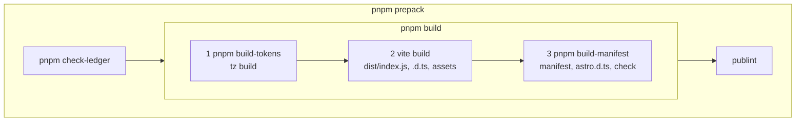

# 18 · Build and package

> **What you learn here**
>
> - What `pnpm build` does, step by step, and what goes into `dist/`.
> - Which `package.json` fields make the public package, and what each one does for a consumer.
> - The rules for `NODE_ENV`, lint, format and the type check.
>
> **Read first:** [11 · Design tokens](11-design-tokens.md) and
> [15 · Metadata and the manifest](15-metadata-and-the-manifest.md). **Time:** 35 minutes.
>
> Open work as of main @ e251d45, 2026-10-27.

The package `@edgarjaymez/grove` contains only the build output. This chapter follows the source
from `src/lib/` to the files in `dist/` that npm receives.

## Whiteboard

The diagram shows the steps of `pnpm build` and the wrapper that `pnpm prepack` puts around them.



Each arrow is `&&` in a script. When one step fails, the next step does not run.

## The build steps

`package.json`, `scripts.build`:

```json
		"build": "pnpm build-tokens && vite build && pnpm build-manifest",
```

1. **`pnpm build-tokens`** runs `tz build`. Terrazzo writes `src/lib/tokens/tokens.css` from the
   token JSON. [11 · Design tokens](11-design-tokens.md#the-pipeline) explains it.
2. **`vite build`** bundles the library in library mode.
   [The Vite library build](#the-vite-library-build) explains it.
3. **`pnpm build-manifest`** writes `dist/custom-elements.json` and `dist/types/astro.d.ts`, then
   runs the manifest check.
   [15 · Metadata and the manifest](15-metadata-and-the-manifest.md#how-the-manifest-is-built)
   explains it.

A component that breaks the manifest rules fails in step 3, not in `pnpm check`. Thus run
`pnpm build` before you call a component change done.

> [!CAUTION]
> Revert `tokens.css` after a build when you did not change a token. Step 1 can rewrite the file
> with no real change. Run `git checkout -- src/lib/tokens/tokens.css`.
> [11 · Design tokens](11-design-tokens.md#churn-in-the-generated-file) tells why.

> [!IMPORTANT]
> **Open work: #64 — gv-icon glyph tests and the dist gate** (open PR, no conflict with main on
> 2026-10-27)
>
> The PR adds a fourth step between `vite build` and `pnpm build-manifest`:
> `node scripts/check-dist.mjs`. It fails when no `dist/*.js` contains the text
> `process.env.NODE_ENV`. The step reads the bundle, so it is in `pnpm build`, not in
> `pnpm build-manifest`. Thus `pnpm build-manifest` still runs with no `dist/`.
>
> `prepack` runs the new step too, because it runs `pnpm build`. When the PR lands, change this
> section and the diagram to four steps. [The NODE_ENV rule](#the-node_env-rule) tells why the step
> exists. <https://github.com/edgarjaymez/grove-lit/pull/64>

## The Vite library build

`vite build` reads `vite.config.ts`. The `build` block uses library mode.
[Source: Vite, Library mode](https://vite.dev/guide/build.html#library-mode)

`vite.config.ts`, `build`:

```ts
	build: {
		lib: {
			entry: 'src/lib/index.ts',
			formats: ['es'],
			fileName: 'index'
		},
		rollupOptions: {
			external: ['lit', /^lit\//]
		},
		outDir: 'dist',
		emptyOutDir: true,
		sourcemap: true
	},
```

- **One entry.** `src/lib/index.ts` is the only entry, so the bundle is one file, `dist/index.js`.
  An import of the package registers all fifteen tags. There is no entry for each component.
- **ES modules only.** `formats: ['es']` writes no CommonJS file.
- **Lit is external.** The bundle imports `lit` and `lit/*`, and does not contain them. The consumer
  installs Lit as a peer, so one page has one copy of Lit.
- **A clean output.** `emptyOutDir: true` deletes the old `dist/` first. `sourcemap: true` writes
  `dist/index.js.map`. [Source: Vite, Build options](https://vite.dev/config/build-options.html)

> [!NOTE]
> **Lit box: keep Lit out of the bundle**
>
> The Lit guide "Publishing" tells library authors not to bundle a component before they publish it.
> A bundle can bring a second copy of Lit, and npm cannot remove the duplicate. Grove example,
> `Button.ts`: `import { LitElement, html, css, nothing } from 'lit';` stays an import in
> `dist/index.js`, because `external` names `lit`.
>
> Lit docs: [Publishing](https://lit.dev/docs/v3/tools/publishing/)

Two plugins run in the same build.

**`unplugin-dts`** writes the `.d.ts` files. It reads only the files in its `include` list, and its
`entryRoot` is `src/lib`. Thus `src/lib/components/Button/Button.ts` becomes
`dist/components/Button/Button.d.ts`.

`vite.config.ts`, the `dts()` options:

```ts
		dts({
			include: [
				'src/lib/index.ts',
				'src/lib/events.ts',
				'src/lib/components/**/*.ts',
				'src/lib/styles/component-reset.ts',
				'src/lib/styles/visually-hidden.ts',
				'src/lib/styles/focus-ring.ts',
				'src/lib/surfaces.ts'
			],
			exclude: ['src/lib/components/**/*.stories.ts', 'src/lib/components/**/*.test.ts'],
			outDirs: 'dist',
			entryRoot: 'src/lib'
		}),
```

**`copy-static-assets`** runs only in a build (`apply: 'build'`), in the `closeBundle` hook. It
copies the files that Vite does not bundle:

- `src/lib/tokens/tokens.css` to `dist/tokens/tokens.css`;
- `components-since.json` to `dist/components-since.json`;
- `src/lib/fonts/` to `dist/fonts/`;
- each `src/lib/styles/*.css` to `dist/styles/`.

`grove.css` imports `../tokens/tokens.css` and `../fonts/fonts.css` with relative paths. These paths
work in `dist/` because `dist/` has the same layout as `src/lib/`.

The `define` block of the config has one entry, `__APP_VERSION__`. No source file uses it.
[23 · Known drift](23-known-drift.md#leftovers-in-the-code) lists it.

> [!IMPORTANT]
> **Open work: #68 — gv-button link mode and form association** (open PR, no conflict with main on
> 2026-10-27)
>
> The PR adds `src/lib/utils/form-control.ts` to the `dts()` include. `Button.ts` then extends
> `FormControl(LitElement)`, so the published `Button.d.ts` imports types from the mixin. Without
> the include, that import points to a file that `dist/` does not have. The PR adds the same file to
> the manifest analyzer globs. The mixin stays internal: `src/lib/index.ts` does not export it. When
> the PR lands, add the file to the code block above.
> <https://github.com/edgarjaymez/grove-lit/pull/68>

## What dist holds

`dist/` is in `.gitignore`. A build makes it again from nothing.

| Path in `dist/`                                            | From                                                       |
| ---------------------------------------------------------- | ---------------------------------------------------------- |
| `index.js` and `index.js.map`                              | The bundle of `src/lib/index.ts`                           |
| `index.d.ts`, `events.d.ts`, `surfaces.d.ts`               | `unplugin-dts`, one file for each source module            |
| `components/<Name>/<Name>.d.ts` and `<Name>.metadata.d.ts` | `unplugin-dts`, for each component                         |
| `styles/*.d.ts`                                            | `unplugin-dts`, for the three style fragments              |
| `styles/*.css`                                             | `copy-static-assets`: `grove.css` and the files it imports |
| `tokens/tokens.css`                                        | `copy-static-assets`                                       |
| `fonts/`                                                   | `copy-static-assets`: the font files and `fonts.css`       |
| `components-since.json`                                    | `copy-static-assets`: the release ledger                   |
| `custom-elements.json`                                     | The manifest analyzer                                      |
| `types/astro.d.ts`                                         | `generate-framework-types.mjs`                             |

[19 · Release](19-release.md#the-release-ledger) explains the ledger.

## The package fields

These fields of `package.json` make the public package.

**`exports`** is the public surface. Node and bundlers let a consumer import only these paths.
[Source: Node.js, Package entry points](https://nodejs.org/api/packages.html#exports)

| Import path                               | File                                     |
| ----------------------------------------- | ---------------------------------------- |
| `@edgarjaymez/grove`                      | `dist/index.js`, types `dist/index.d.ts` |
| `@edgarjaymez/grove/tokens.css`           | `dist/tokens/tokens.css`                 |
| `@edgarjaymez/grove/fonts/*`              | `dist/fonts/*`                           |
| `@edgarjaymez/grove/fonts.css`            | `dist/fonts/fonts.css`                   |
| `@edgarjaymez/grove/grove.css`            | `dist/styles/grove.css`                  |
| `@edgarjaymez/grove/custom-elements.json` | `dist/custom-elements.json`              |
| `@edgarjaymez/grove/astro`                | Types only: `dist/types/astro.d.ts`      |
| `@edgarjaymez/grove/package.json`         | `package.json`                           |

A new public file needs a new entry. `dist/components-since.json` has no entry, so a consumer reads
it by its path. [19 · Release](19-release.md#the-release-ledger) shows how.

**`files`** is `["dist", "!dist/**/*.test.*", "!dist/**/*.spec.*"]`. npm puts only these files in
the package, plus `package.json` and the README and licence files.
[Source: npm, package.json](https://docs.npmjs.com/cli/v11/configuring-npm/package-json/)

**`sideEffects`** tells a bundler which modules it must keep, even when nothing uses their exports.

`package.json`, `sideEffects`:

```json
	"sideEffects": [
		"**/*.css",
		"**/*.js",
		"./src/lib/components/**/*.ts"
	],
```

- `**/*.js` keeps `dist/index.js`. That module registers the tags when it loads, so a consumer's
  bundler must not drop `import '@edgarjaymez/grove';`.
- `**/*.css` keeps each CSS import.
- `./src/lib/components/**/*.ts` never matches in an installed package, because `files` ships only
  `dist/`. It matters for the repo's own Storybook production build. The stories import the
  component sources, and the build reads this field of the repo's `package.json`. The fix for #33
  added it, after the static Storybook lost every registration.
  [16 · Storybook](16-storybook.md#story-registration-and-side-effects) tells the story.

[Source: webpack, Tree shaking (secondary)](https://webpack.js.org/guides/tree-shaking/)

**`type`, `main` and `types`.** `"type": "module"` makes `.js` files ES modules. `main` and `types`
point to `dist/index.js` and `dist/index.d.ts` for tools that do not read `exports`.

**`peerDependencies`.** The package requires `lit` `^3.0.0`. `@phosphor-icons/webcomponents`
`^2.1.5` is optional (`peerDependenciesMeta`): an app needs it only for icons. Both are also in
`devDependencies` at exact versions, so the repo can build and test.

**`engines`.** `"node": ">=20"`. pnpm always stops an install when the Node version does not
agree with the `engines` field of the project itself. The repo's `.npmrc` also sets
`engine-strict=true`. Then pnpm also refuses each dependency that declares an incompatible Node
version. [Source: pnpm, engineStrict](https://pnpm.io/settings/cli#enginestrict)
`.npmrc` is not in `files`, so this option does not reach consumers.

**`customElements`** points to `dist/custom-elements.json`. The field occurs two times in
`package.json`, with the same value. JSON keeps the last one, so the result is correct, but remove
one copy when you next edit the file.

> [!IMPORTANT]
> **Open work: #56 — Lit SSR and Declarative Shadow DOM** (issue, not started)
>
> The spec asks for a decision: does the library ship a server entry point, for example
> `@edgarjaymez/grove/ssr`, that registers the components under `@lit-labs/ssr`? If yes, `exports`
> needs a new entry and the build needs a second entry or a recipe. `@lit-labs/ssr` is a labs
> package, so the spec asks for a version policy too. When the maintainer makes the decision, add
> the entry to the `exports` table. [20 · Grove in an app](20-grove-in-an-app.md#render-on-a-server)
> tells the status for consumers. <https://github.com/edgarjaymez/grove-lit/issues/56>

## The prepack script

`package.json`, `scripts.prepack`:

```json
		"prepack": "pnpm check-ledger && pnpm build && publint",
```

1. **`pnpm check-ledger`** fails when a component directory has no entry in `components-since.json`,
   or an entry has no directory. [19 · Release](19-release.md#the-release-ledger) explains it.
2. **`pnpm build`** is the full build above.
3. **`publint`** checks that `exports`, `types` and `files` point to files that exist and have the
   correct form. [Source: publint, Rules](https://publint.dev/rules)

npm runs `prepack` before it packs a tarball: on `npm pack`, on `npm publish`, and when somebody
installs the package from git.
[Source: npm, Life cycle scripts](https://docs.npmjs.com/cli/v11/using-npm/scripts/#life-cycle-scripts)
pnpm runs `prepack` before `pnpm pack` and `pnpm publish` too.
Thus a failure in any step stops a publish. Run `pnpm prepack` before you publish, to see the result
first.

On `main`, `check-ledger` passes: the ledger covers all fifteen components. It fails again when a
new component directory exists and nobody ran `pnpm record-release`. In that case, use `pnpm build`
to check your work until the release.

## The NODE_ENV rule

Grove logs a warning in development only, for example when a page has not registered a glyph. One
function decides.

`src/lib/utils/dev.ts`, `warningsEnabled`:

```ts
export const warningsEnabled = () => {
	try {
		return process.env.NODE_ENV !== 'production';
	} catch {
		return true;
	}
};
```

In library mode, Vite replaces `import.meta.env.*` in a production build, but it does not replace
`process.env.*`. Then the consumers of the library can set it.
[Source: Vite, Library mode](https://vite.dev/guide/build.html#library-mode) Thus `dist/index.js`
still contains `process.env.NODE_ENV`, and the consumer's bundler decides:

- A production build of the app replaces it with `"production"`, so the warnings stop.
- A development build of the app keeps the warnings.
- A page that loads Grove from a CDN has no `process`. The `catch` returns `true`, so the warnings
  stay on.

The rule: **never put `process.env.NODE_ENV` in the `define` block of `vite.config.ts`.** If Grove's
build replaced it, Grove would decide for every consumer, and the published library would never warn
(or always warn). [16 · Storybook](16-storybook.md#dev-and-static-builds) shows the same rule from
the side of a consumer: the static Storybook is a production build, so it never warns.

> [!IMPORTANT]
> **Open work: #64 — gv-icon glyph tests and the dist gate** (open PR, no conflict with main on
> 2026-10-27)
>
> On `main`, nothing checks this rule. `scripts/check-dist.mjs` fails the build when no `dist/*.js`
> contains `process.env.NODE_ENV`. The PR proved it with a mutation check: with
> `'process.env.NODE_ENV': '"production"'` in `define`, `pnpm build` fails in `check-dist.mjs`. The
> PR also verified on Vite 8.0.14 that library mode keeps the expression, and that a consumer's
> production build compiles it to `false`. When the PR lands, change "nothing checks this rule" to
> name the check. <https://github.com/edgarjaymez/grove-lit/pull/64>

## Lint and format scope

`package.json` has these scripts:

| Script        | Command                          | Scope          |
| ------------- | -------------------------------- | -------------- |
| `pnpm lint`   | `prettier --check . && eslint .` | The whole repo |
| `pnpm format` | `prettier --write .`             | The whole repo |

`pnpm lint` can fail on files that you did not touch. Do not correct that with `pnpm format`.

> [!CAUTION]
> Do not run `pnpm format` or `prettier --write .` on a branch. It changes the format of files that
> are not part of your change, and the diff gets large. Format and lint only the paths that you
> changed:
>
> ```sh
> pnpm exec prettier --write <paths>
> pnpm exec eslint <paths>
> ```

[22 · Cookbook](22-cookbook.md#recipe-9-format-and-lint-only-what-you-touched) gives the full
recipe.

- **Prettier** uses `.prettierrc`: tabs, single quotes, no comma after the last item, and a print
  width of 100. `.prettierignore` leaves out the lockfiles, `/static/`, `src/lib/tokens/tokens.css`
  and one more folder that git ignores.
- **ESLint** uses `eslint.config.js`. It ignores each path in `.gitignore`. It applies the
  recommended rules of JavaScript, `typescript-eslint` and Storybook, and turns off the rules that
  conflict with Prettier. On `**/*.ts` it adds `eslint-plugin-lit`, for template faults, and
  `eslint-plugin-lit-a11y`, for accessibility faults in templates. `no-undef` is off, as
  `typescript-eslint` recommends.

## Type check scope

`pnpm check` runs `tsc --noEmit`. The root `tsconfig.json` has `"include": ["src"]`. Thus the type
check covers `src/`, the type fixture `src/test/events.types.ts` included, and nothing else.

These TypeScript files are outside the check:

- `vite.config.ts`;
- the files in `.storybook/`, which have their own `tsconfig.json` that no script uses;
- `scripts/fixtures/aliased-union.ts`.

The scripts in `scripts/` are JavaScript (`.mjs`), so `tsc` does not read them.
`custom-elements-manifest.config.mjs` and `eslint.config.js` are JavaScript too. Vite removes the
types when it loads `vite.config.ts`, so a type fault in that file does not show in any command.
The `include` list of `tsconfig.json` is `["src"]`, and `tsc --listFiles` does not show
`vite.config.ts`.

Two compiler options are important for Lit: `experimentalDecorators: true` and
`useDefineForClassFields: false`. [03 · Lit essentials](03-lit-essentials.md#the-decorator-setup)
tells why. `pnpm check` does not run the manifest check, so it does not replace `pnpm build`.

## See it in the code

| File                                | Look for                                                                                              |
| ----------------------------------- | ----------------------------------------------------------------------------------------------------- |
| `package.json`                      | `scripts`, `files`, `sideEffects`, `exports`, `peerDependencies`, `engines`, the two `customElements` |
| `vite.config.ts`                    | `define`, `dts()`, `copy-static-assets`, `build.lib`, `external`                                      |
| `src/lib/utils/dev.ts`              | `warningsEnabled`                                                                                     |
| `src/lib/styles/grove.css`          | The relative `@import` paths                                                                          |
| `tsconfig.json`                     | `include`, `experimentalDecorators`, `useDefineForClassFields`                                        |
| `eslint.config.js`                  | `includeIgnoreFile`, the lit and lit-a11y rules                                                       |
| `.prettierrc` and `.prettierignore` | The format settings and the ignored paths                                                             |
| `.npmrc`                            | `engine-strict=true`                                                                                  |

## Sources

**Platform reference**

- [Node.js, Package entry points](https://nodejs.org/api/packages.html#exports). Read 2026-10-27.

**Tool docs**

- [Vite, Library mode](https://vite.dev/guide/build.html#library-mode). Read 2026-10-27.
- [Vite, Build options](https://vite.dev/config/build-options.html). Read 2026-10-27.
- [npm, package.json](https://docs.npmjs.com/cli/v11/configuring-npm/package-json/). Read
  2026-10-27.
- [npm, Life cycle scripts](https://docs.npmjs.com/cli/v11/using-npm/scripts/#life-cycle-scripts).
  Read 2026-10-27.
- [pnpm, engineStrict](https://pnpm.io/settings/cli#enginestrict). Read 2026-10-27.
- [publint, Rules](https://publint.dev/rules). Read 2026-10-27.
- [webpack, Tree shaking](https://webpack.js.org/guides/tree-shaking/), secondary: the source of the
  `sideEffects` field. Read 2026-10-27.
- [Lit, Publishing](https://lit.dev/docs/v3/tools/publishing/). Read 2026-10-27.

## Check yourself

Do [Lesson 14 Build and release](syllabus.md#lesson-14-build-and-release) in the syllabus. Then
answer: which step of `pnpm build` fails when a `@fires` tag is absent? Why must
`process.env.NODE_ENV` stay in `dist/index.js`?

[← 17 · Tests](17-tests.md) · [Index](README.md) · [19 · Release →](19-release.md)
