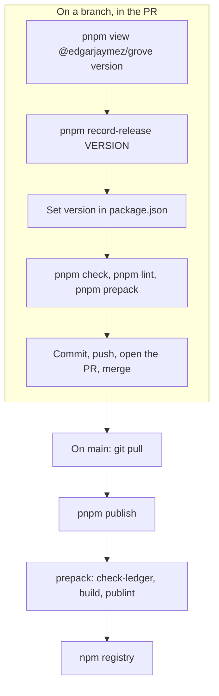
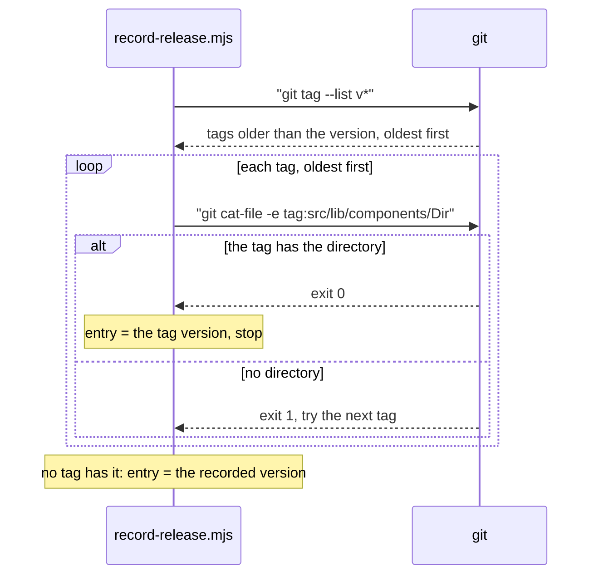

# 19 · Release

> **What you learn here**
>
> - Why no machine checks or publishes Grove, and how a release goes out by hand.
> - How the release ledger records the first version of each component, and how it uses git tags.
> - Which versions shipped, which version is next, and what its release notes must tell consumers.
>
> **Read first:** [18 · Build and package](18-build-and-package.md). **Time:** 30 minutes.
>
> Open work as of main @ e251d45, 2026-10-27.

A release puts a new version of `@edgarjaymez/grove` on npm. In this repo, a person does each step.

## Whiteboard

The diagram shows the release steps: the steps on a branch, the merge, and the publish from `main`.



The ledger step comes before the build checks. Then `check-ledger` in `prepack` passes on the same
branch.

## No CI

The repo has no GitHub Actions workflows: `.github/` holds only the issue template. Nothing runs on
a pull request or on a push, and nothing publishes by itself. The roadmap decision #54 D5 makes this
a rule: the checks run on the machine of the person who does the work.
<https://github.com/edgarjaymez/grove-lit/issues/54>

This has three results:

- Before you merge, run the checks yourself: `pnpm check`, `pnpm build`, the tests, and Prettier and
  ESLint on the paths that you changed. A PR description records the local results.
- GitHub can say that a PR has no conflict with `main`. That does not tell you that the tests pass.
  [21 · House rules and how work moves](21-house-rules-and-how-work-moves.md#mergeable-and-approved)
  explains it.
- A publish happens only when a person runs `pnpm publish`.

PRs merge on GitHub with a merge commit.

## Release by hand

Do these steps on a branch, as part of the PR:

1. Get the version on npm: `pnpm view @edgarjaymez/grove version`.
2. Compare it with `"version"` in `package.json`. If `package.json` is already ahead, publish that
   version. Do not increase it again.
3. Record the release in the ledger: `pnpm record-release <version>`.
4. If the version must change, edit `"version"` in `package.json`.
5. Run `pnpm check`.
6. Run `pnpm lint`. A failure in files that you did not touch is not part of the release.
7. Run `pnpm prepack`. It runs `check-ledger`, the build and `publint`.
8. Revert `src/lib/tokens/tokens.css` if the build changed it and you did not change a token.
9. Commit the ledger and the version.
10. Push the branch and open the PR.
11. Merge the PR on GitHub.

Then do these steps on `main`:

1. Run `git switch main`.
2. Run `git pull`.
3. Log in to npm with an account that has the right to publish the package.
4. Run `pnpm publish`.

By default, `pnpm publish` checks git first. The branch must be `main` or `master`, the work tree
must be clean, and the branch must be up to date with the remote.
[Source: pnpm, pnpm publish](https://pnpm.io/cli/publish) Thus a publish from a feature branch or
from a dirty tree stops before it starts. `pnpm publish` runs `prepack`, so the build and the checks
run again on `main`.
[22 · Cookbook](22-cookbook.md#recipe-10-release-by-hand) gives the same steps as a recipe.

> [!CAUTION]
> Do not run `pnpm publish` before the release PR is on `main`. The version on npm must match a
> commit on `main`.

## The release ledger

`components-since.json`, at the repo root, maps each component directory to the package version that
it first shipped in. The build copies it to `dist/components-since.json`. Thus a consumer can find
the components that are new since a version, with no network access.

`components-since.json`, the start:

```json
{
	"components": {
		"BackButton": "0.41.0",
		"Button": "0.28.0",
```

Two commands manage the ledger. `scripts/components-since.mjs` holds the shared logic.

**`pnpm record-release <version>`** runs `scripts/record-release.mjs`:

- It stops with an error when the version is not a semver version, for example `0.45` or `latest`.
- It stops with an error when the version is older than the newest version in the ledger.
- It adds an entry for each component directory that has none. It never changes an entry.
- It writes the keys in alphabetical order, with tabs, so each component is one line in a diff.
- When it has nothing to add, it prints `[grove] no new components; components-since.json unchanged`
  and leaves the file alone.

Thus you can run it again with no risk. The entry for a new directory is the version that you give,
or an earlier version that a git tag proves. [Dates from release tags](#dates-from-release-tags)
explains the second case.

**`pnpm check-ledger`** runs `scripts/check-ledger.mjs`. It fails in two cases:

- a directory under `src/lib/components/` has no entry. The message tells you to run
  `pnpm record-release <version>`;
- an entry has no directory. The message tells you to remove the entry.

It does not compare the entries with the version in `package.json`, because the version changes
later in the release than the ledger does. On `main`, it passes and prints
`[grove] components-since.json covers all 15 components`. It fails again when somebody adds a
component directory, until the next release records it. That failure is a reminder, not a fault.

`prepack` runs it first, so `pnpm prepack` fails in the same way. Between releases, use `pnpm build`
to check your work. `scripts/components-since.test.mjs` tests both commands.

Both commands count every directory under `src/lib/components/`, also a directory that git
ignores. When a browser test fails, Vitest writes a screenshot to
`src/lib/components/__screenshots__/`. `.gitignore` ignores that directory, so `git status` does not
show it. But `check-ledger` then fails on `__screenshots__`, and `record-release` adds an entry for
it.

> [!CAUTION]
> Run `rm -rf src/lib/components/__screenshots__` before `pnpm record-release` and before
> `pnpm prepack`. If you do not, the ledger can get a false entry.

### How a consumer reads the ledger

`dist/components-since.json` has no entry in `exports`. Node refuses an import of a path that
`exports` does not list.
[Source: Node.js, Package entry points](https://nodejs.org/api/packages.html#exports) Thus a
consumer reads the file by its path. `./package.json` is in `exports`, so a consumer can find the
package directory from it.

Example:

```js
import { readFileSync } from 'node:fs';
import { createRequire } from 'node:module';
import { dirname, join } from 'node:path';

const require = createRequire(import.meta.url);
const root = dirname(require.resolve('@edgarjaymez/grove/package.json'));
const { components } = JSON.parse(readFileSync(join(root, 'dist/components-since.json'), 'utf-8'));
// components.Tooltip === '0.45.0'
```

To find the components that are new since a version, compare each value with that version.
`compare()` in `scripts/components-since.mjs` compares the three numbers of two versions.

## Dates from release tags

Sometimes several releases go out and nobody records them. Then `record-release` must not give each
new component the version that it records now. It looks for the first release tag that contains the
component directory.

The sequence diagram shows how `record-release` finds the version for one new directory.



`components-since.mjs`, `firstRelease`:

```js
export const firstRelease = (dir, tags) => {
	for (const tag of tags) {
		try {
			execFileSync('git', ['cat-file', '-e', `${tag}:${COMPONENTS_DIR}/${dir}`], {
				stdio: 'ignore'
			});
			return tag.slice(1);
		} catch {
			// not in this tag — try the next
		}
	}
	return undefined;
};
```

The result is only as correct as the tags:

- `git cat-file -e` exits with status 0 only when the object exists.
  [Source: git, git cat-file](https://git-scm.com/docs/git-cat-file)
- It reads local tags. Run `git fetch --tags` before `record-release`.
- On 2026-10-27, `origin` has the tags v0.26.0 to v0.33.0 and v0.41.0 to v0.44.0. It has no tag
  between v0.33.0 and v0.41.0, and no v0.45.0 tag.
- npm has versions in that gap, for example 0.40.2. A component that first shipped in such a version
  gets 0.41.0, the first tag that has it.
- `Tooltip` is in no tag. Thus the release of 0.45.0 gave it `0.45.0`, the version that it recorded.

Check the tags with `git ls-remote --tags origin`.
[23 · Known drift](23-known-drift.md#leftovers-in-the-code) lists the gaps.

## The release train

| Version          | What happened                                                                                                                                                         |
| ---------------- | --------------------------------------------------------------------------------------------------------------------------------------------------------------------- |
| 0.41.0 to 0.44.0 | Published to npm on 2026-09-16. Each has a git tag and a GitHub Release                                                                                               |
| 0.45.0           | `package.json` changed to 0.45.0 on 2026-09-18. The ledger recorded it on 2026-10-07 (PR #62). npm received it on 2026-10-08. It has no git tag and no GitHub Release |
| 0.46.0           | The next minor. #68 plans its consumer notes for 0.46.0. No open PR changes `"version"` yet                                                                           |

npm shows `latest` as 0.45.0 on 2026-10-27. GitHub Releases stop at v0.44.0. Check with
`gh release list` and `pnpm view @edgarjaymez/grove version`.

The version names in old texts can mislead. PR #55 has a list with the title "Breaking (0.46.0)".
That list describes the release that shipped as 0.45.0. Thus "0.46.0" in PR #55 means 0.45.0, and
"0.46.0" in #68 means the next release.

A comment on #57 records the decision. Version 0.45.0 was
never published before, so the release counts from 0.44.0. It breaks the API, but it is a minor
release, because the major number is 0. <https://github.com/edgarjaymez/grove-lit/issues/57>

## Release notes

The repo has no `CHANGELOG` file, and 0.45.0 has no GitHub Release. The release notes of a version
are in its PRs. A consumer who updates must read them there.

For 0.45.0, the "Breaking" list of PR #55 tells consumers these changes:

- The events have new names: `input`, `change`, `toggle` and `back` are now `gv-input`, `gv-change`,
  `gv-toggle` and `gv-back`.
- `gv-todo-list-item` has `heading` in place of `title`.
- `componentReset`: `hidden` hides every `gv-*` host, and reduced motion makes changes instant.
- `gv-title` is 4 px taller on one line.
- `gv-icon` hides its glyph from assistive technology, unless `label` has a value.
- Slots: a light-DOM child next to the property now shows. Remove the property or the child.
- Controls draw the Grove focus ring in place of the browser's default indicator.
- `gv-checkbox` shows its slotted children as the label. In inline flow, the box aligns to the
  middle of the line. Without a tick, its line box is 2 px shorter.

<https://github.com/edgarjaymez/grove-lit/pull/55>

> [!IMPORTANT]
> **Open work: #57 — docs sweep for 0.45: release notes** (issue, open: behaviour on main, checks
> remain)
>
> The final pass of #57 asks for release notes for 0.45.0, written from the "Breaking" list of PR
> #55. They must tell consumers how to move from fallback children to slots. A comment on #57
> adds a paragraph on `componentReset`: the Lit components of a consumer that adopt `componentReset`
> get both host rules too. The notes must also say that "0.46.0" in PR #55 means 0.45.0. A later
> comment gives the note text for #50, for the minor after 0.46.0 or for 0.46.0 if both ship
> together. When the notes exist, link them from this section.
> <https://github.com/edgarjaymez/grove-lit/issues/57>

> [!IMPORTANT]
> **Open work: #68 — gv-button link mode and form association** (open PR, no conflict with main on
> 2026-10-27)
>
> The PR has a section "What changes for consumers (release note for 0.46.0)". The most important
> points:
>
> - `<gv-button type="submit">` now submits its form, and `type="reset"` resets it.
> - A page with a click bridge that calls `requestSubmit()` and does not cancel the click now
>   submits two times.
> - The button disables itself after its own submission. A page that handles `submit` itself must
>   set `disabled = false` when its request ends.
> - Enter in a text field submits through the first `type="submit"` `gv-button` when the form has no
>   native submit button.
> - `gv-button` gets `name`, `value`, `form`, `href`, `target`, `rel` and `hreflang`, and
>   `gv-menu-item` gets `target` and `rel`.
>
> The PR does not change `"version"`. When the PR lands, add these notes to the release that ships
> it, and change the 0.46.0 row of the release train table.
> [10 · Forms](10-forms.md#submit-and-reset-timing) explains the timing.
> <https://github.com/edgarjaymez/grove-lit/pull/68>

## See it in the code

| File                                | Look for                                                                    |
| ----------------------------------- | --------------------------------------------------------------------------- |
| `components-since.json`             | Fifteen entries, `Tooltip` at 0.45.0                                        |
| `scripts/components-since.mjs`      | `recordRelease`, `checkLedger`, `releaseTags`, `firstRelease`, `compare`    |
| `scripts/record-release.mjs`        | The semver check, the "older than" check, the message for no new components |
| `scripts/check-ledger.mjs`          | The two kinds of drift, and the comment about `package.json`                |
| `scripts/components-since.test.mjs` | The test of several unrecorded releases                                     |
| `package.json`                      | `version`, `record-release`, `check-ledger`, `prepack`                      |
| `.github/`                          | Only `ISSUE_TEMPLATE/`; no `workflows/`                                     |

## Sources

**Platform reference**

- [Node.js, Package entry points](https://nodejs.org/api/packages.html#exports). Read 2026-10-27.

**Tool docs**

- [pnpm, pnpm publish](https://pnpm.io/cli/publish). Read 2026-10-27.
- [git, git cat-file](https://git-scm.com/docs/git-cat-file). Read 2026-10-27.

## Check yourself

Do [Lesson 14 Build and release](syllabus.md#lesson-14-build-and-release) in the syllabus. Then
answer: a component first shipped in 0.40.2. Which version does `record-release` give it, and why?
Why does `pnpm prepack` pass on `main` today?

[← 18 · Build and package](18-build-and-package.md) · [Index](README.md) ·
[20 · Grove in an app →](20-grove-in-an-app.md)
