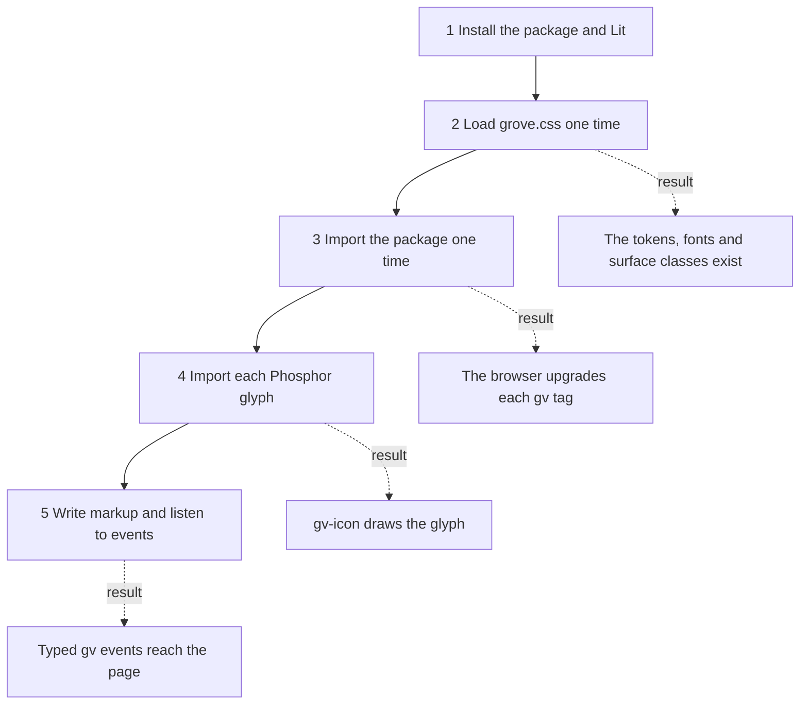
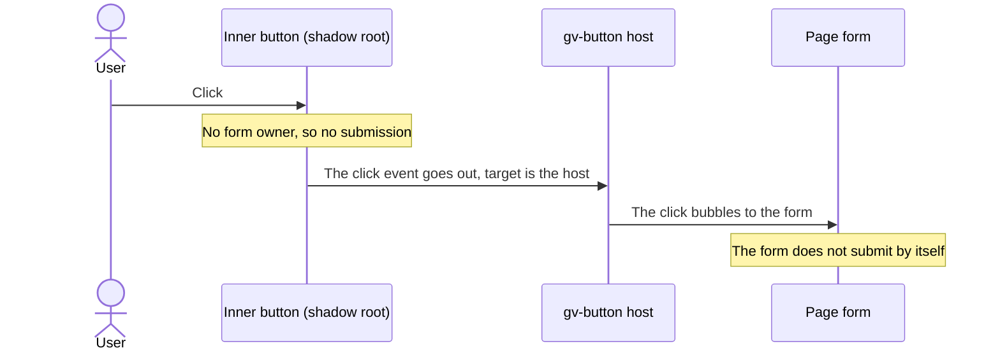

# 20 · Grove in an app

> **What you learn here**
>
> - How an app installs Grove, loads its CSS and registers the `gv-*` tags.
> - How to write attributes, properties and boolean attributes, and how to listen to Grove events.
> - What an app gets today for themes, forms and a render on a server, and what open work changes.
>
> **Read first:** [02 · Web components](02-web-components.md) and
> [03 · Lit essentials](03-lit-essentials.md). **Time:** 35 minutes.
>
> Open work as of main @ e251d45, 2026-10-27.

This chapter looks at Grove from the side of an app that uses it. The package name on npm is
`@edgarjaymez/grove`. The page that consumers read today is `src/stories/Home.mdx`, the Home page of
the Storybook. This chapter tells the same things in steps, and it adds the facts that `Home.mdx`
does not give.

## Whiteboard

The diagram shows the five things that an app does before a Grove component works, and the result
of each one.



If you skip step 2, the components show no Grove colours, spacing or fonts. If you skip step 3, the
tags stay plain unknown elements. If you skip step 4, an icon shows nothing.

## Install

Grove has one required peer dependency, `lit`, and one optional peer dependency,
`@phosphor-icons/webcomponents`. The bundle imports Lit and does not contain it. Thus the app must
install Lit itself.
[Source: npm Docs, package.json](https://docs.npmjs.com/cli/v11/configuring-npm/package-json/#peerdependencies)

`package.json`, the peer dependencies:

```json
	"peerDependencies": {
		"@phosphor-icons/webcomponents": "^2.1.5",
		"lit": "^3.0.0"
	},
	"peerDependenciesMeta": {
		"@phosphor-icons/webcomponents": {
			"optional": true
		}
	},
```

Do these steps in the app:

1. Install Grove and Lit:

   ```sh
   pnpm add @edgarjaymez/grove lit
   ```

   [Source: pnpm, pnpm add](https://pnpm.io/cli/add)

2. If the app shows icons, install Phosphor:

   ```sh
   pnpm add @phosphor-icons/webcomponents
   ```

   Each component that draws a glyph needs this package. Refer to
   [Phosphor glyphs](#phosphor-glyphs).

The `optional` flag means that the package manager does not ask for Phosphor. An app without icons
works without it.
[Source: npm Docs, peerDependenciesMeta](https://docs.npmjs.com/cli/v11/configuring-npm/package-json/#peerdependenciesmeta)

## Load the CSS

The components read design tokens through `var()`. The tokens are CSS custom properties on `:root`,
so the page must load them. [11 · Design tokens](11-design-tokens.md#what-a-token-is) tells what a
token is.

1. Import `grove.css` one time, in the entry module of the app:

   `src/stories/Home.mdx`, the install section:

   ```ts
   import '@edgarjaymez/grove/grove.css';
   ```

   Result: the page has the tokens, the fonts, the base styles, the typography and effect classes,
   the `gv-surface-*` classes and the `.visually-hidden` class.

`src/lib/styles/grove.css`:

```css
@import '../tokens/tokens.css';
@import '../fonts/fonts.css';
@import './globals.css';
@import './typography.css';
@import './effects.css';
@import './surfaces.css';
@import './a11y.css';
```

You can import only the tokens and the fonts. Then the components work, but the surface classes and
the utility classes do not exist:

Example:

```ts
import '@edgarjaymez/grove/tokens.css';
import '@edgarjaymez/grove/fonts.css';
```

The `exports` field of `package.json` lists every path that an app can import. The CSS paths are
`/grove.css`, `/tokens.css`, `/fonts.css` and `/fonts/*`.
[Source: npm Docs, exports](https://docs.npmjs.com/cli/v11/configuring-npm/package-json/#exports)
[13 · Themes and page CSS](13-themes-and-page-css.md#the-page-level-css) explains each file of
`grove.css`.

> [!CAUTION]
> Do not load `grove.css` inside a shadow root of your own. The page-level classes, such as
> `.gv-surface-brand-terrace`, apply only in the tree where the stylesheet is. The tokens on `:root`
> still reach every shadow root, because custom properties inherit.

## Register the elements

The package has one JavaScript entry, `dist/index.js`. When the app imports it, each
`@customElement` decorator in the bundle runs, and the browser registers all 15 tags.

1. Import the package one time, for its side effect, in the entry module of the app:

   Example:

   ```ts
   import '@edgarjaymez/grove';
   ```

   Result: the browser upgrades each `gv-*` element in the page, also the elements that were in the
   page before the import.

No document in the repo shows this line today. `Home.mdx` shows only the CSS import and a type
import. Issue #57 asks for a final check of every `Home.mdx` snippet.

These facts about the bundle are important for an app:

- **There is one entry.** The package has no entry for one component. The `.` entry of `exports`
  is the only JavaScript path. Thus `import '@edgarjaymez/grove'` registers all 15 tags, or none.
- **Lit is external.** The bundle contains `import … from 'lit'`, and the app resolves Lit from its
  own `node_modules`. Thus the page has one copy of Lit. The Lit guide "Publishing" recommends this
  for a library. [Source: Lit, Publishing](https://lit.dev/docs/v3/tools/publishing/)
- **The bundler keeps the import.** `sideEffects` in `package.json` marks every `.js` and `.css`
  file as a module with side effects. Thus the bundler of the app does not remove the bare import
  in a production build.
  [Source: webpack, Tree shaking (secondary)](https://webpack.js.org/guides/tree-shaking/#mark-the-file-as-side-effect-free)

`package.json`, `sideEffects`:

```json
	"sideEffects": [
		"**/*.css",
		"**/*.js",
		"./src/lib/components/**/*.ts"
	],
```

The third entry does not match anything in the published package. Refer to
[Known drift](23-known-drift.md#leftovers-in-the-code).

> [!CAUTION]
> Do not think that a type import registers a tag. TypeScript removes
> `import type { TextInput } from '@edgarjaymez/grove'` from the output. Keep the bare import also.

> [!CAUTION]
> Do not load two copies of Grove in one page. The browser accepts each tag name only one time.
> The second `customElements.define()` for the same name throws an error.
> [Source: HTML Standard, Custom elements](https://html.spec.whatwg.org/multipage/custom-elements.html)

> [!NOTE]
> **Lit box: the decorator registers the tag**
>
> `@customElement('gv-menu-item')` calls `customElements.define()` when the module loads. Thus the
> side-effect import is the registration. Grove example, `MenuItem.ts`:
> `@customElement('gv-menu-item')`.
>
> Lit docs: [Defining a component](https://lit.dev/docs/v3/components/defining/)

## Phosphor glyphs

`gv-icon` draws a glyph with a `ph-*` custom element from `@phosphor-icons/webcomponents`. Grove
does not register these elements. The app registers each glyph that it uses, with one import for
each glyph.

1. For each glyph that the app names, import its module:

   `src/stories/Home.mdx`, the Phosphor example:

   ```ts
   import '@phosphor-icons/webcomponents/PhTree'; // for name="tree"
   ```

   The module name is `Ph` and the glyph name in PascalCase. `name="arrow-left"` needs
   `PhArrowLeft`.

2. Import also the glyphs that the components draw when you do not name one. Each component lists
   them in the `phosphor` field of its metadata.

   `src/stories/Home.mdx`, the glyphs that components draw:

   ```ts
   // Always rendered
   import '@phosphor-icons/webcomponents/PhCheckCircle'; // gv-feedback-strip type="success"
   import '@phosphor-icons/webcomponents/PhWarningCircle'; // gv-feedback-strip type="danger"
   import '@phosphor-icons/webcomponents/PhInfo'; // gv-feedback-strip type="information"
   import '@phosphor-icons/webcomponents/PhCopy'; // gv-color-swatch
   // Defaults, when you leave out the icon attribute
   import '@phosphor-icons/webcomponents/PhArrowLeft'; // gv-back-button
   import '@phosphor-icons/webcomponents/PhTree'; // gv-icon-button, gv-todo-category-toggler, gv-todo-list-item
   import '@phosphor-icons/webcomponents/PhHouse'; // gv-menu-item
   import '@phosphor-icons/webcomponents/PhPalette'; // gv-title
   ```

   Result: each component draws its glyph.

`Home.mdx` also tells that an import of the Phosphor package root registers all 1,512 glyphs. It
works, but the app then ships every glyph.

**When a glyph is not registered**

- The icon draws nothing.
- In development, `gv-icon` logs one console warning for each tag. The warning starts with
  `[grove]`, names the import to add and, inside a component, names the host tag. It waits for the
  page `load` event and then for `GRACE_MS` (2000 ms), so that a late import does not cause a
  warning.
- In a production build, there is no warning. `warningsEnabled()` in `src/lib/utils/dev.ts` reads
  `process.env.NODE_ENV`. The bundler of the app replaces it with `"production"`.
- On a page without a bundler, for example a CDN import, `process` does not exist. Then the warning
  stays on.

`src/lib/components/Icon/phosphor.ts`, `missingGlyphMessage`:

```ts
return (
	`[grove] <${tag}> is not registered, so gv-icon ${value} renders nothing${inside}. ` +
	`Import it once in your app:\n  import '@phosphor-icons/webcomponents/${phosphorModule(sanitized)}';`
);
```

> [!TIP]
> Search the console of a development build for `[grove]`. Each line names one import to add.

The static Storybook is a production build, so it never shows this warning.
[18 · Build and package](18-build-and-package.md#the-node_env-rule) tells why Grove must not decide
`NODE_ENV` in its own build.

> [!IMPORTANT]
> **Open work: #64 — gv-icon glyph tests and the dist gate** (open PR, no conflict with main on
> 2026-10-27)
>
> The PR changes the warning so that it names every shadow host, the outermost first, and reports
> each tag one time only. Two tests keep the glyph lists in step with the metadata. One test reads
> the `Home.mdx` list above, and one test reads `src/test/browser-setup.ts`. A new build step,
> `scripts/check-dist.mjs`, fails when the bundle no longer reads `process.env.NODE_ENV`. When the
> PR lands, add the host chain to the list above, and tell that a test checks the `Home.mdx` list. <https://github.com/edgarjaymez/grove-lit/pull/64>

> [!IMPORTANT]
> **Open work: #47 — gv-icon decorative by default and the glyph warning** (issue, open: behaviour
> on main, checks remain)
>
> The warning and the decorative default are on `main`. The epic closes after #64 and after manual
> checks in Firefox, Safari, VoiceOver with Safari and NVDA with Chrome. When the epic closes,
> remove this box. <https://github.com/edgarjaymez/grove-lit/issues/47>

## Attributes and properties

An attribute is in the HTML markup. A property is a field on the element object. A Grove component
has one attribute for most of its properties. The two names are different when the property name has
more than one word.

- **Write attributes in kebab-case.** The HTML parser changes attribute names to lowercase. Thus
  `isActive` in markup becomes `isactive`, and Grove ignores it. The attribute is `is-active`.
- **Write properties in camelCase.** In JavaScript, set `item.isActive = true`.

This table lists every attribute that has a name different from its property, from
`dist/custom-elements.json` on `main`:

| Tag                        | Attribute          | Property          |
| -------------------------- | ------------------ | ----------------- |
| `gv-button`                | `aria-label`       | `ariaLabel`       |
| `gv-icon`                  | `is-filled`        | `isFilled`        |
| `gv-icon`                  | `fill-in-hover`    | `fillInHover`     |
| `gv-icon-button`           | `aria-label`       | `ariaLabel`       |
| `gv-menu-item`             | `is-active`        | `isActive`        |
| `gv-text-input`            | `input-id`         | `inputId`         |
| `gv-text-input`            | `aria-label`       | `ariaLabel`       |
| `gv-text-input`            | `aria-describedby` | `ariaDescribedby` |
| `gv-todo-category-toggler` | `is-selected`      | `isSelected`      |
| `gv-todo-list-item`        | `is-done`          | `isDone`          |
| `gv-tooltip`               | `is-pressed`       | `isPressed`       |

The package ships the manifest as `@edgarjaymez/grove/custom-elements.json`. Use it to find the
attribute names of each tag.
[15 · Metadata and the manifest](15-metadata-and-the-manifest.md#the-custom-elements-manifest)
describes it.

Some attributes do not change after the first render. `gv-text-input` does not reflect `value`, so
the `value` attribute keeps the start value while the user types. Read the current text from the
`value` property, or from the `detail` of `gv-input`.

Frameworks write to custom elements in different ways. Some set attributes, and some set
properties. The Lit docs describe the case of React.
[Source: Lit, React](https://lit.dev/docs/v3/frameworks/react/)

> [!NOTE]
> **Lit box: the attribute name of a property**
>
> By default, Lit uses the property name in lowercase as the attribute name. Grove sets the name by
> hand for each property with more than one word. Grove example, `MenuItem.ts`:
> `@property({ type: Boolean, attribute: 'is-active', reflect: true }) isActive = false;`
>
> Lit docs: [Reactive properties](https://lit.dev/docs/v3/components/properties/)

## Boolean attributes

A boolean attribute is true when it is present. Its value has no effect. Thus `is-done="false"` is
true. [Source: HTML Standard, Boolean attributes](https://html.spec.whatwg.org/multipage/common-microsyntaxes.html#boolean-attributes)

- To make a boolean false, remove the attribute, or set the property to `false`.
- In a Lit template, use the `?` binding: `?is-done=${done}`.
- In a framework template, pass `undefined` for false, never `false`.

Astro writes `{false}` on a custom element as the string `"false"`. Then the attribute is present,
and Grove reads it as true. `Home.mdx` shows the fix:

`src/stories/Home.mdx`, the boolean example:

```astro
<gv-menu-item label="Docs" href="/docs" is-active={isCurrent || undefined} />
```

The Astro types reject `false` on a boolean attribute. Refer to [Astro types](#astro-types).

> [!NOTE]
> **Lit box: boolean attributes**
>
> Lit converts a `Boolean` property from the attribute by presence only. An empty attribute and the
> value `"false"` both give `true`. Grove example, `ToDoListItem.ts`:
> `@property({ type: Boolean, attribute: 'is-done', reflect: true }) isDone = false;`
>
> Lit docs: [Boolean attributes](https://lit.dev/docs/v3/components/properties/#boolean-attributes)

## Listen to events

Every Grove event has a name that starts with `gv-`. Each one bubbles and has `composed: true`, so
it goes out of every shadow root. A listener on the element, on a `<form>` or on `document` receives
it. [Source: MDN, Event.composed](https://developer.mozilla.org/en-US/docs/Web/API/Event/composed)

| Event       | Tag                                | `detail`                      |
| ----------- | ---------------------------------- | ----------------------------- |
| `gv-back`   | `gv-back-button`                   | none; the event is cancelable |
| `gv-change` | `gv-checkbox`, `gv-todo-list-item` | `boolean`                     |
| `gv-change` | `gv-text-input`                    | `string`                      |
| `gv-copy`   | `gv-color-swatch`                  | `ColorSwatchCopyDetail`       |
| `gv-input`  | `gv-text-input`                    | `string`                      |
| `gv-toggle` | `gv-todo-category-toggler`         | `boolean`                     |

The types come with the package. `GroveEventMap` in `src/lib/events.ts` adds every Grove event to
the event maps of the DOM. Thus `addEventListener('gv-change', …)` has a typed `detail` with no
cast.

`src/stories/Home.mdx`, the events snippet:

```ts
import type { TextInput } from '@edgarjaymez/grove';
declare const field: TextInput;
field.addEventListener('gv-change', (e) => e.detail.trim()); // string
form.addEventListener('gv-input', (e) => e.detail); // string, from any gv-text-input
```

On `document`, `gv-change` has the type `CustomEvent<string | boolean>`, because three tags send it.
On an element reference, the type is exact. The package exports `CheckboxEventMap`,
`TextInputEventMap` and `ToDoListItemEventMap` for these overloads.

Obey these rules in an app:

- **Listen for `gv-input` and `gv-change`, not `input` and `change`.** `gv-text-input` stops the
  native events of its inner `<input>`. A form-level `change` listener never sees a Grove field.
- **Use `event.target` as the host.** The browser changes the target to the host when the event
  leaves the shadow root.
  [08 · Events](08-events.md#event-targets-across-shadow-roots) explains this.
- **Cancel `gv-back` to do your own navigation.** `gv-back-button` calls `history.back()` only when
  no listener calls `preventDefault()`.

Example:

```ts
document.addEventListener('gv-back', (e) => {
	e.preventDefault();
	router.back();
});
```

> [!NOTE]
> **Lit box: events from a component**
>
> A Lit component sends an event with `this.dispatchEvent()`. `composed: true` lets the event go
> out of the shadow root. Grove example, `Checkbox.ts`, `_toggle()`:
> `new CustomEvent('gv-change', { detail: this.checked, bubbles: true, composed: true })`.
>
> Lit docs: [Events](https://lit.dev/docs/v3/components/events/)

## Astro types

The build writes `dist/types/astro.d.ts` from the manifest. An Astro project can use it to check the
`gv-*` attributes in its templates.

1. Add this line to `src/env.d.ts` in the Astro project:

   `src/stories/Home.mdx`, the Astro snippet:

   ```ts
   /// <reference types="@edgarjaymez/grove/astro" />
   ```

2. Run `astro check`.

   Result: Astro rejects a camelCase attribute name, an unknown value such as `size="lg"` on
   `gv-menu-item`, and `false` on a boolean attribute.
   [Source: Astro Docs, TypeScript](https://docs.astro.build/en/guides/typescript/)

`scripts/generate-framework-types.mjs` writes the file. Boolean attributes accept only `true`.
Number attributes accept a number or a numeric string. The check does not find a misspelled dashed
name, such as `is-activ`, because TypeScript does not check extra properties with a dash in the
name. The comment at the top of the generated file tells this too.

`dist/types/astro.d.ts`, the start of the `gv-button` entry:

```ts
		'gv-button': HTMLAttributes & {
			'text'?: string | null | undefined;
			'variant'?: 'filled' | 'tonal' | 'outlined' | 'ghost' | null | undefined;
```

The `./astro` entry of `exports` has `types` only. It has no JavaScript.

## Themes in an app

Grove follows the colour scheme of the device. The page does not need a script for dark mode. [Source: MDN, prefers-color-scheme](https://developer.mozilla.org/en-US/docs/Web/CSS/Reference/At-rules/@media/prefers-color-scheme)

- **To pin a theme**, set `data-theme="light"` or `data-theme="dark"` on `<html>`.
- **To make a theme island**, set `data-theme` on any other element. The island gets a fresh
  Ground background and text colour in its theme. The focus ring in the island goes back to the
  Ground ring of that theme.
- **To print**, do nothing. Print is always light, also in an island.

`src/lib/styles/globals.css`:

```css
/* A `[data-theme]` island is a fresh Ground: it repaints the surface and resets inherited text. */
body,
[data-theme] {
	background-color: var(--semantic-color-surface-ground);
	color: var(--semantic-color-text-on-ground-base);
}
```

To paint a section of the page, use a `gv-surface-*` class from `grove.css`, for example
`class="gv-surface-brand-terrace"`. The class sets the background, the text colour and the focus
ring colour. The controls in the section then draw the ring of that surface.
[12 · Surfaces and elevation](12-surfaces-and-elevation.md#surface-classes) lists the classes.
[13 · Themes and page CSS](13-themes-and-page-css.md#theme-islands) explains islands.

## Forms in an app

On `main`, no Grove control takes part in a native form. The controls are not form-associated
custom elements. Their native `<input>` and `<button>` are in the shadow root, so they have no form
owner. [Source: HTML Standard, Form-associated custom elements](https://html.spec.whatwg.org/multipage/custom-elements.html#form-associated-custom-elements)

The sequence diagram shows what happens on `main` when the user clicks a `gv-button` with
`type="submit"` in a form.



Thus, on `main`:

- `<gv-button type="submit">` does not submit the form around it. `type="reset"` does not reset it.
- `<gv-text-input name="email">` does not add `email` to the form data.
- `<gv-checkbox>` adds nothing to the form data.

Do these steps to use Grove controls in a form on `main`:

1. Keep the values in the app. Listen for `gv-change` and `gv-input` on the `<form>`, one listener
   for all fields.
2. Put a native `<button type="submit">` in the form, or call `form.requestSubmit()` from a
   `gv-button` click.
3. In the `submit` listener, build the data from the values that step 1 keeps.

[10 · Forms](10-forms.md#forms-on-main-today) explains why the shadow root blocks the form.

> [!IMPORTANT]
> **Open work: #68 — gv-button link mode and form association** (open PR, no conflict with main on
> 2026-10-27)
>
> The PR makes `gv-button` a form-associated custom element, through the internal `FormControl`
> mixin. The maintainer plans it for 0.46.0. After it lands:
>
> - `type="submit"` submits the form, after validation and a cancelable `submit` event. The form
>   acts after the click has finished its propagation, so `preventDefault()` in any click listener
>   cancels it. `type="reset"` resets the form.
> - Enter in a text field submits through the first `type="submit"` gv-button, when the form has
>   no native submit button.
> - The button disables itself after its own submission and matches `:state(submitting)`.
> - `name`, `value` and `form="id"` work. With `href`, the button renders a real `<a>`.
>
> Two traps change app code. First, a page click handler that calls `requestSubmit()` and does not
> cancel the click now submits two times. Second, a page that handles `submit` itself
> (`preventDefault()` and `fetch`) must set `disabled = false` again when the request ends. If it
> does not, the button stays disabled. When the PR lands, remove step 2 above for `gv-button`, and
> add these two traps as steps. `gv-checkbox` and `gv-text-input` stay outside forms until #50 and
> #51 land. <https://github.com/edgarjaymez/grove-lit/pull/68>

## Render on a server

On `main`, Grove renders only in the browser. The HTML from a server contains the host tags and
their light DOM, for example the slotted text. The shadow root of each component, with its heading
element, link and icon, exists only after the browser runs the bundle.

Thus, in a framework that renders on a server, load Grove in the browser only. Astro bundles a
plain `<script>` tag, and the script runs in the browser.
[Source: Astro Docs, Scripts and event handling](https://docs.astro.build/en/guides/client-side-scripts/)

Example, in an Astro layout:

```astro
<script>
	import '@edgarjaymez/grove';
	import '@edgarjaymez/grove/grove.css';
</script>
```

Server code can import the bundle with no error. On 2026-10-27, an app on Node 25.9 imported the
packed tarball. After the import, `customElements.get('gv-button')` returned a class. The reason is
the `node` export condition of `@lit/reactive-element`: in Node, Lit loads a small DOM shim that
supplies `HTMLElement` and `customElements`.
[Source: Lit, Lit SSR DOM emulation](https://lit.dev/docs/v3/ssr/dom-emulation/) The import does
not render anything. It only registers the tags.

A render of a web component on a server uses Declarative Shadow DOM: a
`<template shadowrootmode="open">` element that the HTML parser turns into a shadow root.
[Source: HTML Standard, shadowrootmode](https://html.spec.whatwg.org/multipage/scripting.html#attr-template-shadowrootmode)
Lit renders this markup on a server with `@lit-labs/ssr`. On the client, the module
`@lit-labs/ssr-client/lit-element-hydrate-support.js` must load before `lit`.
[Source: Lit, Client usage](https://lit.dev/docs/v3/ssr/client-usage/)
Astro 5.0 deprecated the Astro integration `@astrojs/lit`.
[Source: Astro Docs, @astrojs/lit](https://docs.astro.build/en/guides/integrations-guide/lit/)

> [!NOTE]
> **Lit box: Lit on the server**
>
> Lit can render a component to HTML on a server. The server runs the constructor, `willUpdate()`
> and `render()`, but not `connectedCallback()` or `updated()`. Grove example, `Icon.ts`,
> `updated()`: `if (changed.has('name')) this._checkRegistration();`. Thus the glyph check stays in
> the browser.
>
> Lit docs: [Authoring components for Lit SSR](https://lit.dev/docs/v3/ssr/authoring/)

> [!IMPORTANT]
> **Open work: #56 — Lit SSR and Declarative Shadow DOM** (issue, not started)
>
> The spec asks for a server render of every component as Declarative Shadow DOM, with no hydration
> mismatch. It names the work: `gv-tooltip` uses `connectedCallback`, which does not run on the
> server; `gv-icon` renders `ph-*` elements; `SlotContent` reads the children in `hostConnected`.
> Its open decisions are a server entry, for example `@edgarjaymez/grove/ssr`, the framework
> integrations, and the glyphs on the server. `@lit-labs/ssr` is a labs package, so the spec asks
> for a version policy. When it lands, replace "load Grove in the browser only" with the server
> recipe. <https://github.com/edgarjaymez/grove-lit/issues/56>

## See it in the code

| File                                   | Look for                                       |
| -------------------------------------- | ---------------------------------------------- |
| `package.json`                         | `exports`, `sideEffects`, `peerDependencies`   |
| `src/stories/Home.mdx`                 | The install, glyph, boolean and event snippets |
| `src/lib/styles/grove.css`             | The seven `@import` lines                      |
| `src/lib/components/Icon/phosphor.ts`  | `missingGlyphMessage`, `GRACE_MS`              |
| `src/lib/utils/dev.ts`                 | `warningsEnabled()`                            |
| `src/lib/events.ts`                    | `GroveEventMap` and the `declare global` block |
| `scripts/generate-framework-types.mjs` | `attributeType()`, the boolean rule            |

## Sources

**Standards**

- [HTML Standard, Boolean attributes](https://html.spec.whatwg.org/multipage/common-microsyntaxes.html#boolean-attributes).
  Read 2026-10-27.
- [HTML Standard, Custom elements](https://html.spec.whatwg.org/multipage/custom-elements.html).
  Read 2026-10-27.
- [HTML Standard, Form-associated custom elements](https://html.spec.whatwg.org/multipage/custom-elements.html#form-associated-custom-elements).
  Read 2026-10-27.
- [HTML Standard, shadowrootmode](https://html.spec.whatwg.org/multipage/scripting.html#attr-template-shadowrootmode).
  Read 2026-10-27.

**Platform reference**

- [MDN, Event.composed](https://developer.mozilla.org/en-US/docs/Web/API/Event/composed). Read
  2026-10-27.
- [MDN, prefers-color-scheme](https://developer.mozilla.org/en-US/docs/Web/CSS/Reference/At-rules/@media/prefers-color-scheme).
  Read 2026-10-27.

**Tool docs**

- [Lit, Defining a component](https://lit.dev/docs/v3/components/defining/). Read 2026-10-27.
- [Lit, Reactive properties](https://lit.dev/docs/v3/components/properties/). Read 2026-10-27.
- [Lit, Boolean attributes](https://lit.dev/docs/v3/components/properties/#boolean-attributes).
  Read 2026-10-27.
- [Lit, Events](https://lit.dev/docs/v3/components/events/). Read 2026-10-27.
- [Lit, Publishing](https://lit.dev/docs/v3/tools/publishing/). Read 2026-10-27.
- [Lit, React](https://lit.dev/docs/v3/frameworks/react/). Read 2026-10-27.
- [Lit, Authoring components for Lit SSR](https://lit.dev/docs/v3/ssr/authoring/). Read
  2026-10-27.
- [Lit, Client usage](https://lit.dev/docs/v3/ssr/client-usage/). Read 2026-10-27.
- [Lit, Lit SSR DOM emulation](https://lit.dev/docs/v3/ssr/dom-emulation/). Read 2026-10-28.
- [npm Docs, package.json](https://docs.npmjs.com/cli/v11/configuring-npm/package-json/#peerdependencies).
  Read 2026-10-27.
- [npm Docs, peerDependenciesMeta](https://docs.npmjs.com/cli/v11/configuring-npm/package-json/#peerdependenciesmeta).
  Read 2026-10-27.
- [npm Docs, exports](https://docs.npmjs.com/cli/v11/configuring-npm/package-json/#exports). Read
  2026-10-27.
- [pnpm, pnpm add](https://pnpm.io/cli/add). Read 2026-10-27.
- [webpack, Tree shaking](https://webpack.js.org/guides/tree-shaking/#mark-the-file-as-side-effect-free),
  secondary: the source of the `sideEffects` field. Read 2026-10-27.
- [Astro Docs, TypeScript](https://docs.astro.build/en/guides/typescript/). Read 2026-10-27.
- [Astro Docs, Scripts and event handling](https://docs.astro.build/en/guides/client-side-scripts/).
  Read 2026-10-27.
- [Astro Docs, @astrojs/lit](https://docs.astro.build/en/guides/integrations-guide/lit/), deprecated
  in Astro 5.0. Read 2026-10-27.

## Check yourself

Do [Lesson 15 Use Grove in an app](syllabus.md#lesson-15-use-grove-in-an-app) in the syllabus. Then
answer these questions. Which import registers the tags? Why is `is-done="false"` true? Which event
must a form-level listener use for a Grove field? Why does the static Storybook show no glyph
warning?

[← 19 · Release](19-release.md) · [Index](README.md) ·
[21 · House rules and how work moves →](21-house-rules-and-how-work-moves.md)
