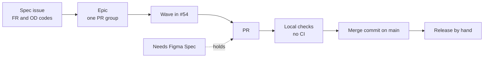
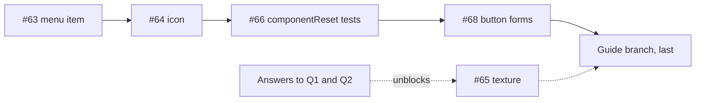

# 21 · House rules and how work moves

> **What you learn here**
>
> - The house rules that a reviewer checks in each change, as a checklist, with the tool that
>   checks each rule.
> - The five roadmap decisions of #54 as rules, and the codes that issues use for requirements and
>   decisions.
> - How work moves from a spec to a merged PR, and what "mergeable" means in a repo with no CI.
> - The merge order of the open PRs.
>
> **Read first:** [04 · Anatomy of a component](04-anatomy-of-a-component.md). **Time:** 30
> minutes.
>
> Open work as of main @ e251d45, 2026-10-27.

Use the first half of this chapter as a review checklist. Each rule names the file or the test that
checks it, when one exists. A rule with no tool is a rule that a reviewer checks by eye.

## Whiteboard

The diagram shows how a piece of work moves, from an issue to `main`.



The rest of the chapter explains each box. The first six sections are the house rules.

## Names

- [ ] The directory and the class use PascalCase: `src/lib/components/MenuItem/`, `MenuItem`.
- [ ] The tag uses `gv-` and kebab-case: `gv-menu-item`.
- [ ] The files in the directory are `Name.ts`, `Name.metadata.ts`, `Name.stories.ts` and,
      when needed, `Name.browser.test.ts`. There is no per-component `index.ts`.
- [ ] No property has the name `title`. A component with a heading and a body text uses `heading`
      and `message`. `title` is a global HTML attribute, so a `title` property also shows a native
      tooltip on the host.
- [ ] Each event name starts with `gv-`. Refer to [Events](#events).

The metadata export of a component has the name of the class and `Metadata`, for example
`ButtonMetadata`.
[15 · Metadata and the manifest](15-metadata-and-the-manifest.md#component-metadata) describes it.

## Properties and attributes

- [ ] A property with more than one word sets its attribute name in kebab-case by hand:
      `attribute: 'is-selected'`. If you do not, Lit listens for `isselected`, and the markup
      `is-selected` does nothing. The manifest check fails when an `attribute:` name is not in the
      manifest.
- [ ] `disabled` and each toggled state use `reflect: true`, so CSS in the page can select
      `gv-button[disabled]`.
- [ ] A boolean property has the default `false`.
- [ ] An ARIA property has the type `string | null` and the default `null`. The template writes it
      with `?? nothing`.
- [ ] An optional string has the type `string | undefined`. The template writes it with
      `ifDefined()`.
- [ ] A property with a fixed set of values has a type alias above the class, for example
      `type ButtonSize = 'lg' | 'md' | 'sm';`.
- [ ] The properties come before `static styles`, and `static styles` comes before the methods.
- [ ] The JSDoc tags `@slot`, `@fires {CustomEvent<T>}` and `@cssprop` agree with the code.
      `pnpm build` fails when they do not.

`ToDoCategoryToggler.ts`, the toggled state:

```ts
	@property({ type: Boolean, attribute: 'is-selected', reflect: true }) isSelected = false;
```

`TextInput.ts`, an optional string and an ARIA property:

```ts
	@property({ type: String }) placeholder: string | undefined;
	@property({ type: String, attribute: 'input-id' }) inputId: string | undefined;
	@property({ type: String }) name: string | undefined;
	@property({ type: String }) type: InputType = 'text';
	@property({ type: String, attribute: 'aria-label' }) ariaLabel: string | null = null;
```

> [!NOTE]
> **Lit box: the attribute option**
>
> The `attribute` option of `@property` sets the name of the attribute that Lit observes. Without
> it, Lit uses the property name in lowercase. Grove example, `ToDoListItem.ts`:
> `@property({ type: Boolean, attribute: 'is-done', reflect: true }) isDone = false;`
>
> Lit docs: [Reactive properties](https://lit.dev/docs/v3/components/properties/)

> [!IMPORTANT]
> **Open work: #50 — accessible names across the shadow boundary** (branch, no PR)
>
> The work branch, which epic #50 links, replaces the rule for ARIA properties. Its new rule: never
> declare a property with the name of an ARIA attribute, such as `ariaLabel`. That property hides
> the built-in ARIA reflection of the element (#50 R6), and the host stays named. Name a control
> with `label` and describe it with `description`, with helpers in
> `src/lib/utils/accessible-name.ts`. The branch waits for #68. When it lands, replace the ARIA
> rule in this checklist. <https://github.com/edgarjaymez/grove-lit/issues/50>

## Styles

- [ ] `static styles` is an array. `componentReset` comes first. In an interactive component,
      `focusRing` comes second. The own `css` of the component comes last.
- [ ] A block-level component has `:host { display: block; }` as the first rule of its `css`.
- [ ] The selectors are flat. There is no CSS nesting.
- [ ] Each colour, spacing, radius, shadow and font value is a token, through `var()`.
- [ ] Typography uses the `font` shorthand with a composite token, and a separate
      `letter-spacing` token. Never set `font-size`, `line-height` or `font-family` alone.
- [ ] A control sets its shadow through `--_drop`, never through `box-shadow` directly. The focus
      ring stacks on top of `--_drop`.
- [ ] The focusable element inside the shadow root has the class `gv-focusable`.
- [ ] No rule has `outline: none` or `outline: 0`. `src/lib/styles/focus.test.ts` fails on it.
- [ ] A private custom property starts with `--_`. A public one starts with `--gv-` and has a
      `@cssprop` tag in the JSDoc.

`Checkbox.ts`, the label rule:

```css
.label {
	min-width: 0;
	font: var(--typography-single-line-base-base);
	letter-spacing: var(--letter-spacing-base);
}
```

`src/lib/styles/focus.test.ts`, the outline check:

```ts
expect(text).not.toMatch(/outline(-style)?\s*:\s*(none|0)\b/);
```

[06 · Styles inside a component](06-styles-inside-a-component.md#rules-for-css-inside-a-component)
explains each rule.
[14 · The focus ring](14-the-focus-ring.md#checklist-for-a-new-interactive-component) has the focus
ring checklist.

## Exports

- [ ] Each new component is in both export lists. `src/lib/components/index.ts` has
      `export * from './Name/Name.js';`, in alphabetical order. `src/lib/index.ts`, the package
      entry, exports the class, its `*Metadata` and its public types by name.
- [ ] A component that is not in `src/lib/index.ts` is not in the package. It is also not in
      `groveTags` (`src/test/grove-tags.ts`), so the shared browser tests skip it.
- [ ] Each import path ends in `.js`, also when the file ends in `.ts`.
- [ ] A component that renders a different Grove tag imports it for its side effect:
      `import '../Icon/Icon.js';`.
- [ ] Each component file ends with its `HTMLElementTagNameMap` entry.

`src/test/grove-tags.ts`:

```ts
/** Every custom element the public entry registers, read from the registry so new components are covered. */
export const groveTags = Object.values(grove)
	.map((value) =>
		typeof value === 'function' ? customElements.getName(value as CustomElementConstructor) : null
	)
	.filter((tag): tag is string => !!tag)
	.sort();
```

[01 · Repo map](01-repo-map.md#the-two-export-lists) explains the two export lists.

## Events

- [ ] Each event is a `CustomEvent` with a `gv-*` name and `{ bubbles: true, composed: true }`.
- [ ] `cancelable: true` is only on an event that guards a default action, such as `gv-back`.
- [ ] The class JSDoc has `@fires {CustomEvent<T>} gv-name - description`. `pnpm build` fails when
      a dispatched event has no typed `@fires` tag.
- [ ] The event is in `GroveEventMap` in `src/lib/events.ts`.
- [ ] When two tags send the same event with different `detail` types, each tag has its own
      `*EventMap` with listener overloads. `Checkbox.ts`, `CheckboxEventMap` is the model.
- [ ] A component that forwards the event of a child calls `e.stopPropagation()` on the child event
      first. Then it dispatches its own event.
- [ ] A component that wraps a native input stops `input` and `change`, and dispatches `gv-input`
      and `gv-change`.

`Checkbox.ts`, `_toggle()`:

```ts
	private _toggle() {
		this.checked = !this.checked;
		this.dispatchEvent(
			new CustomEvent('gv-change', { detail: this.checked, bubbles: true, composed: true })
		);
	}
```

[08 · Events](08-events.md#the-event-rules) explains the three patterns.

## Generated files

A tool writes these files. Never edit them by hand.

| File                        | Tool that writes it                                      | What to do instead                                       |
| --------------------------- | -------------------------------------------------------- | -------------------------------------------------------- |
| `src/lib/tokens/tokens.css` | `pnpm build-tokens` (Terrazzo)                           | Edit the JSON under `src/lib/tokens/`, then build tokens |
| `src/.ai/`                  | The generated AI index, which the maintainer regenerates | Ask the maintainer to regenerate it                      |
| `dist/`                     | `pnpm build`                                             | Change the source, then build                            |
| `dist/custom-elements.json` | `cem analyze`                                            | Change the JSDoc tags or the properties                  |
| `dist/types/astro.d.ts`     | `scripts/generate-framework-types.mjs`                   | Change the properties                                    |

`tokens.css` and `src/.ai/` are in git. `dist/` is in `.gitignore`. `pnpm build` can rewrite
`tokens.css` when no token source changed.
[Recipe 11](22-cookbook.md#recipe-11-undo-churn-in-the-generated-tokens) tells how to undo that.

The ledger, `components-since.json`, is not generated. `pnpm record-release <version>` adds entries
to it, and you commit it with the release.
[19 · Release](19-release.md#the-release-ledger) explains it.

## The roadmap decisions

Epic #54 records five decisions from 2026-09-28. They are rules for new work.

| Code   | Rule                                                                                                                                                                                  |
| ------ | ------------------------------------------------------------------------------------------------------------------------------------------------------------------------------------- |
| #54 D1 | Visible text in the slot names a control. `label` is always an invisible name, for an icon-only control. A form control is also form-associated, so a `<label>` in the page names it. |
| #54 D2 | One `GroveSurface` type, with the token names, is an explicit property. Aurora is a surface for a short time only (a highlight, hover or press), never a container at rest.           |
| #54 D3 | Each focusable control uses the `--ring-on-*` tokens (Path A). The tokens stay public.                                                                                                |
| #54 D4 | Components that show text take it through slots, with the string property as the fallback. Server rendering follows in its own spec.                                                  |
| #54 D5 | The checks run on your computer only. There is no CI. Fix known violations first, with no baselines. The a11y gate is report-only until #46 and #50 land.                             |

What is on `main` for each decision:

- **#54 D1.** On 2026-10-08, #21 and #50 set an order: visible text first, then a page label, then
  `label`. With none of them, the control has no name, and a development warning shows one time
  for each tag. This order is on the #50 branch, not on `main`.
- **#54 D2.** It shipped as `src/lib/surfaces.ts`, with 21 values.
- **#54 D3.** It shipped with #22 (closed).
- **#54 D4.** The slots shipped with #34 (closed). The render on a server is #56, and nobody has
  started it.
- **#54 D5.** `pnpm test` runs the unit, browser and Storybook projects. The Storybook a11y check
  is `test: 'todo'` in `.storybook/preview.ts`.

> [!IMPORTANT]
> **Open work: #54 — roadmap of PR groups, branches and waves** (issue, open: behaviour on main,
> checks remain)
>
> The epic stays open until its last wave closes. Most specs of wave 1 are on `main`. Wave 2 has
> three open PRs (#64, #65 and #68), and #29 and #30 wait. Waves 3 to 5 wait for #68, for #50 and
> for answers from the Figma design.
>
> The epic body names a branch for each PR group. Nobody made many of those branches. Find the work
> through the PR or the epic link, not through the branch name. When a wave closes, update this box.
> <https://github.com/edgarjaymez/grove-lit/issues/54>

## How work moves

Work in Grove moves through five levels. Each level is a GitHub issue or a PR.

1. **Spec.** An issue with `[Spec]` in its title describes one change. The repo has a Markdown form
   for a spec: context, inputs, functional requirements, files, open decisions. Each functional
   requirement has a code, for example `#14 FR-01`. Each open decision has a code, for example
   `#40 OD2`.
2. **Epic.** An issue with `[Epic]` in its title groups specs into one PR group. The specs are
   sub-issues of the epic. Each spec has exactly one parent. For example, epic #49 groups #14 and
   #40.
3. **Wave.** Epic #54 puts the PR groups in five waves. The groups in one wave can go in parallel.
   A later wave waits for the groups that it needs.
4. **PR group.** One PR group becomes one PR. Epic #54 groups 31 specs (#14 to #44) into 23 PRs.
   The 23 PRs are 9 group epics, 12 single-spec PRs, one PR for the typings and one docs sweep.
5. **PR.** The PR names its epic and the FR codes that it covers. It says `Closes #N` for each spec
   that it completes.

These chains set the order of the work. An arrow means "lands before":

- #33 (the test harness) comes before every browser test.
- #49 → #50 → #51 → #17. #68 is the PR for #49.
- #49 → #44, because both change `Button.ts`.
- #66 → #67 and #66 → #30. #66 adds the `AT_REST` table, and #67 and #30 change durations
  that the table pins.

The maintainer merges a PR on GitHub with a merge commit. A release goes out by hand from `main`.
[19 · Release](19-release.md#release-by-hand) tells how.

### Checks before you open a PR

There is no CI, so you run each check yourself. Run these checks before you call a change done:

1. Run `pnpm check`. It type-checks `src/`, also the event type fixtures in
   `src/test/events.types.ts`.
2. Run `pnpm build`. It runs the manifest check. Then undo the churn in `tokens.css`, if you did
   not change a token.
3. Run the tests that cover your change. [17 · Tests](17-tests.md#commands) lists the commands.
4. Run Prettier and ESLint on the files that you changed only.

> [!CAUTION]
> Do not run `prettier --write .` or `pnpm format` to make `pnpm lint` pass. `pnpm lint` checks the
> whole repo, so it can fail on files that you did not touch. A write over the whole repo changes
> unrelated files. Use [Recipe 9](22-cookbook.md#recipe-9-format-and-lint-only-what-you-touched).

The format rules are in `.prettierrc`: tabs, single quotes, no comma after the last item and 100
characters for each line. ESLint includes `eslint-plugin-lit`, for mistakes in templates, and
`eslint-plugin-lit-a11y`, for accessibility in templates.

`.prettierrc`:

```json
{
	"useTabs": true,
	"singleQuote": true,
	"trailingComma": "none",
	"printWidth": 100,
	"plugins": []
}
```

## Decision codes

Issues use short codes for requirements and decisions. Many issues use the same letters. Thus
always write the code with its issue number.

| Code form | What it is                             | Example                                                 |
| --------- | -------------------------------------- | ------------------------------------------------------- |
| `FR-NN`   | A functional requirement in a spec     | `#14 FR-10`: native activation of the link              |
| `FR-DTn`  | A dark-theme requirement in a spec     | `#20 FR-DT1`: the night grain source                    |
| `ODn`     | An open decision in a spec             | `#40 OD2`: activation in the next task                  |
| `Dn`      | A roadmap decision                     | `#54 D1`: the rule for names                            |
| `Cn`      | A composition rule for forms and slots | `#49 C1`: form association follows the DOM tree         |
| `Ln`      | A link mode rule                       | `#49 L2`: a link never submits                          |
| `Sn`      | A rule for Enter in a form             | `#49 S2`: skip buttons that are not rendered            |
| `Rn`      | A review result                        | `#50 R6`: an `ariaLabel` property hides ARIA reflection |
| `Fn`      | A review result for the text field     | `#51 F3`: a required field that is not rendered         |

Write `#49 C1`, not `C1`. Write `#40 OD2`, not `OD2`. The topic index lists the codes that this
guide uses.

## Needs Figma Spec

`Needs Figma Spec` is a GitHub label. It means that the item waits for an answer from the Figma
design. On 2026-10-27, these open items have the label: #15, #16, #17, #18, #19, #27, #29, #39, #44
and PR #65.

The rule for a PR comes from a comment on #65:

> Rule from the maintainer: a PR with a Figma dependency waits until the dependency is answered,
> and the need is documented.

Thus a PR with this label gets no review fixes and no merge until the Figma question has an answer.
The answer goes on the issue or the PR, so that the next reader can find it.

> [!IMPORTANT]
> **Open work: #65 — gv-texture colour variants and the night grain** (open PR, no conflict with
> main on 2026-10-27)
>
> The PR has the label `Needs Figma Spec` and waits for two answers. Q1: does the Nightwood branch
> of the Grove Figma library define a night grain (#20 FR-DT1)? Q2: does Grove copy the `color`
> variant of the Figma Texture set, or does it keep `tint` as its only colour API?
>
> Two review threads, marked as blockers, wait for these answers. The PR says `Closes #20`, so a
> merge now closes #20 with FR-DT1 still open. The Figma file could not be checked at the time. When
> both answers are on the PR, remove #65 from the label list above.
> <https://github.com/edgarjaymez/grove-lit/pull/65>

## Mergeable and approved

This repo has no CI. No workflow runs on a PR or on a push. Thus two words on GitHub mean less than
they mean in other repos.

- **"Mergeable".** GitHub shows that a PR has no conflict with `main`. That is all. It does not
  mean that the tests pass. It is also only true for the time when GitHub last computed it.
  [Source: GitHub Docs, Merge conflicts](https://docs.github.com/en/pull-requests/reference/merge-conflicts)
- **Conflicts between open PRs.** Each open PR can merge into `main` with no conflict, and still
  conflict with a different open PR. On 2026-10-27, the five open PRs change 12 of the same files.
- **"Approved".** No open PR has an approval. The cross-PR review of 2026-10-08 was automated. It
  is a set of comments, not an approval.

These are the 12 files that more than one open PR changes:

| File                                                         | PRs                       |
| ------------------------------------------------------------ | ------------------------- |
| `.storybook/preview.ts`                                      | #63, #68                  |
| `DESIGN_SYSTEM.md`                                           | #63, #65, #66, #68        |
| `docs/01-repo-map.md`                                        | #64, #68                  |
| `docs/07-metadata-manifest-and-ai-tooling.md`                | #64, #68                  |
| `docs/08-storybook-and-tests.md`                             | #63, #64, #68             |
| `docs/10-cookbook.md`                                        | #64, #66, #68             |
| `docs/11-known-drift.md`                                     | #63, #68                  |
| `src/lib/components/FeedbackStrip/FeedbackStrip.metadata.ts` | #64, #68                  |
| `src/lib/components/MenuItem/MenuItem.metadata.ts`           | #63, #68                  |
| `src/lib/components/MenuItem/MenuItem.stories.ts`            | #63, #68                  |
| `src/lib/utils/link-attributes.test.ts`                      | #63, #68                  |
| `src/test/shadow.ts`                                         | #64, #66 (the same bytes) |

#68 contains #63 through a merge commit (`48c00a8`). Thus many of the #63 and #68 overlaps are the
same lines.

> [!CAUTION]
> Do not merge a PR only because GitHub shows "mergeable". Check it out at its head commit and run
> the checks first. [Recipe 15](22-cookbook.md#recipe-15-review-and-land-an-open-pr-locally) tells
> how.

## Merge order

The recommended merge order is the merge train. It keeps each conflict small and lets each PR land
on the code that it expects.

The diagram shows the merge train.



1. Merge #63. It is small, and #68 contains it.
2. Merge #64.
3. Merge #66. It adds `src/test/shadow.ts` with the same bytes as #64, so git sees no conflict.
4. Merge #68. Its #63 commits are already on `main`.
5. Merge #65 only after Q1 and Q2 have answers. Refer to [Needs Figma Spec](#needs-figma-spec).
6. Merge the guide branch last. Rebase it one time over the merged PRs.
   [Recipe 16](22-cookbook.md#recipe-16-rebase-the-guide-over-merged-prs) tells how.

If #68 merges before #63, it brings the commits of #63 with it. Then check the state of #63 on
GitHub, and close it if it is still open.

> [!IMPORTANT]
> **Open work: #63 — gv-menu-item a11y check and metadata** (open PR, no conflict with main on
> 2026-10-27)
>
> First in the train. When it lands, mark step 1 as done.
> <https://github.com/edgarjaymez/grove-lit/pull/63>

> [!IMPORTANT]
> **Open work: #64 — gv-icon glyph tests and the dist gate** (open PR, no conflict with main on
> 2026-10-27)
>
> Second in the train. When it lands, mark step 2 as done.
> <https://github.com/edgarjaymez/grove-lit/pull/64>

> [!IMPORTANT]
> **Open work: #66 — componentReset tests for hidden and reduced motion** (open PR, no conflict with
> main on 2026-10-27)
>
> Third in the train. It adds the `AT_REST` table that #67 and #30 need. A focus ring test failed 2
> of 17 full runs on its branch, under full parallel load. When it lands, mark step 3 as done.
> <https://github.com/edgarjaymez/grove-lit/pull/66>

> [!IMPORTANT]
> **Open work: #68 — gv-button link mode and form association** (open PR, no conflict with main on
> 2026-10-27)
>
> Fourth in the train. It contains #63. The maintainer plans it for 0.46.0. When it lands, mark step
> 4 as done, and start the #50 branch on the new `main`.
> <https://github.com/edgarjaymez/grove-lit/pull/68>

## See it in the code

| Item                                      | Look for                                          |
| ----------------------------------------- | ------------------------------------------------- |
| `src/lib/components/Checkbox/Checkbox.ts` | The `@fires` tag, `_toggle()`, `CheckboxEventMap` |
| `src/lib/styles/focus.test.ts`            | The `outline` check                               |
| `src/test/grove-tags.ts`                  | `groveTags`                                       |
| `.prettierrc`                             | The format rules                                  |
| Issue #54                                 | The decisions, the PR groups and the waves        |
| PR #65, the comments                      | The rule for a PR with a Figma dependency         |

## Sources

All other facts in this chapter come from the repo, its issues and its PRs.

**Tool docs**

- [Lit, Reactive properties](https://lit.dev/docs/v3/components/properties/). Read 2026-10-27.
- [GitHub Docs, Merge conflicts](https://docs.github.com/en/pull-requests/reference/merge-conflicts).
  Read 2026-10-27.

## Check yourself

Do [Lesson 16 Capstone](syllabus.md#lesson-16-capstone) in the syllabus. Then answer these: why
`#49 C1` and not `C1`, what "mergeable" tells you in this repo, and why #65 waits.

[← 20 · Grove in an app](20-grove-in-an-app.md) · [Index](README.md) ·
[22 · Cookbook →](22-cookbook.md)
