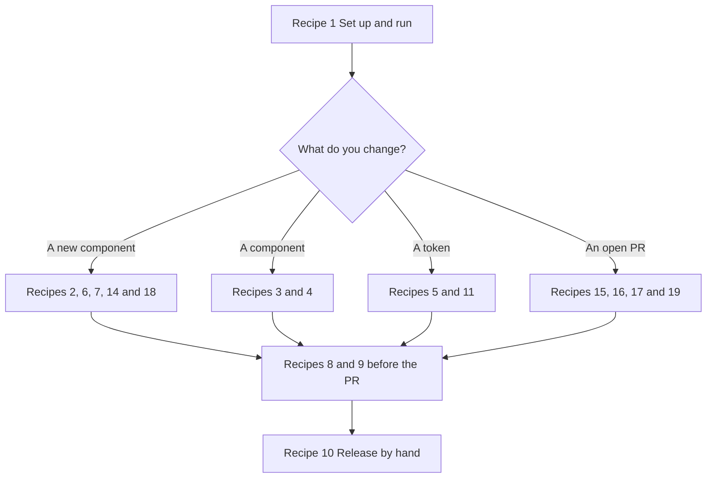

# 22 · Cookbook

> **What you learn here**
>
> - Step-by-step procedures for the tasks of your first weeks in this repo.
> - The result of each step, and the failure that shows when you skip a step.
> - How to review an open PR, land it, and rebase this guide after it.
>
> **Read first:** [21 · House rules and how work moves](21-house-rules-and-how-work-moves.md).
> **Time:** use it as a reference. Each recipe takes 5 to 30 minutes.
>
> Open work as of main @ e251d45, 2026-10-27.

Each recipe is a numbered procedure. A caution comes before the step that it applies to. The result
of a step comes after it. Each recipe links to the chapter that explains why.

## Whiteboard

The diagram shows which recipes you use for each kind of change.



## Recipe 1 Set up and run

1. Install Node 20 or newer, and pnpm. `package.json` sets `"node": ">=20"` in `engines`.
2. Install the dependencies:

   ```sh
   pnpm install
   ```

   Result: `node_modules/` exists.

   In a fresh clone, pnpm 12.4.2 can stop with the error `ERR_PNPM_IGNORED_BUILDS` for
   `rs-module-lexer`. The packages install, but pnpm also adds a line for `rs-module-lexer` to
   `pnpm-workspace.yaml`. [23 · Known drift](23-known-drift.md#leftovers-in-the-code) tells why.

> [!CAUTION]
> Discard the new line in `pnpm-workspace.yaml` before you commit. Run
> `git checkout -- pnpm-workspace.yaml`. A change to the build allowlist is a decision for a
> separate PR.

> [!CAUTION]
> Do not skip step 3. Without Chromium, the `browser` and `storybook` test projects cannot start a
> browser, and `pnpm test` fails.

3. Install the browser for the tests:

   ```sh
   pnpm exec playwright install chromium
   ```

4. Start Storybook:

   ```sh
   pnpm storybook
   ```

   Result: Storybook runs on <http://localhost:6006>.

[16 · Storybook](16-storybook.md#dev-and-static-builds) tells the difference between the dev and
the static builds.

## Recipe 2 Add a component

In this recipe, the new component is `gv-badge`.

1. Create `src/lib/components/Badge/Badge.ts`. Copy the form of `Button.ts`:
   `@customElement('gv-badge')`, `export class Badge extends LitElement`,
   `static styles = [componentReset, …]` and the `HTMLElementTagNameMap` entry at the end.
   [04 · Anatomy of a component](04-anatomy-of-a-component.md#stop-4-registration-and-the-class)
   shows each part.
2. If the component is interactive, add `focusRing` after `componentReset`. Put `gv-focusable` on
   the focusable element. Refer to
   [Recipe 14](#recipe-14-add-an-interactive-surface-aware-component).
3. If the component shows text, add a slot with a fallback prop through `SlotContent`. Add a `@slot`
   JSDoc tag. [07 · Slots](07-slots.md#the-slotcontent-controller) explains this.
4. If the component dispatches events, do [Recipe 4](#recipe-4-add-an-event).

> [!CAUTION]
> Do not skip step 5. Without the metadata, `slots.browser.test.ts` fails for the slot that the
> component renders. If the slot list differs from the `@slot` tags, `pnpm build` fails with
> `composition.slots … differ from <gv-badge>'s @slot tags`.

5. Create `Badge.metadata.ts`. Export `BadgeMetadata` with `satisfies ComponentMetadata`. Copy a
   different metadata file and replace every section. List the same slots as the `@slot` tags. List
   the glyphs that the component draws in `phosphor`.
6. Create `Badge.stories.ts`. Refer to [Recipe 6](#recipe-6-add-a-story).
7. Add `export * from './Badge/Badge.js';` to `src/lib/components/index.ts`, in alphabetical order.

> [!CAUTION]
> Do not skip step 8. Without it, the component is not in the package, and `groveTags` does not
> include it. Then the shared browser tests (slots, `hidden`, reduced motion) skip it and give no
> error.

8. Add the class, `BadgeMetadata` and each public type to `src/lib/index.ts`.
9. Raise the component count of 15 in `src/lib/components/metadata.test.ts` and in
   `src/lib/styles/host-hidden.browser.test.ts`.

   Result: both tests pass again. They fail until you change the count.

> [!CAUTION]
> Do not skip `pnpm build` in step 10. `pnpm check` and `pnpm test` do not run the manifest check.
> Only `pnpm build` runs it.

10. Run `pnpm check`, `pnpm build` and `pnpm test`.

    Result: all three pass.

After this recipe, `pnpm check-ledger` fails, and thus `pnpm prepack` fails also. This is
correct. The new component has no ledger entry until the next release records it.
[19 · Release](19-release.md#the-release-ledger) explains this.

> [!IMPORTANT]
> **Open work: #64 — gv-icon glyph tests and the dist gate** (open PR, no conflict with main on
> 2026-10-27)
>
> The PR adds two checks to this recipe. A default or fixed glyph of the new component must also go
> into the `Home.mdx` glyph list and into `src/test/browser-setup.ts`. `glyphs.browser.test.ts`
> fails when the glyphs that the component draws differ from its `phosphor` field.
> `metadata.test.ts` fails when a list differs from the metadata. A component that is not in
> `groveTags` then makes `glyphs.browser.test.ts` fail, because its metadata has no pair. When the
> PR lands, add these to step 5 and to the caution of step 8.
> <https://github.com/edgarjaymez/grove-lit/pull/64>

> [!IMPORTANT]
> **Open work: #66 — componentReset tests for hidden and reduced motion** (open PR, no conflict with
> main on 2026-10-27)
>
> The PR removes the count of 15 from `host-hidden.browser.test.ts`. After it lands, only
> `metadata.test.ts` has a count. When the PR lands, change step 9 to name `metadata.test.ts` only.
> <https://github.com/edgarjaymez/grove-lit/pull/66>

## Recipe 3 Add a property

> [!CAUTION]
> Do not forget the `attribute:` option on a name with more than one word. Without it, the markup
> `is-compact` does nothing, because Lit listens for `iscompact`.

1. Add the field with `@property` in the property block, before `static styles`. Obey these rules:
   - For a name with more than one word, set the attribute in kebab-case:
     `attribute: 'is-compact'`.
   - For a boolean, use the default `false`. Add `reflect: true` if CSS in the page must select it.
   - For an optional string, use the type `string | undefined`, and `ifDefined()` in the template.
   - For a fixed set of values, add a type alias above the class.
2. Use the property in `render()`, or in a class name through `classMap`.
3. Update the metadata: `variants` and the `usage.commonPatterns` snippets. Use attribute names in
   the snippets, not property names.

   Result: `metadata.test.ts` passes. It fails on a camelCase name in a snippet, and `pnpm build`
   fails on an attribute that the element does not declare.

4. In the metadata, raise `component.version` and set `component.modified` to today.
5. Add the control to `argTypes` and `args` in the stories file.
6. Run `pnpm build`.

   Result: the manifest check passes. A type alias that the manifest cannot expand fails here, and
   nowhere earlier.

[03 · Lit essentials](03-lit-essentials.md#attributes-and-reflection) explains the attribute names.

## Recipe 4 Add an event

1. Select a `gv-` name. Use a current name if it means the same thing. For example, use
   `gv-change` for a value change that the user commits.

> [!CAUTION]
> Do not leave out `composed: true`. Without it, a listener outside the component never receives
> the event.

2. Dispatch the event with `new CustomEvent('gv-name', { detail, bubbles: true, composed: true })`.
   Add `cancelable: true` only when a listener can stop a default action.
3. Add `@fires {CustomEvent<T>} gv-name - description` to the class JSDoc.

   Result: `pnpm build` passes. Without the tag, it fails with
   `dispatches "gv-name" without a typed @fires tag`.

4. Add the event to `GroveEventMap` in `src/lib/events.ts`.

   Result: `addEventListener('gv-name', …)` has a typed `detail` for consumers.

5. If two tags send the event with different `detail` types, add a `*EventMap` with listener
   overloads. Copy `CheckboxEventMap` in `Checkbox.ts`. Export the map from `src/lib/index.ts`.
6. If the component wraps a Grove component that sends the same event, call `e.stopPropagation()`
   on the inner event. Then dispatch your own event.

   Result: the page receives one event for each action, not two.

7. Add a case to `src/lib/events.browser.test.ts`. Add a typed line to `src/test/events.types.ts`.

[08 · Events](08-events.md#pattern-2-forward-a-child-event) explains step 6.

## Recipe 5 Add or change a token

> [!CAUTION]
> Do not edit `src/lib/tokens/tokens.css`. Terrazzo writes it. The next build removes your change.

1. Edit the JSON under `src/lib/tokens/`. Each token is an object with a `$value`. Copy the form of
   the tokens next to it.

   If a token has no `$value`, Terrazzo writes no variable for it and shows no error. In the DTCG
   format, an object with no `$value` is a group, not a token.
   [Source: DTCG Format Module 2025.10](https://www.designtokens.org/tr/2025.10/format/)

2. If the token is different in dark mode, edit the `*.light.tokens.json` file and the
   `*.dark.tokens.json` file. For example, edit `palette/semantic-color.light.tokens.json` and
   `palette/semantic-color.dark.tokens.json`.
3. Build the tokens:

   ```sh
   pnpm build-tokens
   ```

4. Read the diff:

   ```sh
   git diff src/lib/tokens/tokens.css
   ```

   Result: the new or changed variable is in each block that declares it.

5. Run the contrast test:

   ```sh
   pnpm vitest run --project unit src/lib/tokens/contrast.test.ts
   ```

   Result: the test passes. If you skip step 3, it fails, because the built CSS does not agree with
   the JSON. A colour change can break text contrast in one theme, and this test finds it.

6. If `DESIGN_SYSTEM.md` names the token, update the text to agree.

[11 · Design tokens](11-design-tokens.md#the-pipeline) explains the pipeline.

## Recipe 6 Add a story

1. In `Name.stories.ts`, add `import './Name.js';`, a `meta` with `title: 'Components/gv-tag'` and
   `tags: ['autodocs']`, a `render` that returns `html`, `argTypes` and `args`.

   `Checkbox.stories.ts`, the start of `meta`:

   ```ts
   const meta: Meta<Args> = {
   	title: 'Components/gv-checkbox',
   	tags: ['autodocs'],
   ```

2. Export one story for each state that matters.
3. If the component has slots, add a story that puts light DOM children in the host.
4. Open the story in Storybook. Look at it in the three themes of the toolbar: System, Light and
   Dark.

   Result: the `storybook` test project finds the new stories without more work. It runs each story
   in light, dark and OS dark.

[16 · Storybook](16-storybook.md#a-story-file) explains a stories file.

## Recipe 7 Add a browser test

1. Create `Name.browser.test.ts` next to the component.
2. Import the component for its side effect, and import its type.
3. Render into a host element with the `render` function of Lit. Then `await el.updateComplete`.
4. Assert on `el.shadowRoot`, on the layout (`getBoundingClientRect()`), or on the accessibility
   tree (`commands.ariaSnapshot`).
5. Clear the host in `afterEach`.

   `MenuItem.browser.test.ts`, the set-up:

   ```ts
   const host = document.body.appendChild(document.createElement('div'));
   host.style.width = '240px';

   afterEach(() => render(html``, host));
   ```

6. Run the file:

   ```sh
   pnpm vitest run --project browser src/lib/components/Name/Name.browser.test.ts
   ```

   Result: the test runs in headless Chromium.

Use `MenuItem.browser.test.ts` as the model. [17 · Tests](17-tests.md#a-new-browser-test)
explains the parts.

> [!IMPORTANT]
> **Open work: #50 — accessible names across the shadow boundary** (branch, no PR)
>
> The work branch, which epic #50 links, adds a browser command, `commands.axNodes`, that reads the
> accessibility tree of Chrome. It changes step 4: use `commands.axNodes` for names and
> descriptions, and `commands.ariaSnapshot` for structure. `ariaSnapshot` uses its own name
> computation (#50 R2). When the branch lands, change step 4.
> <https://github.com/edgarjaymez/grove-lit/issues/50>

## Recipe 8 Run tests selectively

1. Run one project, or one file in a project:

   ```sh
   pnpm vitest run --project unit
   pnpm vitest run --project browser src/lib/slots.browser.test.ts
   pnpm vitest run --project storybook
   ```

   Result: Vitest runs one time and exits.

2. For watch mode over every project, run `pnpm test:unit`.

> [!CAUTION]
> Do not expect `pnpm test` to exit in a terminal. It runs `pnpm test:unit -- --run`, and pnpm
> passes the `--` to Vitest, so `--run` has no effect. In a terminal, Vitest runs all projects one
> time and then waits for file changes. Press `q` to quit, or use `pnpm vitest run`.

On 2026-10-27, the maintainer ran `pnpm test` in a terminal with no CI or AI-agent variables. All
projects ran once: 65 test files passed, Vitest skipped 3, and 960 tests passed. Then Vitest stayed
in watch mode. Under CI or a detected AI agent, Vitest 4.1 turns watch mode off, so the same command
exits. [Source: Vitest, watch](https://vitest.dev/config/watch)
[17 · Tests](17-tests.md#watch-mode-and-agents) explains this.

If a browser test times out in the full run, run its file alone first.
[17 · Tests](17-tests.md#flaky-tests) explains why.

## Recipe 9 Format and lint only what you touched

> [!CAUTION]
> Do not run `pnpm format` or `prettier --write .` to make `pnpm lint` pass. They change files that
> you did not touch.

1. List the changed files:

   ```sh
   git diff --name-only
   ```

2. Format those files:

   ```sh
   pnpm exec prettier --write <those paths>
   ```

3. Lint the `.ts` files among them:

   ```sh
   pnpm exec eslint <those .ts paths>
   ```

   Result: your diff contains only your change.

[18 · Build and package](18-build-and-package.md#lint-and-format-scope) explains why `pnpm lint`
can fail on files that you did not touch.

## Recipe 10 Release by hand

There is no CI, and nothing publishes by itself. [19 · Release](19-release.md#release-by-hand)
has the full procedure. This is the short form.

On a branch, as part of the PR:

1. Get the version on npm:

   ```sh
   pnpm view @edgarjaymez/grove version
   ```

   On 2026-10-27, npm has 0.45.0, and `package.json` has 0.45.0.

> [!CAUTION]
> Run `rm -rf src/lib/components/__screenshots__` before step 2. A failed browser test writes
> that ignored directory, and `record-release` adds a false ledger entry for it.
> [19 · Release](19-release.md#the-release-ledger) explains this.

2. Record the release in the ledger:

   ```sh
   pnpm record-release <version>
   ```

   Result: each component directory without an entry gets one. Current entries do not change, so
   you can run it again.

3. Set `"version"` in `package.json`, if it must change.
4. Run `pnpm check`, `pnpm lint` and `pnpm prepack`.

   Result: `prepack` runs `check-ledger`, then `build`, then `publint`. All pass.

5. Commit the ledger and the version. Push the branch, open the PR and merge it.

On `main`, after the merge:

6. Pull `main`.

> [!CAUTION]
> Do not publish from a branch or from a tree with changes. By default, `pnpm publish` checks that
> the tree is clean and that the branch is `main` or `master`.
> [Source: pnpm, pnpm publish](https://pnpm.io/cli/publish)

7. Log in to npm with an account that has the right to publish the package.
8. Run `pnpm publish`.

   Result: pnpm runs `prepack` before it packs, and then publishes.

## Recipe 11 Undo churn in the generated tokens

`pnpm build` runs `pnpm build-tokens` first. It can rewrite `tokens.css` when no token source
changed.

1. After `pnpm build`, if you did not change a token JSON file, look at the diff:

   ```sh
   git diff --stat src/lib/tokens/tokens.css
   ```

2. Undo it:

   ```sh
   git checkout -- src/lib/tokens/tokens.css
   ```

   Result: `git status` does not show `tokens.css`.

[11 · Design tokens](11-design-tokens.md#churn-in-the-generated-file) explains the churn.

## Recipe 12 Regenerate the manifest only

1. Run the manifest steps:

   ```sh
   pnpm build-manifest
   ```

   Result: the script writes `dist/custom-elements.json` and `dist/types/astro.d.ts`, and it runs
   the manifest check. It does not build the tokens or the bundle.

Use this recipe while you correct JSDoc tags.
[15 · Metadata and the manifest](15-metadata-and-the-manifest.md#when-check-manifest-fails) lists
the failures.

## Recipe 13 The AI index looks stale

`src/.ai/` is the generated AI index, which the maintainer regenerates.

1. Do not edit it by hand.
2. Ask the maintainer to regenerate it.
3. Commit the result in a commit of its own.

[15 · Metadata and the manifest](15-metadata-and-the-manifest.md#the-generated-ai-index) describes
it.

## Recipe 14 Add an interactive surface-aware component

An interactive component draws the focus ring of the surface that it is on. It gets the ring colour
from the page, so it needs no `surface` property for the ring.

1. Do [Recipe 2](#recipe-2-add-a-component) steps 1 to 4.
2. Put `focusRing` second in `static styles`, after `componentReset`.
3. Put the class `gv-focusable` on the inner element that takes focus.

> [!CAUTION]
> Do not set `box-shadow` on the focusable element. Set `--_drop`. The ring stacks on top of
> `--_drop`, and a direct `box-shadow` removes the ring.

4. Set the shadow of the control through `--_drop`:

   `Button.ts`, the filled accent variant:

   ```css
   .btn--filled.btn--accent {
   	background: var(--semantic-color-surface-accent-summit);
   	color: var(--semantic-color-text-on-accent-summit-base);
   	--_drop: var(--drop-shadow-under-accent-summit);
   }
   ```

5. If the component paints its own surface, set a private default ring with `--_ring-default`.

   `MenuItem.ts`, the `.item` rule:

   ```css
   --_ring-default: var(--ring-on-brand-terrace);
   ```

6. If the component takes a `surface` property, type it as `GroveSurface`. Check the value against
   `GROVE_SURFACES`, and use `'ground'` for an unknown value.

   `Title.ts`, `render()`:

   ```ts
   const surface = GROVE_SURFACES.includes(this.surface) ? this.surface : 'ground';
   ```

7. Add the control to `CONTROLS` in `src/lib/styles/focus-ring.browser.test.ts`.
8. Add the control to `FOCUSABLES` and `controls` in `src/stories/FocusRing.stories.ts`.

   Result: the FocusRing story shows the ring of the new control on each surface.

9. Run the focus tests:

   ```sh
   pnpm vitest run --project unit src/lib/styles/focus.test.ts
   pnpm vitest run --project browser src/lib/styles/focus-ring.browser.test.ts
   ```

   Result: both pass. `focus.test.ts` fails on `outline: none` or `outline: 0`.

10. Do [Recipe 2](#recipe-2-add-a-component) steps 5 to 10.

[14 · The focus ring](14-the-focus-ring.md#checklist-for-a-new-interactive-component) has the full
checklist.
[12 · Surfaces and elevation](12-surfaces-and-elevation.md#the-surface-types-in-typescript) explains
`GroveSurface`.

> [!IMPORTANT]
> **Open work: #44 — outlined and ghost buttons on any surface** (issue, blocked: Needs Figma Spec)
>
> #44 is the open part of epic #52, which makes `surface` one shared property. Unknown values fall
> back to Ground, and the check is case-sensitive. A control over an aurora keeps the ring of the
> surface at rest, because there are no aurora ring tokens. Issue #44 also waits for #68, because
> both change `Button.ts`. When #52 closes, replace step 6 with the shared pattern.
> <https://github.com/edgarjaymez/grove-lit/issues/44>

## Recipe 15 Review and land an open PR locally

There is no CI. Thus a review includes the checks, on your computer, at the exact head commit of
the PR.
[21 · House rules and how work moves](21-house-rules-and-how-work-moves.md#mergeable-and-approved)
tells why "mergeable" is not enough.

1. Get the head commit and the state of the PR:

   ```sh
   gh pr view 68 --json headRefOid,state,mergeable
   ```

   [Source: GitHub CLI, gh pr view](https://cli.github.com/manual/gh_pr_view)

2. Fetch the head of the PR:

   ```sh
   git fetch origin pull/68/head
   ```

   [Source: GitHub Docs, Checking out pull requests locally](https://docs.github.com/en/pull-requests/how-tos/review-pull-requests/checking-out-pull-requests-locally)

> [!CAUTION]
> Do not use `gh pr checkout` for a review. It makes a local branch with the name of the PR branch.
> Use a detached head at the SHA. Then the review still works after the PR merges or after somebody
> deletes its branch.
> [Source: GitHub CLI, gh pr checkout](https://cli.github.com/manual/gh_pr_checkout)

3. Switch to the head commit, with no branch:

   ```sh
   git switch --detach <headRefOid>
   ```

   Result: `git status` shows `HEAD detached at <sha>`.
   [Source: Git, git switch](https://git-scm.com/docs/git-switch)

4. If the PR changes `pnpm-lock.yaml`, install the locked dependencies:

   ```sh
   pnpm install --frozen-lockfile
   ```

   [Source: pnpm, pnpm install](https://pnpm.io/cli/install#--frozen-lockfile)

5. Read the net diff, and list the files that the PR touches:

   ```sh
   gh pr diff 68
   gh pr diff 68 --name-only
   ```

   Use the net diff, not `--patch`. The patch shows each commit, and a commit can contain work that
   a later commit removes.
   [Source: GitHub CLI, gh pr diff](https://cli.github.com/manual/gh_pr_diff)

6. Run `pnpm check`.
7. Run Prettier and ESLint on the touched paths only. Refer to
   [Recipe 9](#recipe-9-format-and-lint-only-what-you-touched).
8. Run `pnpm vitest run`.

   Result: every project runs one time and Vitest exits.

9. Run `pnpm build`. Then do [Recipe 11](#recipe-11-undo-churn-in-the-generated-tokens).
10. Go back to `main`:

    ```sh
    git switch main
    ```

11. Write the result of each check on the PR. Then merge the PR on GitHub with a merge commit.

> [!TIP]
> To check the merge train, merge the PRs in order into a practice branch, and run steps 6 to 9 on
> it. [21 · House rules and how work moves](21-house-rules-and-how-work-moves.md#merge-order) has
> the order. Delete the practice branch after use.

A `git worktree` lets you keep the PR in a second directory, so that your own work does not move.
[Source: Git, git worktree](https://git-scm.com/docs/git-worktree)

## Recipe 16 Rebase the guide over merged PRs

The open PRs #63, #64, #66 and #68, and the #50 branch, edit the old guide in `docs/01` to
`docs/11`. This guide deletes those files. Thus a rebase of the guide branch gives a modify/delete
conflict for each old file that a merged PR changed. The guide branch merges last, so that you
resolve each conflict one time.

> [!CAUTION]
> Commit or stash all your changes before you start. A rebase with changes in the tree can stop or
> lose work.

1. Get the new `main`:

   ```sh
   git fetch origin
   ```

2. Switch to the guide branch:

   ```sh
   git switch <guide branch>
   ```

3. Rebase it:

   ```sh
   git rebase origin/main
   ```

   Result: git stops on each old file that a merged PR changed. `git status` shows the file as
   deleted in the guide and changed in `main`.
   [Source: Git, git rebase](https://git-scm.com/docs/git-rebase)

4. For each conflict file, read what the merged PRs changed in it:

   ```sh
   git diff e251d45 origin/main -- docs/10-cookbook.md
   ```

5. Find the open-work box for the PR in the guide:

   ```sh
   grep -rn "Open work: #68" docs/guide
   ```

   Result: a box tells the same change as the hunk of step 4. If no box tells it, write the change
   into the right chapter now.

6. Keep the deletion:

   ```sh
   git rm docs/10-cookbook.md
   ```

   [Source: Git, git rm](https://git-scm.com/docs/git-rm)

7. Continue the rebase:

   ```sh
   git rebase --continue
   ```

8. Do the steps of [When open work lands](style-rules.md#when-open-work-lands) for each merged
   PR. Move the text of each box into the body, and delete the box.
9. Run Prettier on `docs/guide/` only.

> [!CAUTION]
> Do not push with `--force`. Use `git push --force-with-lease`. It stops when the remote branch has
> commits that you do not have.

10. Push the branch:

    ```sh
    git push --force-with-lease
    ```

## Recipe 17 Make a stories file fail on a11y violations

On `main`, the Storybook a11y check only reports violations. `.storybook/preview.ts` sets
`test: 'todo'`. A stories file can set `'error'` for its own stories. Then a violation fails the
test. [Source: Storybook 10 docs, Accessibility tests (read 2026-10-27)](https://storybook.js.org/docs/writing-tests/accessibility-testing)

1. Run the `storybook` project, and read the a11y warnings for the component.

   Result: you know the violations of the component in the three themes.

2. Fix each violation. Do not add a baseline (#54 D5).
3. Add `parameters: { a11y: { test: 'error' } }` to the `meta` of the stories file, with a
   comment that tells why.

   Example:

   ```ts
   const meta: Meta<Args> = {
   	title: 'Components/gv-badge',
   	tags: ['autodocs'],
   	// Already clean, so it fails on a11y violations now.
   	parameters: { a11y: { test: 'error' } },
   ```

4. Run the `storybook` project again:

   ```sh
   pnpm vitest run --project storybook
   ```

   Result: the stories of the component pass in light, dark and OS dark.

5. Plant one violation, for example remove a `min-block-size`. Run step 4 again.

   Result: the test fails. Undo the planted violation.

[09 · Accessibility](09-accessibility.md#the-a11y-checks-in-storybook) explains the three modes.

> [!IMPORTANT]
> **Open work: #63 — gv-menu-item a11y check and metadata** (open PR, no conflict with main on
> 2026-10-27)
>
> The PR does step 3 for `gv-menu-item`. `MenuItem.stories.ts` at `07d3d75` gets
> `parameters: { a11y: { test: 'error' } },` in its `meta`, and a comment in `preview.ts` tells
> about the opt-in. Under `'todo'`, a regression of
> [2.5.8 Target Size (Minimum) (AA)](https://www.w3.org/WAI/WCAG22/Understanding/target-size-minimum)
> passed `pnpm test`. With `'error'`, it fails in three themes. When the PR lands, name
> `MenuItem.stories.ts` in step 3 as the model. <https://github.com/edgarjaymez/grove-lit/pull/63>

## Recipe 18 Add a glyph a component draws

A component draws a glyph when it renders `gv-icon`. The app must import each glyph. Thus each glyph
that a component draws is part of its public contract.

1. In the metadata of the component, update `phosphor`:
   - `prop` is the attribute that sets the glyph, or `null`.
   - `default` is the glyph when the attribute is not set, or `null`.
   - `fixed` lists the glyphs that the component always draws.

   `FeedbackStrip.metadata.ts`, `phosphor`:

   ```ts
   	phosphor: {
   		prop: null,
   		default: null,
   		fixed: ['check-circle', 'warning-circle', 'info']
   	},
   ```

2. Raise `component.version` and set `component.modified`.
3. Add the import to the glyph list in `src/stories/Home.mdx`. End the line with a comment that
   names the tag.
4. Add the import to `src/test/browser-setup.ts`, in alphabetical order.

   Result: the browser tests do not trip the glyph warning by accident.

5. Run the metadata test:

   ```sh
   pnpm vitest run --project unit src/lib/components/metadata.test.ts
   ```

   Result: the test passes. It fails when a glyph is not in Phosphor.

The Storybook preview imports every Phosphor glyph, so a story never shows the problem.
[15 · Metadata and the manifest](15-metadata-and-the-manifest.md#the-phosphor-field) explains the
field.

> [!IMPORTANT]
> **Open work: #64 — gv-icon glyph tests and the dist gate** (open PR, no conflict with main on
> 2026-10-27)
>
> On `main`, nothing checks steps 3 and 4. The PR adds the checks. `metadata.test.ts` compares the
> `Home.mdx` list and the `browser-setup.ts` list with the metadata. `glyphs.browser.test.ts`
> renders each component and compares the glyphs that it draws with `default` and `fixed`. When the
> PR lands, add these tests to the results of steps 3 to 5.
> <https://github.com/edgarjaymez/grove-lit/pull/64>

## Recipe 19 Build on the FormControl mixin

On `main`, this recipe does not apply. No component is form-associated, and
`src/lib/utils/form-control.ts` does not exist. The box below holds the recipe from #68. It is the
one way for a Grove control to join a form.
[10 · Forms](10-forms.md#the-formcontrol-mixin) explains the mixin.

> [!CAUTION]
> Never call `attachInternals()` in a component yourself. A second way to join forms skips Enter,
> the self-disable and the warning for a control in a shadow-root form.

> [!IMPORTANT]
> **Open work: #68 — gv-button link mode and form association** (open PR, no conflict with main on
> 2026-10-27)
>
> The PR adds this recipe as cookbook recipe 14 of the old guide. In this recipe, the control is
> `gv-field`. The steps, from `docs/10-cookbook.md` at `ccba0a3`:
>
> 1. Extend the base. The mixin gives a reflected `disabled` property, so the component does not
>    declare one: `export class Field extends FormControl(LitElement) {`, with
>    `import { FormControl } from '../../utils/form-control.js';`.
> 2. Override the hooks that apply, each marked `/** @internal */`: `formRole()` (`'submit'`,
>    `'reset'`, `'field'` or `null`), `renderedControl()`, `submissionValue()`, `onFormReset()` and
>    `honoursFormDisabled()`.
> 3. Report the value with `this.internals.setFormValue(value)`. Report validity with
>    `this.internals.setValidity(flags, message, anchor)`, on the inner native element.
> 4. Render the inner control with `?disabled=${this.effectivelyDisabled}` and nothing for forms:
>    no `name` and no `type="submit"`. The host is the form control.
> 5. Add `@attr {string} form - …` to the class JSDoc. Give a control with a value a reflected
>    `name` property.
> 6. If its slot is inside the control, use `SlotContent` with `{ phrasingOnly: true }`.
> 7. Copy the cases that apply from `Button.browser.test.ts`. Import the helpers `nextTask`,
>    `recordSubmits`, `cancelFormSubmits` and `settle` from `src/test/forms.ts`.
>
> Without `@internal`, the hooks show in `custom-elements.json`. Without step 5, the Astro types
> reject `form="checkout"`. The mixin is not exported from the package. When the PR lands, move
> these steps into the body of this recipe and remove the first paragraph.
> <https://github.com/edgarjaymez/grove-lit/pull/68>

> [!IMPORTANT]
> **Open work: #50 — accessible names across the shadow boundary** (branch, no PR)
>
> The work branch, which epic #50 links, starts from an older head of #68 (`cbaa7b0`). Its recipe
> adds a hook, `hasVisibleName()`, and tells that the mixin reads the text of page labels into
> `pageLabelText()`. In its version, the component still declares `disabled`. Thus treat its details
> as provisional until somebody rebases it on the new `main`. It also adds a recipe "Name a
> control". <https://github.com/edgarjaymez/grove-lit/issues/50>

## See it in the code

| File                                                   | Look for                             |
| ------------------------------------------------------ | ------------------------------------ |
| `src/lib/components/Button/Button.ts`                  | The model for Recipe 2 and Recipe 14 |
| `src/lib/components/MenuItem/MenuItem.browser.test.ts` | The model for Recipe 7               |
| `src/lib/components/metadata.test.ts`                  | The count of 15                      |
| `src/test/browser-setup.ts`                            | The glyph imports                    |
| `src/stories/FocusRing.stories.ts`                     | `FOCUSABLES`                         |
| `.storybook/preview.ts`                                | `a11y: { test: 'todo' }`             |

## Sources

**Standards**

- [Understanding WCAG 2.2, 2.5.8 Target Size (Minimum)](https://www.w3.org/WAI/WCAG22/Understanding/target-size-minimum).
  Read 2026-10-27.
- [DTCG Format Module 2025.10](https://www.designtokens.org/tr/2025.10/format/). Read 2026-10-28.

**Tool docs**

- [Vitest, watch](https://vitest.dev/config/watch). Read 2026-10-27.
- [pnpm, pnpm install](https://pnpm.io/cli/install#--frozen-lockfile). Read 2026-10-27.
- [pnpm, pnpm publish](https://pnpm.io/cli/publish). Read 2026-10-27.
- [Storybook 10 docs, Accessibility tests](https://storybook.js.org/docs/writing-tests/accessibility-testing)
  (read 2026-10-27).
- [GitHub CLI, gh pr view](https://cli.github.com/manual/gh_pr_view). Read 2026-10-27.
- [GitHub CLI, gh pr diff](https://cli.github.com/manual/gh_pr_diff). Read 2026-10-27.
- [GitHub CLI, gh pr checkout](https://cli.github.com/manual/gh_pr_checkout). Read 2026-10-27.
- [GitHub Docs, Checking out pull requests locally](https://docs.github.com/en/pull-requests/how-tos/review-pull-requests/checking-out-pull-requests-locally).
  Read 2026-10-27.
- [Git, git switch](https://git-scm.com/docs/git-switch). Read 2026-10-27.
- [Git, git rebase](https://git-scm.com/docs/git-rebase). Read 2026-10-27.
- [Git, git rm](https://git-scm.com/docs/git-rm). Read 2026-10-27.
- [Git, git worktree](https://git-scm.com/docs/git-worktree). Read 2026-10-27.

## Check yourself

Do [Lesson 16 Capstone](syllabus.md#lesson-16-capstone) in the syllabus. Then answer these
questions. Why does Recipe 15 use `git switch --detach`? Which step of Recipe 2 does the manifest
check need? What do you keep in a modify/delete conflict in Recipe 16?

[← 21 · House rules and how work moves](21-house-rules-and-how-work-moves.md) · [Index](README.md) ·
[23 · Known drift →](23-known-drift.md)
