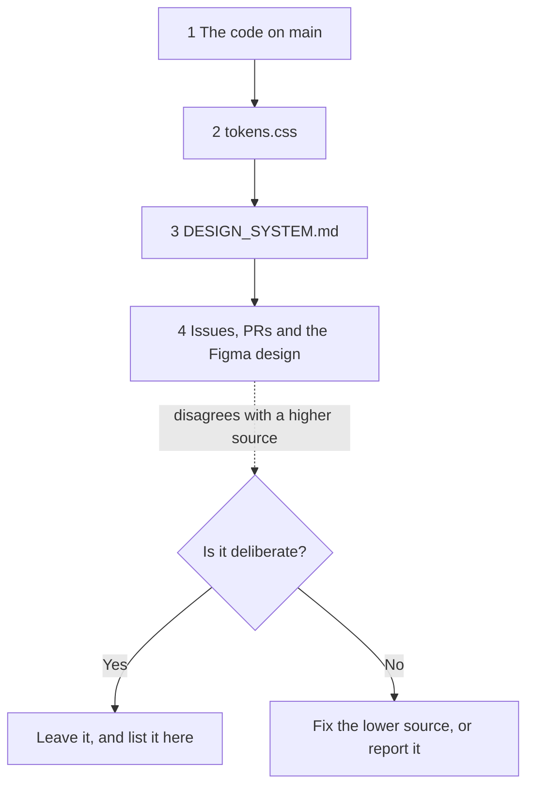

# 23 · Known drift

> **What you learn here**
>
> - The places where a document, a name, an issue or a design file tells one thing and the code does
>   a different thing.
> - Which of those are deliberate, so that you do not "fix" them.
> - Where drift comes back, and the rule that settles a disagreement.
>
> **Read first:** [21 · House rules and how work moves](21-house-rules-and-how-work-moves.md).
> **Time:** 20 minutes.
>
> Open work as of main @ e251d45, 2026-10-27.

Drift is a difference between two sources that must agree. Some drift is a mistake. Some drift is a
decision. This chapter lists both kinds, so that you can tell them apart. Each item names the file
or the issue that proves it.

## Whiteboard

The diagram shows the order of trust when two sources disagree, and what you do in each case.



## The rule

When two sources disagree, the code on `main` wins. Then `tokens.css` wins. Then `DESIGN_SYSTEM.md`
wins. The [README](README.md#when-two-sources-disagree) gives the same order.

1. Find the source that is lower in the order.
2. Fix that source, or report the difference to the maintainer.
3. Do not change the code to agree with a stale document.

When you report drift, give three things: what the document tells, what the code does, and the file
that proves it.

> [!CAUTION]
> Do not "fix" an item in [Deliberate and left alone](#deliberate-and-left-alone). Each one is a
> decision.

## Deliberate and left alone

| What looks like drift                                                                                      | Why it is correct                                                                                                          | Where to look                                                            |
| ---------------------------------------------------------------------------------------------------------- | -------------------------------------------------------------------------------------------------------------------------- | ------------------------------------------------------------------------ |
| `--font-weight-extra-light` is `200`, but `fonts.css` loads Inclusive Sans for the weights 300 to 700 only | The weight scale does not depend on one font. A project with a different font family keeps a real extra-light weight       | `src/lib/tokens/text/font-weight.tokens.json`, `src/lib/fonts/fonts.css` |
| Some primitive colours have a `hex` note that is not the same as their OKLCH value                         | These colours are outside the sRGB range, so each hex value is an approximation. The OKLCH value is the one that renders   | `src/lib/tokens/palette/color.tokens.json`                               |
| `gv-tooltip` sits on a summit surface. The old guide recorded that its Figma component uses aurora         | The code is deliberately ahead of the design file. Aurora is a highlight for a short time, not a surface at rest (#54 D2)  | `Tooltip.ts`, `DESIGN_SYSTEM.md` (elevation rule 8)                      |
| The Storybook a11y checks report violations, but they do not fail                                          | The gate stays report-only until #46 and #50 land, with no baselines (#54 D5). The a11y canary proves that the checks work | `.storybook/preview.ts`, `scripts/a11y-canary.mjs`                       |

The Figma file could not be checked at the time, so the guide does not confirm the aurora surface in
Figma today.

> [!IMPORTANT]
> **Open work: #63 — gv-menu-item a11y check and metadata** (open PR, no conflict with main on
> 2026-10-27)
>
> The PR makes `MenuItem.stories.ts` fail on violations, with
> `parameters: { a11y: { test: 'error' } }`. The library default stays `'todo'`. When it lands,
> change the a11y row to "most Storybook a11y checks report violations but do not fail". Name
> `gv-menu-item` as the stories file that opts in.
> <https://github.com/edgarjaymez/grove-lit/pull/63>

### Rows of the old guide that are stale

The old guide had two more rows in this table. Both are not true on `main` now.

- **"`pnpm check-ledger`, and thus `pnpm prepack`, fails on `main`."** Not true. The ledger records
  0.45.0 (#62), and `node scripts/check-ledger.mjs` prints
  `[grove] components-since.json covers all 15 components` and exits with 0. `prepack` runs
  `pnpm check-ledger && pnpm build && publint`. `check-ledger` fails again when a new component
  exists and no release has recorded it. That failure is correct.
- **"`package.json` has a higher version than npm."** Not true. On 2026-10-27, `package.json` has
  0.45.0, and the `latest` tag on npm is 0.45.0. This can come back when a branch raises the version
  before the release.

## Name quirks

| What the name suggests                                               | What it does                                                                                                                      | Where to look                       |
| -------------------------------------------------------------------- | --------------------------------------------------------------------------------------------------------------------------------- | ----------------------------------- |
| The root `README` is the project readme                              | It is an essay about how to think about systems. The setup is in this guide                                                       | `README` (no file extension)        |
| `src/lib/components/index.ts` is how components get into the package | The package entry is `src/lib/index.ts`. Nothing imports the components barrel. It is kept by convention                          | `vite.config.ts`, `build.lib.entry` |
| `component.version` in a metadata file is the package version        | It is the version of the component, raised when that component changes. `ButtonMetadata` has `1.2.0` while the package has 0.45.0 | Each `*.metadata.ts`                |
| `pnpm test:unit` runs the unit tests                                 | It runs `vitest` over every project, in watch mode in a terminal. `pnpm vitest run --project unit` runs only the unit project     | `package.json`                      |
| The GitHub link on the Home page of Storybook names the repo         | It points to `github.com/edgarjaymez/grove`. GitHub redirects that to `edgarjaymez/grove-lit`                                     | `src/stories/Home.mdx`              |

## Leftovers in the code

These items are on `main` today. They do no damage, but they surprise a new reader. A fix is a code
change for a later PR.

- **`pnpm test` does not exit in a terminal.** It runs `pnpm test:unit -- --run`. pnpm passes the
  `--` to Vitest, so `--run` has no effect. On 2026-10-27, one full run in a terminal passed 960
  tests, and then Vitest waited for file changes. Under CI or a detected AI agent, Vitest 4.1 turns
  watch mode off, so the command exits there.
  [Source: Vitest, watch](https://vitest.dev/config/watch) Use `pnpm vitest run`, or press `q`.
  [17 · Tests](17-tests.md#watch-mode-and-agents) explains this.
- **A fresh `pnpm install` stops at a build script.** `pnpm-workspace.yaml` permits build scripts
  for `esbuild` only, in `allowBuilds`. On 2026-10-27, `pnpm install --frozen-lockfile` with pnpm
  12.4.2 in a fresh checkout stopped with `ERR_PNPM_IGNORED_BUILDS` for `rs-module-lexer`. The
  manifest analyzer needs that package. The packages installed, and pnpm wrote a line for
  `rs-module-lexer` into `pnpm-workspace.yaml`. Discard that line with
  `git checkout -- pnpm-workspace.yaml`. A later PR can add `rs-module-lexer` to `allowBuilds`
  with the value `true` or `false`. [Source: pnpm, Settings](https://pnpm.io/settings)
  [22 · Cookbook](22-cookbook.md#recipe-1-set-up-and-run) has the steps.
- **The ledger counts ignored directories.** `scripts/components-since.mjs` lists every directory
  under `src/lib/components/`. A failed browser test writes `src/lib/components/__screenshots__/`,
  which `.gitignore` ignores. Then `check-ledger` and `prepack` fail, and `record-release` adds an
  entry for `__screenshots__`. Delete the directory before a release. A later PR can make the
  script skip ignored directories.
  [19 · Release](19-release.md#the-release-ledger) explains this.
- **`__APP_VERSION__` has no reader.** `vite.config.ts` defines it in `define`, but no source file
  uses it.
- **`customElements` is in `package.json` two times**, with the same value
  `dist/custom-elements.json`. A JSON parser keeps the last one, so the result is the same.
- **The `src` glob in `sideEffects` does not match in the published package.** `files` ships only
  `dist`, so `./src/lib/components/**/*.ts` matches nothing for a consumer. Do not remove it: #33
  added it for the production build of the Storybook of this repo, where the stories import the
  sources.
- **`components-since.json` is not in `exports`.** The build copies it to
  `dist/components-since.json`, but `exports` does not list it. Node rejects a package path that
  `exports` does not list. Thus a tool reads the ledger by its file path in `node_modules`.
  [Source: Node.js, Package entry points](https://nodejs.org/api/packages.html#exports)
- **`pnpm check` type-checks `src/` only.** `tsconfig.json` has `"include": ["src"]`. The scripts in
  `scripts/` and `vite.config.ts` are not type-checked.
- **Tags on origin are not complete.** Origin has the tags v0.26.0 to v0.33.0 and v0.41.0 to
  v0.44.0. It has no tag between v0.33.0 and v0.41.0, and no `v0.45.0`. `pnpm record-release` uses
  the `v*` tags to find the first release of a component.
  [19 · Release](19-release.md#dates-from-release-tags) explains this.
- **GitHub Releases stop at v0.44.0.** npm has 0.45.0, published on 2026-10-08.
- **The homepage does not resolve.** `package.json` sets
  `"homepage": "https://grove.edgarjaymez.com"`. On 2026-10-27, the host name did not resolve.

`vite.config.ts`, `define`:

```ts
	define: {
		__APP_VERSION__: JSON.stringify(pkg.version)
	},
```

`tsconfig.json`, `include`:

```json
	"include": ["src"],
```

> [!IMPORTANT]
> **Open work: #57 — docs sweep for 0.45** (issue, open: behaviour on main, checks remain)
>
> The first pass is on `main`, from #55. The final pass is not started. It asks for a check of every
> `Home.mdx` snippet against the attribute names in the manifest, because the drift check covers
> only the metadata snippets. It also asks for release notes and new `Home.mdx` cards. When it
> lands, check the Home page rows of this chapter again.
> <https://github.com/edgarjaymez/grove-lit/issues/57>

## Specs that lag the code

Somebody writes a spec before the code. Later decisions can make parts of a spec stale. When a spec
and the code disagree, the code and the latest decision on the issue win. These specs lag the code
on 2026-10-27:

- **The contrast helpers were never moved out of the test.** `toRgb()`, `ratio()` and the other
  helpers are private functions in `src/lib/tokens/contrast.test.ts`. #51 F5, #16 and #30 propose
  sibling `*.contrast.test.ts` files that import shared helpers, and #58 plans to reuse the helpers.
  #44 extends `contrast.test.ts` itself, and #27 needs no change to it.
- **#21 and #25 name `ariaLabelledByElements`.** Comments on both issues point the inner control at
  the page labels with element references. The #50 work branch does a different thing. It copies the
  text of the page label into the `aria-label` of the inner control, because axe cannot follow a
  reference across shadow roots.
- **#17, #18, #25, #26 and #29 use the old event names**, for example `change`, `input` and
  `toggle`. The events are `gv-change`, `gv-input` and `gv-toggle` since the 0.45.0 renames.
- **A new rule replaces the slot ban.** The body of #53 and item 6 of the review in #54 have the old
  rule. It says that slots accept "text and phrasing content, never form controls". Decision #49 C6
  splits the rule by slot. A slot inside a control or a popup is phrasing-only, and a different slot
  is a container.
- **`label` has two meanings.** Under #54 D1, `label` is always an invisible name. Issue #18 uses
  `label` for a visible label above the field. Issue #51 must give the visible label a different
  name.
- **`AT_REST` exists only in #66.** #67 uses the `AT_REST` table of
  `reduced-motion.browser.test.ts` as its change detector, but `main` does not have it. Thus #67
  waits for #66.
- **#65 adds a `color` API that #20 does not have.** #20 specifies `tint` and `frequency` only. The
  `color` property of #65 copies a variant of the Figma Texture set. #65 waits for that decision.
- **#54 and the group epics name branches that were never made.** Each PR group has a branch name
  in the form `feat/…`. Find the work through the PR or the epic link, not through the branch name.

> [!IMPORTANT]
> **Open work: #50 — accessible names across the shadow boundary** (branch, no PR)
>
> The work branch, which epic #50 links, is the code that #21 and #25 lag. It waits for #68. When a
> PR for it lands, update #21 and #25, or close them, and remove the `ariaLabelledByElements` item
> above. <https://github.com/edgarjaymez/grove-lit/issues/50>

> [!IMPORTANT]
> **Open work: #68 — gv-button link mode and form association** (open PR, no conflict with main on
> 2026-10-27)
>
> When the PR lands, these four statements of this guide become stale:
>
> - "no component is form-associated";
> - the slot ban for all slots;
> - "Button has no browser test";
> - the eight stops of `Button.ts`.
>
> The old guide also lists form-associated custom elements among the Lit features that this repo
> does not use. That list goes stale too. When the PR lands, follow
> [When open work lands](style-rules.md#when-open-work-lands) for each box of #68. Add a row here
> for each item that you cannot fix at once. <https://github.com/edgarjaymez/grove-lit/pull/68>

> [!IMPORTANT]
> **Open work: #66 — componentReset tests for hidden and reduced motion** (open PR, no conflict with
> main on 2026-10-27)
>
> The PR adds the `AT_REST` table. While it wrote the table, it found more spec drift: the animated
> element of the checkbox is `.box`, not `.checkbox`. When the PR lands, remove the `AT_REST` item
> above. <https://github.com/edgarjaymez/grove-lit/pull/66>

> [!IMPORTANT]
> **Open work: #65 — gv-texture colour variants and the night grain** (open PR, no conflict with
> main on 2026-10-27)
>
> The PR waits for two Figma answers. If Grove copies the Figma `color` variant, record it on #20.
> If not, the PR drops `color`. Either way, remove the `color` item above when the PR lands.
> <https://github.com/edgarjaymez/grove-lit/pull/65>

## Where drift comes back

- **`DESIGN_SYSTEM.md` after a token change.** It is prose, and no test compares it with
  `tokens.css`. When you change a token, search the document for its name.
- **The generated AI index after a component change.** `src/.ai/` is the generated AI index, which
  the maintainer regenerates. It can be some changes behind the code.
- **The Figma design.** A design can show a state that the code has passed, as with `gv-tooltip`.
- **Issue bodies after a decision.** A decision goes into a comment, and the body stays the same.
  #54 lists this as item 1 of its review. Read the latest comments and the group epic before you
  build from a spec.
- **The open-work boxes of this guide.** A box is true until its item lands. Follow
  [When open work lands](style-rules.md#when-open-work-lands) each time a PR merges.
- **The count of 15 components.** `metadata.test.ts` and `host-hidden.browser.test.ts` contain the
  number. [Recipe 2](22-cookbook.md#recipe-2-add-a-component) tells you to change it.

If you find new drift, add a row to this chapter. Give what the document tells, what the code does,
and the file that proves it.

## See it in the code

| Item                              | Look for                                              |
| --------------------------------- | ----------------------------------------------------- |
| `package.json`                    | `customElements` two times, `sideEffects`, `homepage` |
| `vite.config.ts`                  | `define`, `__APP_VERSION__`                           |
| `tsconfig.json`                   | `include`                                             |
| `src/lib/tokens/contrast.test.ts` | `toRgb()`, `ratio()`                                  |
| `components-since.json`           | The 15 entries; Tooltip has `0.45.0`                  |
| `scripts/check-ledger.mjs`        | The success message                                   |

## Sources

All other facts in this chapter come from the repo, its issues and its PRs.

**Platform reference**

- [Node.js, Package entry points](https://nodejs.org/api/packages.html#exports). Read 2026-10-27.

**Tool docs**

- [Vitest, watch](https://vitest.dev/config/watch). Read 2026-10-27.

## Check yourself

Do [Lesson 16 Capstone](syllabus.md#lesson-16-capstone) in the syllabus. Then answer these: which
source wins over `DESIGN_SYSTEM.md`, why you keep the `src` glob in `sideEffects`, and why #67 waits
for #66.

[← 22 · Cookbook](22-cookbook.md) · [Index](README.md) · [Syllabus →](syllabus.md)
