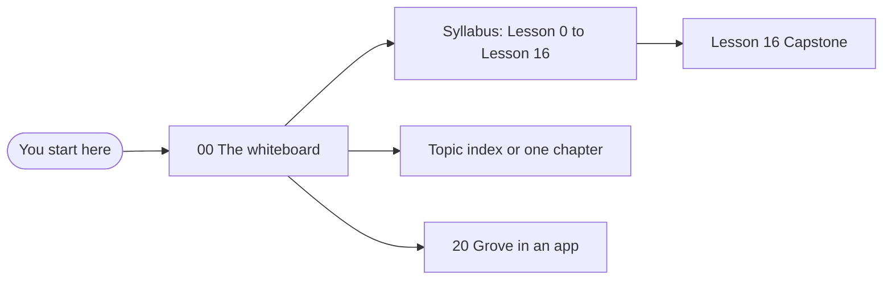

# The Grove guide

> **What you learn here**
>
> - What Grove is, and who this guide is for.
> - Which path through the guide to use.
> - Where each topic is, and which source to trust when two sources disagree.
>
> **Read first:** nothing. **Time:** 10 minutes.
>
> Open work as of main @ e251d45, 2026-10-27.

## What Grove is

Grove is a design system. It is on npm as **`@edgarjaymez/grove`**, version `0.45.0` in
`package.json`. The package contains these parts:

- **15 custom elements.** Each tag starts with `gv-`, for example `gv-button`, `gv-checkbox` and
  `gv-tooltip`. The elements use [Lit](https://lit.dev/docs/v3/), a small library for web
  components.
- **Design tokens.** Colours, spacing, type and shadows are CSS custom properties in `tokens.css`.
- **Page CSS.** Fonts, typography classes, surface classes and shadow classes are in `grove.css`.
- **A custom elements manifest.** `custom-elements.json` and the Astro types tell editors and tools
  the attributes, events and slots of each element.

The package has ES modules only. `lit` is a peer dependency. The app that installs Grove also
installs Lit. The Grove build does not include Lit, so the page has only one copy of Lit.

Vercel publishes a static Storybook of each component (`vercel.json`). The `homepage` field in
`package.json` names `grove.edgarjaymez.com`, but that address did not resolve on 2026-10-27. Ask
the maintainer for the current Storybook link, or run Storybook on your computer with
`pnpm storybook`.

## Who this guide is for

This guide is for a developer who knows TypeScript, the DOM and a component framework, such as React
or Vue. You do not need to know Lit or web components. The guide explains each Lit idea at the
place where Grove uses it, in a Lit box.

After you read the guide, you can do these tasks:

- Take an issue in this repo, change a component and know which checks prove the change.
- Review an open PR in this repo, and know the decisions and the traps that apply to it.
- Explain each part of the repo on a whiteboard.

## How to read this guide

The diagram shows the three paths through the guide.



- **The syllabus path.** Use this path when you are new to the repo. Do the lessons in
  [the syllabus](syllabus.md) in order. Each lesson tells you which chapters to read, gives you an
  exercise and a lab about open work, and asks questions with answers.
- **The reference path.** Use this path when you have a task. Find the topic in
  [the topic index](topic-index.md), or go to the chapter in the contents below. The
  [cookbook](22-cookbook.md) has step-by-step recipes.
- **The quick start path.** Use this path when you only want to use Grove in an app. Read
  [00 · The whiteboard](00-the-whiteboard.md), then [20 · Grove in an app](20-grove-in-an-app.md).

Each chapter has the same parts. The `## Whiteboard` section gives the picture first.
`## See it in the code` tells you which files to open. `## Sources` lists the official documents that
the chapter cites. `## Check yourself` sends you to the lesson for the chapter.

Each chapter uses `Button.ts` as an example. Open work boxes connect a concept to an open PR or
issue. [Style rules](style-rules.md#open-work-boxes) explains the boxes.

## Contents

| #   | Chapter                                                                | You learn                                                      |
| --- | ---------------------------------------------------------------------- | -------------------------------------------------------------- |
| 00  | [The whiteboard](00-the-whiteboard.md)                                 | The whole repo on one board, and the work that is in progress  |
| 01  | [Repo map](01-repo-map.md)                                             | Where each file is, what is generated and what is published    |
| 02  | [Web components](02-web-components.md)                                 | The platform: custom elements, shadow DOM, slots               |
| 03  | [Lit essentials](03-lit-essentials.md)                                 | The Lit features that Grove uses                               |
| 04  | [Anatomy of a component](04-anatomy-of-a-component.md)                 | `Button.ts` from the top to the bottom                         |
| 05  | [Component catalogue](05-component-catalogue.md)                       | All 15 tags, how they connect, and the proposed tags           |
| 06  | [Styles inside a component](06-styles-inside-a-component.md)           | CSS in a shadow root, the shared fragments, the shadow cascade |
| 07  | [Slots](07-slots.md)                                                   | How content goes into a component                              |
| 08  | [Events](08-events.md)                                                 | How events come out of a component                             |
| 09  | [Accessibility](09-accessibility.md)                                   | Names across the shadow boundary, WCAG 2.2 AA, the a11y checks |
| 10  | [Forms](10-forms.md)                                                   | Form-associated custom elements, and the form work in progress |
| 11  | [Design tokens](11-design-tokens.md)                                   | How `tokens.css` is made, and the token families               |
| 12  | [Surfaces and elevation](12-surfaces-and-elevation.md)                 | Tracks, depths, surface classes and contrast                   |
| 13  | [Themes and page CSS](13-themes-and-page-css.md)                       | Light, dark, print, theme islands and `grove.css`              |
| 14  | [The focus ring](14-the-focus-ring.md)                                 | How the ring gets its colour from the surface                  |
| 15  | [Metadata and the manifest](15-metadata-and-the-manifest.md)           | The metadata files and the manifest check that stops a build   |
| 16  | [Storybook](16-storybook.md)                                           | Stories, the global preview and the static build               |
| 17  | [Tests](17-tests.md)                                                   | The four test projects and the test methods                    |
| 18  | [Build and package](18-build-and-package.md)                           | What `pnpm build` makes, and the package fields                |
| 19  | [Release](19-release.md)                                               | The release by hand, the ledger and the release train          |
| 20  | [Grove in an app](20-grove-in-an-app.md)                               | How an app installs and uses Grove                             |
| 21  | [House rules and how work moves](21-house-rules-and-how-work-moves.md) | The conventions, the roadmap decisions and the merge order     |
| 22  | [Cookbook](22-cookbook.md)                                             | Recipes for frequent tasks                                     |
| 23  | [Known drift](23-known-drift.md)                                       | Where the docs and the code disagree, and which one wins       |
| —   | [Syllabus](syllabus.md)                                                | The lessons, exercises, labs and self-checks                   |
| —   | [Topic index](topic-index.md)                                          | Each topic, file, command and open item, with links            |
| —   | [Glossary](glossary.md)                                                | Each term, with one meaning                                    |
| —   | [Style rules](style-rules.md)                                          | How to write and change this guide                             |

### Full contents

Each chapter and each of its sections:

<details>
<summary>Open the full contents</summary>

### Start

- **[00 · The whiteboard](00-the-whiteboard.md)**
  - [Whiteboard](00-the-whiteboard.md#whiteboard)
  - [The runtime map](00-the-whiteboard.md#the-runtime-map)
  - [The five layers](00-the-whiteboard.md#the-five-layers)
  - [The life of a change](00-the-whiteboard.md#the-life-of-a-change)
  - [The work in motion](00-the-whiteboard.md#the-work-in-motion)

### Part 1 · Foundations

- **[01 · Repo map](01-repo-map.md)**
  - [Whiteboard](01-repo-map.md#whiteboard)
  - [The tree](01-repo-map.md#the-tree)
  - [The package and the tools](01-repo-map.md#the-package-and-the-tools)
  - [One directory per component](01-repo-map.md#one-directory-per-component)
  - [The two export lists](01-repo-map.md#the-two-export-lists)
  - [Generated but committed](01-repo-map.md#generated-but-committed)
  - [Files outside the library](01-repo-map.md#files-outside-the-library)
  - [The issue template](01-repo-map.md#the-issue-template)
- **[02 · Web components](02-web-components.md)**
  - [Whiteboard](02-web-components.md#whiteboard)
  - [Custom elements](02-web-components.md#custom-elements)
  - [Upgrade](02-web-components.md#upgrade)
  - [Shadow DOM](02-web-components.md#shadow-dom)
  - [ID references stay in one tree](02-web-components.md#id-references-stay-in-one-tree)
  - [Slots](02-web-components.md#slots)
  - [Declarative Shadow DOM](02-web-components.md#declarative-shadow-dom)
  - [If you know React or Vue](02-web-components.md#if-you-know-react-or-vue)
- **[03 · Lit essentials](03-lit-essentials.md)**
  - [Whiteboard](03-lit-essentials.md#whiteboard)
  - [LitElement and the decorators](03-lit-essentials.md#litelement-and-the-decorators)
  - [Reactive properties](03-lit-essentials.md#reactive-properties)
  - [Attributes and reflection](03-lit-essentials.md#attributes-and-reflection)
  - [Internal state](03-lit-essentials.md#internal-state)
  - [The decorator setup](03-lit-essentials.md#the-decorator-setup)
  - [Templates and bindings](03-lit-essentials.md#templates-and-bindings)
  - [Directives](03-lit-essentials.md#directives)
  - [The update cycle](03-lit-essentials.md#the-update-cycle)
  - [Lifecycle hooks](03-lit-essentials.md#lifecycle-hooks)
  - [Controllers and mixins](03-lit-essentials.md#controllers-and-mixins)
  - [ARIA properties and reflection](03-lit-essentials.md#aria-properties-and-reflection)
  - [Lit on the server](03-lit-essentials.md#lit-on-the-server)
  - [Tag registration and types](03-lit-essentials.md#tag-registration-and-types)
  - [Lit features this repo does not use](03-lit-essentials.md#lit-features-this-repo-does-not-use)

### Part 2 · Components

- **[04 · Anatomy of a component](04-anatomy-of-a-component.md)**
  - [Whiteboard](04-anatomy-of-a-component.md#whiteboard)
  - [Stop 1 Imports](04-anatomy-of-a-component.md#stop-1-imports)
  - [Stop 2 Local types](04-anatomy-of-a-component.md#stop-2-local-types)
  - [Stop 3 The JSDoc block](04-anatomy-of-a-component.md#stop-3-the-jsdoc-block)
  - [Stop 4 Registration and the class](04-anatomy-of-a-component.md#stop-4-registration-and-the-class)
  - [Stop 5 Properties](04-anatomy-of-a-component.md#stop-5-properties)
  - [Stop 6 Styles](04-anatomy-of-a-component.md#stop-6-styles)
  - [Stop 7 The render method](04-anatomy-of-a-component.md#stop-7-the-render-method)
  - [Stop 8 The tag map](04-anatomy-of-a-component.md#stop-8-the-tag-map)
  - [The files around it](04-anatomy-of-a-component.md#the-files-around-it)
- **[05 · Component catalogue](05-component-catalogue.md)**
  - [Whiteboard](05-component-catalogue.md#whiteboard)
  - [The catalogue table](05-component-catalogue.md#the-catalogue-table)
  - [Leaves and composites](05-component-catalogue.md#leaves-and-composites)
  - [How a composite registers its children](05-component-catalogue.md#how-a-composite-registers-its-children)
  - [Notes for each component](05-component-catalogue.md#notes-for-each-component)
  - [Proposed components](05-component-catalogue.md#proposed-components)
- **[06 · Styles inside a component](06-styles-inside-a-component.md)**
  - [Whiteboard](06-styles-inside-a-component.md#whiteboard)
  - [Static styles](06-styles-inside-a-component.md#static-styles)
  - [The component reset](06-styles-inside-a-component.md#the-component-reset)
  - [The focus ring fragment](06-styles-inside-a-component.md#the-focus-ring-fragment)
  - [The visually hidden fragment](06-styles-inside-a-component.md#the-visually-hidden-fragment)
  - [Rules for CSS inside a component](06-styles-inside-a-component.md#rules-for-css-inside-a-component)
  - [What crosses the shadow boundary](06-styles-inside-a-component.md#what-crosses-the-shadow-boundary)
  - [The shadow cascade](06-styles-inside-a-component.md#the-shadow-cascade)
  - [Private and public custom properties](06-styles-inside-a-component.md#private-and-public-custom-properties)
  - [Custom properties from a template](06-styles-inside-a-component.md#custom-properties-from-a-template)
  - [Invalid at computed-value time](06-styles-inside-a-component.md#invalid-at-computed-value-time)
  - [The currentColor fallback](06-styles-inside-a-component.md#the-currentcolor-fallback)
- **[07 · Slots](07-slots.md)**
  - [Whiteboard](07-slots.md#whiteboard)
  - [The whitespace problem](07-slots.md#the-whitespace-problem)
  - [Reactive controllers](07-slots.md#reactive-controllers)
  - [The SlotContent controller](07-slots.md#the-slotcontent-controller)
  - [Prop or slot](07-slots.md#prop-or-slot)
  - [Text in a slot](07-slots.md#text-in-a-slot)
  - [Phrasing-only and container slots](07-slots.md#phrasing-only-and-container-slots)
  - [Slots and nested shadow roots](07-slots.md#slots-and-nested-shadow-roots)
  - [What may go in a slot](07-slots.md#what-may-go-in-a-slot)
  - [How slots are checked](07-slots.md#how-slots-are-checked)
- **[08 · Events](08-events.md)**
  - [Whiteboard](08-events.md#whiteboard)
  - [The event rules](08-events.md#the-event-rules)
  - [Event targets across shadow roots](08-events.md#event-targets-across-shadow-roots)
  - [Listeners](08-events.md#listeners)
  - [Pattern 1 Wrap a native input](08-events.md#pattern-1-wrap-a-native-input)
  - [Pattern 2 Forward a child event](08-events.md#pattern-2-forward-a-child-event)
  - [Pattern 3 A cancelable event](08-events.md#pattern-3-a-cancelable-event)
  - [Trusted and untrusted events](08-events.md#trusted-and-untrusted-events)
  - [Activation in the next task](08-events.md#activation-in-the-next-task)
  - [Events on a form](08-events.md#events-on-a-form)
  - [Document-level keys](08-events.md#document-level-keys)
  - [Event types](08-events.md#event-types)
  - [How events are checked](08-events.md#how-events-are-checked)

### Part 3 · Accessibility and forms

- **[09 · Accessibility](09-accessibility.md)**
  - [Whiteboard](09-accessibility.md#whiteboard)
  - [The target WCAG 2.2 AA](09-accessibility.md#the-target-wcag-22-aa)
  - [Accessible names across the shadow boundary](09-accessibility.md#accessible-names-across-the-shadow-boundary)
  - [ARIA properties](09-accessibility.md#aria-properties)
  - [Decorative and meaningful images](09-accessibility.md#decorative-and-meaningful-images)
  - [Live regions](09-accessibility.md#live-regions)
  - [Colour is never the only cue](09-accessibility.md#colour-is-never-the-only-cue)
  - [Forced colours](09-accessibility.md#forced-colours)
  - [Target size](09-accessibility.md#target-size)
  - [Language of parts](09-accessibility.md#language-of-parts)
  - [Hidden and reduced motion](09-accessibility.md#hidden-and-reduced-motion)
  - [Visually hidden text and skip links](09-accessibility.md#visually-hidden-text-and-skip-links)
  - [The contrast gate](09-accessibility.md#the-contrast-gate)
  - [The a11y checks in Storybook](09-accessibility.md#the-a11y-checks-in-storybook)
  - [The a11y canary](09-accessibility.md#the-a11y-canary)
- **[10 · Forms](10-forms.md)**
  - [Whiteboard](10-forms.md#whiteboard)
  - [Forms on main today](10-forms.md#forms-on-main-today)
  - [Form-associated custom elements](10-forms.md#form-associated-custom-elements)
  - [ElementInternals](10-forms.md#elementinternals)
  - [The form callbacks](10-forms.md#the-form-callbacks)
  - [The FormControl mixin](10-forms.md#the-formcontrol-mixin)
  - [Submit and reset timing](10-forms.md#submit-and-reset-timing)
  - [Implicit submission](10-forms.md#implicit-submission)
  - [Self-disable](10-forms.md#self-disable)
  - [Disabled fieldsets](10-forms.md#disabled-fieldsets)
  - [The tree rule](10-forms.md#the-tree-rule)
  - [Link mode](10-forms.md#link-mode)
  - [Field state and validity](10-forms.md#field-state-and-validity)
  - [Text input and IME](10-forms.md#text-input-and-ime)
  - [Hidden required fields](10-forms.md#hidden-required-fields)

### Part 4 · Design system

- **[11 · Design tokens](11-design-tokens.md)**
  - [Whiteboard](11-design-tokens.md#whiteboard)
  - [What a token is](11-design-tokens.md#what-a-token-is)
  - [The pipeline](11-design-tokens.md#the-pipeline)
  - [The folders](11-design-tokens.md#the-folders)
  - [Primitive and semantic colours](11-design-tokens.md#primitive-and-semantic-colours)
  - [Three modifiers](11-design-tokens.md#three-modifiers)
  - [From JSON path to CSS name](11-design-tokens.md#from-json-path-to-css-name)
  - [OKLCH and wide gamut](11-design-tokens.md#oklch-and-wide-gamut)
  - [Spacing and grids](11-design-tokens.md#spacing-and-grids)
  - [Border](11-design-tokens.md#border)
  - [Effects](11-design-tokens.md#effects)
  - [Typography composites](11-design-tokens.md#typography-composites)
  - [Digital and print](11-design-tokens.md#digital-and-print)
  - [DTCG types](11-design-tokens.md#dtcg-types)
  - [Literals and tokens](11-design-tokens.md#literals-and-tokens)
  - [Token gaps](11-design-tokens.md#token-gaps)
  - [Churn in the generated file](11-design-tokens.md#churn-in-the-generated-file)
  - [The design doc and the generated file](11-design-tokens.md#the-design-doc-and-the-generated-file)
- **[12 · Surfaces and elevation](12-surfaces-and-elevation.md)**
  - [Whiteboard](12-surfaces-and-elevation.md#whiteboard)
  - [Tracks and depths](12-surfaces-and-elevation.md#tracks-and-depths)
  - [The nesting rules](12-surfaces-and-elevation.md#the-nesting-rules)
  - [Proportions](12-surfaces-and-elevation.md#proportions)
  - [Surface classes](12-surfaces-and-elevation.md#surface-classes)
  - [The surface types in TypeScript](12-surfaces-and-elevation.md#the-surface-types-in-typescript)
  - [Aurora is a state](12-surfaces-and-elevation.md#aurora-is-a-state)
  - [Text on a surface](12-surfaces-and-elevation.md#text-on-a-surface)
  - [Contrast on summit and aurora](12-surfaces-and-elevation.md#contrast-on-summit-and-aurora)
- **[13 · Themes and page CSS](13-themes-and-page-css.md)**
  - [Whiteboard](13-themes-and-page-css.md#whiteboard)
  - [How themes layer in one file](13-themes-and-page-css.md#how-themes-layer-in-one-file)
  - [Why where matters](13-themes-and-page-css.md#why-where-matters)
  - [Theme islands](13-themes-and-page-css.md#theme-islands)
  - [Print](13-themes-and-page-css.md#print)
  - [The page-level CSS](13-themes-and-page-css.md#the-page-level-css)
  - [Typography and effect classes](13-themes-and-page-css.md#typography-and-effect-classes)
  - [Without the page CSS](13-themes-and-page-css.md#without-the-page-css)
  - [The light-dark function](13-themes-and-page-css.md#the-light-dark-function)
  - [Color scheme and native widgets](13-themes-and-page-css.md#color-scheme-and-native-widgets)
- **[14 · The focus ring](14-the-focus-ring.md)**
  - [Whiteboard](14-the-focus-ring.md#whiteboard)
  - [The mechanism](14-the-focus-ring.md#the-mechanism)
  - [The resolution order](14-the-focus-ring.md#the-resolution-order)
  - [Inheritance across shadow roots](14-the-focus-ring.md#inheritance-across-shadow-roots)
  - [The private default ring](14-the-focus-ring.md#the-private-default-ring)
  - [Rings over aurora](14-the-focus-ring.md#rings-over-aurora)
  - [Theme islands and the ring](14-the-focus-ring.md#theme-islands-and-the-ring)
  - [Forced colours](14-the-focus-ring.md#forced-colours)
  - [Focus after a control disables itself](14-the-focus-ring.md#focus-after-a-control-disables-itself)
  - [Checks](14-the-focus-ring.md#checks)
  - [Checklist for a new interactive component](14-the-focus-ring.md#checklist-for-a-new-interactive-component)

### Part 5 · Tools

- **[15 · Metadata and the manifest](15-metadata-and-the-manifest.md)**
  - [Whiteboard](15-metadata-and-the-manifest.md#whiteboard)
  - [Component metadata](15-metadata-and-the-manifest.md#component-metadata)
  - [The phosphor field](15-metadata-and-the-manifest.md#the-phosphor-field)
  - [Required props](15-metadata-and-the-manifest.md#required-props)
  - [Metadata versions](15-metadata-and-the-manifest.md#metadata-versions)
  - [Metadata tests](15-metadata-and-the-manifest.md#metadata-tests)
  - [The custom elements manifest](15-metadata-and-the-manifest.md#the-custom-elements-manifest)
  - [How the manifest is built](15-metadata-and-the-manifest.md#how-the-manifest-is-built)
  - [JSDoc tags the manifest reads](15-metadata-and-the-manifest.md#jsdoc-tags-the-manifest-reads)
  - [When check-manifest fails](15-metadata-and-the-manifest.md#when-check-manifest-fails)
  - [Framework types](15-metadata-and-the-manifest.md#framework-types)
  - [The generated AI index](15-metadata-and-the-manifest.md#the-generated-ai-index)
- **[16 · Storybook](16-storybook.md)**
  - [Whiteboard](16-storybook.md#whiteboard)
  - [A story file](16-storybook.md#a-story-file)
  - [The global preview](16-storybook.md#the-global-preview)
  - [Repo-level pages](16-storybook.md#repo-level-pages)
  - [How a test picks a theme](16-storybook.md#how-a-test-picks-a-theme)
  - [Dev and static builds](16-storybook.md#dev-and-static-builds)
  - [Story registration and side effects](16-storybook.md#story-registration-and-side-effects)
  - [The static smoke test](16-storybook.md#the-static-smoke-test)
  - [Deploy](16-storybook.md#deploy)
  - [The landing page](16-storybook.md#the-landing-page)
- **[17 · Tests](17-tests.md)**
  - [Whiteboard](17-tests.md#whiteboard)
  - [The four test projects](17-tests.md#the-four-test-projects)
  - [Watch mode and agents](17-tests.md#watch-mode-and-agents)
  - [Commands](17-tests.md#commands)
  - [The test helpers](17-tests.md#the-test-helpers)
  - [The test inventory](17-tests.md#the-test-inventory)
  - [A new browser test](17-tests.md#a-new-browser-test)
  - [Trusted input](17-tests.md#trusted-input)
  - [Nested shadow roots in tests](17-tests.md#nested-shadow-roots-in-tests)
  - [Names in the accessibility tree](17-tests.md#names-in-the-accessibility-tree)
  - [Tests that keep two copies in step](17-tests.md#tests-that-keep-two-copies-in-step)
  - [Mutation checks](17-tests.md#mutation-checks)
  - [Change detectors](17-tests.md#change-detectors)
  - [Flaky tests](17-tests.md#flaky-tests)
- **[18 · Build and package](18-build-and-package.md)**
  - [Whiteboard](18-build-and-package.md#whiteboard)
  - [The build steps](18-build-and-package.md#the-build-steps)
  - [The Vite library build](18-build-and-package.md#the-vite-library-build)
  - [What dist holds](18-build-and-package.md#what-dist-holds)
  - [The package fields](18-build-and-package.md#the-package-fields)
  - [The prepack script](18-build-and-package.md#the-prepack-script)
  - [The NODE_ENV rule](18-build-and-package.md#the-node_env-rule)
  - [Lint and format scope](18-build-and-package.md#lint-and-format-scope)
  - [Type check scope](18-build-and-package.md#type-check-scope)
- **[19 · Release](19-release.md)**
  - [Whiteboard](19-release.md#whiteboard)
  - [No CI](19-release.md#no-ci)
  - [Release by hand](19-release.md#release-by-hand)
  - [The release ledger](19-release.md#the-release-ledger)
  - [Dates from release tags](19-release.md#dates-from-release-tags)
  - [The release train](19-release.md#the-release-train)
  - [Release notes](19-release.md#release-notes)

### Part 6 · Use and change Grove

- **[20 · Grove in an app](20-grove-in-an-app.md)**
  - [Whiteboard](20-grove-in-an-app.md#whiteboard)
  - [Install](20-grove-in-an-app.md#install)
  - [Load the CSS](20-grove-in-an-app.md#load-the-css)
  - [Register the elements](20-grove-in-an-app.md#register-the-elements)
  - [Phosphor glyphs](20-grove-in-an-app.md#phosphor-glyphs)
  - [Attributes and properties](20-grove-in-an-app.md#attributes-and-properties)
  - [Boolean attributes](20-grove-in-an-app.md#boolean-attributes)
  - [Listen to events](20-grove-in-an-app.md#listen-to-events)
  - [Astro types](20-grove-in-an-app.md#astro-types)
  - [Themes in an app](20-grove-in-an-app.md#themes-in-an-app)
  - [Forms in an app](20-grove-in-an-app.md#forms-in-an-app)
  - [Render on a server](20-grove-in-an-app.md#render-on-a-server)
- **[21 · House rules and how work moves](21-house-rules-and-how-work-moves.md)**
  - [Whiteboard](21-house-rules-and-how-work-moves.md#whiteboard)
  - [Names](21-house-rules-and-how-work-moves.md#names)
  - [Properties and attributes](21-house-rules-and-how-work-moves.md#properties-and-attributes)
  - [Styles](21-house-rules-and-how-work-moves.md#styles)
  - [Exports](21-house-rules-and-how-work-moves.md#exports)
  - [Events](21-house-rules-and-how-work-moves.md#events)
  - [Generated files](21-house-rules-and-how-work-moves.md#generated-files)
  - [The roadmap decisions](21-house-rules-and-how-work-moves.md#the-roadmap-decisions)
  - [How work moves](21-house-rules-and-how-work-moves.md#how-work-moves)
  - [Decision codes](21-house-rules-and-how-work-moves.md#decision-codes)
  - [Needs Figma Spec](21-house-rules-and-how-work-moves.md#needs-figma-spec)
  - [Mergeable and approved](21-house-rules-and-how-work-moves.md#mergeable-and-approved)
  - [Merge order](21-house-rules-and-how-work-moves.md#merge-order)
- **[22 · Cookbook](22-cookbook.md)**
  - [Whiteboard](22-cookbook.md#whiteboard)
  - [Recipe 1 Set up and run](22-cookbook.md#recipe-1-set-up-and-run)
  - [Recipe 2 Add a component](22-cookbook.md#recipe-2-add-a-component)
  - [Recipe 3 Add a property](22-cookbook.md#recipe-3-add-a-property)
  - [Recipe 4 Add an event](22-cookbook.md#recipe-4-add-an-event)
  - [Recipe 5 Add or change a token](22-cookbook.md#recipe-5-add-or-change-a-token)
  - [Recipe 6 Add a story](22-cookbook.md#recipe-6-add-a-story)
  - [Recipe 7 Add a browser test](22-cookbook.md#recipe-7-add-a-browser-test)
  - [Recipe 8 Run tests selectively](22-cookbook.md#recipe-8-run-tests-selectively)
  - [Recipe 9 Format and lint only what you touched](22-cookbook.md#recipe-9-format-and-lint-only-what-you-touched)
  - [Recipe 10 Release by hand](22-cookbook.md#recipe-10-release-by-hand)
  - [Recipe 11 Undo churn in the generated tokens](22-cookbook.md#recipe-11-undo-churn-in-the-generated-tokens)
  - [Recipe 12 Regenerate the manifest only](22-cookbook.md#recipe-12-regenerate-the-manifest-only)
  - [Recipe 13 The AI index looks stale](22-cookbook.md#recipe-13-the-ai-index-looks-stale)
  - [Recipe 14 Add an interactive surface-aware component](22-cookbook.md#recipe-14-add-an-interactive-surface-aware-component)
  - [Recipe 15 Review and land an open PR locally](22-cookbook.md#recipe-15-review-and-land-an-open-pr-locally)
  - [Recipe 16 Rebase the guide over merged PRs](22-cookbook.md#recipe-16-rebase-the-guide-over-merged-prs)
  - [Recipe 17 Make a stories file fail on a11y violations](22-cookbook.md#recipe-17-make-a-stories-file-fail-on-a11y-violations)
  - [Recipe 18 Add a glyph a component draws](22-cookbook.md#recipe-18-add-a-glyph-a-component-draws)
  - [Recipe 19 Build on the FormControl mixin](22-cookbook.md#recipe-19-build-on-the-formcontrol-mixin)
- **[23 · Known drift](23-known-drift.md)**
  - [Whiteboard](23-known-drift.md#whiteboard)
  - [The rule](23-known-drift.md#the-rule)
  - [Deliberate and left alone](23-known-drift.md#deliberate-and-left-alone)
  - [Name quirks](23-known-drift.md#name-quirks)
  - [Leftovers in the code](23-known-drift.md#leftovers-in-the-code)
  - [Specs that lag the code](23-known-drift.md#specs-that-lag-the-code)
  - [Where drift comes back](23-known-drift.md#where-drift-comes-back)

</details>

## When two sources disagree

Trust the sources in this order:

1. **The code on `main`.** The components, the scripts and the tests are what runs.
2. **`src/lib/tokens/tokens.css`.** A tool makes it from the token JSON files. It owns each token
   name and each token value.
3. **`DESIGN_SYSTEM.md`.** It gives the design language in prose: the intent, the composition rules
   and examples. It can fall behind the tokens.
4. **An issue or a PR.** It tells what somebody plans. It is not the current behaviour until it
   merges.

This guide obeys the same rule. It copies code from the repo, and it does not describe the code in
other words. When the code changes, the code wins.
[23 · Known drift](23-known-drift.md#the-rule) lists the places where sources disagree now.

## Day one

Do these steps on your first day:

1. Install Node 20 or a later version. The file `.node-version` gives the version.
2. Install the dependencies:

   ```sh
   pnpm install
   ```

   In a fresh clone, pnpm can stop with `ERR_PNPM_IGNORED_BUILDS` for `rs-module-lexer`. The
   packages install, and pnpm adds a line to `pnpm-workspace.yaml`.

3. Discard the line that pnpm added, if `git status` shows a change:

   ```sh
   git checkout -- pnpm-workspace.yaml
   ```

4. Install the browser for the browser tests. Do this one time only:

   ```sh
   pnpm exec playwright install chromium
   ```

5. Start Storybook:

   ```sh
   pnpm storybook
   ```

   Result: Storybook opens at <http://localhost:6006>.

6. Stop Storybook. Then run the type check:

   ```sh
   pnpm check
   ```

7. Run all tests one time:

   ```sh
   pnpm vitest run
   ```

   Result: all four test projects run, and the command stops.

8. Build the library:

   ```sh
   pnpm build
   ```

   Result: the build makes the tokens, the bundle and the manifest, and then checks the manifest.

9. Discard the change to the generated tokens file, if `git status` shows one:

   ```sh
   git checkout -- src/lib/tokens/tokens.css
   ```

> [!TIP]
> `pnpm test` also runs all tests. In a terminal, it then stays in watch mode, and you must push
> `q` to stop it. [17 · Tests](17-tests.md#watch-mode-and-agents) tells why.

When these steps pass, your setup works. Then start [Lesson 0](syllabus.md#lesson-0-find-your-way).

## The rules for this guide

This guide obeys the rules of ASD-STE100 Issue 9. Nobody checked it against the STE
dictionary. [Source: ASD-STE100 Simplified Technical English](https://www.asd-ste100.org/)

The guide uses short sentences, one word for one meaning, and the active voice. The
[glossary](glossary.md) gives the meaning of each term. Each claim about the web platform, about
accessibility or about a tool has a link to an official source.
[Style rules](style-rules.md) gives all the rules. Use them when you change the guide.

## Sources

**Standards**

- [ASD-STE100 Simplified Technical English](https://www.asd-ste100.org/), Issue 9. Read 2026-10-27.

**Tool docs**

- [Lit 3 documentation](https://lit.dev/docs/v3/). Read 2026-10-27.

[00 · The whiteboard →](00-the-whiteboard.md)
